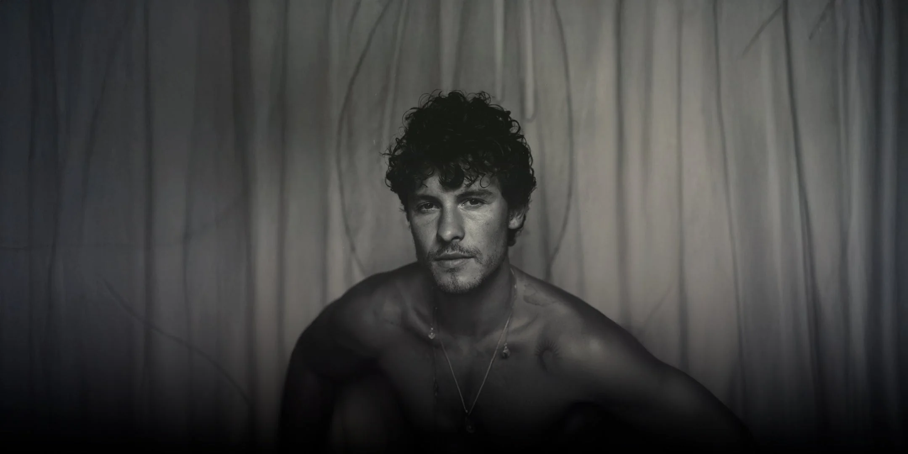
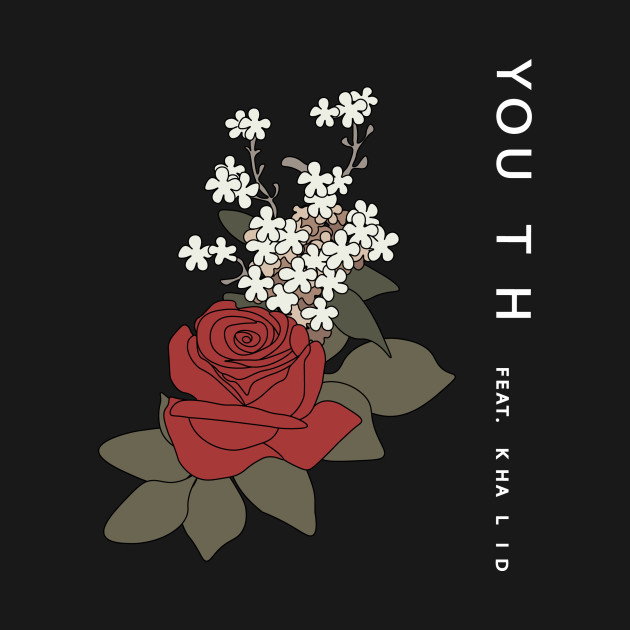

# special appendix: insights from my 10 years

Giới thiệu lại một lần nữa, tôi là Jonathan Bronstein, người đang viết những dòng này cho các bạn. Tính ở thời điểm này thì tôi đã chính thức tốt nghiệp và đã đi làm trong khoảng một năm. Như vậy cũng có thể gọi là kỷ niệm 1 năm cái repo này chính thức hoạt động và tôi có thể tự hào rằng repo này được nhiều sinh viên biết tới, đó có lẽ là một thành công đủ lớn cho cuộc đời vốn đã mờ nhạt trong nhiều năm. Như tôi có nói về bản chất của cái repo này, ngoài là một nơi lưu trữ tài liệu, thì nếu các bạn cần một nơi mà bạn cảm thấy được lắng nghe, repo này chính là nơi như vậy. Thành ra, tôi, dưới tư cách một người sáng lập, thật sự muốn các bạn và cả chính tôi có thể viết những câu chuyện và tâm sự về những khó khăn trong cuộc sống. Với tôi, repo này chính là ước mơ về một thế giới mà đâu đó, những con người được phép sống như là chính mình, được giúp đỡ, yêu thương nhau và bảo vệ lẫn nhau trong một thế giới nơi khái niệm “nhân văn” chỉ là thứ trong truyện cổ tích. Dù tôi chưa gặp mặt hoặc không biết gì về các bạn, tôi thật lòng cảm ơn các bạn vì ít nhất cũng có thể hiểu cái ước mơ ngây ngô ấy và giúp tôi thực hiện những điều tôi đã không thể làm, kể cả khi những nỗ lực này không thể kéo dài được lâu…

Đáng ra, khi tôi viết về phần kỉ niệm 1 năm, có lẽ nó sẽ phải vui vẻ và đầy màu hồng, nhưng thực tế lại không phải vậy. Tôi viết cái bản phụ lục này trong một giai đoạn mà tôi phải đối mặt với chính quá khứ của mình, những cái mặc cảm mà tôi từng cố gắng để che giấu, những nỗi đau, mất mát và những kỳ vọng đã tan vỡ. Nhưng, nhìn vào một mặt khác, tôi tiếp nối những gì tôi đang làm và những thói quen mà tôi đã từng phải bỏ lại, những điều đó ít nhiều cho tôi một cơ hội để tôi được sống như là chính mình. Nói những sự thật về bản thân có lẽ là một việc khó, vì chẳng ai dám nói đến những nỗi đau đằng sau cái gọi là “hào quang” cũng như những sự suy sụp sau đó, và tôi chọn viết ra khi tôi đối diện với chính mình. Ít nhất, cái sự đối diện ấy tạo nên sức nặng cho mỗi quyết định mà tôi có, nên tôi càng có lý do để trung thực và viết phần đặc biệt này….

Nếu các bạn tìm một nơi mà có ai lắng nghe, thì những lời này sẽ giúp bạn cảm thấy dễ chịu phần nào…

> ***từ tan vỡ đến chữa lành….***
> 

# introduction: how i came into???

> Disclaimer: Kể về nguyên nhân, cái phần intro này sẽ cực kì dài vì nó không chỉ liên quan tới hiện tại mà còn kéo toàn bộ khoảng thời gian gần 10 năm về trước, nên thành ra, nếu như các bạn không đủ kiên nhẫn thì có thể lướt qua, cũng vì lý do đấy nên tôi mới phải để toggle heading để các bạn có thể chọn lọc những phần các bạn muốn đọc…

Tôi sẽ không đi quá sâu vào việc phân tích kĩ những chuyện xảy ra trong quá khứ cũng như chỉ mặt những kẻ đã gây ra những chuyện ấy, mà tôi muốn nói bản chất của chính những việc ấy đã ít nhiều tác động ra sao. Kèm theo đó, tôi cũng muốn kể lại hành trình để trở về với những điều quen thuộc mà bản thân đã từng dự định, đó chính là hy vọng mà tôi muốn để lại ở cái phần phụ lục này….

Muốn sống cho hiện tại, đóng hòm một quá khứ tan vỡ và tin vào tương lai, bạn phải đối diện với chính mình, chứ không phải cứ liên tục tin vào những ảo mộng qua những lần trốn chạy….
> 

Ngoài lề nhưng lại liên quan, đó là background của bản nhật kí này. Tôi chắc có nói với các bạn về Shawn Mendes với album “Shawn” rồi nhỉ? Ngoài bìa chính thì cũng có một vài ảnh photoshoot khác, có cả đen trắng lẫn có màu. Tôi cũng khá máu khi quyết định chi tiền để mua 3 cái băng cassette thuộc 3 album của ổng, từ “Shawn Mendes” đến “Shawn”, cũng cho mình một vài trải nghiệm mới mà từ trước đến nay, chưa một lần nào tôi thử cho nghiêm túc. Sau rất nhiều ngày chọn lựa thì tôi chọn bức này, nó đẹp và hợp cái hướng đi mà tôi muốn viết: “**self-reflection**”, tính chiêm nghiệm. Tôi muốn người đọc và ngay cả chính tôi, khi đọc những bản nhật kí này, đều sẽ thấy rằng những quyết định mà mình đã từng đưa ra ít nhiều đều đã thay đổi cái cách chúng ta suy nghĩ về cuộc sống, và hơn nữa, chỉ khi chúng ta dám đối mặt với những quyết định ấy, dù đúng hay sai, thì chúng ta mới thật sự chữa lành cho chính mình. Trong cái bản special appendix này sẽ có rất nhiều bài nhạc, tùy thể loại, và phù hợp với cái nhịp độ tôi muốn đưa ra để các bạn có thể cảm nhận được những gì tôi thật sự nghĩ trong đầu, không chỉ có mỗi Shawn, mà có thể nhiều nghệ sĩ khác nữa….

---

> **Đó là background cơ bản và cái vibe tôi muốn đưa ra, vậy thì lý do tại sao tôi lại viết phần này, kỉ niệm một năm??**
> 

Thời điểm tôi bắt đầu chắp bút cho phần phụ lục riêng cho repo này cũng tầm tháng 9, giai đoạn cuối năm, ngày này khoảng thời gian cuối 2024, đầu 2025, cũng là lúc kết thúc học kì của tôi ở Troy và chuẩn bị thủ tục cho tốt nghiệp, thật ra là phải học xong các học phần do Bộ Giáo dục đề ra. Cuộc sống nguyên một năm thật sự không dễ dàng, đối diện với nỗi lo thất nghiệp khi mới ra trường, và tưởng rằng mình may mắn khi mới ra trường đã được nhận việc ngay lập tức, nhưng chính điều đó không phải là một lựa chọn tốt, kể cả khi nó là quyết định duy nhất mà tôi phải đưa ra. Tôi từng nghĩ là, dù vất vả, mình kiểu gì cũng sẽ tìm thấy niềm vui và trở về với cuộc sống vốn có, cũng có thể hiểu là có thể chuyển giao trong hòa bình ấy, nhưng mọi thứ không đi theo cái điều tôi mong muốn, và cái điểm chặn ấy khiến tôi một lần nữa phải suy nghĩ lại chính mình…

Tầm cuối năm 2025 và nửa đầu 2026, có lẽ không dễ dàng để sống một cuộc sống lặp lại với chứng kiệt sức tâm lý. Tôi có vào làm một cái dự án “tài sản hóa” - theo cách gọi của công ty, tầm chỉ 1 tháng thôi nhưng hậu quả tâm lý mà nó để lại khiến tôi không còn nhìn cuộc sống công sở với màu hồng nữa. Là một nhân viên mới, tôi có một niềm tin rằng mình nên làm việc chăm chỉ dù kết quả đến đâu và niềm tin mù quáng ấy khiến tôi rơi vào trạng thái kiệt sức. Bạn có bao giờ cảm nhận được cái sự bào mòn tâm lý khi phải đối diện với những người không có thái độ thân thiện chưa, còn tôi thì hàng trăm và nghìn lần, nhưng lần đi làm này khiến những ám ảnh tâm lý của tôi trở nên nặng nề hơn, vì ngoài chính công việc, nó còn khởi động một thứ hồi ức mà tôi tưởng như mình đã vứt vào sọt rác rồi. Mỗi lần tôi họp, từ cái lúc bắt đầu đào tạo thì tôi đã không thể theo kịp do đếch ai chuẩn bị cho đàng hoàng, chả vào được server của dự án biến tôi thành người thừa. Tôi kêu đúng 3 lần cầu cứu trong đúng 3 ngày KT (Knowledge Transfer), trong nguyên 3 ngày hỏi xem có vào được không, hoặc tôi xem ké vì tôi không muốn mình phải sống trong cái tình trạng này mãi. Câu trả lời của họ là… sự im lặng trước cái kêu cứu, ngay cả ông PM cũng không thèm để ý, và cái chuỗi ngày chết tiệt tôi phải gánh, chính thức bắt đầu…

Mỗi một ngày họp là tôi phải đối diện với một cảm giác xa lạ, rằng dù tôi cố tập trung đến đâu, sự thiếu gắn kết của tôi với mọi người trong đó khiến tôi dần mất đi động lực. Ban đầu, đó chỉ là những ngày mệt mỏi khi tôi liên tục về nhà muộn hơn một chút, và tôi chỉ nằm bệt ra ghế. Những ngày sau đó, tôi ăn mặc xuề xòa hơn vì mỗi ngày đến là họp không ngừng, mỗi lần họp là tầm 1-2 tiếng trong trạng thái mất tập trung. Mỗi một ngày nghe tên dự án, bị tra hỏi tiến độ để khảo sát, tôi không thể làm việc được khi những người khác trả lời vô cùng lấp lửng và cố tình trốn tránh, khiến tôi mang một cảm giác như không thể làm xong việc. Họ chẳng giúp một tay đã đành, nhưng cái ánh mắt, hành vi và thiếu sự cảm thông khiến tôi dần xa cách. Mỗi một ngày tôi nghe tên dự án là tôi thở dốc và rơi vào tình trạng mệt mỏi kéo dài, cứ như vậy trong nửa năm. Tâm lý tôi dần rơi vào một trạng thái bất an khủng khiếp, càng làm việc càng chán nản và chẳng học được cái gì. Đám ấy chơi thân với nhau, và kiểu “gatekeeping” khiến tôi phát cáu nhưng không thể làm được gì. Cái cảm giác suy sụp nhất, chắc là lúc bị PM trách ngược chuyện không thể làm tốt, ổng nói một câu giờ khiến tôi mất sạch lòng tin: “**Em yếu đuối quá…**”. Cái kiểu đổ hết trách nhiệm lên đầu tôi trong khi chính ổng còn chẳng thèm đoái hoài những lời kêu cứu, tôi phát chán rồi…

Kể từ cái ngày đó, cuộc sống của tôi trở nên vô cùng thảm hại, nếu không muốn nói là dần chệch hướng, và cũng là lúc tôi phải gặp lại những hồi ức đáng quên nhất trong cuộc đời của mình. Mỗi một ngày đi làm, không còn là cảm giác háo hức mà giống như một ngày mình mất đi năng lượng. Cuộc sống chỉ có 9.8 tiếng ngồi lì mông trước máy tính, ngồi chờ tin nhắn và làm dự án, nếu không có thì lại ngồi xem điện thoại. Có mang máy tính nhưng vì không có mạng nên chỉ có thể viết nhật kí, mà có viết cũng khó vì cảm giác như bị giám sát liên tục vậy. Cuộc sống mệt mỏi, tôi ăn mặc trông chán đời và bạn biết gì không, kể từ lúc đó, tôi chỉ mặc hoodie hoặc áo chống nắng có mũ, vì tôi không còn có cảm giác an toàn nữa. Tôi không muốn bản thân mình phải tỏ ra là mình hòa đồng nữa, vì tôi cạn năng lượng và tôi chỉ muốn kiếm chỗ nào đó mà không ai thèm nhìn thấy thôi. Cũng kể từ lúc này, có những sự thật mà tôi mới vỡ lẽ….

Sự thật đó chính là thời hạn hợp đồng làm việc chỉ có 2 năm, có nghĩa là dù tôi cố gắng đến đâu, tôi cũng chỉ có thể cầm cự được 2 năm ở trong công ty đó, và kiểu gì cũng bị thuộc diện layoff, đây là điều tôi không thể tránh khỏi. Những tranh cãi với gia đình khi tôi không thể cứ lừa dối và ảo tưởng mãi được nữa, những tan vỡ và những nỗi lo âu dần trỗi dậy. Trong khoảng thời gian đầu ấy, cái sự trồi sụt trở nên rõ ràng, tôi ít vận động hơn, dễ căng thẳng, luôn trong tình trạng mệt mỏi và hay ngủ, khả năng lập trình kém đi… Điều tồi tệ hơn nữa, chính là việc những mâu thuẫn mà tôi từng nghĩ mình sẽ che đậy, lại ám ảnh tôi một lần nữa khiến tôi không thể sống được như người bình thường. Những ám ảnh từ quá khứ, những sự so sánh, những kỳ vọng đã tan vỡ và một cuộc sống bất định… lại trỗi dậy và đập tan đi những nơi tôi đang cố gắng trú ẩn. Tôi sống trong trạng thái tự ti ấy trong một khoảng thời gian rất dài, và giờ nó còn kéo dài thêm một chút và một chút nữa….

Với tôi, việc viết ra những điều này là để nói ra sự thật cho chính mình, rằng chính tôi cũng đến lúc phải đưa ra một cuộc chiến với chính quá khứ và hồi ức đen tối cho chính mình. Tôi đã không còn nơi để chạy trốn sự thật được nữa, và điều khó nhất là, tôi cần phải cho mình một cái “định nghĩa” thật sự về chính mình và những điều mình thật sự muốn hướng tới….

Cũng từ chính sự thật ấy, tôi muốn viết sâu hơn những gì tôi trải qua, đằng sau những quyết định của bản thân khi còn làm lớp trưởng, thì đó là cả một sự đấu tranh không ngừng nghỉ, và những quyết định ở đại học cũng chỉ là một cái mở màn, chứ chưa bao giờ là kết thúc cả. Thế nên, thật ngây thơ khi cho rằng những quyết định ấy là hiển nhiên ngay từ đầu….

Thật ra, ở hiện tại thì tôi cũng đang thực hiện một “đại kế hoạch”, ít nhiều cũng đã chuẩn bị tinh thần nếu như có nghỉ việc. Nhưng chuyện không đơn thuần nằm ở công việc, mà nó phải mở rộng lớn hơn, chính là việc tôi chọn con người của mình và tin vào những điều mà mình cố gắng bảo vệ. Khi tôi viết cho 10 năm, nhìn lại giai đoạn mất mát của mình và hiện thực tàn khốc, tôi không muốn bản thân lại đi vào một vết xe đổ của sự thoả hiệp mà tôi biết chắc kết cục. Tôi có viết rất nhiều thứ, cả một phụ lục lớn hơn và một vài dự án lập trình có hơi hướng low-level. Chính những thứ ở hiện tại, những điều chớm nở và sự quyết tâm, dù không lớn, đã níu tôi và cho tôi một cánh cửa, một cuộc sống mới mà tôi muốn bảo vệ - tôi sẽ nói tới ở phần cuối. Rất khó để thực hiện tiếp những dự định mà không có một quan điểm rõ ràng về những việc mình muốn làm, nên là tôi muốn viết ra để nói rõ những điều ấy…

Lý do hơi dài, nhưng mọi người hiểu mà…

---

> **Có phải toàn bộ những gì viết trong đây sẽ là một màu xám xịt, khi toàn bộ thời gian 10 năm chật vật đến vậy???**
> 

Đáng ra, phần này nên được viết là: “8 years of grief”, tức là “8 năm của nỗi buồn”, nhưng thực tế mà nói, lý do của 10 năm thì nó còn phải đến từ 2 năm ngắn ngủi kia nữa. Khoảng thời gian 2 năm ấy chính là những điều mà tôi vẫn giữ, dù mọi thứ đã không thể quay về cho 10 năm về trước, nhưng chính những điều tôi có được lại giúp tôi rất nhiều trong cuộc đời, như tình yêu, tình bạn, những kỉ niệm và một thế giới còn chưa kịp thành hình. Đó chính là những hy vọng còn sót lại sau những lần sụp đổ trong đời mà tôi vẫn muốn tin rằng tôi vẫn có thể làm được và thậm chí là tốt hơn.

Nếu các bạn nhìn theo hướng “luyến tiếc quá khứ”, có vẻ đúng nhưng lại không hoàn toàn đúng. Khi tôi quyết định viết phần này, tôi đã mặc định một cái sự thật là mọi thứ đã không thể quay về như trước đây, nhưng không có nghĩa là những điều ấy vô giá trị, đây chính là mâu thuẫn mà các bạn thường hay nghĩ đến. Sự thật, trong những khoảng thời gian làm lớp trưởng, thì tôi sống trong một trạng thái hoàn toàn khác biệt, nếu không muốn nói là làm lại từ đầu, con số 0. Thời kì làm lớp trưởng của tôi có đúng 2 năm rưỡi, nhưng bài học từ những lần ấy khiến cho những hy vọng kia trở nên có ý nghĩa. Tôi biết, những năm tháng làm lớp trưởng ấy không phải là những năm tháng dễ dàng, một mặt, là tôi phải sống cái cuộc sống bất định, còn mặt khác thì tôi phải đối diện với chính cái quá khứ THPT đầy đau khổ mà tôi mong mình sẽ được giải thoát. Đây cũng là khoảng thời gian tự hào nhất trong đời, khi tôi lần đầu biết tới một góc nhìn khác về mình, chính là một con người có trách nhiệm, có lý tưởng và luôn giúp đỡ mọi người, cũng chính là những viên gạch đầu tiên để tôi tự hình dung về con người thật sự của mình, và khi mình lớp 8…

Tôi viết về hy vọng như là một nỗ lực để tìm ra chính mình, nó giống như là, trong những đêm xám xịt của trầm cảm và cô đơn, những hy vọng từ những lần làm việc tốt, những lần đưa ra những quyết định không phải hối hận khi nhìn lại, chính là liều thuốc tinh thần nuôi dưỡng ý chí sống. Chúng ta không thể coi hy vọng là sự trốn chạy, mà phải từ chính sự thật, rằng dù chúng ta không thể thay đổi được tất cả mọi chuyện, nhưng chúng ta cũng sẽ không chết đi trong hối hận. Và để không phải thấy hối hận, thì phải có dũng khí, và muốn có dũng khí thì phải có hy vọng cùng với quyết tâm. 

Cũng có thể hiểu là… nó như một cuộc chiến để bảo vệ nền độc lập của chính bạn trước những thế lực xâm lăng, và đã là một cuộc chiến, thì phải có quyết tâm cao độ…

---

> **Một sự bổ sung cần thiết**
> 

Phần phụ lục đầu tiên đã làm rất tốt trong việc khắc họa được những quyết định ở đại học ảnh hưởng ra sao và ít nhiều, nó cho thấy tính khốc liệt của tình trạng học tập lúc bấy giờ, đó là việc không có một ai đó chỉ dẫn và phải đi từng bước để vượt qua. Nhưng, nói vậy, thì nó đang đưa ra một giả định rằng những quyết định ấy quá dễ dàng để đưa ra và người thực hiện cái quyết định ấy hẳn phải tài giỏi lắm khi chuyện gì cũng có thể vượt qua được. Tôi không thích cái suy nghĩ ấy lắm, vì bản chất mỗi quyết định chưa bao giờ là hư không, chỉ là ở thời điểm hiện tại thì tôi có nhiều không gian cho mình để hệ thống hóa những thứ mà mình từng trải qua khi phải đối diện với chính quá khứ mình từng trốn chạy. Thế nên, có thể hiểu là, phần phụ lục này sẽ kể cho bạn về một mảng khác mà tôi chưa từng nói, bản chất của từng quyết định, những cuộc chiến trong cái đầu óc tôi và cả những hy vọng cùng với những điều tôi đang thật sự làm để sửa chữa và ngăn chặn những thảm kịch đã từng xảy ra với tôi trước đó. 

Nói một cách dễ hiểu, đây vừa là tiền truyện và cũng là phần kế tiếp trong trải nghiệm cá nhân của chính tôi. Sẽ thật là một sự bỏ phí nếu như chúng ta không hiểu bản chất của những quyết định ấy, cũng như những tác động của nó. Nhân đây, tôi không phải là một người lúc nào cũng chỉ nói lên những hy vọng, mà tôi muốn các bạn thật sự hiểu rằng, chạy trốn sự thật không phải là cách để hy vọng, mà phải là dám đứng lên và chiến đấu không hối hận cho chính niềm tin của mình, đó là điều mà tôi thật sự muốn truyền tải thông qua chính bản nhật kí đặc biệt này…

Nó có thể sẽ lấy đi nước mắt của mọi người nên xin hãy chuẩn bị cả khăn giấy…

---

[chapter 1: before everything happened…](sub_diary/chapter1.md)

[chapter 2: the empty space…](sub_diary/chapter2.md)

[chapter 3: the continuation…](sub_diary/chapter3.md)

---

# verdict: up to you…

> it’s up to us to stand our ground and say that no matter what happens, our youth will not be taken away from us…
>
>Shawn Mendes
> 

Trước khi khép lại toàn bộ phần phụ lục này, tôi muốn chấp nhận một sự thật rằng: ngành Troy sau này còn tồn tại hay biến mất, phát triển hay dần bị lãng quên, không còn là điều tôi quá quan tâm nữa.

Tôi đã từng dành rất nhiều thời gian để suy nghĩ về sự sống còn của nó, về những điều cần thay đổi và về việc liệu những nỗ lực của mình có thể để lại ảnh hưởng gì hay không. Nhưng đến hiện tại, tôi hiểu rằng mình không thể tiếp tục đặt toàn bộ ý nghĩa của những năm tháng ấy vào số phận của một chương trình đào tạo. Một ngành học có thể được mở ra rồi đóng lại, một thế hệ có thể tốt nghiệp và được thay thế bởi thế hệ tiếp theo, còn những con người đã sống trong đó vẫn phải tiếp tục mang cuộc đời của chính mình đi về phía trước.

**Tôi không tạo ra repo này để cứu lấy một cái tên.**

**Tôi viết nó cho những con người đang học bên trong cái tên ấy.**

Tôi viết cho những bạn từng cảm thấy mình bị bỏ lại trong một lớp học, từng không biết phải bắt đầu từ đâu, từng sợ rằng một thất bại có thể quyết định toàn bộ tương lai. Tôi viết cho những người đã thức khuya dậy sớm để chạy theo một thước đo, nhưng càng cố gắng lại càng không còn nhận ra mình đang sống vì điều gì. Và tôi viết cho những ai, giống như tôi trước đây, đang tìm một nơi mà ít nhất tiếng nói của họ không bị coi là vô nghĩa.

Tôi không thể hứa rằng ngành học này sẽ tốt hơn, cũng không thể đảm bảo rằng những bất công và sai lầm từng diễn ra sẽ không bao giờ lặp lại. Tôi càng không thể chiến đấu thay cho tất cả các bạn. Nhưng tôi muốn các bạn hiểu rằng, bất kể nơi này sau cùng sẽ trở thành điều gì, cuộc sống của các bạn vẫn có ý nghĩa lớn hơn số phận của nó.

Nếu có điều gì cần được bảo vệ đến cùng, thì đó không phải danh tiếng của một chương trình, một tấm bằng hay những con số trên bảng điểm.

**Đó là quyền được sống cuộc đời của chính các bạn.**

Quyền được học mà không phải đánh đổi toàn bộ sức khỏe tinh thần. Quyền được đặt câu hỏi, được thất bại, được thay đổi hướng đi và được thừa nhận rằng mình không ổn. Quyền được lựa chọn con người mà các bạn muốn trở thành, thay vì phải sống mãi trong một hình ảnh do gia đình, nhà trường hay xã hội áp đặt.

Tôi đã mất rất nhiều năm mới hiểu được điều đó.

Tôi từng nghĩ tuổi trẻ của mình đã kết thúc từ ngày cuộc sống cũ tan vỡ. Tôi đã sống như cái bóng của chính mình, chạy theo những thành tích không đem lại bình yên và cố gắng trở thành một người đủ hữu ích để không bị bỏ lại. Nhưng ở hiện tại, tôi hiểu rằng tuổi trẻ không chết chỉ vì chúng ta đã đi qua những năm tháng đau khổ. Nó chỉ thật sự chết khi chúng ta để quá khứ quyết định rằng phần đời còn lại không còn đáng để sống.

Tôi không thể lấy lại những năm tháng đã mất, cũng không thể đưa tất cả những người từng yêu quý trở về. Tôi không thể trở lại tuổi 13 và ngăn cậu bé ấy bước vào những ngày tháng tồi tệ nhất. Nhưng tôi vẫn có thể quyết định điều gì sẽ xảy ra với con người còn lại sau tất cả những mất mát ấy.

Tôi vẫn có thể chụp ảnh, viết, lập trình và hoàn thành những dự định từng bị bỏ lại. Tôi vẫn có thể yêu thương, bảo vệ những điều mình tin tưởng và xây dựng một cuộc sống không hoàn hảo nhưng thật sự thuộc về mình.

**Và các bạn cũng vậy.**

Đấu tranh cho cuộc sống của mình không nhất thiết phải bắt đầu bằng một hành động lớn lao. Đôi khi, nó chỉ là việc thừa nhận rằng mình đang kiệt sức. Là dám nói rằng một điều gì đó không công bằng. Là từ chối tiếp tục sống theo một định nghĩa khiến mình đau khổ. Là tìm kiếm sự giúp đỡ, bảo vệ một người đang bị bỏ lại hoặc quyết định bắt đầu lại dù chưa biết kết quả sẽ ra sao.

Cuộc đấu tranh ấy không đảm bảo rằng chúng ta sẽ chiến thắng ngay lập tức. Chúng ta vẫn có thể thất bại, sợ hãi và nhiều lần muốn quay trở lại cái bóng quen thuộc. Nhưng lần này, ít nhất chúng ta biết mình đang chiến đấu vì điều gì: không phải để chứng minh với thế giới rằng mình mạnh mẽ, mà để bảo vệ quyền được sống như chính mình.

Repo này rồi có thể bị lãng quên. Ngành Troy rồi có thể thay đổi, biến mất hoặc tiếp tục tồn tại mà không còn liên quan gì đến tôi. Nhưng nếu những dòng này có thể khiến một người dừng lại và tự hỏi rằng họ thật sự muốn sống cuộc đời nào, thì có lẽ tất cả những gì tôi đã làm vẫn còn một chút ý nghĩa.

Tôi không thể lựa chọn thay các bạn.

Không ai có thể.

Tôi chỉ có thể kể lại những gì đã xảy ra với mình và nói rằng: có những điều không thể tiếp tục làm ngơ, có những sai trái không nên được che đậy và có những phần của cuộc đời chỉ chính chúng ta mới có thể đứng lên bảo vệ.

Hy vọng không đến từ việc giả vờ rằng mọi chuyện rồi sẽ tự ổn. Nó phải đến từ sự quyết tâm giải thoát chính mình, kể cả khi chúng ta đã thất bại hàng trăm lần.

> you can’t take my youth away  
this soul of mine would never break  
as long as i wake up today  
you can’t take my youth away…  
>
>Shawn Mendes - “Youth” - “Shawn Mendes”: The Album
> 

Họ có thể lấy đi thời gian, cơ hội và rất nhiều năm tuổi trẻ của chúng ta.

Nhưng họ không thể lấy đi quyết định rằng chúng ta sẽ sống phần đời còn lại như thế nào — trừ khi chính chúng ta trao nó cho họ.

Vậy nên, lời phán quyết cuối cùng không thuộc về tôi.

**it’s up to you.**
