# chapter 1: before everything happened…

Trước khi đọc, liệu các bạn có bao giờ tò mò rằng những quyết định hay những gì tôi viết trong phụ lục đầu tiên đến từ đâu không??? Như tôi có nói ở phần intro, tôi không tiện kể lể nhiều về những gì trước đại học là vì tôi muốn khắc họa những quyết định trực tiếp mà tôi đưa ra ở đại học, và ít nhiều nó đã làm rất tốt. Nhưng nói như vậy, cũng có nghĩa là nó chỉ làm tốt ở bề mặt, còn về bản chất của từng quyết định ấy, thì không đơn giản một tí nào, cũng vì lẽ ấy nên tôi phải tách riêng thành phần phụ lục sau bao gồm tiền truyện - những gì diễn ra trước đại học và hậu truyện - những gì diễn ra ở hiện tại. Sự thật là, nếu như không hiểu được nguồn gốc của những quyết định ấy, dù đúng đắn hay sai lầm, thì chúng ta sẽ liên tục mắc những lỗi sai mà đáng ra có thể tránh được, đó là lý do của phần đầu tiên này: “***trước khi mọi thứ thật sự xảy ra***”…

Với tôi, đây chính là những câu chuyện đầu tiên và bản chất trong những cách làm việc, đều có dấu ấn của kinh nghiệm xử lý vấn đề đến từ quá khứ, những trải nghiệm khó quên, tình đầu, tình bạn và cả một tương lai còn chưa thành hình trong trí tưởng tượng của cậu nhóc 13 tuổi. Nhưng, điều khiến cho nó thêm sức nặng, chính là những trải nghiệm khổ đau ở THPT, những góc khuất tâm lý đằng sau hào quang, một thế giới bị định hình bởi những cuộc cạnh tranh, sự giám sát đến ngột ngạt, những định kiến, mất mát và trầm cảm kéo dài. Dẫu vậy, ở phía cuối, nó bắt đầu cho một cuộc chiến tư tưởng, giữa một bên là một tương lai bất định nhưng mới chớm nở hoa, còn một bên là quá khứ đáng quên dần ăn mòn ý chí sống. Những gì được viết ở đây, chính là bản chất của toàn bộ những quyết định ở đại học khi tôi làm lớp trưởng và những niềm tin đầu tiên mà tôi cố gắng tạo dựng…

Bạn không thể sống chết vì một lý tưởng, nếu như không hiểu nó đến từ đâu nhỉ????

so, start the chapter one, huh???

# me before depression…

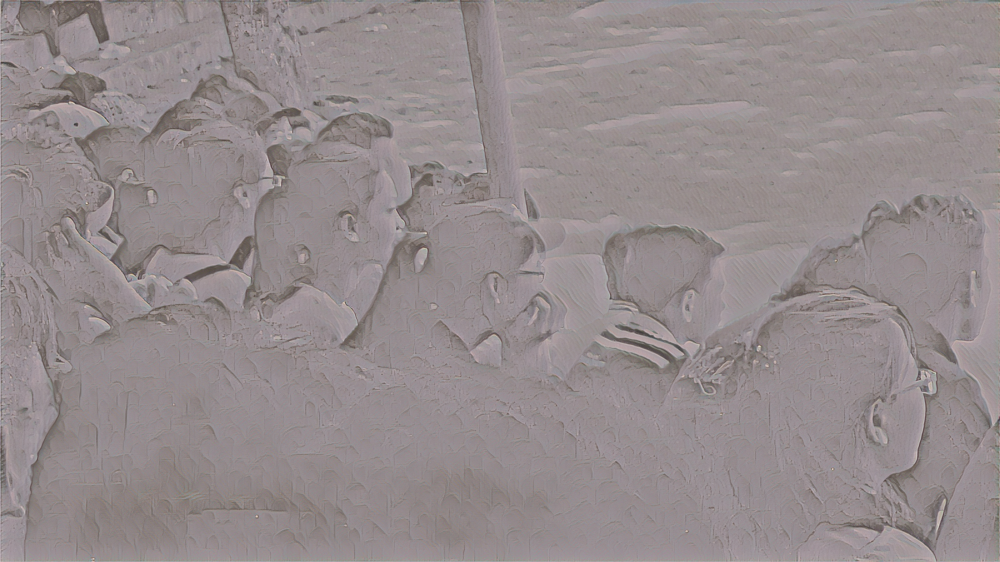

Chắc nếu ai theo dõi tôi hoặc có biết một vài câu chuyện, thì sẽ biết nguồn gốc của bức hình này, và sau này tôi sẽ nói đến việc tại sao tôi lại bắt đầu với nhiếp ảnh - bức hình này chính là bức hình debut đầu tiên trong đời tôi mà phải tới 10 năm sau thì tôi mới có thể tiếp tục cái đam mê với nhiếp ảnh từ khi ấy… Bức này được chụp vào hè năm 2017, cái thời điểm cuối lớp 8. Hầu hết mọi người chỉ biết tôi từ giai đoạn THPT trở đi, còn những câu chuyện về cuối cấp 2 thì nó quá ngắn để có thể nói là một câu chuyện, hơn nữa, nó trôi qua cũng 10 năm rồi nên có nhiều thứ thật sự khó tin ở lúc bấy giờ. Nhưng có một sự thật mà tôi phải nói rằng, đây chính là khoảng thời gian đầu tiên mà tôi đã sống và thật sự sống đúng với tuổi trẻ của mình, chỉ là tôi còn quá trẻ để hiểu rằng cuộc sống ấy quá ngắn để giữ….

Phần này có tên là “***tôi trước khi trầm cảm***”, tôi đang nói về một bản thân khi mình 13 tuổi. Hai năm cuối cấp II là khoảng thời gian hạnh phúc nhất mà tôi từng có trong đời của mình. Cuộc sống học tập khi ấy không mấy dễ dàng, nếu không muốn nói là rất khó khăn, cường độ học tập khá nặng và thời gian để chuẩn bị cũng không thật sự dài - 2 năm và hàng đống kì thi khi ấy. Thế nhưng, trong cái khoảng thời gian khó khăn ấy, tôi có một cuộc sống muôn màu muôn vị. Tôi có một mối tình đầu khiến tôi biết thế nào là tình yêu, tôi có khả năng học tập tốt, tôi tự tin với mọi thứ và tôi trân trọng từng khoảnh khắc trong đời mình. Trong cái khốc liệt khi ấy, tôi thấy một con người khác, khi không phải kì vọng gì về mình quá nhiều mà sẵn sàng đối diện trước mọi hoàn cảnh, đến giờ nghĩ lại, nhiều bài học từ năm lớp 8 vẫn có chỗ đứng trong tâm trí tôi và đã giúp tôi rất nhiều khi tôi lên đại học và ở hiện tại. 

Phương pháp học tập khi ấy của tôi cũng dị, thay vì tôi học giỏi mọi thứ thì tôi chọn cách tiếp cận cởi mở với mọi thứ. Tôi học ở trường năm ấy không nổi bật, nhưng điều nổi bật mà tôi có chính là việc tôi sẵn sàng thử nghiệm những cái mới. Trong cái sự tự ti của việc không thể trở thành người giỏi nhất, thì tôi lại tìm ra sự tự tin trong việc thử nghiệm mọi thứ và 2 năm trôi qua, tôi ít nhiều phải nói rằng tôi vô cùng tự tin vì tôi luôn sẵn sàng cho mọi thứ….

Nhưng… thời kì này nó cũng có một sự tiếc nuối, chính là vì nó quá ngắn. 2 năm là quá ngắn để tôi thật sự được sống và thấy tiềm năng của chính mình. Thời kì trước trầm cảm thật sự rất vui, nhưng tôi cũng khó lòng chấp nhận rằng nó lại tan vỡ quá sớm. Nó quá đẹp mà… phải không???

Vậy thì, tôi của trước khi trầm cảm là ai, và tại sao nó thay đổi cuộc sống của tôi sau này….???

---

    
<strong>adventure time…</strong>

 

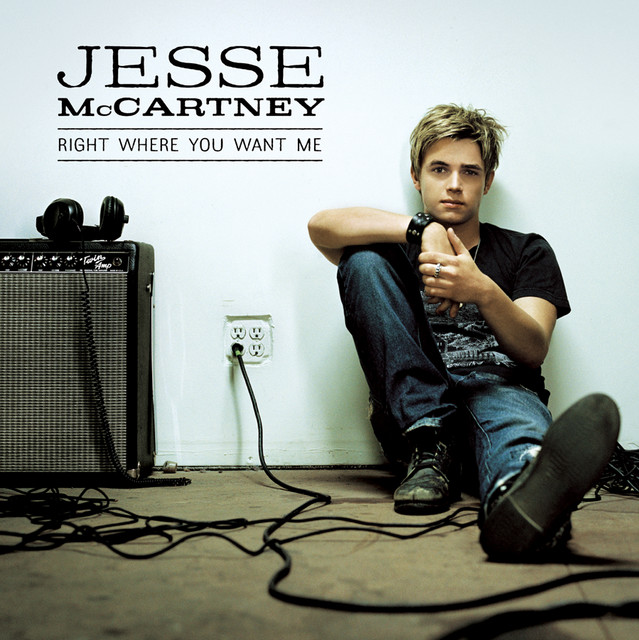  

> slow down, things have been a little crazy  
> right now, it's time to get away  
> you can, find out, what it is you're really after  
> time is on our side  
> come on, we're leaving everything behind  
> 
> you know that sun is shining  
> we'll keep driving doesn't matter where  
> 'cause we got that open highway  
> leading our way  
> as long as you are there  
> yeah, we can go anywhere  
> woah, we can go anywhere  
> 
> Jesse McCartney - “We Can Go Anywhere” - “Right Where You Want Me”
> 
    
Giới thiệu một chút, đây là một trong số những bài nhạc mà tôi nghe trong giai đoạn ấy, trong album của Jesse McCartney. Tôi thích những bài hát kiểu upbeat như vậy vì thời điểm ấy, tôi phải di chuyển rất nhiều và rất xa, bao gồm đi học trên trường và học thêm, cũng vì đó mà tiêu đề là “**giờ phiêu lưu**”. Để những gì trong 2 năm đầu thì cũng khá ngắn, đó là việc tôi gặp khó trong việc giao tiếp với mọi người trong trường và bị ngộp trước khối lượng học tập, đặc biệt là việc tôi nói nhiều khiến tôi dễ bị mất thiện cảm - và ở hiện tại thì tôi trở nên ít nói hơn - cũng có lý do cả. Sau khoảng thời gian 2 năm, kết quả học tập không như kì vọng ban đầu và việc gặp khó trong giao tiếp, khiến tôi dần trở nên tự ti trước mọi người, cũng không khác gì ở hiện tại mà tôi đang cố gắng đi qua. Sau này ở lớp 7, tôi học cũng khá hơn một chút, nhưng cái vấn đề là tôi luôn cảm thấy rằng mình bị ngợp quá nhiều mà không thể học theo cách mà bản thân muốn, nên kết quả học tập trên lớp cũng rất cầm chừng. Tôi học nhưng không quen sống với công thức nên càng học thì càng nản, điểm số cũng chỉ đến thế. Dù mang tiếng là con giáo viên, nhưng lúc đi học thêm Toán ở gần nhà thì tôi học khá lẹt đẹt. Thú thật, tôi luôn sống trong cái tình trạng mà không biết phải bắt đầu học từ đâu, học như thế nào và có suy nghĩ ra sao. Mỗi ngày một bài tập và đề thi, tôi luôn cảm thấy chán nản khi điểm số bị thấp lẹt đẹt và những sơ suất trong học tập. Luôn muốn lên cao, nhưng càng sống trong cái hệ quy chiếu ấy, tôi thấy rất mệt mỏi và chán nản, cứ như vậy kéo dài cho đến tận hè 2016…
    
---
    
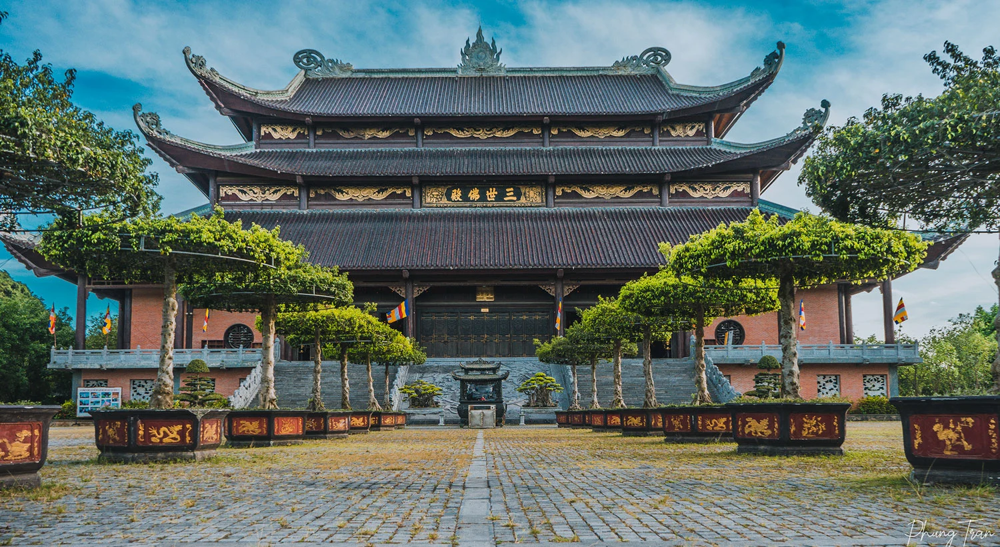
    
Cuộc sống của tôi có một bước ngoặt lớn, theo như tôi nhớ là sau lần đi chơi vào tầm tháng 7. Gia đình tôi quyết định làm một chuyến tới Ninh Bình, thăm chùa Bái Đính và Tràng An, và nhân tiện cũng đi thăm một người quen của gia đình, trước là quân nhân - giờ đang làm chủ của một xưởng chuyên đúc tượng đá. Lần đầu tiên trong đời tôi mà tôi được chiêm ngưỡng cả thế giới vào trong tầm mắt, những danh lam thắng cảnh và những con người lao động ở đó. Trải nghiệm tự do đi thăm quan ấy khiến tôi thay đổi suy nghĩ của mình rất nhiều, và coi những cuộc phiêu lưu ấy như là một gia vị không thể thiếu trong quá trình học tập của bản thân. Những năm đầu, tôi quá tập trung vào việc học mà quên mất đi rằng, trong việc học cũng cần phải có tính phiêu lưu và kì thú. Kể từ sau chuyến đi ấy, tôi có nhiều năng lượng hơn và thay vì mỗi ngày phải cảm thấy chán nản, tôi chấp nhận sự phiêu lưu ấy như là một phần không thể thiếu trong cuộc đời của mình…
    
---
    

    
Thời điểm ấy, tôi học cũng không tệ, nhất là ở lớp 7 thì tôi hiểu kiến thức cơ bản, nhưng lại không thể bứt phá được. Một trong số những lý do ấy chính là việc tôi không thể học theo những cách mà mọi người vẫn học. Ví dụ, mọi người kiểu đọc, hiểu lý thuyết thì hiểu ngay lập tức ấy, kiểu như môn Toán, đọc cái là ra cả định lý, môn Hóa thì ra cả phản ứng các kiểu,… tôi không nói kiểu học ấy là sai hay đúng, vì mọi người quen với cái đấy mà, còn tôi học kiểu tự biết thì chịu. Nơi học thêm Toán đầu tiên ở gần nhà tôi cũng tựa tựa vậy, dù tôi học không tệ nhưng thực sự tôi thấy rất tự ti vì không thể đạt được kì vọng học tập của chính mình. Nhưng thật ra, cái nguyên nhân cốt lõi chính là sự mặc cảm đến từ việc luôn bị sống trong cảm giác thất bại mà không thể cho mình cái quyền tự sửa chữa. Nếu tôi không thể giỏi một môn học nào đó, thì tôi chọn “cởi mở” để bù lại những cái thiếu hụt ấy. Thời gian tôi học thêm Toán năm lóp 8, có một giai đoạn khá đặc biệt (xin không nhắc tên ông thầy), mà gọi học thêm cũng chẳng đúng vì ổng dạy nó cũng chả theo cách mà mọi người nghĩ là dạy, nhưng chính cái cách suy nghĩ này thay đổi toàn bộ cuộc đời tôi và cũng giúp tôi soi chiếu nhiều vấn đề của giáo dục…
  
Cơ bản, nếu xét về chuyên môn, thì tôi dám chắc là ổng không thể sánh với những người trước, vì những người dạy Toán bình thường sẽ dạy theo một mô phạm lý thuyết đã được định sẵn từ trước và được chuẩn hóa, đây là sự thật rõ ràng nhất mà tôi muốn nói rằng phương pháp của ông thầy tôi có vẻ sẽ không phù hợp lắm với tất cả mọi người. Cái cách dạy của ổng rất dị, nếu không muốn nói là nếu thằng nào không đủ kiên nhẫn thì chắc hóa điên, đó là ông ấy không dạy quá bài bản, dạy như không dạy mà tập trung vào việc học sinh ấy sẽ xử lý vấn đề như thế nào. Đây là những nguyên tắc mà tôi nhớ được:
    
- Không nhồi quá nhiều lý thuyết nặng, hoặc spoil trước bài học, hoặc nếu có, thì chỉ nói qua…
- Tùy vào mức độ của bài có thể đưa ra một mức thời gian nhất định, có trường hợp nếu bài quá khó thì thời gian có thể lên tới 30 phút.
- Được phép xem giải, nhưng sau khi xem giải thì phải làm lại và giải thích các bước làm.
- Không quan trọng chuyện làm được bài hay không, mà phải là trong quá trình giải một bài toán, thì những kiến thức nào được áp dụng, và thử tìm nhiều cách khác nhau để giải một bài toán.
- Không dạy gấp, không cố đuổi chương trình mà dựa vào tình hình học tập thực tế
- Liên tục tranh biện, tìm kiếm thông tin và bù đắp vào dữ kiện của bài toán
- Thoải mái, chill everytime…
    
Đấy là những đặc điểm mà tôi nhớ được về lớp học ấy, một lớp học “trong mơ” mà tôi từng được trải nghiệm bởi một ông thầy “cũng chả phải ông thầy”. Cái điều khiến tôi tự hào về cái cách học lúc ấy, chính là việc nó dạy tôi về sự cởi mở, kiên trì và hiểu biết thông qua trải nghiệm giải quyết một vấn đề nào đó. Các lớp học trước đó của tôi xoáy rất sâu vào việc phải trình bày “đúng”, nhưng để giải thích tại sao nó phải như vậy - cũng như tìm ra một ý tưởng khác cho một bài toán, thì lại làm dở. Tiếp theo, trong cái lớp của ông ấy, thì ông ấy không xoáy sâu vào nỗi mặc cảm của người khác, về khía cạnh tâm lý này thì đây là lý do tại sao tôi thích làm việc cùng với ông thầy ấy. Ông ấy có chê, có, nhưng tuyệt nhiên ông cũng không rủa sả rằng chúng tôi là kẻ vô dụng mà luôn hối thúc rằng chúng tôi phải tập trung. Chưa một lần ông chê tôi học kém, mà ông ấy cho phép tôi được thất bại, được sai và sửa sai. Với một tâm lý tốt, tôi lúc ấy có rất nhiều không gian cho học tập và thử nghiệm liên tục, cũng từ đó mà tôi hiểu kiến thức Toán tốt hơn và sâu hơn so với giai đoạn trước đó. Tôi có nói, nếu như tôi không thể giỏi, thì tôi sẽ bù lại bằng sự cởi mở và liên tục thử nghiệm - vì sau cùng, sự giỏi làm gì có ý nghĩa khi con người sống trong sự bảo thủ và tự ti với chính mình…., nhỉ?
    
---
    
Nhưng ngoài chuyện học, thì tôi cũng dần tận hưởng những chuyến đi xa khi một mình, thật ra khoảng cách cũng không phải là quá dài - tầm 16km là cùng, và cho mình những khoảng lặng cần thiết. Một trong số những sai lầm của tôi trong 2 năm đầu chính là việc tôi không cho mình một cơ hội nào đó để một mình. Chắc các bạn biết cái tật nói nhiều khi ấy khiến tôi dễ mất thiện cảm, thì khi tôi quyết định thay đổi suy nghĩ, thì tôi chọn tận hưởng cảm giác một mình, và nhìn mọi thứ với lăng kính khác. Thời điểm ấy thì tôi khá kỷ luật, nếu không muốn nói là siêu đúng giờ, tầm 5h là tôi đã dậy để đi học và đi sớm. Mỗi một ngày trôi qua, tôi có thể chợp mắt một chút khi tới trường, lúc thì lấy sách ra đọc, lúc thì chỉ cần ngắm bình minh lên. Bạn biết cái cảm giác khi đi xe bus, lúc thấy mặt trời ló rạng và xóa tan màn đêm, nó là một khung cảnh tuyệt vời. Bạn thấy, 30 phút đi xe bus, nó là một sự tận hưởng, nhất là khi bạn đeo một tai nghe và bật bài nhạc ưa thích thì cái cảm giác này còn thú vị gấp bội. Tôi nghĩ, ở 2 năm đầu cấp II, tôi quá tập trung vào việc phải trở thành một ai đó được chú ý, và vô hình chung, chính việc đó lại khiến tôi thiếu quan tâm tới chính cảm xúc của mình. Kể từ lúc ấy, tôi không còn cảm thấy quá chán nản hay cô đơn khi chẳng có ai nói chuyện, mà chỉ là tôi đang tận hưởng cái cảm giác một mình, không ai biết và không ai hay. Tôi chọn tận hưởng những chuyên đi, vì đó là những lúc hiếm hoi khi có thể nhìn thấy dòng chảy của thời gian. Nói tóm lại…, cứ hiểu là tôi tập tận hưởng cuộc sống một mình cũng được….
    
---
    
Cuối cùng, khi tôi nói ý tưởng của những cuộc phiêu lưu, nó là một cái bước ngoặt về mặt suy nghĩ của tôi lúc ấy, và có khi hiện tại thì tôi cũng đang ở cái bước ngoặt ấy. Những cuộc phiêu lưu dạy tôi về chấp nhận sự cô đơn như là một phần của câu chuyện về chính mình. Đôi khi, thật khó khăn khi phải bắt đầu lại từ đầu, nhưng cái lúc tôi bắt đầu những cuộc phiêu lưu ấy, tôi như được sống trong một thế giới hoàn toàn khác. Thế giới ây bắt đầu bằng việc tôi chấp nhận thất bại, liên tục thử nghiệm, hiểu và tận hưởng những gì đang diễn ra xung quanh mình. Đôi lúc không phải cứ đi nhiều, mà phải là việc chấp nhận đưa mình ra khỏi một hình ảnh bị đóng khung, và cứ để nó trôi thôi, vì chẳng biết nó sẽ như thế nào mà…
    
Tôi không biết ở hiện tại sẽ ra sao, nhưng cái lúc tôi nghĩ về một cuộc sống ở phía bên kia, tôi cũng cảm nhận được lúc ấy trông như thế nào…

    

    
<strong>knock yourself out xd</strong>

 

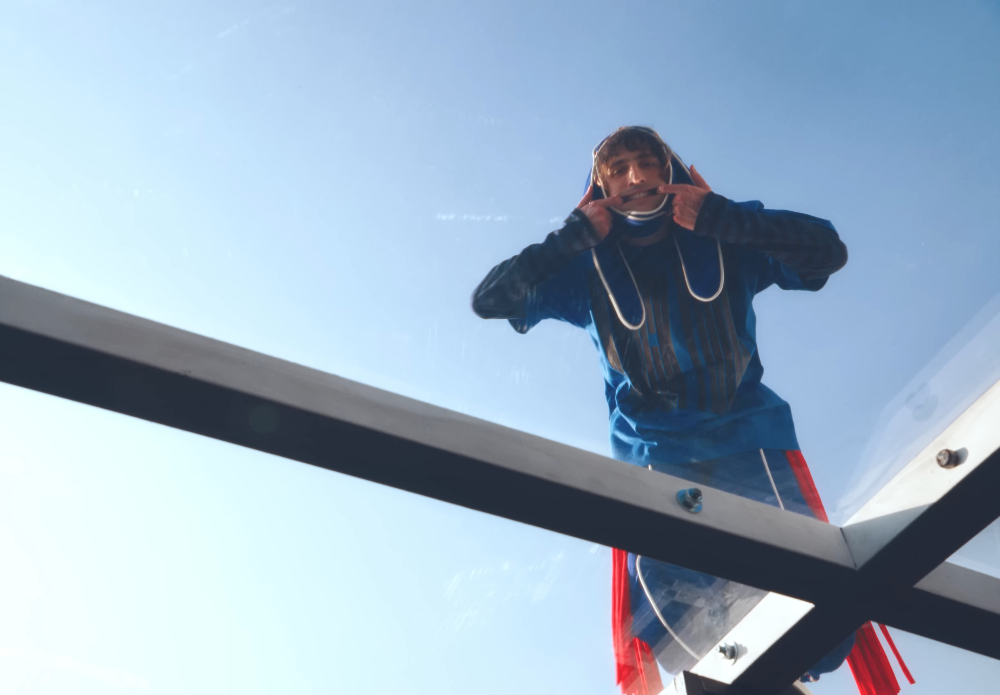
    
> 
> 
> 
> and i'm everything you talk about  
> why should you keep letting yourself be let down?  
> if i'm everything you talk about  
> i'm in the mirror, baby, let it all out  
> knock yourself out  
> 
> Porter Robinson - “Knock Yourself Out XD” - “SMILE :D”
> 
    
Thời điểm tôi bắt đầu nghe tới bài hát này, theo như tôi nhớ là vào hè 2024. Album “SMILE :D” của Porter được ra mắt cũng vào thời điểm ấy. rồi sau đó tour diễn cũng vào tầm tháng 7 cùng năm. Bài hát này là một trong số những thứ nhộn nhất mà tôi từng nghe, khiến tôi nhớ về cái quãng thời gian vô tư của mình vào hè trước lớp 8. Tôi nghĩ là, cái câu chuyện khi tôi chấp nhận sự phiêu lưu, cũng chỉ là bắt đầu khi mà tôi chấp nhận sự cởi mở tới tất cả những gì sẽ diễn ra trong đời của mình, nhưng để có thể nghĩ về sự thoải mái và vô tư trong mọi hành động, thì nó là cả một hành trình dài mà phải đến khi tôi thật sự đi học thì tôi mới hiểu được cái cảm giác ấy. Tôi muốn nói về một cảm giác như vậy, khi mình quyết định thả lỏng về tâm lý, bước ra khỏi cái trung tâm của sự chú ý quá mức và vô tư hơn trong hành động của mình khi nhận ra mình không còn là trung tâm để chú ý quá mức nữa.…
    
Cái nội dung của bài hát cũng châm biếm y chang. Cái lời hát miêu tả cuộc sống của một celebrity - người nổi tiếng, hoặc là văn hóa pop (pop culture) nói chung. Chúng ta sống trong một thế giới, nơi mà chúng ta phải được chú ý, hoặc chú ý tới một ai đó. Trong cái sự chú ý đó, chúng ta phải sống trong một hình ảnh mà nhiều khi trái ngược với chính chúng ta, mang một sự hào nhoáng nhưng bên trong hoàn toàn rỗng tuếch, hay là những câu chuyện sáo rỗng, chúng ta luôn mặc định là phải cảm thấy vui hoặc buồn dựa trên chính những hình ảnh hay câu chuyện dựng ra. Cái cuộc sống như vậy, với tôi nó không hề dễ chịu, vì mình trở thành trung tâm bất đắc dĩ cho quá nhiều câu chuyện không cần thiết và cuộc sống ấy khiến tôi khó phát triển, vì tôi luôn cảm thấy mình không thể thành công trong từng dự định của mình. Sau cùng, tôi nhận ra một thực tế rằng, mình đã sống trong một thế giới mà phải liên tục được định nghĩa hoặc chú ý bởi một ai đó, chứ chưa một ngày nào mình thật sự sống cho mình, dẫn đến việc tôi thay đổi suy nghĩ và chuyển mình khỏi những drama phù phiếm ấy, để có thể sống thật tốt vào 2 năm cuối cấp. Thứ tôi muốn viết chính là cái trải nghiệm khi tôi thay đổi suy nghĩ ấy, và cái cách nó thay đổi toàn bộ mọi thứ về sau trong cuộc sống.…
    
Tôi nghĩ là, dù cái cuộc sống không hào quang ấy cũng chỉ diễn ra trong 2 năm cuối cấp, nhưng phần nhiều lại khiến tôi có một cái suy nghĩ về chính mình, và tôi cũng bắt đầu trở về với những suy nghĩ ấy.…
    
---
    
Cái suy nghĩ này của tôi, theo tôi nhớ xuất phát từ năm lớp 7, khi tôi nhận ra một thực tế như câu nói của ai đó:
    
> “Bạn cứ thử biến mất vài hôm xem, cuộc sống vẫn diễn ra như bình thường..…”
> 
    
Phải thừa nhận một thực tế rằng, tôi đã sống theo những cái cách không phải chính tôi lắm (sau này tôi sẽ giải thích). Trong suốt 2 năm đầu cấp II, tôi luôn để mình dính phải những rắc rối từ những lần vạ miệng hay những hành động không cần thiết. Một trong số đó là việc tôi kỳ vọng ở bản thân hay người khác quá nhiều vào việc tôi phải trở thành một ai đó để được người khác yêu thích, cũng có thể nói là phải có hào quang nào đó. Có những thời điểm mà đi học cũng rất khó, khi mỗi lần tôi kết bạn hoặc cố gắng làm gì, khi đã thành một vết nhơ, thì người khác cũng khó lòng mà chấp nhận tôi khi ấy. Hơn nữa, thời điểm ấy, tôi học cũng chỉ ở mức bình thường, nếu không muốn nói là vô cùng cầm chừng. Ban đầu tôi từng cố gắng để có thể kết bạn nhiều hơn, nhưng về sau, có lẽ tôi thấy chán và chẳng muốn làm gì nữa, hoặc có lẽ nhận ra, mình sẽ mãi sống trong cảm giác chán nản này mãi. Đáng lý ra là như vậy, nhưng có một thứ đã bắt đầu trong cuộc sống của tôi khi ấy.…
    
Chắc tôi có kể cho bạn về câu chuyện phiêu lưu khi tận hưởng một mình đi học thêm, thì rộng hơn, cái câu chuyện phiêu lưu ấy cũng là một phần của cái cuộc sống không có hào quang mà tôi vô tình va phải. Sau rất nhiều lần thất bại để cải thiện hình ảnh của mình trong mắt mọi người, tôi đi đến một kết luận rằng: “ừ, có lẽ họ không ưa mình thật, và có làm đến đâu cũng chẳng khiến mọi thứ tốt hơn”. Tôi nghĩ là bản thân đã quá lãng phí về mặt tinh thần khi cố gắng phải làm những điều không thể, mình cố gắng tìm kiếm sự chú ý nhưng cái cách đó của mình chỉ mang về thêm mệt mỏi, nói tóm lại là lãng phí không cần thiết. Thế là, tôi bắt đầu chủ động im lặng và chấp nhận sự cô đơn như là một phần của đời mình, cũng vì thế mà nhiều lúc mẹ tôi hay nói là tôi không có nhiều bạn bè. Tôi chủ động rút mình khỏi mọi drama, cố gắng tìm một vài cách tự nhiên hơn để có thể hòa giải với những bạn trong lớp và chỉ tập trung vào mối quan hệ ở trong lớp, thay vì cố gắng tỏ ra như một người hướng ngoại, vốn không khác gì cái cách tôi vận hành cuộc sống của mình bây giờ - tránh giao lưu không cần thiết mà tập trung vào cuộc sống của bản thân. Có thể hiểu đơn giản là, tôi chấp nhận cái việc thay đổi suy nghĩ người khác là điều không thể, và tốt nhất là đừng cố gắng nếu như họ không thật sự thay đổi suy nghĩ của chính họ nếu như họ không tác động nhiều lắm tới cuộc sống của chính mình.
    
> Thế nhưng, cuộc sống liệu có quá nhàm chán khi không còn là trung tâm của mọi sự chú ý, dù tiêu cực hay tích cực???
> 
    
Thật ra, ban đầu cái sự phiêu lưu ấy cũng khá chán, ý tôi là, chấp nhận sự cô đơn không thật sự dễ và tôi vẫn muốn kết bạn, chỉ là tôi chưa thực sự sẵn sàng. Tôi chấp nhận dần một cuộc sống lặp đi lặp lại, đôi khi là chẳng có ai bên cạnh, tôi sáng đi học, tối thì học thêm rồi ngủ, nó thành một chu trình lặp lại. Tôi cũng hiếm khi đi ra ngoài hơn, vì có lẽ nếu tôi ra ngoài thì người ta lại bàn ra tán vào, lại chán tiếp. Cũng may mắn làm sao khi vị tiền bối cùng tuổi - bạn thân của tôi cũng phần nào giúp tôi đi qua những ngày tháng ấy khi tôi có nhiều thời gian để chia sẻ về công nghệ, những câu chuyện đời thường và kể từ đó, hai thằng và một vài đứa khác cũng thân với nhau hơn khi nhìn thấy những thay đổi của tôi. Cũng phải nói thêm là tôi khá cẩn thận trong lời ăn tiếng nói, vì người ta đã không có thiện cảm nên nếu như không thể nói được cái gì ra hồn, thì đừng nói cái gì cả. Nếu có thích một đứa con gái thì đừng cố gắng giành sự chú ý của họ làm gì nếu họ không ưa mình từ đầu, vì làm vậy sẽ khiến họ cảm thấy khó chịu và mình thì khó xử. Gần như là, tôi duy trì cái sự trầm ấy, vừa đủ để có thể dựng cho mình một không gian cần thiết cho những thứ lớn hơn như học tập hay là những mối quan hệ có ý nghĩa. Và dĩ nhiên, mọi thứ cũng cần một cái bứt phá nào đó, tôi cũng không ngoại lệ.…
    
Cái bứt phá ấy chính là giai đoạn năm lớp 8. Thật ra, trong lớp hồi cấp II thì tôi được biết với cái biệt danh là “Tuất” - ban đầu tôi không thích lắm nhưng sau này gọi nhiều cũng quen nên tôi cũng đi kèm với mình luôn. Ở lớp, thay vì để mình cứ bị cô lập mãi, thì tôi dần hướng tới một bản thân nó “tập thể hóa” hơn, cũng là một phần khía cạnh khi làm lớp trưởng. Tôi thừa biết là không phải ai cũng ưa mình nên tôi hoàn toàn bỏ ngay cái ý định làm mọi thứ để người khác hài lòng và phải đặt sự chân thành lên hàng đầu, chính là cái sự “vô tư” khi quyết tâm ra khỏi một hình ảnh bị định nghĩa bởi người khác. Tôi nghĩ là dù người ta nghĩ thế nào về tôi thì tôi vẫn sẽ làm vậy, nên không có gì phỉa thấy khó xử cả. Thay vì phải cố ép mình là một trung tâm, tôi cố gắng trở thành một hậu phương, nếu ai cần thì cứ gọi và tôi sẽ đến nơi ngay lập tức - một phần mà lớp Troy chọn tôi làm lớp trưởng khi ở đại học. Mục tiêu cuộc sống khi này của tôi không phải là co cụm, mà phải là trở thành một con người mà ai ai cũng tin tưởng, bất kể cái lăng kính nào từ bất cứ ai. Tôi chọn bản thân là một người bình thường, nhưng phải là một người đáng tin cậy, và để tin cậy, thì như bài hát, tôi cần phải để hành động của mình đúng nghĩa là hành động của mình, chứ không phải là một hình ảnh bị phản chiếu bởi kỳ vọng từ người khác. Cũng nhờ đấy mà tôi thả lỏng và vui tươi hơn rất nhiều so với những năm đầu tiên.…
    
Còn nói về mối quan hệ khác, thì thật ra, sự vô tư ấy cũng thể hiện bằng việc tôi đi kết bạn với đủ thể loại, và đặc biệt là khi chẳng ai chú ý, thì tôi kết bạn còn nhiều hơn. Trong số những người tôi quen, từ bác bảo vệ, cho đến thầy cô, cho đến mấy đứa lớp dưới và cũng có một vài đứa bạn khác nữa. Cái hay trong cuộc đời là người ta cởi mở với cái tật nói hơi nhiều và tếu táo của tôi khi ấy, nên càng lúc tôi cảm thấy đỡ chán đời hơn và tận hưởng cuộc sống theo những cách rất riêng. Thật ra thì tôi đếch quan tâm người khác nghĩ gì, và nếu như người ta kết bạn với tôi thì tôi biết ơn vì điều đó, còn không thì cũng chả sao... Mà thôi kệ, miễn sao vui là được :)))).
    
Kể tiếp thì cũng phải là sự dứt khoát trong hành động của mình. Trong mấy phim Hàn mà tôi thích, thì những nhân vật kiểu bất cần, hành động khá thả lỏng, nhưng vô cùng chắc chắn. vì lẽ đó mà tôi học được cái kiểu hành động của họ. Như cái câu thần chú: “đếch ai quan tâm”, nên tôi muốn mình có một hành động nó khác biệt một chút. Với cái cơ thể của tôi, thì thay vì tôi luôn phải gồng như thể tôi phải trông như thế nào đó, thì tôi tập thả lỏng và bung xõa hết nấc cái cơ thể của mình. Một trong khía cạnh ấy là tôi nhận những công việc lao động nặng nhọc như là một cách rèn luyện sức khỏe, đi kèm với vận động thể chất thông thường. Với tôi, mọi hành động không nên bị thừa thãi, vì mình cần thoải mái với chính mình, cũng như việc làm mọi thứ với hiệu suất cao nhất. Ví dụ, nếu như tôi đi lao động, thì tôi sẽ đi những bước đi chắc chắn, tôi làm mọi thứ nhẹ nhàng, khoan thai, nhưng làm đến đâu thì chắc đến đấy. Vâng, vì chẳng ai quan tâm, nên cứ thong dong, chắc chắn mà thực hiện :)))).
    
Một khía cạnh khác của việc vô tư, đó là tôi quyết định thử nghiệm nhiều hình ảnh về mình hơn và làm nhiều việc hơn. Như tôi nói, trung tâm của mọi suy nghĩ này là: “bạn làm cái gì, người khác đếch quan tâm”, nên tôi làm việc trong một tâm thế đặt sự tử tế, chân thành và dứt khoát lên hàng đầu, thế là tôi làm đủ trò và thử nghiệm đủ thứ trong đời của mình. Có một chuyện - sau này sẽ kể kĩ hơn, đó là câu chuyện trang phục trong trường học và chút “bá khí”. Tâm niệm của tôi đối với một trang phục hoặc một ý tưởng nào đó, không phải là việc so đo từng li từng tí với người khác hay có sự công nhận, vì người khác có thích hay không, chẳng nằm trong phận sự của tôi. Đó là cách mà tôi thử nghiệm những ý tưởng của mình. Năm ấy, 2017, mùa đông, tôi diện luôn một bộ trang phục mà trước giờ chẳng ai biết về nó, chính là áo “manteau”, áo dạ dài. Tôi biết, nó sẽ rất dị khi tôi lấy áo của mẹ mình ra mặc, nhưng phải công nhận là nó khá vừa vặn với người tôi, giữ ấm tốt và khiến tôi tự tin hơn rất nhiều - thật ra trước giờ luôn thích mặc :))). Tôi bảo, nếu như tôi là một người sợ bị chê thì chắc tôi đã không cả gan mặc nó tới trường, nhưng tôi chẳng ngờ là có nhiều người thích cái sự mới lạ ấy thật. Đôi khi, chỉ có việc mình chấp nhận rằng có thể sẽ chẳng có ai ưa, thì mình mới có nhiều không gian thử nghiệm, thậm chí là đột phá. Với tôi, đó có lẽ là những trải nghiệm vui nhất khi tôi được phép thử nghiệm mà chẳng ai cấm cản.…
    
Cái lý do tôi muốn nói về sự vô tư, nếu chỉ là những năm tháng lớp 8 thì cũng chưa đủ, mà còn là chính cuộc sống hiện tại khi tôi dần đưa mình khỏi bóng tối bởi một hình ảnh bị quy chụp, và trở về với hình ảnh ban đầu - thứ mà đã từng phải bỏ lại trong nhiều năm. Tôi nói về sự vô tư dựa trên một thực tế như cái năm lớp 8 ấy là: “tôi nên sống cho cuộc sống của mình, làm thật tốt những việc của mình và cho những người cần tôi”, và có lẽ tôi nên giải thích tại sao tôi lại dần nghĩ tới những điều ấy…
    
---
    
Câu chuyện đến vào một thời điểm đặc biệt ở hiện tại, một phần, tôi dần chấp nhận rằng có những chuyện đã qua đi rất lâu rồi, nhưng mặt khác, tôi cũng phải thừa nhận một sự thật khác còn đau đớn hơn, chính là cái ám ảnh mà nó từng gây ra đã tước đoạt đi rất nhiều thứ mà tôi từng cố gắng có được và khiến tôi, như thời điểm đầu tiên, là liên tục chán nản và mệt mỏi. Trong những năm tháng ấy, tôi thật sự cảm thấy buồn vì đã không thể sống vô tư như tôi đã từng, chỉ là ở hiện tại, tôi dần nhận ra rằng tôi muốn sống, thật sự rất muốn sống đúng như con người ấy của mình. Ở hiện tại, khi tôi bắt đầu một hình ảnh của một nhiếp ảnh gia, thích chụp ảnh, thử nghiệm nhiều dự án cá nhân và chụp bản thân nhiều hơn, tôi chấp nhận có thể không ai ưa mình, nhưng tôi cũng đã tự tin rằng kể cả không ai ưa thì tôi vẫn muốn cố gắng. Động lực lớn nhất, tôi tin trong cái trách nhiệm của mình, thì mình phải thay đổi những thứ thật sự cần thiết, và chỉ có sự vô tư - khi mình hành động một cách thoải mái và dứt khoát, mới khiến mình vui vẻ được.…
    
Tôi nghĩ là mình chỉ nên nói tới đây, vì những phần sau đó chính là mở rộng từ cái sự “vô tư” và quá trình trở thành một con người “huyền thoại” năm lớp 8.…
    
> “i got a brand new feeling in the back of my head....”
> 

    
<strong>call my friends….</strong>

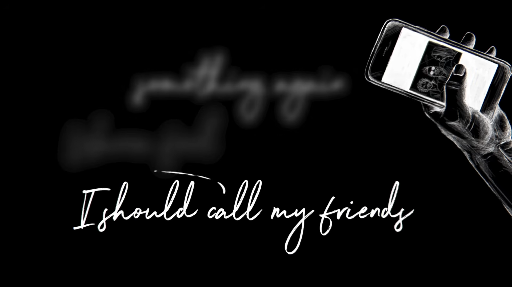
    
> i should call my friends and go get high….  
>i need a vacation from my mind….  
>i wanna go nobody knows me better than them.  
>wanna feel something again  
>i should call my friends…  
>
>Shawn Mendes - “Call My Friends” - “Wonder”
> 
    
Để mượn tiếp câu chuyện khi tôi 13 tuổi, thì tôi muốn nói đến bài hát phù hợp nhất để nói về nỗi nhớ ấy: “Call My Friends” trong album “Wonder”. Theo như Shawn có chia sẻ về bài hát, nguyên văn như này:
    
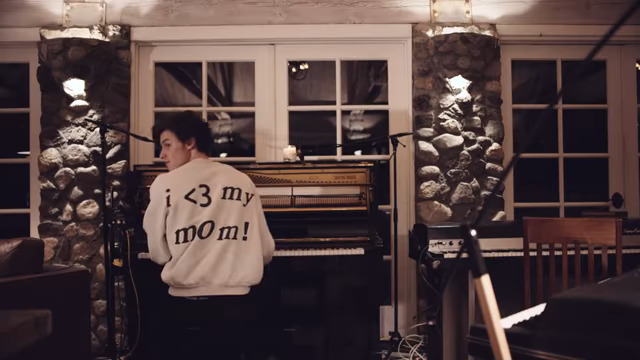
    
> We wrote “Call My Friends”, a while ago in Malibu and… I think “Call My Friends” is one of the most exciting songs on the album because it has energy in it, because it was one of the first songs that we wrote for the album. And I was thinking I just came off a massive world tour, and I was thinking what types of songs are going to feel huge live. And that song had this insane bass line and lyrics that felt really… you know kind of relevant to how I was feeling being away from my friends at home and my family for three months while I was traveling the world and kind of just being like I think I need to “**call my friends and go get high**”….
>    
>Shawn Mendes - “The Making of Wonder” - “Call My Friends”
> 
    
Bài hát có lẽ là hay nhất để nói về những kỉ niệm ấy, với tôi, có một ý nghĩa rất đặc biệt. Như Shawn có chia sẻ, bài hát nói về cái cảm giác khi phải xa bạn bè trong một khoảng thời gian rất dài, vì bắt đầu từ tuổi 15 thì anh đã đi tour khắp cả thế giới. Cũng như bao nhiêu người khác, cái cảm giác phải xa bạn bè, nó thật sự rất cô đơn, và đôi khi, anh ấy chỉ muốn về quê, gọi điện mấy đứa bạn và phê pha chút. Cái hay của bài hát, hay là cả album “Wonder”, đó là việc anh ấy nói về cái quá trình khám phá bản thân, đặc biệt là đằng sau ánh hào quang, với một giai điệu khá vui tươi và bắt tai. Bài hát đơn giản, và chỉ đúng cái lời: “tôi nên gọi cho mấy đứa bạn và đi quẩy”, có lẽ đúng với những suy nghĩ của tôi bây giờ. Đó là lý do mà tôi chọn bài hát này là chủ đề để nói về những người bạn khi ấy, một chút tri ân và chút cảm giác nhớ nhung mà tôi gần như không thể gặp mặt ở hiện tại…
    
Dù đã plan tầm cả tháng rồi, nhưng phải đến giai đoạn cuối cùng, thì tôi mới đặt bút viết tiếp những dòng về những người bạn của mình. Phải thú thật, tôi thấy vô cùng khó khăn để có thể viết ra, phần vì trước đó, tôi phải dồn tâm trí và cảm xúc để đối mặt với những sự thật mà mình từng né tránh và những bất an của hiện tại; phần vì một thực tế là tôi không có quá nhiều người bạn, không phải kiểu người thích xã giao và thời gian cũng không có nhiều - luôn trong trạng thái sẵn sàng phải đi xa, nên nói về tình bạn là một thử thách vô cùng khó để tái hiện. Thế nhưng, dù khó khăn là vậy, tôi vẫn muốn kể về một vài người bạn và tri ân mọi người khi tôi dần bước qua khỏi bóng tối của trầm cảm và nghĩ về kỉ niệm ngắn ngủi ấy với một chút tự hào xen lẫn tiếc nuối vì đã không thể kéo dài khoảnh khắc với mọi người lâu hơn một chút nữa. Tôi nghĩ là, những nguyên tắc trong cuộc sống, tư duy, cách làm việc và giao tiếp của tôi ở đại học, được lấy từ những kỉ niệm và bài học với những người bạn từ cấp II, và càng trở nên rõ ràng hơn khi tôi bắt đầu làm lớp trưởng và phải học cách vượt qua nỗi sợ để làm nên đại cục..…
    
Chà, khi tâm trí của tôi nhẹ nhàng hơn, có lẽ tôi nên bắt đầu câu chuyện về những người bạn của mình…
    
---
    
Bắt đầu câu chuyện ở cấp II, tôi muốn nói về người bạn đầu tiên của mình, và cũng là người tôi giữ liên lạc tới hiện tại, tôi xin phép dùng bí danh mà tôi gọi anh bạn ấy, thay cho tên thật, là “Vladimir”. Để mô tả vài thông tin thì đáng ra, tôi không nên gọi là “bạn” mà là “ông anh” vì năm sinh của hắn là 2002, nhưng do học cùng lớp với nhau nên gọi là “bạn”. Anh bạn khá cao lớn, nếu không muốn nói là cao nhất lớp, học lực ở cấp II thì ở mức tốt cùng với bản tính của một người trưởng thành sớm, đó là nhẫn nại, kiên trì, kiểm soát cảm xúc rất tốt và luôn lắng nghe học hỏi những người xung quanh. Những năm tháng đầu tiên, chúng tôi biết nhau, ngoài là học cùng lớp, còn là sở thích về máy tính và công nghệ. Cái mở đầu của tôi khi ấy, toàn hỏi về máy tính, mà trong lớp thì ngoài anh trai ấy hiểu ra thì chả có ai nghe, cứ thế mà thân nhau tới tận bây giờ. Những năm tháng đầu tiên lớp 8, hắn có vào đội tuyển Tin, là người dạy tôi lập trình cơ bản bằng Pascal, và sau đó là tôi tự học khi đã hoàn toàn đủ khả năng xử lý bài tập. Năm ấy, tôi khá sợ việc học lập trình vì không biết cài đặt môi trường, sách giáo khoa cũng có viết nhưng tôi không biết xử lý như thế nào, và bạn tôi nhiều lúc đã giúp tôi giải nguy trong cái giai đoạn mà tưởng chừng tôi mạt vận tới nơi. Tôi nghĩ là nếu không có sự giúp đỡ ấy, khéo tôi không làm lập trình viên hay là có chút đam mê với những món đồ điện tử như bây giờ. Tôi là một thằng dễ rơi vào tình trạng hoảng loạn, nên ít nhiều thấy may mắn khi có một người lớn giúp tôi hiểu rõ ràng hơn những việc phải làm. Kể cả sau này, người tôi gặp đầu tiên ở đại học mà ngoài lớp của mình, thì chính là người bạn thân và ngay cả hiện tại, ít nhiều tôi thấy tự hào với hiện tại vì đã có một người bạn rất tốt với mình và đã giúp mình sống trong một thế giới mà nhiều khi nỗi buồn còn lớn hơn cả niềm vui. Có những chuyện vô cùng bí mật nên tôi sẽ không kể chi tiết hơn, nhưng tôi muốn nói một vài lời cảm ơn tới người vừa là bạn, vừa là thầy, vừa là anh trai của mình khi tôi đã ổn hơn so với trước đây…
    
Nhưng chỉ một người bạn là chưa đủ, người ta sống trong một tập thể thì ít nhiều cũng phải có giao thiệp, cho dù rất khó để có một mối quan hệ nhẹ nhàng. Nguyên tắc của tôi khi làm lớp trưởng là không tranh chấp phe phái, tất cả mọi người đều quan trọng với tôi và không ai bị bỏ lại phía sau. Dĩ nhiên, cái nguyên tắc ấy được lấy cảm hứng từ những người bạn cùng lớp và những bài học đầu tiên để hoà nhập với những sự khác biệt.…
    
Tôi sẽ nói bắt đầu từ giai đoạn cuối lớp 7 trở đi, vì đó là thời điểm tôi học cách bắt dầu thích nghi với những thực tế của trường học. Mình cũng không thể nào chỉ có vận hành mọi thứ bằng tay không, lại chẳng phải người giỏi nhất, vậy thì mình cần làm gì để khiến cho mọi chuyện bớt căng thẳng hơn?
    
Ban đầu, tôi từng cố gắng làm hài lòng tất cả mọi người trong lớp, cố gắng làm thân mà không thực sự để ý rằng người ta có cho phép hay không, chuyện gì cũng phải góp mặt bằng được,... nói tóm lại là tôi muốn mình có thể hiện diện và cố gắng thay đổi suy nghĩ của mọi người. Kết cục thì không mấy dễ chịu, những tranh chấp thì không giải quyết nổi, mà ấn tượng thì ngày càng bị xấu đi. Thế thì, điều đầu tiên tôi hiểu được là rất khó để thay đổi một ấn tượng vốn đã rất xấu từ trước đó, và cố gắng thay đổi suy nghĩ của ai đó một cách gượng ép sẽ chỉ khiến mọi thứ trầm trọng hơn. Đây là bài học đầu tiên mà tôi khắc cốt ghi tâm mình khi làm việc với tất cả mọi người. Vậy thì tôi đã tiếp cận vấn đề đó như thế nào????
    
Ý tưởng của tôi khi đó là “**nếu một kỳ vọng không thể được đáp ứng, thì hãy để nó sụp đổ và chấp nhận điều đó một cách nhẹ nhàng**”. Sau tất cả những thất vọng, tôi chấp nhận rằng tôi không thể làm hài lòng tất cả mọi người và tập giữ một khoảng cách nhất định. Tôi không có ý nói rằng mọi người đều xấu, chỉ là tôi muốn tôi và mọi người có một không gian nhất định cho suy nghĩ của mỗi người để đánh giá một ai đó khách quan hơn. Tôi có chuyện của tôi, bạn có chuyện của bạn, giữ được trạng thái như vậy là đủ để bắt đầu lại. Nhưng kể cả đã chấp nhận sự thật, tôi nghĩ mình cần có sự thay đổi và chuyển dịch về mặt căn tính, thì thay vì tôi chọn là một người đứng ngoài cuộc của lớp, thì tôi duy trì bản thân như là một người có trách nhiệm tới những vấn đề chung của lớp. Thực tế, dù lập dị tới đâu, tôi cũng không phải thể loại người không biết trước sau. Tôi chọn đảm nhiệm những vấn đề như lao động, trực nhật và luôn góp mặt để làm những thứ có phần nặng nhọc, con trai mà, có tí sức khỏe thì tự nhiên được chọn thôi. Tôi nghĩ là, nếu không thể làm hài lòng mọi người, thì ít nhất cũng phải trở thành một con người có trách nhiệm với mọi tình huống ở trong cuộc sống, đã ít bạn rồi thì chớ, giờ để mất thêm bạn nữa thì liệu có chấp nhận được???
    
Tiếp đến, tôi muốn định hình mình là một người đáng tin cậy và trung thực, vì đơn giản tôi hiểu câu của mình có thể không ai nghe, nên chọn nói thật và làm việc thật giúp tôi thoải mái hơn khi đưa ra những lựa chọn căng não. Thường khi một ai đó hỏi tôi về cách làm một bài toán, thì tôi không muốn hời hợt - phần vì không thích bị hỏi nhiều, phần vì không muốn cảm thấy khó xử và phần lớn là cái tính cách có phần nói thừa và nói nhiều, và từ đó là tôi giải thích đủ thứ, từ cách làm nọ cách làm kia, cái gì cũng nói được. Nếu một ai đó nhờ giúp, kể cả có không ưa nhau, tôi vẫn ít nhiều có động thái, vì tôi không muốn phải mang sự khó chịu và bức bối của mình khi đối diện với họ lần sau. Khi làm một việc ở lớp, tôi có thái độ kiểu như thi hành ngay lập tức nếu như mình có khả năng. Nói chung là, làm người tử tế còn dễ chịu hơn là lúc nào cũng như mang theo dao găm.…
    
Nói vậy thôi, chứ nhìn sâu xa hơn, lớp tôi cũng có rất nhiều người giỏi, vô cùng hòa đồng và đặc biệt là không có quá nhiều sự khác biệt đến mức phân biệt giai cấp, lạ nhỉ? Lớp tôi góp mặt đông đủ thành phần và ai ai cũng có những nhược điểm riêng. Có người thì rất ngầu như lớp trưởng lớp tôi, có người thì học siêu giỏi và có phần tham vọng trong chuyện học tập, có mấy cha nội thì nghịch với phá, có người thì trưởng thành sớm và trầm lặng, và tôi thì là kiểu quý ông - không phải giỏi nhất, nhưng ít nhất thì cư xử lịch thiệp đến mức toàn gọi đi sang lớp khác để nhờ vả hoặc lấy thông tin. Lớp hòa đồng và chân thật, thành ra tôi hòa nhập cũng rất nhanh và tự do hơn trong hành động của mình. Nhờ cái tính thẳng thắn, nên nếu như tôi sai thì tôi bị nhắc nhở mà không phải thấy nặng nề, khiến việc sửa sai của tôi trông dễ dàng hơn. Hơn nữa, từ lúc tôi bắt đầu có tình cảm với cô gái lớp bên, thì lớp của tôi ít nhiều cũng giúp tôi bớt ngại ngùng hơn, cảm giác được khích lệ và cảm thấy việc mình thích ai đó không gây ra những hậu quả nghiêm trọng giúp tôi thấy thoải mái với cuộc sống học sinh và tập trung cao độ cho việc học cũng như thể hiện bản thân mình, vào cái giai đoạn mà tôi không còn nhiều thời gian nữa.…
    
Mỗi lớp là chưa đủ, tôi cũng giao thiệp với nhiều giáo viên và học sinh lớp khác. Từ thời điểm cô Hường làm chủ nhiệm, tôi có nhiều cơ hội tiếp xúc với mọi người hơn, kể cả những thầy cô có vẻ khó tính nhất. Tôi chọn cách tiếp cận kiểu “quý ông”, không nói quá nhiều nhưng chọn cách lắng nghe và cởi mở trước mọi ý kiến, kể cả ý kiến không hợp với mình. Trong giờ học tiếng Anh hay các môn học khác, tôi học cách trau chuốt từ ngữ, ăn nói và hành động dứt khoát - riêng môn Văn thì tôi không tự tin lắm vì mình học kém nhất. Việc giao tiếp nhiều hơn với mọi người xung quanh cũng giúp tôi có nhiều lợi thế hơn về mặt thông tin và những thông tin ấy ít nhiều giúp mọi người ứng phó tốt hơn với những trường hợp bất khả kháng, như là kiểm tra 1 tiết và phải ôn cái gì để chuẩn bị. Tôi luôn để mình kiểu, hơi hai mặt xíu, một mặt thì tôi rất nghịch ngợm - bồng bột ở tuổi 13, còn mặt khác là một quý ông biết cư xử có chừng mực. Đó cũng chính là cách tôi hành xử với mọi người ở hiện tại, như khi mình ở tuổi 13…
    
---
    
Tôi không chắc là mình có kể chuẩn xác như thời điểm đó hay không, nhưng tôi khi ấy gần như có tất cả, có bạn bè, thầy cô, những người xung quanh,... Hơn nữa, tôi thích bản thân mình vì đã là một quý ông mà tôi không phải thấy xấu hổ - dù có những thứ mà tôi rất ngại để nói. Thật sự rất nhớ cái khoảng thời gian ấy, khi gánh nặng học tập được giải quyết bằng sự chân thành, một chút ý chí cầu tiến và tình bạn thật sự trong một giai đoạn mà không có quá nhiều thời gian....

    
<strong>blooming heart…</strong>

    
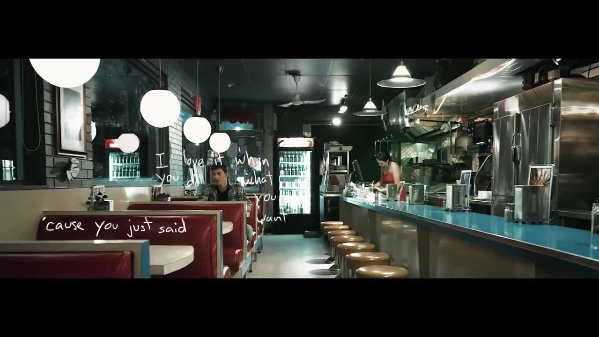
    
> 
> 
> 
> i love it when you just don't care  
> i love it when you dance like there's nobody there  
> so when it gets hard, don't be afraid  
> we don't care what them people say  
> 
> i love it when you don't take no  
> i love it when you do what you want 'cause you just said so  
> let them all go home, we out late  
> we don't care what them people say  
> 
> we don't have to be ordinary  
> make your best mistakes  
> 'cause we don't have the time to be sorry  
> so baby, be the life of the party  
> 
> i'm tellin' you to take your shot, it might be scary  
> hearts are gonna break  
> 'cause we don't have the time to be sorry  
> so baby, be the life of the party  
> 
> Shawn Mendes - “Life Of The Party” - Handwritten
> 

---

TL;DR: bài này cực kì dài và hơi “simp”, nên đừng ném đá cực đoan, không thích thì cứ việc ẩn đi…

**Viết về mối tình đầu của mình, tại sao không???**

Thời điểm mà tôi bắt đầu viết tiếp, trong giai đoạn cuối cùng của bản nhật kí này: **niềm vui từ tình yêu, nỗi nhớ và những nỗ lực đáng sống,** là tầm giữa tháng 10. Buổi chiều của hôm nay thật đẹp, nắng của mùa thu tỏa ra khắp cả bầu trời, không còn đâu đó là nắng gắt như tháng 7 hay những đợt mưa nặng hạt như tháng 8 - 9. Tôi bắt đầu viết lại về niềm vui của cá nhân mình, sau khi viết và chỉnh lý những phần “u tối” mà tôi muốn viết ra cũng như đối mặt với những sự thật mà trước giờ mình chưa từng nghiêm túc nhìn lại. Thật sự là lúc tôi viết xong, một phần, tôi giải phóng phần nào những cảm xúc tiêu cực ấy, nhưng xa hơn, tôi cũng muốn nói tới niềm vui và những hy vọng lớn hơn trong cuộc sống của mình. Để nói tới niềm vui ấy, tôi muốn nói về mối tình đầu của mình, như điểm xuất phát cho giai đoạn này, vì nghĩ đi nghĩ lại, cô ấy là một phần không thể thiếu trong trái tim tôi, một vùng mà không thể thay thế và cũng là động lực để tôi tin vào bản thân sau hàng tá những biến cố. Có lẽ, nếu không có crush thì cũng khó mà có tôi của hiện tại, hay ngay cả những suy nghĩ đầy hy vọng này….

Để nói về lớp 8, thì không dễ để viết, vì có rất nhiều thứ tuyệt vời đã xảy ra mà tôi không thể nhớ hết, cũng như nó quá ngắn để có thể được nhớ tới so với những gì nó đã định hình suy nghĩ của tôi. Chuyện tình yêu cũng khó viết, vì hầu hết, các bạn cũng khó mà tin những chuyện đã từng xảy ra, cũng như không phải ai cũng đồng tình với suy nghĩ hiện tại. Vì chính sự khác biệt ấy, tôi mong khi các bạn đọc những tâm sự này về tình đầu của tôi, đừng phán xét nó quá nhiều, tôi cũng không ép các bạn phải đông ý 100% những điều tôi nói, chỉ là tôi muốn được “lê thê” chút về mối tình mà đã khiến tôi muốn sống một lần nữa, sau hàng tá chia ly, mất mát, thất bại và những vô định trong cuộc đời của mình…

Với tình yêu, chúng ta không thể định nghĩa một tiêu chuẩn cố định, cũng như mỗi giai đoạn, mỗi thời đại đều có một cách định nghĩa khác nhau. Có người định nghĩa nó với sự dồi dào về vật chất, có người định nghĩa bằng những mơ mộng màu hồng, có người định nghĩa nó bằng cả hối hận khi không thể giữ… Bản thân tôi thì định nghĩa nó như một hành trình để khám phá bản thân, bảo vệ những điều tốt đẹp, sự bao dung, tính cao thượng, sức bền và sự trở lại với chính con người mình cho dù từng lạc lối. Có một câu nói mà phù hợp với góc nhìn của tôi:

> **tình yêu không định nghĩa bằng cách nó bắt đầu hay kết thúc, mà là cách nó thay đổi một ai đó…**
> 

enough intro, start…

---

**life before my crush….**

Cuối năm lớp 7, đầu năm lớp 8, tôi từng hứa với bản thân trong thời điểm ấy là sẽ không để mình vướng vào bất cứ drama tình ái với bất cứ ai, hữu ý hay vô ý. Hai năm đầu cấp II, tôi từng thích không ít bạn nữ, nếu không muốn nói thậm tệ là “simp”. Ở trong trường, ngoài việc gặp khó để làm bạn, thì mấy chuyện tình duyên của tôi nó tiêu cực lắm và có lẽ, chính những trải nghiệm này mà sau khi crush đi, tôi đã không còn cảm nhận được niềm vui của mấy chuyện tình ái, hay thích những câu hỏi về mấy chuyện cưới hỏi (sau này tôi sẽ giải thích chi tiết hơn). Gặp bạn nào thì bạn ấy né như né tà, và cùng lắm thì chỉ có vài đứa bạn trong lớp là có giao tiếp - cũng chỉ là vấn đề học tập. Thật sự khó khăn để nghĩ về chuyện tình ái, cho đến giờ những khó khăn ấy vẫn hiện hữu trong cái cách tôi giao tiếp với mọi người. Tôi thì cố theo đuổi, cố tỏ ra như mình phù hợp với ai đó và cũng chán nản dần khi thấy cái khoảng cách giữa mình và họ dần rộng hơn. Xui xẻo hơn nữa, cái chuyện tôi thích một ai đó, thường bị phóng đại một cách quá tiêu cực và vô tình khiến ai đó khó xử. Vì cái trải nghiệm không vui ấy, nên ngay cả ở hiện tại, tôi cũng thừa biết rằng tôi không thể hòa hợp với ai đó cho dù cố gắng thế nào, và tôi cũng chỉ có một cách, đó là tập trung học, hòa hoãn với những mối quan hệ xung quanh và duy trì khoảng cách để tránh những hiểu lầm không đáng có. Có một quan điểm mà tôi thấy khá hợp lý, đó là thay vì phải cố gắng làm hài lòng một ai đó và ngược lại, thì mình nên tập trung trên những khía cạnh mà mình có thể làm tốt và cho mình một không gian cần thiết….

Ừ, tôi đã xác định rõ, mình sẽ không bao giờ có một mối tình nào cả, chẳng ai để nhớ cả, xác định là đã trở thành ác quỷ trong mắt người khác, thế nhưng…, đến cái lúc tôi không cần tình yêu nữa, thì đã có một người khiến tôi muốn sống và đã thay đổi suy nghĩ của tôi rất nhiều. Và xa hơn, tôi cô đơn ở hiện tại, cùng một sự cô đơn, nhưng lý do đã khác: **vì chẳng có ai khiến tôi thoải mái như cô ấy cả…**

---

**introduction…**

À, giới thiệu chút về cô gái ở trong bức hình, đó là crush của tôi - cô gái mà tôi nói đến, tôi sẽ chỉ nói đến tên và ngày sinh, còn những info khác thì tôi xin không để lộ. Tên cô ấy là Ngọc Anh, 18 tháng 7. Bức hình chụp cũng khá dị - phần nào tôi thấy mình khôn, vì tôi không chụp chính diện mà chỉ một bên của khuôn mặt, và may mắn là ảnh khá mờ nên vừa đủ bảo mật để không bị coi là xâm phạm thông tin cá nhân. Một gợi ý nữa là cô ấy học ngay cái lớp cách lớp tôi một cái cầu thang, nên khoảnh khắc chạm mặt nhau diễn ra khá tình cờ và thường xuyên. Thật sự, tôi chả nghĩ là mình tự dưng lại thích một cô gái ở lớp bên sau hàng tá chuyện đã xảy ra khi ấy, nhưng đời đưa đẩy tôi đến những trải nghiệm của cái câu: “**ghét của nào trời trao của đó…**”.

Để miêu tả về ngoại hình crush của tôi thì bạn chỉ cần nghĩ cô ấy giống như một cô chị lớp trên, hoặc trên hẳn một cấp học, kiểu nếu tôi lớp 8 thì cô ấy trông giống như đang học lớp 9 trở lên. Hơn nữa, kèm theo tính cách chị đại cục súc và giọng như một đứa con trai thì rất khó để nói rằng cô ấy là mẫu người mà tôi thích khi đó. Bạn biết là, những cô gái mà tôi từng thích trước crush của mình cũng phải là thuộc dạng nổi bật, lúc thì học vấn phải cao, lúc thì tính cách phải ngầu, lúc thì kiểu ai nhìn vào cũng thích,… cô ấy xuất hiện và khiến tôi thấy khó hiểu vì cô ấy đều không phù hợp lắm với tiêu chí mà tôi nghĩ khi đó. Nhưng có một thứ mà khiến tôi dần thay đổi suy nghĩ của mình, rất nhẹ nhàng, đó là những khoảnh khắc khi tôi và cô ấy chạm mặt trong những khoảnh khắc thường ngày, cách nhau một cái cầu thang và làm những thứ rất thường ngày, tôi nhận ra là ừ, cũng chẳng đến nỗi tệ. Tôi dần nhận ra rằng, một cô gái dù ngoại hình có không giống ai thì cũng là một người bình thường, và tôi nên suy nghĩ thoáng hơn về chuyện đó cũng như đối xử cho nó tử tế một chút. Nhưng, cái câu chuyện chúng tôi biết nhau lần đầu lại kéo trước lúc đi học, tầm tháng 7 gì đó…

Chúng tôi có đi học thêm tiếng Anh cùng với nhau, thời điểm đó thì tôi dồn sức tập trung học, một phần là vì lớp 8 rất quan trọng để tiến xa, và cũng là cơ hội để tôi làm lại từ đầu; nhưng mặt khác, tôi muốn nói không với mấy chuyện tình ái vớ vẩn, tôi không thích cái việc đi tầm vài bước chân thì lại có một chuyện tình ái nào đó. Cuộc sống đi học thêm diễn ra, với một vòng tròn nhẹ nhàng: từ việc chiều đến giờ thì lên xe, cuốc bộ, đi học và trở về nhà, cứ như một vòng tròn cuộc sống mà tôi dần tìm thấy niềm vui của việc học một mình. Và đột nhiên một ngày, có một cô gái xuất hiện, chắc cái miêu tả vẫn chưa đủ…. Cô bạn đó xuất hiện với một chiếc mũ lưỡi chai, một chiếc kính có cái mắt kính hình eclipse, tóc thì được cột ra phía sau, có ngoại hình khác biệt - cao, hơi lớn so với tuổi và điều khiến tôi thấy lạ, cô bạn ấy rất tự tin và có một khả năng thích nghi đáng kinh ngạc. Tôi thì khá rụt rè, nếu có tự tin thì chắc chỉ là ở việc học và nói chuyện với mấy ông bạn thôi. Ban đầu, sự xuất hiện của cô ấy không khiến tôi cảm thấy quá khác biệt, kiểu là chỉ chạm mặt nhau hàng ngày thôi và ai nấy cũng chỉ tập trung chuyện học của mình, còn tôi thì vẫn cố bình thường hóa điều đó. Thế nhưng, có một cảm xúc rất lạ trong trái tim và suy nghĩ tôi khi ấy. Tôi dần muốn đi học nhiều hơn, chuyện học là một phần, nhưng cốt là để nhìn thấy ả, và nếu ả ta không có ở đó thì cuộc sống của tôi lại có phần chán ngắt. Tôi chả bao giờ nghĩ là mình sẽ cần một ai đó đến vậy, từ một ấn tượng vừa tốt, cuộc sống lặp lại nhàm chán trở nên vui vẻ cho đến việc mong ước một ai đó sẽ đến nhiều hơn…

Nhưng mối duyên chưa dừng lại ở đó, thậm chí là còn xa hơn đến nỗi, tôi chả nghĩ được mình dần biết nhiều hơn thế…

---

Bẵng đi một thời gian, cô gái ấy vẫn hiện hữu trong suy tưởng của tôi, dù tôi chẳng biết liệu hai đứa có cơ hội gặp lại. Cơ hội duy nhất để nhìn thấy nhau là ở lớp học thêm, thông tin về cô ấy tôi cũng chẳng có gì ngoài cái tên lớp – bởi thời ấy, nào ai đoán trước được điều gì.

Tôi của năm lớp 8 phải chật vật học cách bắt đầu lại mọi thứ, từ bài vở cho đến phương pháp học tập. Tôi chấp nhận mình chỉ là một học sinh bình thường, thậm chí còn phải học chuyên biệt một bộ môn mà ngay cả kiến thức cơ bản tôi còn mông lung: Toán. Bước vào lớp 8, tôi buộc phải thích nghi với một thực tế rằng: mình không nổi bật, và đôi khi luôn ở thế yếu hơn người khác. Cách xử lý của tôi khi ấy không phải là gồng lên cạnh tranh, mà là tập cho mình một thái độ nhã nhặn, đồng thời tự xây dựng một thế giới riêng – nơi hầu hết mọi người đều không thể chạm tới. Chuyện tình cảm của tôi cũng được cất giấu trong thế giới đó.

Nói thẳng ra, tôi thích rất nhiều cô gái, nhưng tôn chỉ khi đó là không để cảm xúc vượt quá giới hạn. Kiểu như này: nếu một cô gái đứng trước mặt, là bạn cùng lớp hoặc người có quen biết, tôi chắc chắn sẽ chào; còn lại, tôi chỉ nhìn rồi lướt qua, như thể họ vốn không thuộc về cuộc sống của mình. Lúc đó, tôi phân biệt rất rõ ràng giữa việc 'thích' và 'mến mộ' một ai đó. Dù biểu hiện có vẻ giống nhau, nhưng cách ta hành xử trong từng loại cảm xúc lại hoàn toàn khác biệt.

Những kỹ năng ứng xử ấy, tôi đổi bằng hàng tá lần bị từ chối trước đó. Để rồi tôi nhận ra: 'thích cũng được, bị từ chối cũng chẳng sao'. Tâm thế ấy khiến tình cảm tuổi học trò trong tôi không còn gay gắt, mà trở nên nhẹ nhàng, dễ ứng xử hơn. Với các bạn nữ trong lớp, tôi không đòi hỏi hay kỳ vọng quá nhiều. Tôi chọn cách: **họ hỏi tới đâu thì mình trả lời tới đó, không vòng vo**. Nhờ vậy, tâm trí tôi nhẹ nhõm hẳn. Tôi tập trung trở thành một người đáng tin cậy để bạn bè có thể hỏi đáp, thay vì biến mình thành một kẻ tiêu cực chỉ vì không biết cách kiểm soát cảm xúc của chính mình...

Well, có lẽ ở hiện tại, tôi chọn cách tiếp cận như thế này, và nếu như crush không xuất hiện thì có lẽ đã chả còn gì để nói, nhưng cuộc sống là một chuỗi những sự cố bi hài, những bất ngờ và cảm giác khi cô gái bạn thích nhất và bạn ghét nhất…. lại là cùng một người…

---

**when someone you loved and you hated…. are the same one.**

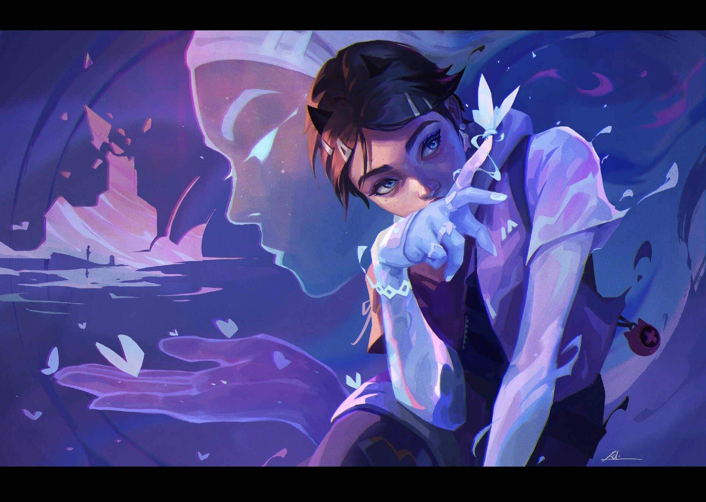

> 
> 
> 
> if you give me a piece of your heart  
> you'll keep easy when we are a part  
> of two worlds, it could be nothin'  
> maybe it's somethin'  
> 
> keep your eyes on me  
> 
> Madge, VALORANT - “2WORLDS” - Agent Clove…
> 

Để tôi nói thật nhé, ban đầu, tôi không thích crush của mình nhiều tới vậy, nếu không muốn nói là có phần rất ghét. Đúng là tôi khá ấn tượng về crush của mình từ cái lần học thêm và mọi thứ trông rất nhẹ nhàng, vì cuộc sống kể cả không có crush thì vẫn trôi, chả có gì xảy ra, có chăng chỉ là thêm một bạn nữ lạ nào đó thì tò mò hơn thôi. Nếu để dùng một câu nào đó để nói về tình trạng đó thì… 

> ả khiến ta không thoải mái, và ta nghiện cảm giác đó lúc nào chẳng hay…
> 

Qua một vài 'tai mắt' thám thính cộng với những gì tự mình cảm nhận, tôi nhận ra ả hoàn toàn nằm ngoài vùng an toàn của tôi. Nói trắng ra, ả không phải kiểu người tôi sẽ có cảm tình, nếu không muốn nói là tôi... rất sợ. Chúng tôi như hai mảng màu đối chọi chan chát. Gu của tôi khi ấy là những gì hòa nhã, nhẹ nhàng, ăn nói chừng mực và luôn cẩn thận trong mọi động thái. Thậm chí lúc đó, tôi đang thầm thích một bạn nữ khác cùng lớp với ả – một hình mẫu chuẩn sách giáo khoa: học giỏi, tính tình hiền hòa, xinh xắn và luôn nổi bật theo một cách rất riêng. Còn crush của tôi á? Well... một bà chị đại chính hiệu. Giọng nói của ả oang oang như một đứa con trai, nếu không muốn nói là còn khủng khiếp hơn thế, dáng người thì khá cao, còn nhan sắc thì cũng chỉ ở mức “bình thường”, kiểu chỉ ở mức bình thường nhất có thể ấy. Nhưng mà, dù có sự trái ngược ấy, thì tôi không hiểu sao là tôi vẫn rơi vào lưới tình, nếu không muốn nói là rất sâu đậm và nó đến từ những khoảnh khắc rất thường ngày….

Thông thường, mỗi khi đến trường, tôi luôn có thói quen đánh mắt nhìn xung quanh để quan sát. Năm lớp 8 phòng tôi ở tầng hai, lên lớp 9 thì dời lên tầng ba. Tôi cứ nhìn một cách vô thức như để xem có sự thay đổi gì không, cho đến một ngày, tôi bắt gặp một điều bất thường phá vỡ sự tĩnh lặng thường nhật. Đó là ánh mắt của ả.

Ban đầu, một hai lần bắt gặp tôi nghĩ chỉ là tình cờ, nhưng tần suất của nó bắt đầu dày lên một cách đáng báo ngờ. ả nhìn tôi bằng một ánh mắt vô cùng bí hiểm, nở một nụ cười ẩn ý nào đó rồi nhanh chóng chuồn thẳng vào lớp, bỏ lại tôi đứng trơ trọi với một dấu hỏi chấm to đùng trong đầu. Lúc ấy, tôi vẫn là một thằng 'cụ non' chỉ muốn tận hưởng cuộc sống bình thường nên chẳng buồn bận tâm. Thế nhưng, tận sâu trong lòng, tôi dần có một dự cảm mơ hồ rằng: sắp có một cơn bão đổ bộ và thay đổi hoàn toàn quỹ đạo cuộc đời mình.

Dự cảm ấy bắt đầu hữu hình hóa qua những buổi sáng tôi đi trực nhật sớm. Người ta bảo kẻ dậy sớm thì không bao giờ lãng phí đời mình, và tôi đã được kiểm chứng điều đó theo cách lãng mạn nhất. Ả luôn đi xe đạp và là đứa đến sớm nhất lớp. Cái hình ảnh ả dắt xe vào cổng trường dần trở thành một phần quen thuộc trong ngày của tôi. Từ sự xa lạ ban đầu, tôi thấy mình bắt đầu... 'nghiện' cảm giác này. Tôi tìm mọi cách để đến trường sớm nhất có thể, chỉ để đổi lấy vài phút ngắn ngủi được nhìn thấy ả trước khi bắt tay vào việc. Tôi thầm đánh giá ả là một người có khả năng vận động rất tốt và cực kỳ đúng giờ (chẳng biết bây giờ ả có còn giữ được thói quen đó không). Nhưng chính cái ấn tượng từ những lần chạm mặt sớm tinh mơ ấy đã thúc đẩy tôi tự lập cho mình một chế độ sinh hoạt lành mạnh hơn – một cái cớ hoàn hảo để được gặp ả nhiều hơn.

Bước ngoặt thực sự đến vào những buổi học chuyên biệt. Ban đầu ả học đội tuyển Văn, nhưng không biết vì cơ sự nào lại quay xe chuyển sang khối Lý. Sự thay đổi định mệnh ấy khiến khoảng cách giữa hai thế giới sụp đổ hoàn toàn. Giờ đây, gần như ngày nào chúng tôi cũng chạm mặt nhau, không lúc này thì lúc khác. Và tôi phát hiện ra một điều: ả cực kỳ hay cười, đặc biệt là trước những pha 'hớ hênh' ngốc nghếch của tôi.

Nghĩ lại vẫn thấy mình ngây ngô vô cùng. Thời đó, chẳng hiểu sao tôi rất hay dùng ké đồ của mẹ, ví như một cái mũ có phần hơi nữ tính mang đến trường, và nó ngay lập tức trở thành tâm điểm gây cười của ả. Kể cả những lúc tôi mệt mỏi, bày ra cái bản mặt thảm hại nhất, ả nhìn thấy cũng có thể bật cười giòn giã. Tôi thề là lúc đó tôi chỉ muốn tìm một cái lỗ để chui xuống, chết trân tại chỗ vì cự ly giữa hai đứa quá gần, có muốn né tránh ánh mắt của ả cũng là điều bất khả thi. Nhưng chính cái nụ cười sảng khoái trước sự ngốc nghếch của tôi lại khiến tôi nhận ra: ở bên ả, tôi không cần phải gồng mình lên nữa.

Thế nhưng, trò đùa của số phận chưa dừng lại ở đó. Có một bí mật từ hồi đầu năm lớp 8 mà tôi luôn giấu kín và đinh ninh rằng nó đã chìm vào quên lãng: tôi từng vô tình buông những lời không mấy hay ho, nếu không muốn nói là khá thô lỗ với một đứa con gái. Một buổi sáng nọ, tôi đi học muộn và chạm trán đúng ả ở cổng trường. Bản tính sợ con gái khiến tôi có chút né tránh, nhưng mọi chuyện vẫn diễn ra bằng vài câu tán gẫu bình thường cho đến khi ả bất ngờ hỏi ngược lại tôi về vụ việc năm xưa – cái 'phốt' mà tôi luôn cầu nguyện cho nó biến mất khỏi Trái Đất.

Giây phút ấy, cảm giác ngại ngùng xen lẫn sợ hãi dâng lên đỉnh điểm. Tôi đứng hình khi nhận ra một sự thật phũ phàng: cô gái bí ẩn có ánh nhìn kỳ lạ hàng ngày, người khiến tôi mến mỗi buổi sáng sớm, và cái kẻ 'nặc nô' mà tôi từng ghét cay ghét đắng vì vụ va chạm trong quá khứ... hóa ra lại cùng là một người. Đến lúc này, tôi mới hoàn toàn hiểu được tại sao mình lại luôn có cảm giác bất an và bị thu hút. Cái bẫy đã sập, và tôi chính thức đầu hàng trước sự sắp đặt bi hài của định mệnh.

---

**overcoming the fear of rejection, the change…**

Những khoảnh khắc thường ngày trôi qua, từ vài cái chạm mặt vô tình, chút ngại ngùng không gọi tên cho đến sự quen thuộc cứ thế lớn dần lên, đã khiến tôi nhận ra mình thích cô ấy từ lúc nào không hay.

Ban đầu, tôi bước vào năm lớp 8 với tâm thế của một đứa đã chấp nhận một cuộc sống có phần chán nản và khó tìm kiếm niềm vui. Nhưng từ khi cô ấy xuất hiện, tôi lại khao khát được sống, được tận hưởng trọn vẹn những tháng ngày ấy. Tôi tự nhắc nhở mình rằng thanh xuân cấp hai này cũng chỉ còn vỏn vẹn hai năm, biết đâu khi ra khỏi cánh cổng trường kia, tôi sẽ chẳng còn nghĩ ngợi nhiều được nữa. Vậy nên, tôi muốn trân trọng từng ngày có ả.

Thế nhưng, lý trí là một chuyện, còn con tim lại là chuyện khác. Đáng sợ nhất là cảm giác mỗi đêm, khi tôi nhắm mắt và chuẩn bị chìm vào giấc ngủ, hình ảnh quen thuộc của crush lại hiện lên rõ mồn một trước mắt. Tôi nằm đó, cố chấp gối đầu lên tay rồi tự nhủ thầm một câu đầy ngạo nghễ: 'Xời, có cái gì đâu mà phải nghĩ!'. Nhưng rồi chính cái đứa vừa tặc lưỡi ấy lại nằm lật qua lật lại, trằn trọc, chỉ để loanh quanh trong một câu hỏi không có đáp án: “**liệu người ta có thích mình không nhỉ?**”.

Cái cảm giác lấp lửng ấy nó khó chịu và bức bối vô cùng. Nó cứ âm ỉ, dồn nén, và một thằng nhóc mười ba tuổi như tôi lúc bấy giờ hoàn toàn bất lực, chẳng biết phải làm cách nào để thổi bay nó đi...

Cuối cùng, tôi chọn thỏa hiệp với một suy nghĩ cũng lấp lửng không kém: tôi chẳng thể biết liệu cô ấy có thích mình hay không, nhưng có một sự thật không thể chối bỏ – tôi thì có. Tôi của năm mười ba tuổi có lẽ đã sống trong cảm giác bị từ chối quá nhiều lần, nhiều đến mức nó vô tình dạy cho tôi một bài học đắt giá: học cách yêu mà không cần phải cân đo đong đếm quá nhiều. Tôi muốn mình thích một ai đó theo cách vô tư nhất có thể. Không chiếm hữu, không kỳ vọng, cũng không đặt nặng bất cứ áp lực nào lên vai hai đứa.

Giữa những bộn bề của bài vở, giữa nỗi sợ môn Toán và sự tự ti của một kẻ luôn nghĩ mình ở vị thế 'kèo dưới', tôi chọn cách đối diện thẳng thắn với chính trái tim mình. Không còn né tránh, không còn giả vờ nhã nhặn hay tặc lưỡi 'xời, có cái gì đâu'. Tôi thừa nhận một cách thật lòng nhất: “t**ôi thích cô ấy thật rồi…”.** Rồi đó là cả một câu chuyện dài mà hẳn đã thay đổi cả con người tôi một cách tích cực…

Kể từ lúc mà tôi thích crush của mình, một phần là cảm giác ngại ngùng khi giờ, mình sẽ phải học cách đối diện với ánh mắt của crush hàng ngày và chẳng biết phải bày tỏ điều đó ra sao. Cuộc sống vẫn trôi như vậy, và việc học của tôi vẫn ít nhiều suôn sẻ hơn, chỉ có điều là khi tôi bắt đầu rơi vào lưới tình, thì thay vì tôi cảm thấy cực đoan về mặt cảm xúc, tôi thấy chút thoải mái và nhẹ nhàng trong cái ngại ngùng của chính mình. Ngày trước, tôi từng nghĩ là mình không cần tình yêu hay chỉ cảm thấy mọi thứ thoáng qua, nhưng ánh mắt, khuôn mặt và tóc của cô ấy khiến cho một khoảnh khắc tưởng chừng như mãi mãi như thế, mọi thứ giống như đóng băng trong chốc lát vậy. Ngoài giờ học căng thẳng, mỗi khi một mình, nghĩ về hình bóng ấy, tự nhiên tôi thấy nhẹ nhàng đi, giống như là mình đang ở trong thế giới riêng của mình vậy. Kể từ đó, tôi thích đến trường nhiều hơn và dù chẳng thể lúc nào cũng gặp nhau, tôi muốn nhìn thấy crush mình ở đâu đó…

Tôi trở nên thoải mái hơn trong việc biểu lộ cảm xúc của chính mình, dù một chút ngại ngùng nhưng thật sự rất khó để che giấu cảm xúc của mình - nhất là khi bắt đầu thích một ai đó. Tất nhiên là tôi chỉ chia sẻ cho đúng thằng bạn thân của mình, cùng lắm là những người anh em thân cận, chứ không có ý định làm rùng beng mọi thứ lên. Thế quái nào, kể từ lúc tôi thổ lộ, là cả lớp tôi đều biết và thay vì nhìn điều đó kiểu tiêu cực, mọi người vẫn hay trêu, nhiều khi là dọa sẽ nói cho crush tôi biết điều đó. Nhưng có lẽ cũng chẳng sao, thật ra thì tôi không sợ bị từ chối vì tôi đã quen với điều đó rồi, nhưng tôi rất lo rằng có nhiều thứ tiêu cực sẽ ăn theo - những xung đột và những vấn đề mà tôi chưa thể giải quyết ở cá nhân mình. May mắn là đã không có gì tiêu cực xảy ra, và sự vui vẻ của mọi người khi ấy đã giúp tôi thoải mái hơn về mặt cảm xúc so với trước đây. Kể từ đấy, tôi trở nên rất lãng mạn, luôn để mình trong nhiều phong cách khác nhau, có lúc tôi sẽ trông hơi giống phụ nữ, có lúc thì trông rất nam tính, có lúc như người lớn, có lúc như trẻ con,… nhưng điểm chung là tôi thấy vui vẻ, không gánh nặng và lúc nào cũng cười.

Một trong những thay đổi lớn hơn về mặt tư tưởng là tôi rút hẳn bản thân khỏi những drama vô nghĩa, những định kiến và những cuộc cạnh tranh không mang lại giá trị cho mình. Nếu như khoảng thời gian đầu tiên, tôi cảm thấy cô độc khi không biết phải định hình mình ở đâu, thì từ lúc bắt đầu có tình cảm với crush của mình, tôi muốn sống như một người mà tôi có thể tin tưởng. Tôi cảm thấy nhàm chán khi cứ liên tiếp phải sống trong những ánh nhìn của người khác và luôn sợ bị từ chối. Nhưng từ lúc có crush, tôi tập theo đuổi những giá trị cốt lõi của mình, đó là một tinh thần bền bỉ, một thằng con trai lãng mạn, một người mà ai cũng có thể tin cậy,… Có thể hiểu hơn là, tôi muốn mình trở nên đơn giản hơn và làm đúng nghĩa là mình. Tôi học cách thôi quan tâm tới những bàn tán xung quanh, và chỉ tập trung đưa mắt nhìn tới crush của mình, tôi thà làm tốt những mối quan hệ ở trong lớp, kết thêm bạn bè, sống tử tế với mọi người xung quanh và cho mình một cơ hội để thể hiện chính mình. Ngay cả việc học, tôi chấp nhận nhẹ nhàng rằng mình không phải là con người của thành công, nhưng ít nhất cũng đã làm mọi thứ ra hồn và đưa mình trở thành một con người tự tin sống đúng bản chất không chút gánh nặng tâm lý nào…

Kể ra thì nhiều, nhưng nếu xét thứ nổi bật nhất ở mình khi ấy, chính là về thời trang, đúng là về học tập hay những mối quan hệ thì đã khá tốt, nhưng tôi cần một chút táo bạo hơn ở bản thân mình. Thế là năm lớp 9, tôi lấy ngay áo khoác bằng vải dạ, cái áo manteau (overcoat) của mẹ tôi đi mặc. Trên thực tế thì áo cũng không chỉ riêng cho nữ mà nam cũng mặc được, nếu không nói là nó hợp với dáng người cao khi ấy của tôi. Tôi muốn trong mùa đông cuối cùng ấy, có thể sau này sẽ chẳng gặp được nhau, nên tôi muốn tạo ra đột phá về trang phục của mình. Tất nhiên, nó thành biểu tượng về trang phục của tôi khi đó, đó là tôi không bị giới hạn bởi bất cứ khuôn mẫu nào và luôn tự tin trước mọi hoàn cảnh, điều này có lẽ không thể thực hiện được nếu như không yêu ai đó thật lòng…

---

**a little reflection…**

Hành trình hai năm ấy với hàng tá câu chuyện xảy ra giờ đã lùi xa tròn một thập kỷ. Nếu gom hết thảy chi tiết, dòng hồi tưởng này sẽ trở nên lan man. Điều tôi nhận ra ở hiện tại khi nghĩ về người con gái năm ấy, không phải là chuyện cô ấy sẽ nghĩ gì nếu đọc được những lời này — bởi tôi không viết để mong cô ấy hiểu — mà đây là một lời thú nhận rằng: có lẽ tôi sẽ không thể tìm thấy chính mình của ngày hôm nay nếu như ngày đó không có cô ấy. Tôi từng hao mòn cả tâm trí chỉ để cố khiến một ai đó thích mình, từng nếm trải cảm giác cô độc đến tận cùng khi chẳng biết mình là ai. Cho đến khi tôi học được cách thích một người, học được cách buông bỏ định kiến để yêu ai đó thật lòng mà không sợ bị khước từ. Nếu tôi của năm ấy mà chín chắn hơn, tầm 30 tuổi, có lẽ tôi sẽ cưới cô ấy mà chẳng cần đắn đo. Tôi không biết mình có đang nói quá hay không, nhưng cô ấy là người duy nhất khiến tôi muốn sống có trách nhiệm, muốn trở thành một người đàn ông tử tế và tự cho mình một cuộc đời khác, tách biệt khỏi những định kiến và những cuộc cạnh tranh ngoài kia. Chính việc nhặt nhạnh từng mảnh ký ức về những động lực đầu tiên, về một tình yêu không kỳ vọng ấy, lại là thứ giúp tôi hiểu rõ bản thân và định hướng cho chính mình ở hiện tại. Điều khiến tôi buồn, không phải vì đã không yêu ai đó đủ nhiều, mà vì khi ấy tôi còn quá trẻ để hiểu rằng: đó rất có thể là lần cuối cùng tôi có thể nghĩ về một người mà không phải cảm thấy đau lòng…

Nhưng dù sao, tôi biết rất khó để có thể hạnh phúc như thể vô lo vô nghĩ, tôi chẳng biết là mình có đặt ra tiêu chuẩn quá cao hay không, nhưng tôi thừa biết rằng tôi không thực sự muốn tìm kiếm một ai đó khác, đơn giản là vì cô ấy khiến tôi thoải mái khi được là chính mình, cảm giác đó dù quá ngắn, nhưng giống như là mãi mãi vậy… 

yeah, i love you, but i can’t stay….

thank you, for everything, hana…

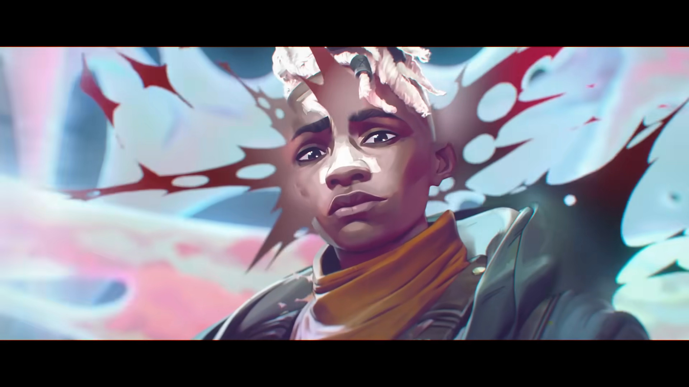

    
<strong>miracles from imperfections…</strong>

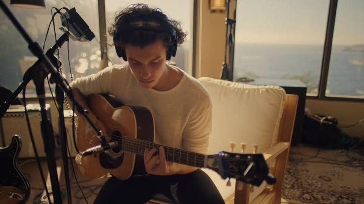

> “you have to not only accept imperfection but embrace the imperfection because that imperfection in that moment is what turns into magic in the next.…”
>
>Shawn Mendes - “In Wonder”
> 

Tôi bắt đầu viết tiếp, trong một trạng thái mà cái nhật kí đã đi gần hết, và chờ cho chặng cuối cùng, nơi tôi tiếp tục nói tới những niềm vui năm lớp 8. Bình thường, với những bản nhật kí trước, tôi có xu hướng chạy đua về tốc độ vì thời gian lúc đó cũng không nhiều để tôi có thể chỉnh lý hay đưa ra những ý tưởng, còn hiện tại, tôi đã giãn ra tầm 1 tháng, viết chậm hơn để những gì mình viết thật sự chất lượng, cũng như quan tâm nhiều hơn tới sức khỏe thể chất và tinh thần. Phải đến khi cho mình thời gian và tự thả lỏng một chút, tôi mới có thể nhìn sâu vào những chuyện đã trải qua và trả lời được một câu hỏi lớn:

> tại sao tôi của những năm lớp 8 lại khác xa so với những năm tháng trầm cảm, đặc biệt là về khía cạnh học tập, tại sao tôi lại cảm thấy không thoải mái dù thành tích cũng có thể gọi là đứng đầu…
> 

Như tôi có kể rằng ở phần sau đó, hệ quả của một giai đoạn trầm cảm chính là cảm giác “mất vị giác”, tức là cảm giác mà mình làm mọi thứ đều không thể mãn nguyện và luôn trong một cảm giác như mình làm chẳng có tác dụng. Suy nghĩ của tôi dần thay đổi khi tôi bắt đầu học nhiếp ảnh, và từ đó, tôi hiểu ra một điều còn lớn hơn thế, thứ mà đã giúp cuộc sống của tôi dễ thở hơn, học tập tốt hơn và thấy vui vẻ trước mọi thứ dù cực nhọc tới đâu:

> có lẽ, tôi không phải là một người hoàn hảo, tôi chỉ là một người bình thường đang cố gắng hết sức….
> 

Tôi nghĩ, đây là câu nói mang nhiều sức nặng nhất trong trái tim tôi, ngoài việc nó là một lời an ủi, nó luôn nhắc tôi nhớ rằng mọi nỗ lực, dù không thể tạo ra những đột phá quá lớn, thì luôn xứng đáng được trân trọng. Cần gì phép màu khi chính nỗ lực để làm một điều gì đó, đã thay đổi chúng ta và tạo ra những phép màu…

Tôi muốn kể về trải nghiệm học tập và cái cách tôi đối diện với mọi vấn đề, cũng như những điều tôi học và muốn mang theo ở tương lai…

---

**the childhood…**

Mở đầu, điều tôi muốn nói chính là tôi luôn đồng cảm với các bạn, những người đang ngày ngày cày mặt mà học để qua môn, những người vỡ mộng và những kẻ thiếu may mắn trong quá trình học tập của chính mình. Nhìn từ bản thân, tôi muốn nói rằng tôi chưa bao giờ và không bao giờ nhìn nhận mình là một người học giỏi, thông minh hay xuất sắc hơn người vì cả cuộc đời tôi chứng minh rất rõ cho những nhược điểm ấy. Tôi có những nhược điểm rất bình thường mà mình luôn phải tìm cách cứu chữa như thiếu tập trung, vụng về, học rất chậm và hay nghĩ phức tạp không cần thiết - người ta còn gọi là “overthinking”. Nhưng thay vì chỉ xoáy sâu vào những nhược điểm ấy, tôi muốn cho các bạn thấy một điều rằng, các bạn hoàn toàn có thể học với một cách tiếp cận khác, với một mục tiêu dài hạn và đặc biệt, giúp các bạn buông những áp lực tâm lý và tìm thấy được niềm vui thông qua sự cởi mở, nhẫn nại và bền bỉ. Đây cũng là những bài học kinh nghiệm từ lớp 8 mà tôi muốn mình có thể thực hiện từ bây giờ…

Kể ra từ mẹ tôi - cô giáo đầu tiên, tôi có khá nhiều giai thoại vừa tréo ngoe, vừa buồn cười nhưng cũng đầy hy vọng của tuổi ấu thơ, và cũng là những động lực đầu tiên cho phương pháp học tập của tôi, cũng như với các bạn. Tôi là một đứa trẻ khá chậm nói và hơi chậm phát triển, phải đến 3 tuổi mới biết đi và 4 tuổi mới biết nói. Nhưng điều lạ sau đó là biết đi rồi biết chạy ngay sau đó, và biết đọc ngay lập tức mà không qua đánh vần (**well, cái này tôi không nói phét đâu, mẹ tôi nhiều lần kể lại vừa nể, vừa buồn cười nhưng cũng có phần tiếc vì nhà tôi khi đó khá nghèo và bấp bênh**). Ngoài ra, cái cách tôi học viết cũng rất lạ, không giống như mọi người. Hầu hết mọi người nhìn theo chữ là viết được luôn ngay khi được chỉ dạy, tôi thì kiểu không nhạy bén lắm. Cái cách viết chữ của tôi rất dị, những chữ của tôi không đều nhau, lúc thì bé tí, lúc thì to, nhìn trông rất lệch và lúc ấy, tôi chỉ nhìn nét mà cố tô theo, chứ không thực sự hiểu các bước như nào. Nhưng sau một khoảng thời gian thì tôi viết khá thuần thục và nhiều lúc viết rất đẹp. Nhìn lại thì tôi nghĩ những đứa trẻ sau này cũng sẽ đọc và hiểu nhanh hơn tôi, điều này được chứng minh rồi, chỉ là khi tôi nhìn lại ở bản thân mình, thì tôi không thấy mình quá hoàn hảo, mà thậm chí là mang nhiều nghịch lý mà rất khó để giải thích. Những trải nghiệm hồi còn bé ấy dạy tôi rằng không ai là biết mọi thứ đúng sai ngay từ đầu mà phải là quá trình biết sai - sửa sai, và hơn hết là sự bền bỉ, nghị lực và cương trực đến cùng cho quyền lợi học tập của mình. Những điều này sẽ được chứng minh khi tôi học cấp II…

---

**some broken expectations…**

Nhưng nếu chỉ kể ra từ bé, thì nó là quá diệu kì và siêu thực, phần nhiều lại không đúng lắm với tinh thần mà tôi đang muốn truyền tải, cho dù chuyện đó là giả hay thật. Những phương pháp học tập đầu tiên phải đến cấp II, chính xác hơn là 2 năm cuối: lớp 8 và lớp 9, thì mới có một sự lột xác về mặt tư duy và mang tính nguyên tắc. Tôi nghĩ đi nghĩ lại, kể cả ở THPT, đại học hay là ở hiện tại, ít nhiều những gì tôi học và đang cố gắng làm, đều mang những yếu tố ấy. Đây có lẽ chính là khởi đầu của niềm vui mà tôi muốn nhắc đến…

Trước khi hiểu về nguyên tắc, tôi phải nhắc tới 2 năm đầu học chật vật, khi sự diệu kì của một cậu bé đã hết phép, nhường chỗ cho một cậu bé 12 tuổi bấp bênh đang cố gắng định vị lại bản thân trong việc học của chính mình.…

Ở trường tôi khi đó, dù mang tiếng là trường chuyên của huyện, lại đối mặt với một tình trạng học tập không mấy khả quan. Một mặt, đó là tình trạng thiếu giáo viên, đặc biệt là dạy môn Toán; còn mặt khác là sự thiếu cân đối trong vấn đề kiến thức khi những học sinh được tuyển chọn vào trường lại chỉ chuyên biệt một môn nào đó, tôi là trường hợp rõ ràng nhất khi học rất tốt môn ngoại ngữ nhưng lại chật vật trong môn Toán và những sự thay đổi rõ rệt trong chuyện giảng dạy. Ngoại trừ những bạn có học lực rất tốt hoặc được bồi dưỡng từ tiểu học, thì hầu hết lại rơi vào tình trạng học lệch và khó bắt nhịp với nhịp độ. Nhà trường khi đó liên tiếp, trong những giờ chào cờ, nhắc lại những vấn đề học tập và nề nếp, những sự thất vọng và mệt mỏi của việc học nhiều nhưng thụ động. Nhà trường đối mặt với chính **gót chân Achilles** của chính mình khi mang tiếng là trường **chất lượng cao** của huyện, vận hành bằng kỳ vọng của phụ huynh và ban lãnh đạo huyện nhưng lại **không thể tạo ra phép màu** nào về giáo dục cả, hoặc nếu có thì **chẳng thấm vào đâu** so với những thực trạng hiện hữu. Tình trạng này còn rõ rệt hơn khi vào những tiết học, và tôi cũng cảm nhận rõ điều đó. Năm ấy, tôi vẫn nhớ thầy dạy môn Vật Lý, dù có tính cách khá nghiêm khắc nhưng lại chẳng thể tạo ra diệu kỳ nào cả, lớp vẫn ngơ ngác trước bài giảng, để rồi mỗi khi trả bài chỉ là sự chán nản giữa hai bên: người cảm thấy bài quá khó còn người cảm thấy lớp chẳng đạt được kỳ vọng gì. Các môn khác cũng không thoát khỏi ngoại lệ, đặc biệt là môn Tiếng Anh, thậm chí là thời điểm đó còn có lớp “bổ túc” khẩn cấp dựa trên kết quả điểm kiểm tra nhằm vớt vát.

Tôi là một trường hợp tréo ngoe nhất khi ấy. Nếu nói về khoản ngoại ngữ, thì tôi gần như đứng đầu cả trường, nếu không muốn nói là cả huyện (thực ra tôi vào được bằng thi IOE với kết quả khá tốt), và nền tảng ngoại ngữ sẵn có khi được tiếp cận từ nhỏ - và càng được củng cố khi tôi tự tìm hiểu về công nghệ thông tin và máy tính. Nhưng, chính việc quá chuyên biệt lại là gót chân Achilles, để học được môn ngoại ngữ, tôi buộc phải đánh đổi những môn học khác, đặc biệt là môn Toán. Nói như vậy, không phải là tôi không biết gì hay quên kiến thức, mà là tôi quá tập trung vào một phía mà quên mất rằng những mảng khác cũng quan trọng không kém. Việc học của tôi rơi vào đúng 2 trạng thái: một là học kém - 3 môn Văn, Sinh, Sử; hai là học tạm. Tôi nhớ khoảnh khắc mà mỗi lần học trong lớp là trạng thái căng thẳng khi nhận thông tin về điểm số, những lần kiểm tra bài cũ hay cảm giác kỳ vọng học tập bị sụp đổ, mỗi lúc đó, tôi thực sự thấy sợ và ô nhục, vì hấu hết mọi người học cũng chẳng đến nỗi nào, mình thì ngày ngày cố cày hết cả sách giáo khoa cũng chẳng hiểu và chẳng nhớ được gì. Bố mẹ cũng nhiều lần nhắc nhở, thậm chí nhiều khi ăn cơm cũng không ngon miệng khi tôi nói về chuyện học tập.…

Để nói cái khoảnh khắc khiến tôi thấy mệt mỏi nhất, chính là việc học môn Toán của mình. Sự khác biệt về cách học, từ việc tự học, học trên lớp và học thêm, đã tạo thành một áp lực tâm lý khủng khiếp. Khoảnh khắc ấy chính là việc tôi đối diện với việc giải những phương trình phức tạp nhưng lại rơi vào trạng thái không hiểu nguyên tắc. một là chẳng biết giải, mà có giải thì chuyển vế rất chậm và sợ sai. Nhìn mấy chế kia làm bài nhanh thoăn thoắt, giải chốc cái là xong vài ba bài, nhìn mình cứ buồn rầu làm sao. Rồi khi đi học thêm, tôi có thể tự tin khi học thuộc lòng mọi mệnh đề, nhưng động đến việc phải giải hay chứng minh, tôi lại rơi vào trạng thái không biết phải làm gì..…

Sang đến lớp 7, tôi may ra mới vớt vát chút thể diện. Việc tôi học kém các môn như Sinh hay Sử, phải vất vả lắm mới gỡ gạc được bằng việc phải cố nhớ từng chút một và tự đi tìm hiểu những thứ khác. Thật ra, với môn Sử, tham khảo từ lời cô giáo dặn, đó là viết Sử thì không chỉ là thuật lại trận đánh, mà là những đánh giá của mình trước trận chiến đó, còn tôi chỉ nghe từ thằng bạn: “m cứ viết dài ra”. Điều này yêu cầu một thực tế là, tôi phải hiểu một vấn đề nào đó để viết thay vì chỉ viết dài hơn. Cách xử lý đầu tiên của tôi khi đó là cố mà nhớ kiến thức, dù theo cách nào đó, còn việc hiểu hay không thì tôi chưa bàn đến. Thực tế là, thời gian học không đứng về phía tôi là bao, và để học lại một khối lượng kiến thức lớn như vậy không phải cứ nói hiểu là hiểu.…

Đỉnh điểm của mâu thuẫn, khi tôi học thêm Toán, chính xác là chuyện tôi vào đội tuyển nào đó. Trên thực chất, việc học môn đội tuyển khi ấy là một cơ hội để cho các học sinh thể hiện sở trường, khả năng học tập và đưa ra định hướng, mặc dù phần nhiều vẫn còn nặng tính danh hiệu. Tham vọng của tôi về vấn đề trường lớp lớn dần, một mặt, tôi muốn mình có thể khẳng định bản thân học thật sự tốt ở những môn đó, nhưng mặt thực tế khiến tôi phải suy nghĩ rất nhiều: “**tôi thật sự là ai trong cái bản đồ ấy????**”. Khi đi học thêm, tôi luôn có cảm giác như thể mình phải đạt điểm cao nhất, nhưng lại cảm thấy khó khăn khi cố gắng hiểu một bài toán, hiểu một cách giải hay cách trình bày. Tôi cảm thấy việc mình không thể bao dung cho những khiếm khuyết của chính mình, và thấy tự ti về khả năng học tập. Tôi có thể gọi là “học giỏi”, nhưng cảm giác của nó không khiến tôi vui vì nó trái ngược với cảm xúc thực tế. Cố gắng để đạt một danh hiệu, nhưng ngoài việc bị tụt lại, tôi không thấy vui khi sống với danh hiệu đó và sợ hãi rằng sẽ có một ngày danh hiệu ấy biến mất. Những điều ấy đánh sập cái kỳ vọng của chính mình và chính gia đình về cái cách mình sẽ học tập như thế nào.…

Cảm giác mà để thoát khỏi học kém, tôi phải cố gắng mà nhớ, nhưng tệ hại hơn cả việc học kém là để giữ việc học giỏi, tôi luôn phải mang những gánh nặng đó, luôn phải cố tỏ ra hiểu mặc dù thực tế trái ngược. Cảm giác sợ bản thân bị mang tiếng kém cỏi cản trở khả năng tự học rất nhiều và tôi cần một cách suy nghĩ khác.…

Và ngày đó, cũng đến, vào một mùa hè 2016 nọ.…

---

**miracle from imperfections.**

Tôi xin phép không kể tên của người thầy và những người bạn liên quan, để bảo đảm tính riêng tư, nhưng tôi sẽ giải thích chi tiết cái phương pháp ấy.…

Tôi bắt đầu đi xa, chính xác là từ hè trước khi vào lớp 8. Để xin nói thêm thì ngoài ý muốn gia đình, tôi chọn đội tuyển Toán một phần cũng là để học chắc kiến thức hơn và nhìn từ vấn đề tương lai. Tôi cũng khá tham vọng, nhưng thực tế học tập cho thấy một sự thật nghiệt ngã rằng, đội tuyển cần một cách tiếp cận học tập mới, hơn là một phương pháp cứ lặp đi lặp lại. Thực tế xung khắc ấy cũng được biểu hiện rõ ràng trong việc tôi gặp khó khi phải đưa ra một cách giải chính xác cho những bài nâng cao, hay việc nhỏ nhất là đưa ra một ý tưởng - tôi không thể làm do kiến thức chưa vững, nhưng lớn nhất là cách tiếp cận cứng nhắc trước đó, khi tôi chỉ tập trung để nhớ kiến thức trong thời gian ngắn, hơn là để hiểu nó trong dài hạn. Kỳ vọng sụp đổ và choáng váng, khiến tôi vô định, cảm thấy bản thân kém cỏi và khó phát triển. Vì lẽ đó, tôi quyết định đi xa, học nhóm lại từ đầu, reset mọi thứ. Theo một cách nào đó, trải nghiệm học lại này giúp tôi thay đổi cả bản thân của mình.…

Như tôi có nói, lý do lớn nhất tôi chọn đi xa là vì nếu xét về kiến thức thì tôi không kém, mà vấn đề thật sự nằm ở tư duy và tâm lý. Về mặt tư duy, tôi lại khá thụ động trong việc đưa ra một cách giải bài toán, tôi sợ sai và cố chấp nhất phải áp dụng công thức đó mà không biết mình nên áp dụng ở phía nào. Nhưng tồi tệ nhát là vấn đề tâm lý. Ở lớp học trước đó, tôi mang một cảm giác tự ti lớn khi mà mình không thể học hay giải một bài toán với tâm trạng vô tư, mà luôn phải cố gắng hơn ai đó, hay ngay cả hiện tại - thời điểm tôi viết ra những dòng này, tôi cũng mang một tâm trạng tương tự. Cảm giác sợ ai đó thất vọng, sợ những kỳ vọng sụp đổ, sợ điểm kém,.... khiến tôi quá đắn đo trong việc phải đưa ra một kế hoạch để triển khai. Và cách dạy của ông thầy ấy khiến tôi bị sốc, nếu không muốn nói là từ khó hiểu, sang thích nghi, yêu thích, cải tổ lại phương pháp học tập và định hình nên cái cách suy nghĩ như ở tiêu đề:

> “phép màu từ những điều không hoàn hảo…”
> 

Có thể nhiều học sinh sẽ không ưa phương pháp của ổng lắm, ổng cũng không nói ngọt hay nịnh học sinh bao giờ cả, tôi phải nhắc điều ấy, nhưng ít nhất sự thành thật của ổng khiến tôi thay đổi rất nhiều. Nếu bạn xem những bài giảng kiểu MIT OpenCourseWare hay CS50 thì cái cách ổng truyền đạt kiến thức cũng tương tự. Tôi reset từ nhóm học từ trung bình đến yếu, không phải kiểu học lại mọi thứ, mà là học lại từ cách tư duy và nhìn nhận vấn đề. Hơn nữa, cũng nhờ cách học có phần chậm rãi, tôi đối diện với vấn đề tâm lý của mình nhẹ nhàng hơn, từ đó thay đổi mọi thứ trong cuộc sống của mình.…

Trong tất cả những buổi học, cái cách vận hành lớp rất khác so với các lớp trước đó. Thay vì phải cố gắng chạy đua rằng làm được bao nhiêu bài và phải đúng trong mọi trường hợp, thì cách dạy ông thầy có vẻ rất dông dài, làm cực kì ít và trông có vẻ thiếu hiệu quả. Đó là việc ông không cố nhồi nhét kiến thức mà tập trung giải thích về những mảng kiến thức thường hay bị bỏ qua ở trên trường lớp. Ví dụ, chúng ta có thể biết về định lý đường trung tuyến với con số 2/3, thì ông thầy sẽ chứng minh và giải thích tại sao lại ra con số 2/3 và cái điểm đó. Kèm theo đó, là ông thầy sẽ chỉ ra rất nhiều điểm mù mà thường chúng tôi rất ít để ý, với mục tiêu là tránh bị trừ điểm oan khi gặp phải những bài cần chứng minh. Thêm nữa, ông thầy rất để ý mọi người và yêu cầu tập trung cao độ đối với mỗi bài giảng. Lúc làm bài tập, thay vì cố phải đưa ra một kết quả, ông thầy cố kéo dài thời gian lâu nhất có thể, và tập trung tìm kiếm nhiều cách để giải một bài toán cũng như những điểm nào có thể áp dụng. Hơn nữa, việc đọc sách giải không bị coi là đáng xấu hổ vì ngay cả ông thầy cũng chả chuẩn bị cái gì, nhưng có một yêu cầu đi theo là, phải làm lại và giải thích tại sao lại có thể tận dụng được. Nhiều lúc, tiết học có thể kết thúc cực kì muộn vì ông cũng tham việc, giải xong mới chịu đi…

Dù việc học chậm như vậy có thể gây ra khó chịu cho hầu hết mọi người, nhưng bài học về tư duy và tâm lý từ những buổi học siêu lề mề ấy, vẫn còn có giá trị tới hiện tại. Khác với mọi người nghĩ rằng những buổi học ấy có thể không mang lại kết quả tốt trên điểm số - cái này tôi thừa nhận và không phải ai cũng đủ kiên nhẫn, thì tâm lý của tôi trở nên thoải mái dần. Nếu như trước đó, tôi phải cố đạt điểm cao và phải làm đúng tất cả mọi thứ, thì với kiểu học như này, mục tiêu của tôi là phải “hiểu” một bài toán và cách giải của nó. Không có kiến thức nào sinh ra từ chân không, mà phải là quá trình tự bước đi, tự vấp ngã, biết sai lầm, dám sửa và học được từ những lần sửa ấy. Muốn hiểu một cách trình bày, bạn phải hiểu trình tự tư duy. Muốn có kế hoạch giải một bài toán, thì phải đi thị sát, phải tìm những dữ kiện cần thiết và sử dụng chúng như thế nào để chứng minh. Muốn giải một bài toán, thì phải dám đối diện, mà dám đối diện thì phải đến từ việc thay đổi mục đích và phương pháp học tập. Tôi không đặt bản thân trong trạng thái của một người cần điểm số, và tôi chọn sự chậm ấy vì tôi biết, từ hồi còn bé, tôi không học quá nhanh như tất cả mọi người. Điều lớn nhất là, tôi hiểu về giá trị của sự cởi mở từ việc đối diện sai lầm trong học tập. Đối với tôi, một bài toán có rất nhiều phương pháp giải, miễn sao chúng liên quan tới nhau và có những điểm có thể tận dụng. Một người có thể dùng một phương pháp cổ điển để chứng minh, hoặc một người có thể dùng mẹo, nhưng sau cùng đều vẫn ra kết quả, do đó chúng đều hợp lệ. Chúng ta không thể áp đặt một phương pháp nhất định cho một vấn đề mà trên hết, nếu có một phương pháp tốt hơn và đỡ mất thời gian hơn, thì đáng để xem xét.

---

**from learning to changing mindset**

Chuyện học thêm cũng chỉ là một phần, những ý tưởng học tập ấy được áp dụng trên lớp, từ lớp 8 trở đi và được sự ủng hộ của cô giáo chủ nhiệm, cũng là cô giáo dạy Hóa khi ấy - cô Hường. Một phần, tôi biết đến cô khi tôi học thêm Hóa, một phần khác là chồng cô lại chính là hiệu trưởng khi ấy của mẹ tôi. Phải đến một khoảng thời gian sau, lúc tôi gặp chú thì mới vỡ lẽ, nên có thể coi là duyên. Có thể mọi người không thích lắm với cách dạy, hay là cách giao tiếp có phần hơi “thảo mai” và ít khi biểu lộ cảm xúc thật, nhưng điều khiến tôi cảm thấy nhẹ nhõm là cô giúp tôi trút bỏ gánh nặng tâm lý và hướng tôi đến một con người trách nhiệm với chính cuộc sống của mình, và những thay đổi trong cách học ấy được áp dụng triệt để: từ việc học đến cách vận hành cuộc sống cá nhân…

Cách tiếp cận đầu tiên, với các môn học trên lớp, tôi không học với một thái độ vì điểm số hay thành tích. Sự thật chứng minh rằng kỳ vọng quá nhiều về một thứ chẳng bao giờ tới, sẽ chỉ khiến trái tim tan nát và mất dần động lực. Tôi không học để cố học giỏi, mà tôi tìm hiểu kiến thức như là chính nó. Tôi dần chủ động chuyện bài vở, có thể phát biểu ý kiến về một góc nhìn lịch sử, hoặc có thể thêm kiến thức nếu như còn thiếu. Chắc chắn không phải là gánh cả buổi học, nhưng nếu có ý kiến thì phải học cách nói về vấn đề đó, dù có thể nó đúng hay sai, miễn sao là trong chừng mực cho phép thì nó vẫn nên được đưa ra và lắng nghe. Việc có thể phát biểu giúp tôi tự tin hơn và dần quan tâm đến nội dung của những gì mình sẽ phát biểu trước mọi người.

Tiếp theo, chính là thái độ đối với điểm số, dù cao hay thấp. Tâm lý của tôi khi ấy được giải tỏa rằng, dù tôi điểm kém hay cao, tôi phải chấp nhận vì nó là thứ tôi đã làm. Nếu như trước đó, tôi khá thất vọng, chán nản, gượng ép rồi chất vấn liên tục, thì khi tôi biết mình điểm không cao, tôi không cần phải than vãn, biết mình sai mà sửa. Rõ ràng, một môn học, tôi chẳng hơn ai, nên có than vãn cũng chẳng giải quyết được gì, thậm chí còn gây ấn tượng xấu tới tất cả mọi người. Mà nếu học, thì phải viết đủ và viết đúng những gì mình biết và mình học, chứ không phải là cố gắng vẽ ra những thứ không có thật. Kể ra, từ cái suy nghĩ ấy, tôi học với một thái độ nhẹ nhàng, không chán nản và luôn luôn tìm hiểu một vấn đề khi có cơ hội. Điểm số là cần thiết, nhưng nếu nó không được xây dựng với một tâm lý tốt và sự trung thực, thì cũng không giải quyết được gì. Đó là lúc tôi trút bỏ gánh nặng trong suốt những năm tháng ấy.…

Và cuối cùng, từ cách học, tôi tự tin và thay đổi cách mình tiếp cận với mọi người. Cô giáo và bạn bè tôi dạy tôi rằng, tôi là một thành viên của lớp và dù có bất đồng với ai, thì tôi vẫn phải có trách nhiệm với tất cả mọi người và không ngoài công việc đó. Thật ra, đó cũng là lúc mà tôi thả lỏng và không còn phải cố tỏ ra thế nọ thế kia. Làm việc với một thái độ kiểu: được đến đâu thì đến, mình không hoàn hảo nên cứ thoải mái thôi. Tôi nhận những việc được coi là nặng nhọc với học sinh lúc bấy giờ, nhận trách nhiệm trực nhật, giải quyết chuyện nước uống hay vấn đề ngoại giao với các giáo viên. Tôi không cố nói nhiều, nhưng nếu cần nói thì tôi sẽ nói đủ và nói đúng. Tôi không cố phát biểu để nhận sự tán dương, hay được lòng ai cả, vì tôi biết tôi không hoàn hảo, mà là tôi cho mình cơ hội để làm một điều gì đó ý nghĩa từ sâu trong tâm của mình.…

---

**reflection on depression arc and present…**

Kể ra thì có vô số giai thoại mà chắc giờ quên béng, nhưng thứ đọng lại mà tôi cần, đó là một thái độ rằng mình không hoàn hảo và mình luôn phải đối diện với điều đó hàng ngày. Mình không hoàn hảo, nhưng ít nhất cũng phải dám đối diện và làm hết sức cho một điều gì ý nghĩa. Tôi không biết đến mình như là một kẻ chỉ biết học giỏi, mà là một người có tâm lý thoải mái, lành mạnh và dám nhìn thẳng vào sự không hoàn hảo để vận hành mọi thứ..…

Nhưng tôi cũng nói rồi đấy, tuổi 13 quá ngắn để nhìn ra cả một con người khi ấy, mà đôi khi, có những giai đoạn trầm cảm và vô định để tôi hiểu được những điều nó thật sự dạy mình và cũng là những hạt giống của hiện tại để nói rằng, ở một quãng thời gian nào đó, tôi đã sống và học tập là chính mình….

Điều đầu tiên tôi nhận ra ở bản thân, đó là dù mình có nỗ lực hay tạo ra kỳ tích đến đâu, tôi cũng chỉ là một con người đầy khiếm khuyết. Cũng vì những thiếu sót đó, tôi từng có những mặc cảm tự ti nhất định khi không thể làm được tất cả những gì mình muốn. Tôi không thể học được mọi thứ, có những môn tôi rất kém và có những cuộc đua mà tôi biết mình không bao giờ có thể hoàn thành. Nhưng, điều khiến tuổi 13 trở nên đáng nhớ không nằm ở những kết quả ngoạn mục, mà là sự khác biệt đến mức trái ngược trong thái độ đối diện của tôi khi ấy, so với thời kỳ khủng hoảng ở THPT.

Cách tiếp cận của tôi ở năm lớp 8 một phần là do quy mô của vấn đề chưa đến mức nghiêm trọng. Thực tế mà nói, tôi bắt đầu lại không phải từ con số không mà đã có sự chuẩn bị kiến thức từ trước, nên gánh nặng học tập cũng giảm đi kha khá. Nếu năm ấy tôi mất gốc hẳn, chắc tôi đã không còn ở đây để nói về hai chữ 'kỳ tích'. Nhưng, bất kể vấn đề lớn hay nhỏ, tôi cũng đã làm được một việc: chấp nhận từ bỏ một vài thứ để tìm ra điều mình thật sự muốn. Tôi chấp nhận rằng mình có thể học chậm hơn, học ít hơn đồng trang lứa. Đổi lại, tôi có một tâm lý thoải mái, sức sáng tạo từ việc thử nghiệm lẫn sửa sai, những mối quan hệ lành mạnh và một tư duy dài hạn. Tôi biết mình có những giới hạn về mặt tư duy và tâm lý, nên tôi đã chọn khỏa lấp chúng bằng sự vui tươi và nhẹ nhàng, để tìm lại hứng thú trong việc học lẫn cuộc sống. Hóa ra, điều định hình chúng ta không phải là khiếm khuyết, mà là thái độ của ta đối với khiếm khuyết ấy….

Nhưng câu chuyện ở THPT lại mở ra một bối cảnh hoàn toàn khác. Đó là guồng quay khốc liệt của thi cử, của áp lực sinh tồn và những định kiến nặng nề. Ở nơi đó, dù bắt đầu với một nền tảng kiến thức được coi là 'chắc chắn', nhưng văn hóa học tập xung đột đã biến mọi thứ thành một cơn ác mộng. Tôi gần như không có lấy một phút nghỉ ngơi, không có khoảng lặng để đối diện với những bất ổn tâm lý cá nhân, và càng không có không gian cho sự sáng tạo. Một mặt, tôi vừa phải chật vật chống chọi với những khiếm khuyết của bản thân; mặt khác, tôi lại phải cố che đậy chúng để vẽ nên một vỏ bọc hoàn hảo – một phiên bản hoàn toàn xa lạ với những gì tôi thực sự nghĩ.

Nếu ở một nơi nào đó, người thầy đủ kiên nhẫn để kéo dài giờ dạy chỉ để giúp học sinh thấu hiểu một bài toán, thì những lớp học thêm của tôi lại gấp gáp đến lạ kỳ. Mục tiêu ở đó chỉ là nhồi nhét thật nhiều câu hỏi, giải thật nhiều bộ đề, bằng những công thức rập khuôn và lặp đi lặp lại. Những chuỗi ngày học thêm dài dằng dặc, những cuộc chạy đua chỉ tiêu và sự xung đột về mặt văn hóa ấy đã dần xói mòn 'di sản' học tập quý giá từ năm lớp 8. Tôi không thể cho phép mình được thở, được sai và được thử nghiệm để sửa sai. Do đó, tôi không thuộc về nơi ấy. Tôi từ chối để bản thân bị định nghĩa bởi những thành tích vô hồn – những thứ chẳng thể tạo ra bất cứ điều gì đẹp đẽ, cho dù chúng có đang nhân danh sự hoàn hảo đi chăng nữa….

Từ góc nhìn của sự khiếm khuyết, tôi tìm thấy cho mình một thái độ bao dung hơn—với chính bản thân và với cả những người xung quanh. Con người không ai hoàn hảo. Chúng ta đang sống trong một thời đại mà việc nương tựa, dựa vào nhau để làm việc và sinh tồn là điều tất yếu, bởi ai cũng sở hữu những mảnh ghép mà người khác đang thiếu hụt. Sự bao dung của tôi được định hình từ chính thực tế đó. Con người không phải là đấng tối cao không tì vết, nên sẽ thật tàn nhẫn nếu chúng ta cứ liên tục chỉ trích người khác dựa trên những khiếm khuyết mà chính họ đang phải chật vật đối diện mỗi ngày.

Kể từ khi thấu hiểu những giới hạn của chính mình, tôi chưa bao giờ cho phép mình chê bai bất kỳ ai. Thay vào đó, tôi chọn cách nhìn đa chiều để thực sự thấu cảm những gì họ đang nỗ lực thực hiện. Xã hội của chúng ta nhiều khi quá khắc nghiệt với những người thiếu may mắn; chúng ta không ngừng áp đặt những tiêu chuẩn vàng mà ngay cả bản thân mình cũng chẳng thể chạm tới. Sự thiếu bao dung ấy không hề thúc đẩy con người tiến bộ; ngược lại, nó tạo ra một làn sóng tự ti độc hại, cuốn phăng đi tính sáng tạo và quyền được biểu đạt tiếng nói cá nhân.

Khi chọn cho mình một cách học khác, một cách sống khác, tôi học cách chấp nhận những khiếm khuyết một cách nhẹ nhàng. Tôi chọn thái độ bao dung để giữ cho mình sự tỉnh táo nhằm sửa chữa sai lầm, thay vì cố ép mình vào một cái khuôn hoàn hảo để rồi đánh mất luôn khả năng tự chữa lành….

Cuối cùng, điều diệu kỳ từ những khiếm khuyết, đó là sự tự tin và tính sáng tạo. Người ta chấp nhận sự không hoàn hảo là một chuyện, còn xử lý nó như thế nào là một chuyện khác. Những khuyết điểm dạy tôi về tính trung thực trong đánh giá, và khi mình phát ngôn những nhận xét đó thì phải là những nhận xét công tâm và có tính xây dựng. Để có thể dám phát biểu, tôi cần học cách đối diện với những quan điểm và thái độ khác nhau bằng một thái độ chân thành, và đó chính là cơ sở của tự tin. Có một nguyên tắc mà giúp tôi tự tin, đó là trong chừng mực cho phép, tôi gói gọn điều tôi nói trong đó và cho phép mình lắng nghe thật nhiều quan điểm để gọt rũa lại nó. Dám nghe và dám nhận chỉ trích mà không cảm thấy quá dao động. Tôi biết mình không thể hài lòng tất cả mọi người, và do đó, một lời nói thật mà mọi người đều hiểu, còn hơn là trăm lời nịnh hót mà người ta thấy khinh bỉ. Tôi tự tin bởi vì tôi biết mình sẽ phải nhận chỉ trích và tôi thoải mái, không thù oán hay suy nghĩ quá nhiều. Hơn nữa, sự tự tin ấy cũng đi đôi với tính sáng tạo. Tôi chấp nhận việc có thể bị chê về mặt phương pháp, nhưng nếu tôi thấy nó hiệu quả thì tôi vẫn sẽ thử. Sự sáng tạo, dù trong bất cứ việc gì, phải đến từ một tâm lý bền bỉ đi tìm thật nhiều ý tưởng, hơn là để mình bị đóng cứng trong một phương pháp cứng nhắc, ngắn hạn và dễ bị lỗi thời trước thời cuộc. Nhờ sự sáng tạo đó mà việc học của tôi được cải thiện hơn nhiều, khi tôi không cần phải kỳ vọng về điểm số, mà chỉ tập trung vào việc học tập và sống sao cho có ý nghĩa…

Tôi không cần điểm số hay sự hoàn hảo để nói rằng nó là mình, tôi chỉ biết mình là một người đàn ông thôi, đó là điều duy nhất tôi biết và tôi tự hào về chính mình ở tuổi 13 ấy....

   

    
<strong>being lionhearted…</strong>

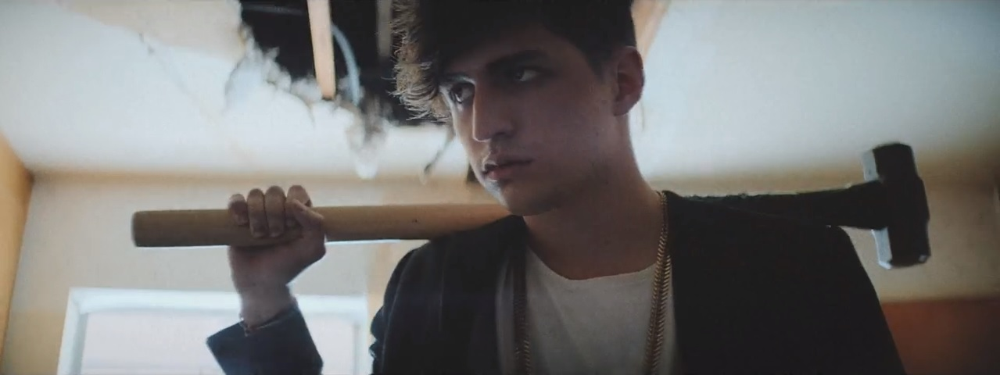
    
> they broke the walls we guarded  
but we don't care about it  
we'll finish what we started  
so promise me that  
we'll be the lionhearted  
for we don't care about it  
we'll finish what we started  
so promise me that they'll fall  
> 
> 
> Porter Robinson, Urban Cone - “Lionhearted” - “Worlds”
> 

Trong số những album tôi nghe ở đại học, ngoài Shawn thì tôi cũng cực kì thích nghe nhạc của Porter Robinson, từ album “Worlds” trở đi. Bài hát tôi thích nhất là “Fresh Static Snow”, sau đó là “Get Your Wish”, “Look At The Sky” của album “Nurture”, nhưng tại thời điểm viết, tôi muốn mang một không khí khác của album, chính là bài nhạc mà tôi cảm thấy phù hợp với đề tài mà tôi sắp viết: “Lionhearted”…

Cảm hứng của album Worlds là những hoài niệm và cảm xúc qua những trò chơi 8 bit, pha cùng với thể loại EDM làm nên thương hiệu. Album này đã làm nên thương hiệu của Porter, và cũng là album chứng minh rằng thể loại EDM không chỉ để cho giải trí. Chính vì lẽ đó, nên tôi vô cùng thích album này và đã tải toàn bộ album gốc với chất lượng cao nhất….

Lời nhạc và giai điệu làm liên tưởng tới tựa game “Space Invaders” với nhịp điệu dồn dập, giống như là có một cuộc chiến giả tưởng đang diễn ra ngay trong đầu. Mục tiêu của người chơi đó là phải bảo vệ thế giới của mình trước khi nó sụp đổ hoàn toàn bởi sự xâm lược của kẻ thù. Hơn hết, nếu bước ra khỏi game, lời bài hát muốn gửi tới một thông điệp lớn hơn về sự dũng cảm, bền bỉ và quyết tâm đánh bại kẻ thù để bảo vệ lãnh thổ và công lý cho chính mình. Vì lẽ đó, bài hát hoàn toàn phù hợp với những gì mà tôi sẽ nói…

---

Phần trước, tôi nói về một điều mà đã khiến tôi thay đổi và chấp nhận khám phá ở mình, đó là việc bản thân không phải là người hoàn hảo và đôi khi, có những phép màu từ những khiếm khuyết ấy. Nghĩ lại, tôi muốn hỏi ngược lại là, ừ, cứ cho là tôi biết về mình như vậy, nhưng cái vấn đề thực tế là tôi sẽ phải có động thái gì để giải quyết những vấn đề đó. Người ta thường nói về sự chấp nhận như là một lẽ tất nhiên, vì đó là phản ứng thực tế của một người tỉnh táo, nhưng điều họ không nói là sẽ phải làm gì tiếp theo. Thiết nghĩ, những điều mà tôi đã làm, thì còn có một yếu tố song hành, đó là một thái độ cứng rắn, quyết tâm dám đối diện với sự bấp bênh và dũng khí để đi qua chính nỗi sợ ấy để thực hiện những điều cần thiết. Đối với bản thân tôi khi đó, tôi đánh giá mình không phải là một người học giỏi, mà là một kẻ lì lợm, một kẻ thua cuộc đáng sợ, giống như một con chó dữ cắn không biết nhả - trừ khi chết mới chịu buông. Nhưng, để có một kiểu tâm lý như chó nghiệp vụ như vậy thì nó là cả câu chuyện dài xây dựng trên những năm lớp 8 ấy….

Câu chuyện bắt đầu từ một kiểu lối chơi mà cả lớp tôi vừa ghét vừa sợ, đó là tính lì lợm. Tôi chơi vật tay với mấy ông con trai ở trong lớp. Tôi thì chỉ có thể lực khá, mà hầu hết mọi người đều có thể lực tốt hơn tôi, thì tôi phải có cách tiếp cận khác để khẳng định bản thân. Nếu như trước đó, tôi chơi với xu hướng là dồn hết lực để áp đảo - cũng là nguyên nhân thua cuộc thường xuyên, thì tôi đổi sang một lối chơi khác cực kì mất dạy, đó là: “**nếu tôi không thể áp đảo, thì tôi sẽ phải cho kẻ đó nếm trải cảm giác ám ảnh về sự thua cuộc của chính mình**”. Để thực hiện, tôi đã dựa trên rất nhiều lần thua cuộc trước đó và luyện tay của mình là: để rất thấp, cách chưa đầy 10cm so với mặt bàn nhưng giữ tư thế đó càng lâu càng tốt. Để đảm bảo tư thế tay như vậy, thì tay phải cực kì chắc và phải đảm bảo giữ như vậy trong thời gian dài, không gì khác ngoài việc lao động chân tay nặng nhọc trong lớp. Kể từ lúc tôi tập luyện tay của mình bằng những trận thua như thế, tôi áp dụng chiên thuật này và mọi người đều nhận xét chua chát: “**chơi với thằng Tuất khó chịu thật sự…**” và chẳng ai dám solo nữa, vì cảm giác thắng mà chả mãn nguyện tẹo nào. Nhưng, dư âm từ lối chơi như vậy, đã tạo thành những nguyên tắc làm việc mà sau này giúp tôi rất nhiều khi tôi phải đối diện với trầm cảm và sự bấp bênh của cuộc sống…

Nhưng, chỉ nhìn vào một trò chơi thì chưa đủ để hình thành một quan điểm sống, mà phải nhìn theo nhiều khía cạnh hơn về hoàn cảnh thực tế khi ấy. Thời điểm ấy là năm lớp 8, tức là thời gian của tôi không còn quá nhiều để tôi có thể kỳ vọng rằng tôi sẽ học giỏi về tất cả các môn, điều này càng trở nên rõ ràng hơn sau những biến cố điểm kém. Tôi cũng đã phải vào đội tuyển mà tôi không thực sự chuẩn bị ngay lúc đầu, đáng ra là tôi có thể vào nhóm Ngoại ngữ nhưng tôi lại chọn Toán - một lựa chọn vô cùng khó hiểu. Một góc nhìn nữa là việc tôi phải chấp nhận rằng tôi chỉ là người bình thường, không còn cái phép màu nào đã xảy ra cả….

Dĩ nhiên, tôi cũng trải qua vô số hối hận, cái cảm giác tự ti xuất hiện mỗi khi tôi tiếp xúc với mọi người. Tôi luôn sống trong cảm giác mà, mình làm cái gì cũng không bao giờ đủ. Tôi từng cố gắng tìm kiếm niềm vui với thành tích, nhưng tôi lại chẳng thể đứng nhất. Tôi cố lừa mình rằng mọi thứ sẽ ổn, nhưng tôi lại không thấy an toàn hơn. Vô vọng - chính là cảm giác của tôi lúc bấy giờ…

Và, cái cách giải quyết khi đó của tôi, chỉ đúng một từ: “**CHAN**”, đúng nghĩa là vậy đó…

---

Nhìn từ góc độ cuộc sống, qua những lần ngã ngựa của bản thân, tôi nhận ra thất bại là thứ hiển nhiên và không thể tránh khỏi. Nếu nhìn từ trận vật tay ấy, tôi chắc chắn mình sẽ thua nếu cứ cố dùng cơ bắp để đấu lại đối thủ mạnh hơn. Nhìn từ việc học, nếu cứ lao vào cuộc đua thành tích mù quáng, tôi sẽ mãi là kẻ tụt hậu, bởi có những người sinh ra đã thuộc về đường đua đó. Sự chán nản trong tôi từng đến từ việc kỳ vọng quá nhiều nhưng lại xa rời thực tế; tôi quá mải miết tìm kiếm sự hoàn hảo nhưng lại thiếu kiên nhẫn với hành trình lớn lên của chính mình. Khi nhìn thấu bản chất ấy, tinh thần trong tôi bắt đầu chuyển dịch…

Việc đầu tiên tôi làm là định nghĩa lại: **“Thế nào là thất bại?”**. Con người thường khao khát chiến thắng nhưng lại trốn tránh việc đối diện với thất bại. Với tôi, điều cốt lõi là làm sao để thua mà không nhục nhã. Bạn có thể thua một trận game, có thể trượt một bài kiểm tra, nhưng nếu cú ngã đó đến từ sự lười nhác và bạc nhược của chính bạn, liệu có đáng không? Bản chất của 'Lionhearted' – trái tim sư tử – không phải là bất bại, mà là không hèn nhát. Thứ đáng sợ hơn thất bại chính là thái độ bạc nhược, buông xuôi, thiếu kiên định trước những vấn đề cần trách nhiệm và sự quyết đoán. Chính sự đầu hàng từ trong tư tưởng mới biến thất bại thành một nỗi ô nhục thực sự.

Từ việc định nghĩa lại thất bại, tôi hiểu rằng điều quyết định thành bại nằm ở thái độ trước trận đánh, và hơn hết, chính là tâm lý chiến. Trước mỗi thử thách lớn, việc đầu tiên tôi làm là nhìn thẳng vào kịch bản tồi tệ nhất. Tôi không chắc mình có thể chuẩn bị hoàn hảo cho mọi tình huống, nhưng tôi buộc bản thân phải rõ ràng về phương án dự phòng cho trường hợp xấu nhất. Chỉ khi tâm trí dám đi xuyên qua bóng tối của sự thất bại, lòng tôi mới thực sự bình yên để dốc toàn lực cho cuộc chiến trước mắt.

Từ nhận thức đó, tôi tự xây dựng một chiến thuật tâm lý chiến độc bản cho chính mình. Tôi từ chối tô vẽ những viễn cảnh hào nhoáng của thành công. Ngược lại, tôi chọn nói về thất bại — nói càng nhiều càng tốt, mổ xẻ đủ mọi kịch bản tồi tệ có thể xảy ra. Để rồi khi mọi thứ đã phơi bày rõ ràng, tôi bấm nút 'reset' và tự nhủ: *'Mình sẽ dọn dẹp sạch sẽ đống hỗn độn này'*. Nếu một chiến binh bước ra trận với tâm thế sẵn sàng hy sinh, liệu anh ta còn gì để do dự? Nếu tôi đã dám chấp nhận kết quả tệ nhất, thế thì áp lực và sự căng thẳng còn chỗ nào để bám víu? Tâm lý chiến chính là như vậy — một tinh thần sắt đá được tôi luyện từ sự rõ ràng về đích đến, đi qua những lần ngã ngựa để đổi lấy một ý chí chiến đấu hết mình, tuyệt đối không chút hối tiếc.

Và cuối cùng, là sự tự tin và thanh thản trong tâm hồn của mình. Tôi nhận ra rằng, dù có trốn tránh đến đâu, thì sau cùng, tôi vẫn sẽ phải đối diện với nó dù theo cách này hay cách khác. Tôi định nghĩa sự tự tin của bản thân, không phải là việc tôi sẽ thắng, mà là kể cả có thua thì tôi đối diện với một thái độ bình thản. Nỗ lực của mình, nếu biết trước thất bại, thì càng trở nên đáng giá. Tầm quan trọng của sự chuẩn bị không phải là khả năng bao phủ được mọi trường hợp, mà là một lá chắn tâm lý vững vàng để khi đối diện với thất bại thì sẽ không suy sụp. Khi đã đối diện và rõ ràng với thất bại, thì sự bình thản là một lẽ đương nhiên, vì ta dồn tâm trí cho việc giải quyết, hơn là chỉ sống quanh quẩn cho việc trốn tránh nó…

Tuy nhiên, chọn cách đối diện với kịch bản tồi tệ nhất không đồng nghĩa với việc tôi cổ xúy cho sự liều lĩnh mù quáng. Bản lĩnh của một trái tim sư tử nằm ở chỗ: dám bước vào hiểm nguy nhưng luôn tỉnh táo để quản trị rủi ro. Nguyên tắc cốt lõi của tôi là phân loại thất bại thành hai nhóm rõ rệt: thất bại có thể tránh được và thất bại không thể tránh khỏi. Tôi chọn ưu tiên xử lý nhóm không thể tránh trước — tức là chấp nhận và đóng băng vùng thiệt hại, sau đó mới tập trung lấp đầy những lỗ hổng có thể cứu vãn. Mục tiêu tối thượng của tôi không phải là lao đầu vào chỗ chết để chứng tỏ lòng dũng cảm, mà là chuẩn bị một tâm thế chủ động nhất cho tình huống xấu nhất. Nếu một vấn đề có thể giải quyết ngay lập tức mà không cần phải tổn hao xương máu, tôi sẽ xử lý nó không một chút do dự. Bởi vì suy cho cùng, mục đích lớn nhất của việc dám đối diện với thất bại chính là để giảm thiểu tổn thất, chặn đứng hậu quả và bảo toàn lực lượng cho những trận chiến dài hơi tiếp theo.

---

Còn để nói về những tác động tích cực mà nó tạo ra, thì tôi sẽ kể về thời kì đen tối nhất ở THPT và chiến lược học tập để đảm bảo không trượt môn trong điều kiện ngặt nghèo. Nổi bật nhất ở đó, hay là ở hiện tại, là phải duy trì song song hai việc đối nghịch với nhau. Một là chuyên môn cá nhân trong tương lai, hai là vấn đề sinh tồn của hiện tại. Tôi không đặt kì vọng quá nhiều rằng mình phải thành công nhưng tôi muốn mình, dù có trượt hay đỗ đại học, thì đều không hối hận với sự chuẩn bị của mình. Cách học của tôi, từ cấp II cho đến hiện tại, là không tập trung vào điểm số hay tốc độ giải đề, mà là việc đọc và hiểu thật sâu một dữ kiện nhất định. Tôi không thể đảm bảo là tôi sẽ học bao quát mọi thứ và có những môn, dù có ôn kĩ tới đâu, cũng không thể điểm cao, nên tôi chọn là chiến đấu hết mình. Nếu kỳ vọng không thể giúp mình an toàn hơn, vậy kỳ vọng làm gì? Nếu trượt môn và trượt đại học quá rõ ràng, thế thì tôi sợ để làm gì? Và cách giải quyết là làm thật chắc bài vở, rồi thi và quên sạch mọi thứ. Tôi muốn mình kết thúc một thời kì bằng việc trôi đi nỗi hối hận, chứ không phải nhớ về nó như một vết nhơ….

Và cuối cùng, tôi muốn các bạn hiểu rằng, nếu các bạn định sẵn là kẻ thua cuộc, thì đừng bao giờ thua theo cách bạc nhược mà hãy chuẩn bị cho chính bạn một đường lui và chiến đấu hết mình, không hối hận vì điều gì…

---

thật ra, tôi không được biết đến nhờ học giỏi, mà bằng nghị lực, cái kiểu mà có thua cuộc cũng sẽ cười hô hố như đã đắc thắng vậy…

có lẽ, thất bại mà được giải tỏa tâm lý là một trải nghiệm trên cả tuyệt vời...

s c o r c h e d e a r t h

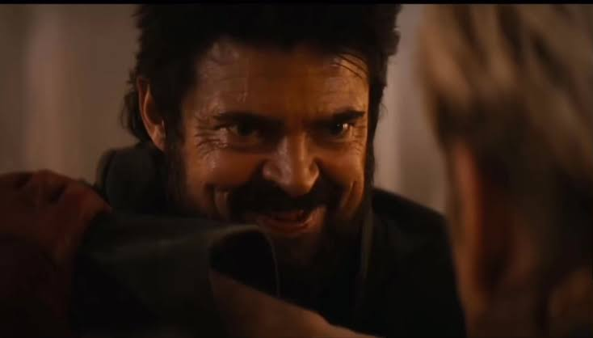

<strong>i can’t get much higher…</strong>

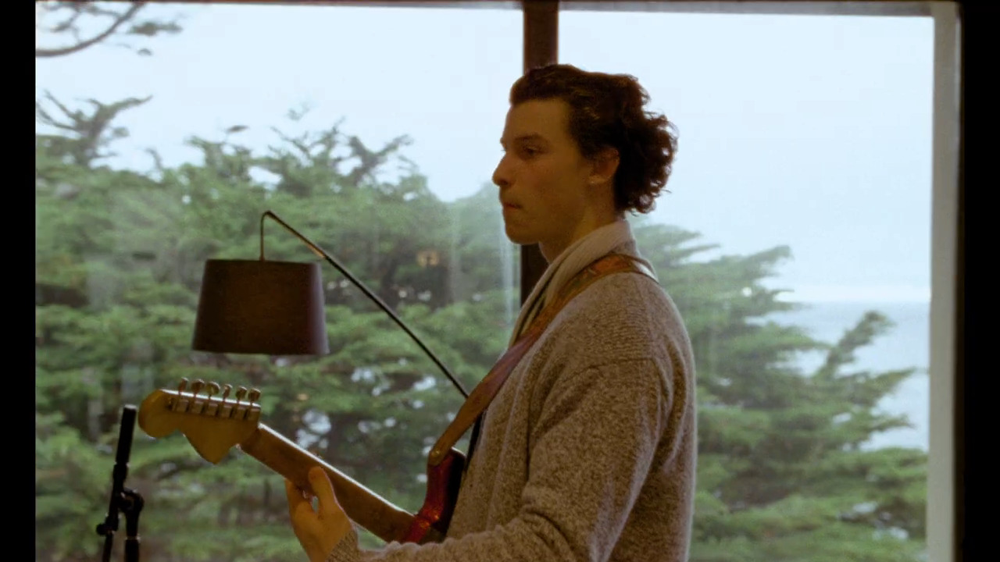

> 
> 
> 
> the drinks are gettin' better,  
> the view is lookin' nice  
> as long as we're together,   
> no, i can't get much higher, high, high  
> no, i can't get much higher  
> 
> let's stay like this forever  
> i'll kiss you every night  
> as long as we're together  
> no, i can't get much higher, high, high  
> no, i can't get much higher  
> 
> Shawn Mendes - “Higher” - “Wonder”
> 

Để nói một chút về đột phá của mình và tổng kết mình đã làm được những gì khi ấy, tôi muốn chọn một bài hát với một tâm trạng vui tươi và năng động nhất có thể, thì đó là bài “Higher” trong album “Wonder” của Shawn. Khác với những bài hát có nhịp điệu chậm trong toàn album, thì bài hát này có một âm hưởng rất khác. Trong bài, đó là một viễn cảnh của một ai đó không thể vui hơn được nữa, khi gần như có tất cả mọi thứ, từ tình cảm, sự nghiệp rồi cuộc sống cá nhân. Đây cũng là bài hát mà tôi từng nghe ở giai đoạn đầu khi vào đại học, khi muốn cho mình một tâm trí sạch sẽ nhất, cũng là điều tôi muốn mình ở năm sau khi mọi thứ đã quá rõ ràng.…

Phải nói như này, kể từ lớp 8, tôi đã không ghét trường lớp tới mức chỉ muốn về nhà. Một trong khía cạnh đó là việc tôi dậy sớm hơn để vận động và tận hưởng một ngày mới. Một phần, vì tôi muốn nhìn thấy crush của mình, nhưng phần khác, tôi tin rằng việc dậy sớm giúp tôi có nhiều thời gian hơn cho bản thân và giúp sức khỏe trở nên tốt hơn. Đến lớp, thay vì thụ động thì tôi tập trung kiểm tra lớp xem có cái gì cần phải lưu tâm, dọn dẹp và đón tiếp mọi người. Với tôi của thời điểm đó, thì ngôi trường khá rộng nên tôi cũng dành thời gian để dạo quanh trường, như là một cách để rèn luyện thể chất trước khi bước vào giai đoạn học tập căng thẳng. Xét trên mặt thể chất, việc có một tâm lý tốt giúp tôi giữ được thể chất ổn định, đặc biệt là tôi có thể chạy và duy trì tốc độ trong một khoảng thời gian rất dài - điều mà ngay cả hiện tại, tôi cũng rất khó để duy trì tình trạng thể chất đó. Dậy sớm, đi học và luyện tập thể dục hàng ngày, đã trở thành một cái chu trình sống cơ bản của những năm tháng ấy, trước khi tôi trầm cảm.

Tiếp theo, đó là việc học và cách giải quyết vấn đề trong cuộc sống của mình. Vì tôi biết mình học không giỏi hơn so với mọi người, nên tôi giải quyết bằng một thái độ vui vẻ và cởi mở. Tôi không thể biến bài khó thành một bài dễ, nên tôi tập trung giải quyết thật tốt những gì mình có thể làm, thay vì phải đâm đầu trở thành một người quá hoàn hảo. Dù học tập trên trường có căng thẳng tới đâu, một thái độ cởi mở giúp tôi vận hành mọi thứ trơn tru hơn so với việc phải làm phức tạp hóa mọi thứ lên. Ngay cả cuộc sống của tôi cũng dễ thở hơn rất nhiều, khi tôi quyết định không kỳ vọng quá nhiều, nhưng lại nhận về rất nhiều thứ.…

Cuối cùng, đó là chuyện tình cảm và những mơ ước về tương lai. Ngay cả ở hiện tại, tôi cũng thật sự thích cái con người của mình năm ấy, khi đã quyết định cởi mở hơn và đã thay đổi mình rất nhiều. Đáng ra năm ấy, nếu như tôi không có tình cảm, thì chắc tôi không rõ ràng như bây giờ. Việc một ai đó giúp tôi mở lòng với thế giới, chấp nhận mọi sự khác biệt và giúp tôi sống tử tế với mọi người xung quanh, đã giúp tôi rất nhiều trong việc định hình bản thân rằng mình muốn trở thành ai đó trong một tương lai dài hạn. Nhìn lại chuyện tình cảm ấy, tôi không tiếc nuối vì đã sống hết mình, mà chỉ là thời điểm đó, mọi thứ đã không thể kéo dài như cách mà tôi mong muốn, và khi trở lại hiện tại, tôi biết chuyện tình cảm và những ước mơ ấy, đã không thể trở lại ban đầu, nhưng tôi vẫn sẽ cố gắng hết mình ở hiện tại, vì tôi đã có một con người mà tôi không phải xấu hổ khi nhìn lại..…

Thật khó để diễn tả thành lời, nhưng đó là năm ý nghĩa nhất mà ngay cả ở hiện tại, tôi cũng muốn bản thân vui vẻ như thế.....

    
<strong>never be alone…</strong>

    
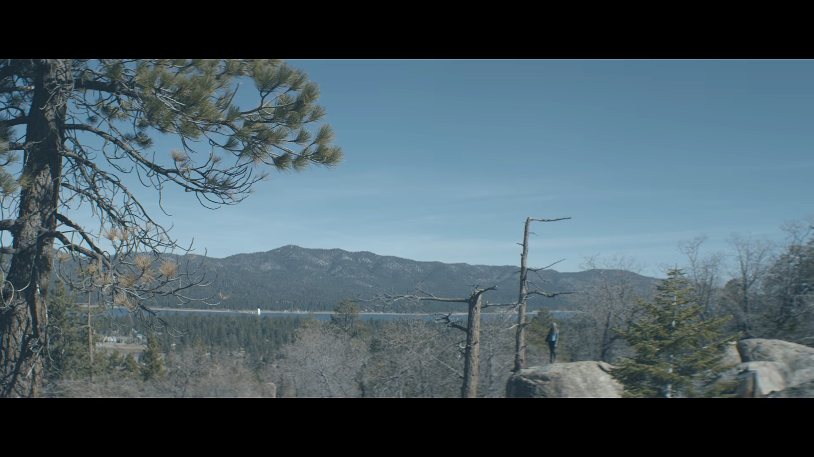

> i promise that one day i'll be around  
>i'll keep you safe  
>i'll keep you sound  
>right now it's pretty crazy  
>and I don't know how to stop  
>or slow it down  
>
>hey  
>i know there are some things we need to talk about  
>but i can't stay  
>just let me hold you for a little longer now  
>
>take a piece of my heart  
>and make it all your own  
>so when we are apart  
>you'll never be alone  
>you'll never be alone  
>
>Shawn Mendes - “Never Be Alone” - “Handwritten”
> 

the translation:

> 
> 
> 
> “em ơi,  
> anh biết chúng ta còn rất nhiều điều muốn thổ lộ…  
> nhưng anh không thể nán lại lâu hơn…  
> vậy hãy để anh ôm chặt em thêm chút nữa.…  
> 
> xin hãy nhận lấy tấm chân tình của anh  
> và để chúng là của riêng em  
> dù hai ta mỗi người một ngả  
> em sẽ không bao giờ cô độc một mình.…”  
> 

---

Trước khi viết cho phần kết của giai đoạn này, tôi muốn giới thiệu một bài hát vô cùng ý nghĩa mà nhiều người chắc sẽ biết. Album chính thức đầu tiên của Shawn có tên là “Handwritten”, nơi chứa những bài hát đầu tay, chắc các bạn sẽ biết đến “Stitches” nếu có nghe nhạc US-UK trong giai đoạn 2015 - 2016. Trong cái album ấy, bài tôi thích nhất và cảm thấy hợp để viết một phần kết cảm xúc, là bài “Never Be Alone”, bài hay tới nỗi mà mỗi chuyến lưu diễn lớn của Shawn đều biểu diễn vì nó mang cảm giác gần gũi và chạm đến trái tim của tất cả mọi người.…

Về nội dung của bài hát, như Shawn kể rằng, bài hát giống như một bức thư gửi đến những người thân, không nhất thiết phải là người yêu, có thể là mẹ, là bạn bè, hoặc những người xung quanh. Bài hát giống như một lời tạm biệt trước khi phải đi xa, mong ước đến một thời điểm có thể ổn định giữa sự nghiệp và cuộc sống cá nhân. Vì ý nghĩa nhân văn ấy, sau rất nhiều bài hát khác nhau, tôi lựa chọn vì nó rất giống một hồi kết mở, thay cho những lời tôi chưa thể nói với tất cả mọi người ở thời điểm đó và cũng như ước mơ rằng đến một thời điểm, chúng ta sẽ hạnh phúc dù chúng ta không còn cơ hội gặp được nhau nữa…

Nhưng, trước khi kết thúc một chương đẹp đẽ của tuổi trẻ này, tôi rất muốn được nói vài điều, mà đáng ra, nếu như tôi biết lần đó là lần cuối tôi gặp mọi người, tôi đã nói ra sớm hơn.…

---

Tôi viết ra những dòng này, trong một trạng thái mà không giống lắm những gì được viết ra trước đó, chính xác hơn là tôi viết bản phụ lục này sau 10 năm tính từ thời điểm tôi bắt đầu mọi thứ, là bao gồm cả giai đoạn trầm cảm nhất trong sự nghiệp của mình. Trong suốt những năm tháng phải đối diện với chứng bệnh tâm lý khủng khiếp ấy, ngay cả hiện tại, tôi không biết phải lựa chọn cái hướng đi của mình sao cho hợp lý, khi thứ tôi biết đầu tiên chỉ là những nguy cơ và thất bại luôn trực chờ cho từng quyết định, riêng vấn đề trầm cảm thì tôi có viết chi tiết để kể về những hậu quả sau đó. Nói tóm lại là, tôi thấy hiện tại khá chán, cho dù tôi nói rằng tôi đã quen với sự chán nản hàng chục năm. Thật sự rất khó để nghĩ về một tương lai quá tươi sáng khi thứ mà bản thân biết - chỉ là những ngày xám xịt.…

Dĩ nhiên, vẽ một tương lai tươi sáng thì khó, viết theo kiểu vinh quang hóa trầm cảm kiểu: “**no pain no gain**” hay kiểu “**phải tổn thương thì mới trưởng thành**” thì nó rất độc hại, thiếu sự cảm thông và cực kì giáo điều, dẫn đến không thể giúp mọi người hiểu ra vấn đề và những điều cần phải thực hiện ở tương lai. Thế nên tôi mới bắt đầu ở giai đoạn trước khi trầm cảm xảy tới và những trải nghiệm khi viết ra những lời này đã giúp tôi rất nhiều trong quá trình đối diện với mặc cảm, tìm kiếm niềm vui, thấu hiểu học hỏi bản thân và hơn hết, để bắt đầu một con người vốn quen thuộc với chính mình, thay vì phải cố gắng trở thành một con người xa lạ…

Thật ra, ở lớp 8, tôi chưa bao giờ kỳ vọng gì ở bản thân, nói trắng ra là tôi gần như muốn buông xuôi nhưng vẫn phải cố gắng sống tiếp. Để có thể đi tiếp, tôi thay đổi suy nghĩ khá nhiều và nhận ra rằng, ở trong cuộc sống lặp đi lặp lại ấy, tôi đã làm những điều mà tôi chưa bao giờ hối hận và làm từ chính trái tim lẫn tâm trí của mình. Ban đầu chỉ là việc chấp nhận mình không phải là trung tâm của cuộc sống ấy, trở nên vô tư - thấu hiểu mọi người hơn, rồi đến việc từ bỏ kỳ vọng về thành tích, chiến đấu cảm tử, rồi cả tình yêu và hơn hết, nó phác họa cho tôi một con người mà tôi muốn hướng tới ở hiện tại. Tôi không dám chắc mình có thể gọi là “trưởng thành” khi bản thân vẫn còn mang nhiều mâu thuẫn, chỉ là trong mỗi quyết định lớn, tôi đã vô tư và làm hết mình. Tôi nhớ đến bản thân mình và trân trọng điều ấy.…

Để viết ra phần kết thúc này, với bài nhạc ấy, tôi không coi đây là một lời tạm biệt, mà nó giống như một lời nói còn dang dở cho những người ở trong hồi ức đấy. Điều khiến tôi cảm thấy chút buồn, không phải là tôi hối hận vì đã sống, mà là trước khi phải chia tay họ, tôi đã không thể nói một lời cảm ơn hay xin lỗi, hay là một lời chia tay tử tế. Đi qua 10 năm, trong đó 8 năm của trầm cảm và viết lại những cảm xúc này, nó vẫn là một thứ rất khó để diễn tả bằng câu chữ, mà chỉ có thể là trải nghiệm của cá nhân mới lột tả hết được. Đến một thời điểm mà tôi hiểu được những gì tôi nghĩ khi ấy, thì mọi thứ đã không còn như trước, và cơ hội để gặp lại - gần như là chạm đáy khi mỗi người đi một ngả, chia xa là mãi mãi.…

Nhưng điều lớn nhất, tôi hiểu được khi viết phần kết này là, chuyện chúng ta gặp lại nhau hay không, thì không thể dự báo được, mọi người còn nhớ hay không, cũng chẳng tác động quá nhiều tới những gì tôi đang viết, mà là những điều đẹp đẽ còn sót lại sau hàng đống biến cố ấy. Khi tôi hệ thống hóa những quan điểm của bản thân trước khi trầm cảm, tôi đã xác định trước một thực tế, như cái điểm xuất phát của nó, là cuộc sống không phải lúc nào cũng diễn ra theo cách ta muốn, nhưng ta có thể chọn cách đối diện với điều đó. Cái sự tương đồng ấy khiến những bài học năm lớp 8 có một giá trị lớn về tư tưởng và chiến lược, rằng tôi có thể lựa chọn khác đi để dừng lại một cái guồng quay của sự hủy hoại và cho bản thân một cơ hội để tiến tới một tương lai tươi sáng hơn. Thật khó để hiểu ra điều này nếu như không có sự hỗ trợ của các bạn, thật lòng là vậy.…

Tôi viết hồi kết cho phần “**trước khi trầm cảm**”, nhưng tôi muốn những gì tôi viết là mở đầu cho một con người mà tôi phải bỏ lại trong nhiều năm. Như bài hát ấy: “**để khi hai ta chia xa, em sẽ không bao giờ cô đơn...**”, tôi nghĩ đây giống như một lời mở đầu và nút “tiếp tục” cho cả một chặng đường dài còn dang dở, chỉ là giờ, tôi chấp nhận mình sẽ mang theo những thiếu vắng ấy mà không suy sụp hay áp lực không đáng có…

Tôi muốn nhắc lại rằng, đây không phải là lời tạm biệt, vì tôi vẫn tin rằng kể cả mãi mãi không gặp được nhau, chúng ta ít nhất vẫn sẽ sống và đi qua những sóng gió của đời mình, để trở thành một ai đó mà chính chúng ta tin tưởng nhất.…

tôi đã đi qua suy sụp ấy đủ lâu, và tôi muốn sống cho hiện tại, và tiếp tục cái hành trình còn dang dở ấy để đến với một tương lai đúng nghĩa..…

---

i really miss you....

from: bronstein.…
to: someone in grade 8…

est. 2016

# the downfall…

> my body’s on the line now  
>i can’t fight this time now  
>i can feel the light shine on my face   
>did i disappoint you?  
>will they still let me over?  
>if i cross the line…  
>
>Twenty One Pilots - “The Line” - “Arcane OST”
> 

ít nhất, thì Viktor còn có thể nói lời tạm biệt…., còn tôi thì không.

đó có lẽ là buổi bế giảng cuối cùng khi tôi còn thấy crush, bạn bè và thầy cô….

đó cũng là mùa hè cuối cùng của niềm vui….

tôi chẳng thể chia tay tử tế, và tôi không nghĩ đó là ngày cuối cùng….

tôi chẳng nghĩ là sau đó, lại tới một mùa đông chừng 8 năm….

và tôi chẳng nghĩ, sau những niềm vui ấy là sự suy sụp và tra tấn dã man…..

nó quá ngắn để viết thành một câu chuyện, nhưng đủ day dứt để nhìn lại….

tôi ước bản thân mình đã có thể nói lời từ biệt ấy và không phải mang theo những day dứt ấy tới hiện tại….

# long depression…

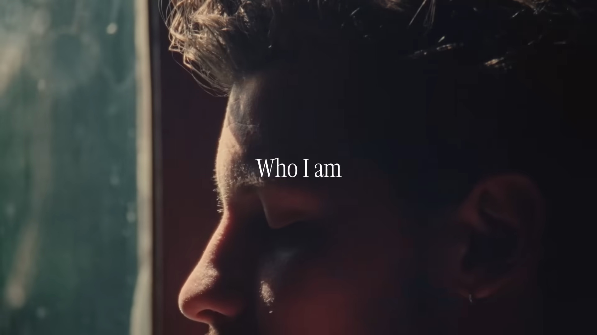

> and it broke my heart  
>when i cancelled tour  
>had my soul and my head  
>going back and forth….  
>
>and i don’t know  
>how i’m gonna face you now  
>sorry, gotta do it, gotta let you down  
>
>’cause i don’t really know  
>who i am right now  
>no i don’t understand  
>who i am right now  
>
>so i bought a new place  
>in a warmer town  
>
>no i don’t really know  
>who i am right now…  
>
>Shawn Mendes - “Who I Am” - “Shawn”
> 

Đôi lời về bài hát, đây là bài “Who I Am” của Shawn. Khoảng thời gian từ 2021 cho tới 2024 là quãng thời gian Shawn trải qua biến cố tâm lý nặng nề nhất, đầu tiên là chia tay, sau đó là sức khỏe tinh thần dẫn đến hủy tour, thậm chí là còn có chuyện tình cảm tay ba tốn nhiều giấy mực nữa - các bạn có thể tự tìm hiểu. Theo như anh ấy kể lại, thì đây là bức thư gửi tới người hâm mộ khi hủy tour, đó là cảm giác vô định và trầm cảm khi không thể trở thành một hình mẫu như người ta vẫn mong đợi. Mở đầu của album chính là bài hát chỉ có lời xin lỗi với câu: “**vì tôi chẳng biết tôi là ai, và tôi cũng chẳng hiểu mình là ai nữa**”. Tôi nghĩ bài hát này vô cùng phù hợp với cái chủ đề trầm cảm ấy, vì đó là một thế giới mà giờ nghĩ lại, chính tôi cũng cảm thấy rất xa lạ với một hình ảnh bị quy chụp như là một quái vật hay là một kẻ thích vi phạm nội quy. Chính bài hát ấy là một phần cảm hứng để tôi quyết định nói về những sự thật về mình, về thời điểm ấy và nỗ lực ở hiện tại để quay về một hình ảnh quen thuộc mà tôi luôn muốn bảo vệ.…

Trước khi tôi đến những phần khác, hay là những chapter sau, thì tôi nghĩ là mình nên đối mặt với những sự thật mà trước giờ mình từng che giấu. Thật lòng thì giờ, tôi chẳng biết phải mở bài như thế nào, vì cứ nghĩ đến khoảng thời gian ấy, trái tim tôi không thể nào ngừng cảm thấy tan vỡ và thấy trống rỗng, nó không khác gì chìm dần vào biển sâu của những kí ức đau khổ mà chẳng biết khi nào sẽ có thể trở lại. Nhiều người, ngay cả những người anh em, bạn bè hay gia đình đều không muốn tôi viết phần này, sự thật là vì nó vô cùng thảm khốc đối với cả cá nhân họ nữa và tôi hoàn toàn hiểu tại sao họ nghĩ như vậy. Trong tôi có một mâu thuẫn khá rõ ràng ở hiện tại, một mặt, là tôi phải cố gắng tìm ra một hướng đi cho riêng mình và mặt khác chính là cái nỗi sợ khi mà quá khứ ấy ẩn khuất trong chính trái tim của mình, tôi rất muốn đi tìm một hướng đi nhưng thứ hướng đi rõ ràng nhất mà tôi biết, chỉ có nỗi đau mà tôi đang cố gắng để thoát ra. Cũng vì lý do đấy, tôi sợ rằng việc mình kể lể quá chi tiết tất cả mọi thứ lại khiến tôi rơi vào trạng thái suy sụp lần nữa, và trong nhiều năm, tôi đã cố gắng không kể những gì đã từng diễn ra ở thời điểm ấy, giống như một cái phong ấn vậy. Mọi chuyện bình lặng như vậy cho tới hiện tại.…

Cái lý do ở phần bề mặt, cho cái phần “quãng trầm cảm dài”, chính là những gì đã diễn ra ở hiện tại. Như tôi có nói ở intro, thì tôi trải qua một đợt kiệt sức tâm lý trong một khoảng thời gian tầm nửa năm tính từ lần đầu mới đi làm, thật ra thì đã rất nhiều lần tôi cảm thấy như vậy. Nếu với những thời điểm trước, tôi ít nhiều vẫn có cái cớ để coi như không có gì, có thể lấy game ra chơi hay học thật nhiều, thì giờ tôi phải học cách đối diện với chính cái tương lai tàn khốc, cũng từ cái cảm giác ấy, những ám ảnh ấy một lần nữa lại xuất hiện và ám tôi trong một khoảng thời gian. Cái tần suất của những lần đó diễn ra nhiều tới mức mà nhiều khi tôi phải hỏi rằng tại sao tôi lại cảm thấy mọi thứ nó nhiều khi dễ chán nản, như một người đã hoàn toàn bị mất vị giác, ăn gì cũng không thấy ngon miệng mà chỉ thấy nhạt thếch. Cũng từ cái vỡ mộng khi đi làm và những tần suất khi ấy khiến tôi quyết định tự mình đi tìm hiểu tại sao mọi chuyện lại như vậy.... Với tôi thì, để đến với hiện tại, thì đối diện với cái quá khứ ấy không dễ dàng một chút nào và nó cần nhiều dũng khí hơn chỉ là vài câu nói suông: “rằng mọi chuyện nó sẽ qua”.

Thật ra, viết về quá khứ của mình thì tôi đã kịp viết khá nhiều rồi, nhưng đây là lần đầu tiên tôi đối diện và cho mình một cơ hội để nhìn nhận bản chất của vấn đề. Nếu những lần trước, tôi viết trong một trạng thái kiểu: “mọi chuyện sẽ qua đi” - một câu như giả vờ rằng mình sống tốt, thì bây giờ, dù không kể lể quá chi tiết, tôi viết với một mục đích lớn hơn, đó là một chút sự thương xót, cảm thông và nói rõ ràng tại sao cái cuộc đời tôi nó thảm hại tới vậy. Có một điều mà tôi học ở hiện tại, đó là nếu bạn muốn một quá khứ qua đi, thì bạn phải thật sự đối diện với chính nó, kể cả khi cái quá trình đối diện ấy mang đầy nỗi đau và có thể kéo bạn xuống vực sâu. Tôi có nói với em tôi như này:

> “Với anh, chúng ta không khơi lại hận thù, nhưng nên biết rằng, đã có những chuyện từng xảy ra, nó là thật và hậu quả nó để lại vô cùng thảm khốc đối với chúng ta..…”
> 

Còn sâu xa hơn, thì có một sự thật mà các bạn nên biết, là hầu hết những gì tôi cố gắng ở đại học chính là những nỗ lực để tôi bước ra khỏi bóng tối ấy, và bản chất của từng quyết định khi tôi làm lớp trưởng, đều có dấu vết hằn sâu những tổn thương tâm lý mà tôi luôn phải đối mặt. Ở hiện tại, tôi nghĩ là khi nói tới bản chất của repo, thì chính tôi cũng phải thừa nhận rằng, nếu như có một món quà mà giúp cho cậu trai trầm cảm ấy, thì chắc cái repo là món quà đẹp nhất. Cậu ấy sống trong biển nước mắt, những con người xa lạ, sự ngột ngạt và mất đi tiếng nói của chính mình. Vì lẽ ấy, repo chính là hiện thân của ước mơ bên trong con người ấy, rằng một con người có trách nhiệm, dùng tiếng nói và hành động của mình để đả phá một thế giới của sự bất công, một ai đó mà các bạn có thể tìm đến lắng nghe và chia sẻ. Có lẽ, nếu cậu ấy mà đọc được những dòng phân tích môn học và giảng viên, chắc cậu ấy sẽ khóc mất vì trước đó, chưa một lần nào cậu ấy được phép nói ra, kể cả những yêu cầu nhỏ nhặt.…

Giờ sang phần nội dung, tôi chắc chắn sẽ không kể lể nhiều, vì tôi không muốn cái repo này đi công kích trực diện một ai đó với những chuyện mà thời điểm ấy, chính họ không hề biết rằng cái mức độ nghiêm trọng của hành vi họ gây ra, nhưng điều đó cũng không có nghĩa là tôi lại giảm đi tính trung thực - tất nhiên những cái gì tôi đã kể thì tôi có kể rồi, đây chỉ là giải thích thôi. Thứ tôi muốn tập trung nhiều hơn đó là những gì đã diễn ra ở cá nhân tôi, khắc họa cái xã hội mà tôi từng sống và tại sao lại có những quyết định như ở phần repo đầu tiên. Dĩ nhiên, nó có thể sẽ nhiều nước mắt nên phần này sẽ khá dài và nhớ chuẩn bị cả khăn giấy.…

Cuối cùng, trước khi đi vào phần bi kịch, tôi muốn nói về bản thân là... tôi không phải một thánh thần, và nếu cho tôi một cơ hội, tôi cũng không mong muốn mình phải trải qua một tuổi trẻ lắm bi kịch đến thế. Nhưng, nên nhớ rằng, nếu như muốn chống lại cái hậu quả từ chính quá khứ, thì chính chúng ta phải học cách đối diện với những sự thật ấy, dù có đau khổ đến đâu.…

> “một quyết định có sức nặng, chỉ khi người đưa ra nó đã phải trải qua cả một đời hối hận để dám mạnh mẽ đưa ra....”
> 

so, get into it...

    
<strong>there is no war in ba sing se</strong>

Trước khi vào câu chuyện, thì giới thiệu cái tiêu đề chút, một chút châm biếm về môi trường học tập khi ấy, và tại sao lại có câu kia. Thì, câu đó trích từ một cái meme cực kì nổi tiếng: “k**hông có chiến tranh ở Ba Sing Se**” với hình ảnh của một cô gái luôn cười và theo sát nhân vật chính, nói đi nói lại cái câu kia. Câu nói trên nhằm chỉ trích và châm biếm sự dối trá, khi người ta liên tục phải tìm cách để che đậy sự thật, lừa người khác tin rằng mọi thứ vẫn ổn và chẳng có gì xảy ra. Điều đáng sợ của những lời nói dối, đó chính là khi những lời nói dối ấy được nói quá nhiều và che đậy quá nhiều thứ, thì sau này người ta cũng chẳng biết sự thật nó nằm ở đâu và luôn phải tìm cách che đậy bằng chồng chồng lớp lớp những lời nói dối. Điều tệ hại hơn, là đến khi sự thật trỗi dậy, nó sẽ tạo thành một cuộc khủng hoảng niềm tin và mang sức hủy diệt, vì lúc này người ta chẳng còn biết phải tin vào điều gì nữa. Thì, trước khi tôi muốn phân tích sâu hơn ở các phần sau, thì tôi muốn bóc trần và tổng quan những gì thật sự diễn ra trong hàng ấy năm tôi đi học, những lời nói dối, cái bản chất mục nát mà ngày ngày tôi phải chịu đựng. Từ trước tới nay, tôi luôn muốn dành cho mình một cơ hội để nói thật và để bóc trần sự thật trong nhiều năm mà tôi luôn che giấu, đến lúc để tôi nói về những điều ấy rồi...

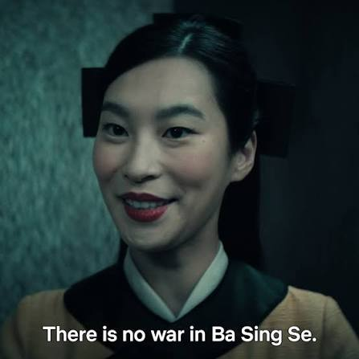

Để nói thông tin về tôi - người viết những dòng này, tôi xin phép dùng tên thật của mình. Tôi là Nguyễn Hoàng Tuấn Anh, học sinh khối A: 10A1 tới 12A1, niên khóa 2018-2021, tôi xin phép được giấu tên trường THPT của mình, và xin phép được gọi là trường Y. Câu chuyện về THPT của tôi xuất phát tầm sau một tháng biết điểm, khi chính thức nhập học. Nhà tôi cũng trải qua một đợt cãi nhau chỉ vì chuyện học tập của con cái - điều mà tôi từng viết vào một bản nhật kí cá nhân, chỉ vì điểm thi của tôi không thể cao hơn những đứa khác. Tôi vào được lớp chọn, cũng phải thừa nhận là tôi dùng mối quan hệ để vào - điều đó chính là lý do mà người ta công kích gia đình và người quen của tôi sau đó. Một chút ảo mộng rằng, ở THPT, tôi có lẽ đã tìm kiếm được niềm vui trong cuộc sống bình thường, có thể tìm thấy bạn bè mới hay là những thầy cô quen thuộc hơn mà không phải đi quá xa..., nhưng thực tế lại cho một bộ mặt khác. Khoảng thời gian học tập ở đó cũng là lúc trầm cảm phát tác, ngoài áp lực học tập nặng nề, còn là cảm giác cô đơn, thiếu vắng bạn bè, sự giám sát quá mức, những sự đổ vỡ trong gia đình,.. Khoảng thời gian ấy, trầm cảm, lo âu và mặc cảm đi cùng tôi kể từ đó tới tận bây giờ, và lớn hơn, nó dần khắc họa điển hình của một nhà nước phát xít đúng nghĩa: dùng thành tích và những định kiến lịch sử đàn áp giai cấp và bao biện cho sự bất bình đẳng. Kèm theo đó, trong khoảng thời gian ấy, tôi cũng nhận phải những tin xấu và những thất bại lớn rất khó phai nhòa, bao gồm chuyện tình cảm tan vỡ khi crush có người yêu, kết quả yếu kém ở các cuộc thi mà đáng ra tôi có cơ hội chứng tỏ bản thân hay cả sự phản bội đến từ một người mà tôi đã từng thân thiết bằng sự im lặng của cậu ta. Tôi vẫn muốn chắc nịch rằng, kết quả thành tích thi đại học có tốt tới đâu, cũng không thể khiến cho chứng bệnh tâm lý nhẹ hơn, và do đó, càng không thể lấy đó làm vinh quang được. Chính quá khứ đầy hủy hoại là nền tảng của những quyết định khi tôi lên đại học, rõ ràng hơn khi tôi làm lớp trưởng và rõ ràng nhất ở cái repo này. Tôi muốn nhắc lại rằng không có cái vinh quang nào từ việc bóc lột và vắt kiệt cảm xúc, thể chất và trí tuệ của người khác để làm lợi cho mình, để nhân danh một ảo mộng nào đó không có thật…

Phần này sẽ tổng quan những gì đã xảy ra, tóm tắt lại cả 2 bản nhật kí cá nhân: 2018 - 2019 của tôi...

---

Để hiểu về những tháng ngày bi kịch ấy, thì phải biết cái cách nó bắt đầu như thế nào. Mấy ngày đầu đi học, thì phần nào gia đình tôi khá kỳ vọng vào cái chuyện tôi sẽ học thật tốt ở một ngôi trường mới và có khi sẽ kiếm được vài mối quan hệ khác như để bù đắp lại những tháng ngày mà tôi phải trải qua. Về khía cạnh này thì tôi không ghét hay hận gì bà ấy, thậm chí là có phần cảm thông khi ai ai cũng muốn con mình đi học cũng sẽ được nhớ tới như một người có học lực tốt, và tôi cũng rất kì vọng ở điều này. Thời điểm ấy thì mối quan hệ giữa tôi và mẹ tôi cũng không mấy nhẹ nhàng, thậm chí là có phần căng thẳng tột độ, cái thứ mà mẹ tôi vẫn vừa tự hào vừa buồn cũng chính là một thực tế: ngoài việc học tôi tốt thì chả có gì thật sự khá khẩm ở cái thời kì đó cả. Vì cái vết sẹo ấy mà nhiều lúc, mẹ tôi không muốn tôi nhắc về cái chuyện khi ấy, dù bà đã từng quá tự hào về cái thành tích học tập. Một ngày đi học nọ, tôi cố gắng như bao nhiêu học sinh bình thường, thậm chí là có phần hơi quá sức. Tôi học trên lớp rất tốt, nhưng cái kiểu học ít ghi chép vẹt tự dưng lại trở thành một ấn tượng xấu đối với giáo viên và học sinh lúc bấy giờ. Riêng cái ngày đầu tiên tôi đi học...., lại là cái ngày tôi không muốn nhắc đến nhất…

Ngày ấy, tôi vô tình quên mang sách và vở ghi chép môn Lý thì phải, tôi không trách người dạy khi ấy, là cậu tôi vì thực tế, cái quan điểm của cậu tôi khi ấy hoàn toàn có thể hiểu được là cần phải nghiêm túc, chỉ là cái góc nhìn khi ấy nó quá khác nhau mà thôi. Tôi quên không mang vở, cả lớp phát giác, tôi bị chỉ trích đủ thứ. Ấn tượng khi ấy người ta biết về tôi cũng tệ đi kể từ ngày tôi quên sách vở. Thế là, nguyên ngày hôm ấy, về nhà là một trận no đòn từ mẹ tôi chỉ vì chuyện quên sách vở. Tôi thừa nhận là mình sai khi quên sách vở, nhưng tôi nhận ra một vấn đề còn tồi tệ hơn sau đó, chính là việc người ta lợi dụng cái chuyện đó để gây áp lực lên gia đình tôi thông qua mối quan hệ ấy, và khủng khiếp hơn, đó tạo ra một mạng lưới giám sát khổng lồ ngấm ngầm hoạt động, một mạng lưới mà tôi không hề biết chúng ngay từ đầu. Kể ra thì, ngày ấy, từ những câu mắng của mẹ, tôi dần cảm thấy việc đi học không khác gì đi trên một bãi mìn, vì một cái sơ sẩy là đi một mạng người, một cái cảm giác sợ hãi mà nhiều lúc tôi chỉ muốn ở nhà và không thèm ra ngoài. Chuyện cũng chỉ là một thứ rất nhẹ nhàng, đáng ra có thể xử lý nhẹ nhàng, đóng cửa bảo nhau nhưng với tôi, nó in sâu vào đầu tôi như là cái cảnh tượng khi một quả mìn nó nổ chỉ vì một sơ suất nhỏ. Và bạn biết cái cách giải quyết vấn đề tôi khi ấy là gì không??? Tôi mang toàn bộ sách ở nhà đi học luôn, đỡ phải kiểm tra cho mệt đầu, ngoài việc tôi hay quên, thì còn là cái kiểu mà trong đầu tôi nghĩ:

> “Đấy, sách tôi mang đây này, kiểm tra cho đã đi nhé!!!!!!”
> 

Nhưng dĩ nhiên, chuyện quên sách vở cũng chưa căng lắm, vì cái cách giải quyết ấy dù khiến mẹ tôi khá giận nhưng cũng không nói được gì, cũng như việc sau đó, mẹ tôi dần cảm thông hơn với cái cách học của tôi và kiểu: “ừ, nó không mang sách cũng chả sao”, may mắn là cái cách học của tôi thì giúp tôi rất nhiều, chỉ là nó đã không còn quá thoải mái như ngày trước thôi…

---

Đi tiếp câu chuyện, chính là những gì diễn ra khi tôi ở trong trường học, từ trong lớp và ngoài lớp. Như tôi có nói, trong 3 năm học thì tôi chưa một lần nào phải chuyển lớp mà vẫn giữ lớp chọn, trong giai đoạn mà nhà trường vẫn giữ cái quy luật mang tính “nhân tài trị” và “ăn thịt đồng loại”, chỉ riêng điều đó đủ chứng minh rằng tôi học không tệ, nếu không muốn nói là học rất tốt. Nếu chỉ được phép chọn một trong hai: học giỏi hoặc có nhiều bạn tốt, thì tôi muốn chọn số 2. Chỉ tiếc là, trong thế giới của những kẻ học giỏi và đứng đầu, tình bạn và sự cởi mở không đảm bảo vị thế của họ. Cái góc nhìn này, tôi sẽ giải thích sâu hơn ở phần: “meritocracy, inequality and cannibalism” để nói về góc nhìn ấy.

Để nói về lớp học của tôi thời THPT, trong nhiều năm tính từ lúc bắt đầu cho đến bây giờ, thật sự rất khó xử để tôi có một cái đánh giá dễ chịu về họ, nếu không muốn nói là phải đến bây giờ, tôi mới khó khăn lắm thì mới dần bớt tiêu cực khi nghĩ về họ. Tôi đánh giá theo một góc độ pháp lý khó mà có thể đưa ra một cách giải quyết hoàn chỉnh: “**một đứa trẻ nhỏ tuổi gây ra chuyện lớn, thì nên phân xử thế nào?**”, nó chứng tỏ một khó phân xử mà chỉ có thể nói một cách cay đắng: “**không thể truy cứu nhưng cũng không thể dung túng...**”. Sự thật là, khi ấy, họ còn chưa lên 18 tuổi, khiến cho sự im lặng của họ hoàn toàn có thể hiểu được - đặc biệt là trong cái môi trường bị giám sát chặt chẽ, nhưng xét đến cái việc họ im lặng trước mọi chuyện, cũng như những gì tôi phải đối mặt với lớp lúc bấy giờ, nếu như nó diễn ra ngay tại cái lớp mà tôi đương chức lớp trưởng, thì cái sự im lặng ấy không thể chấp nhận được, thô thiển hơn thì gọi là “**không có tình người**”. Chính cái nghịch lý ấy mà sau này khi đương chức lớp trưởng, tôi cho phép và yêu cầu sự trung thực tuyệt đối từ tất cả mọi người cũng như sự tôn trọng tối thiểu giữa các thành viên trong lớp dù có ghét nhau tới mấy. Nói kĩ hơn, thì thời điểm ấy, cuộc sống chỉ có việc đi học trên lớp và học thêm, mọi thứ diễn ra trong một trạng thái mà gần như không ai có thời gian để làm bất cứ cái gì. và đặc biệt hơn, họ có quan điểm và tính cách rất khác với tôi, nếu không muốn nói là vì những mâu thuẫn và sự khác biệt ấy, chính tôi đã chọn rời bỏ đi và cắt đứt vài mối quan hệ trong một khoảng thời gian rất dài.…

Có một chuyện mà khiến tôi nhiều lúc cảm thấy không thoải mái, chính là những bất đồng nhỏ lại xé ra to. Cái khoảng thời gian đầu tiên khi tôi học môn Hóa, để đỡ nhàm chán, thì tôi trình bày cách giải một bài toán bằng mô hình sơ đồ hóa như học môn Tin. Nếu như ở đại học, thì những ý tưởng thuật toán này nó là chuyện như cơm bữa, thì cái việc tôi viết sơ đồ khối khi ấy, nó không khác gì như là một hành vi từ người của hành tinh bên kia. Thật ra, tôi cũng không muốn có ý đồ xấu vì có lẽ tôi không muốn mọi thứ quá nhàm chán nếu chỉ quanh đi quẩn lại những phương pháp đã cũ và tôi hoàn toàn chấp nhận việc bị chỉ trích - cũng từ việc bị chỉ trích ấy nên tôi không còn muốn thể hiện bất cứ điều gì nữa. Nhưng điều khiến tôi cảm thấy khó hiểu là đáng ra, nếu như ai đó không thích thì có thể nhẹ nhàng chỉ trích, và dĩ nhiên, nó cũng là nguyên nhân của chứng bệnh tâm lý mà tôi phải đối diện trong nhiều năm: anxiety. Tôi vô tình nhìn xuống lớp và nhìn thấy một vài biểu hiện và những câu nói khiến tôi cảm thấy như mình đã lãng phí quá nhiều thời gian ấy - tôi xin không tiện nhắc lại, nhưng tôi vẫn phải nói rằng những câu nói ấy, kèm theo sự khác biệt văn hóa và những ngày sau đó, với tôi không khác gì địa ngục khi bước vào lớp. Luôn luôn ở đâu đó, khi tôi cố gắng cởi mở với mọi người, thì những ấn tượng xấu và những sự khác biệt gói gọn trong chữ “lập dị”, khiến tôi có một cảm giác như mình trở thành một kẻ ngoài lề. Mỗi một giờ học trôi qua, có người thì cảm thấy bình thường vì nó chill, nhưng với tôi là chuỗi ngày chán nản và ngột ngạt. Tôi càng cố gắng làm điều gì vui, thì nó chỉ khiến mọi thứ dần tệ đi. Tôi nêu một ý tưởng, thì sự phản đối cũng gay gắt gấp bội. Tôi không mong người ta đồng ý cho tôi, nhưng tôi cũng chẳng nghĩ mình xứng đáng phải nhận sự gay gắt ấy. Thế nên là... tôi dần cắt đứt mối liên hệ với gần như cả lớp, và tập sống cô đơn từ đó tới giờ, ôm những vết thương tâm lý ấy.…

Và ở ngoài lớp, cuộc sống cũng không khá hơn, thậm chí là tồi tệ. Tôi chẳng hiểu mình làm sai điều gì mà khiến người ta nghĩ về tôi một cách tồi tệ đến thế. Ở trong lớp đã ngột ngạt về chuyện người ta học như điên, về những sự khác biệt khó hàn gắn và việc bị chỉ trích liên tục chỉ vì những thứ nhỏ nhặt, tôi chỉ muốn ra đâu đó để thở thôi. Tồi tệ hơn là..., tôi gần như khó đến không thể kết bạn được. Sống trong spotlight, nhưng lại không mang điều gì vui vẻ tích cực là bao. Tôi thừa nhận tôi sai chuyện nội quy, nhưng cái việc họ dám rêu rao những cái chuyện vớ vẩn như thể tôi là một kẻ lập dị và không đáng được sống, nó đã chạm tới cái giới hạn về tâm lý của tôi rồi. Mấy bà giáo nọ rỉ tai nhau đủ thứ chuyện về tôi, cứ chỉ xoáy vào chuyện tôi lập dị, học giỏi nhưng tồi tệ nhân cách, và cứ rêu rao với các lớp khác. Cứ thử tưởng tượng khi bạn xuống sân trường, ngồi một mình để chill, thì hàng trăm con mắt nhìn bạn với như nhìn một cái gì đó đáng sợ vậy. Tôi muốn kết bạn với ai đó, nhưng người ta chỉ nói chuyện hời hợt, thậm chí là mang ra làm trò đùa, khiến tôi trở nên sợ hãi hơn. Ngay cả việc tôi mang laptop đi học cũng bị nói nọ nói kia, rồi tôi mang sách ra đọc, học thêm cũng thử nghiệm cái gì đó,... đủ thứ người ta gọi là “lập dị”. Đó là một xã hội mà người ta không nhìn tôi như thể tôi là một người có cuộc sống bình thường, mà chỉ là thứ để người ta chê bai đủ điều về cái kiểu mà họ cho là “không phù hợp”. Kể từ cái lúc ấy, tôi gần như sống trong trạng thái trầm cảm, cô đơn và ám ảnh về một xã hội nghiện giám sát. Quyền riêng tư lúc ấy không còn nữa.…

Cuối cùng, chính là việc học thêm, cạnh tranh thành tích và kiệt sức tâm lý kéo dài trong suốt 3 năm học. Với tôi, cái chuyện học hành là một cái “nỗ lực” đến khốn cùng, để sinh tồn và vớt vát chút thể diện, nhưng càng cố gắng thì người ta không thèm để vào mắt. Thời điểm đầu, tôi rất muốn người ta tôn trọng tôi một chút và có thể bỏ qua chuyện nhỏ nhặt, thế là tôi dồn vào việc học và thi khảo sát. Ảo ma làm sao, tôi có kết quả không hề tệ. Nhưng, điều tồi tệ là người ta không thèm để vào mắt. Càng cố chứng tỏ bản thân, tôi càng có cảm giác người ta thiếu tôn trọng tôi hơn thì phải. Một mặt, tôi cố học vì nỗ lực tuyệt vọng để giữ mình không bị chuyển lớp, nhưng phần khác, chính tôi cũng cảm thấy mệt mỏi và chán nản hơn vì họ chẳng để tôi sống lấy một ngày. Cái chuyện tôi phải cố không để chuyển lớp, phần cũng vì áp lực từ gia đình và người khác nhìn vào, rằng việc bị chuyển lớp xuống lớp “thấp” hơn là một điều nhục nhã. Điểm thấp hơn ai đó là một sự nhục nhã, và tôi liên tục phải thúc ép tâm lý của mình trong một cái cuộc chiến mà tôi không bao giờ muốn dây dưa. Tôi đã không thể học theo cách mà mình muốn, và giờ tôi phải chịu đựng một trong những kì thi cẳng thẳng nhất. Cái mác học giỏi không khiến tôi được lợi một tí nào, vì cái cuộc sống của tôi chỉ có học và trở thành cái thú vui tiêu khiển của người khác cho người ta bàn tán liên tục. Việc học lúc ấy không khác gì sinh tử, vì tôi luôn phải cố mà điểm cao, luôn phải nhìn điểm người khác mà nghĩ, còn cái cách để tôi hiểu kiến thức, người ta đếch quan tâm, thành ra nó tạo thành một tâm lý chán học. Cuộc sống ném vào tôi chỉ có đề thi, còn những cuộc nói chuyện, chắc chỉ có trong giờ ra chơi ngắn ngủi thôi.…

Về chuyện học thêm, nếu nói về trải nghiệm khiến tôi có cảm giác vô nghĩa nhất, thì cũng phải bao gồm học thêm nữa. Chuyện học thêm chính là đỉnh điểm của cuộc sống cá nhân bị tước đoạt bằng FOMO về chuyện hơn thua người khác. Này, một tuần của tôi phải chạy ngược xuôi, tôi học thêm 3 môn, mỗi môn 1-2 buổi thì gần như nửa tuần học thêm. Sau mỗi lần học trên trường, tôi lại vác cái xe đi đến chỗ học thêm như một thằng điên, rồi ngồi học 2 tiếng. Mà nói thật, tôi cực kì ghét việc học thêm dù tôi có học tốt tới đâu. Một trong số lý do, là bị theo dõi, nhưng phần khác là cách dạy khi học thêm chỉ là cày đề tới chết. Cái cách học cứ lặp đi lặp lại một motif về đề thi, cứ làm rồi chữa, làm rồi chữa, chỉ có thi xem thằng nào tính toán nhanh hơn. Cái áp lực của nó khủng khiếp tới nỗi mà gần như, mỗi khi tôi đi học về là tôi không còn thời gian cho vận động hay tự học những cái cần thiết với mình. Mà mỗi lúc tôi đi học, thường những phương pháp làm việc của tôi không phù hợp, và mâu thuẫn với người dạy thêm khiến tôi rơi vào một trạng thái mệt mỏi khủng khiếp, cũng từ đó mà tôi dễ nổi cáu với người khác. Học thêm là một trải nghiệm mà tôi chỉ có làm đề, còn việc học thực tế...., tôi không còn thời gian nữa..…

---

Đó là tổng quan những gì diễn ra trong cuộc sống của tôi khi ấy. Với người khác, đó có thể là thanh xuân khi họ có thể sống một cuộc sống có bạn bè, thì với tôi, đó là khoảng thời gian vất vả mà tôi không thể dành cho bản thân mình một cuộc sống cá nhân như cái thời lớp 8. Những ám ảnh về một cuộc sống mà người ta không cho tôi được sống là một con người, khiến tôi luôn mang một mặc cảm rằng tôi không thể vui vẻ như trước, những mâu thuẫn về văn hóa - ứng xử cùng với cách xử lý vấn đề khi ấy, khiến tôi không còn có khả năng tự bảo vệ mình hay nói một vấn đề nào đó trong nhiều năm. Đó là một khoảng thời gian dài..., nơi tôi chẳng còn là chính mình được nữa....

    
<strong>not for me</strong>

> “tôi biết mình sai, nhưng tôi không mong là mình đáng bị trừng phạt chỉ vì những cái sai nhỏ nhặt ấy…”
> 

Đây có lẽ là cái nhận xét chua chát nhất trong cái thời kì khi tôi còn đi học, năm tôi 15 đến 17 tuổi. Như tôi có kể lại cái tổng quan, cuộc sống THPT của tôi không được gói lại bằng một màu hồng mà là ám ảnh về một cuộc sống mà dù có thích nghi cỡ nào, nó cũng không bao giờ chứa mình trong đó. Khoảng thời gian đầu, tôi cũng như bao người khác, cũng cố gắng gạt đi nước mắt để cố gắng sống như một học sinh THPT bình thường, cũng chấp nhận cuộc sống rằng mọi thứ phải trôi như vậy. Trong đầu tôi khi ấy, cái cuộc sống chỉ có đi học và học thêm là kiểu cuộc sống duy nhất mà tôi có, cũng giống như cái thời điểm đầu mới đi làm - chỉ có đi làm quần quật ở nhà rồi ăn ngủ, còn lại chẳng làm được cái quái gì. Nhưng sự thật là, kỳ vọng thì tan vỡ quá nhanh và tôi phải đối mặt với những chuyện còn khủng khiếp hơn vậy. Cái cuộc sống ấy, nếu các bạn tìm hiểu phim “The Truman Show” thì sẽ hiểu cái cảm giác mà cuộc sống mà bạn đang chật vật hóa ra không thuộc về bạn, mà chỉ là cái cuộc sống giả tạo để cho người ta bàn tán, theo dõi, và tệ hơn là giống như một con chuột bạch - cứ tiếp tục nhồi thuốc và nếu nó chết thì đem đi tiêu hủy. Hơn nữa, cái cảm giác mà tôi không thể hòa hợp dù đã cố gắng để thích nghi, đó là cái trải nghiệm cay đắng nhất, khi mà khác biệt về mặt suy nghĩ càng lúc càng khơi xa. Đến bây giờ, may mắn làm sao khi mẹ tôi cố gắng hiểu cho những trải nghiệm ấy nhưng trước đó, câu chuyện của hai mẹ con chỉ là cãi nhau về việc cuộc sống cày cuốc ấy.…

Rất khó để đối diện, và bây giờ, tôi muốn nói cho bạn biết tại sao tôi lại ít khi dùng tên thật, sống ẩn dật trong nhiều năm, ghét bị gọi tên trước chốn đông người - dù việc này là hết sức bình thường và cuối cùng, ước bản thân đã học dốt đi một chút để sống một cuộc đời bình thường...

Với câu chuyện ở lớp chọn, thì đó là một cái lớp mà... dù cố gắng để phù hợp thì tôi cũng khó lòng mà sống nổi. Điều đó không có nghĩa là tôi ghét hoàn toàn mọi người, coi mọi người đều xấu, chỉ là tôi muốn thừa nhận cái gốc của vấn đề là... sự khác biệt đến mức xung đột khiến những vấn đề từ rất nhỏ thành một sự đổ vỡ thật sự mà đáng ra hoàn toàn có thể giải quyết bằng một thái độ chia sẻ và cảm thông. Để nói về con người của mình, thì tôi có một cái tính cách nó không giống những gì người khác phải nghĩ, hiểu những thứ người khác không muốn hiểu và kiên nhẫn với những thứ mà người khác không muốn chờ đợi. Ví dụ, tôi vẫn nhớ ngày trước thì tôi từng cố gắng trình bày một vấn đề nào đó, một bài toán nào đó bằng một cái sơ đồ khối hay kiểu viết một công thức bằng một đoạn mã lập trình nào đó, tôi không nói mình đúng khi off-topic nhiều đến vậy, nhưng tôi dám nói là nếu cho tôi được phép giải thích một vấn đề thì tôi hoàn toàn kiên nhẫn với điều ấy. Tôi có rất nhiều ý tưởng để khiến một bài học bớt nhàm chán và tôi hoàn toàn cởi mở trước mọi ý kiến xây dựng. Tuy nhiên, có một vài chuyện mà khiến tôi, ngoài việc bớt “bung lụa”, còn là việc tôi dần rút mọi thứ, giống hiện tại, đó là việc tôi dần dể ý thái độ của mọi người. Tôi thừa biết sự không thoải mái ấy, nhưng tôi nghe được những lời không vui, và ánh mắt có phần chán ghét. Từ cái lúc đó, tôi nhận ra là tôi đã phí công vô ích, những kỳ vọng về một môi trường học tập tốt cũng đã tan vỡ kể từ đó. Việc tôi quá cởi mở và quá bay bổng trong một môi trường không chấp nhận nó sẽ chỉ khiến mọi chuyện trở nên tồi tệ hơn, cũng giống như cái cảm giác khi tôi bị kiệt sức ở nửa đầu năm ấy. Dĩ nhiên, cũng kể từ đó, tôi sống cũng để ý lời nói và quan tâm quá mức những gì người ta nghĩ ở tôi, nhiều đến mức mà tôi không dám lên tiếng hay hành động bất cứ cái gì, vì chỉ cần phật ý ai đó thì người ta vẽ đủ thứ chuyện. Cảm giác kiệt quệ về mặt tinh thần trở nên lớn dần, tôi cũng không thể tìm kiếm ai nói chuyện về những chủ đề mà tôi nghĩ, những trải nghiệm mà tôi có và những cảm xúc khó xử mà tôi phải mang theo. Mỗi một ngày đến lớp, tôi cảm thấy mệt mỏi dần khi phải nhìn ánh mắt hướng vào mình, những câu hỏi và cái suy nghĩ người ta nghĩ về mình, chẳng biết phải trốn ở đâu để bản thân bớt thấy căng thẳng. Chà, cùng lớp, nhưng ai hiểu cho nỗi đau của tôi chứ, ai cho tôi một cơ hội để ít nhất tôi có thể nói thật và nói một cách vui vẻ về nó...., chả ai cả. Dĩ nhiên, vì chán đời nên tôi cũng hay ra giữa sân ngồi mưa, vì chả ai nghe tôi khóc cả. Cảm giác cô độc ngay trong cái lớp mà mình bán mạng để giữ một bảng tên trong đó, khiến tôi hiểu cái giá chua chát của một cuộc sống phải chạy đua và sự khác biệt về quan điểm, có thể lớn tới mức nào.… Tôi muốn nhắc lại, không có người nào xấu, nhưng thật lòng - tôi ước gì mình có thể học kém và ai đó có thể thoải mái lắng nghe những ý tưởng của tôi - dù nó quá mơ mộng để ai đó hiểu…

> Và bạn biết cái giá của một kẻ nổi tiếng nhờ tiếng xấu là gì không???? Đó là người ta không coi bạn là người, giống chuột bạch thì hơn.
> 

Thực tế, tôi nói với các bạn là tôi rất ghét bị nhớ tới, và nhiều lúc cầu mong người ta quên con mẹ tôi đi, vì cái mà họ nhớ tới không phải là thứ tôi biết về mình. Như tôi có kể, là tôi được giới thiệu bởi người quen mà vào được trường, nên thành ra đã có rất nhiều vụ nhà tôi cãi nhau chỉ vì mấy chuyện vớ vẩn diễn ra ở trường, điển hình là chuyện trang phục. Thực ra, tôi không phải là một kẻ thích vi phạm nội quy quá nhiều, nhưng cái việc người ta lấy chuyện vi phạm và cái cách tôi xử lý vấn đề ra như thể tôi là một thằng dở hơi, khiến tôi vô cùng khó chịu. Ví dụ, để mặc chiếc áo rét mà tôi thích, thì tôi không mặc hẳn đồng phục ở bên ngoài, mà tôi thường mặc bên trong rồi lồng vào. Một phần, trong thế giới của sự chán nản, mặc trang phục mình thích mà không bị vướng víu chuyện nội quy là cách khá tốt để khiến mình cảm thấy quen thuộc. Thế nhưng, có lẽ vì chuyện tôi vi phạm ấy mà không có một cơ chế xử lý chính thức khiến tôi hiểu cái giá nguy hiểm của đặc quyền. Thông thường, nếu một học sinh vi phạm thì phải bị kiểm điểm và gọi riêng để nói chuyện, nhưng đằng này cách xử lý mà tôi thấy, nó là một cái “case study” hoàn chỉnh về một xã hội làm việc bằng định kiến. Người ta không gọi qua tôi, mà dám nhảy vào chuyện nhà tôi để chấn chỉnh. Bạn biết điều đó khiến tôi phải tự hỏi rằng: “cuộc sống riêng tư hay tư cách học sinh của tôi là trò đùa của các người à????”, nó biểu hiện bằng một sự thiếu tôn trọng cùng cực tới những người mà nó cho là “không phù hợp” và điều này khiến tôi dần mất sạch niềm tin về cái ngôi trường mình đang học. Nói thật, người vi phạm xứng đáng bị khiển trách và kỷ luật, nhưng cái việc thông báo không thông qua người vi phạm mà nhắm thẳng vào mối quan hệ khác của họ, đó là biểu hiện của sự thiếu tôn trọng người khác để bảo vệ cho cái định kiến cá nhân ích kỷ trên một quy mô lớn. Chưa hết, cái tin đồn nhảm thất thiệt và một hình ảnh bị tô vẽ đến mức méo mó: “một kẻ học giỏi” + “chuyên vi phạm nội quy” + “lập dị”, cái công thức kiểu này nó lan truyền đến toàn bộ học sinh đến mức mà tôi làm cái gì, cũng bị đám học sinh đàm tiếu đủ thứ, kể cả những thứ không hay ho một chút nào. Tôi đọc sách, cũng bị chửi. Tôi dùng laptop để tìm tài liệu, cũng bàn tán. Tôi nói chuyện hay cố gắng kết bạn với ai, người khác liên lụy. Đấy, cái cảm giác mà bạn chỉ cần phật ý ai đó thì không khác gì cái cảm giác cầm tù vậy, bạn mặc kệ cũng không được, vì giờ người ta còn dám lôi cả gia đình bạn ra để bàn tán. Từ chính việc bị theo dõi quá mức ấy, tôi rất ghét cái việc người ta hét cái tên của tôi ngay chốn đông người, hoặc nếu có thì dùng tên bí danh, vì cái tên thật của tôi bị gán cho đủ thứ tiêu cực mà tôi không biết là mình phải mang. Khi bạn sống trong một xã hội nhìn nhau bằng định kiến và sự giám sát đến mức bóp nghẹt, cuộc sống cá nhân của bạn cũng bay màu theo.

> Bạn biết điều gì học giỏi không mang lại cho bạn không???? Đó là cảm giác của chính mình và sống như cuộc đời của chính mình.…
> 

Để có được sự tôn trọng của những kẻ định kiến, tôi cố bán mạng để học giỏi, mà nghĩ lại, tôi thấy khá hối hận. Nói như vậy không có nghĩa là tôi thích học kém, chỉ là tôi thấy cuộc sống khi ấy quá vô nghĩa để học tốt, vì việc học giỏi ấy không đem lại cho tôi một cuộc sống bình yên. Bạn biết đấy, ban đầu, tôi thật sự rất cố gắng học, vì thời điểm ấy, tôi tin rằng chỉ có việc chứng minh thành tích học tập mới giúp người ta thật sự thay đổi quan điểm về mình. Và, thế là tôi lao đầu vào học, học trên lớp và học thêm điên cuồng, cố chứng minh bản thân bằng mọi cách rằng người ta ít nhất nên nhìn vào cái chuyện học tập mà cẩn thận cái miệng của họ lại. Thế nhưng, có một vài chuyện khiến tôi nhận ra một thực tế: “**càng cố chứng minh rằng mình phù hợp với ai đó vốn chẳng để bạn vào mắt, thì cái nhận được thường ít khi là lòng biết ơn và sự tôn trọng…**”. Điều đầu tiên, chính là dù tôi cố gắng học tới đâu, thì cái thái độ kiên nhẫn ấy rất xung khắc với mục tiêu thành tích mà nhà trường cố nhồi vào đầu, nên sau đó, ở các kì thi khảo sát thì có nhiều người học tốt hơn và cao hơn. Với họ, việc đạt điểm cao là nghĩa vụ phải làm, muốn học tốt và lớp tốt chỉ có đạt điểm cao trong kì thi khảo sát, và tôi nhìn thấy điều đó trong cái áp lực điểm số mà tôi từng phải trải qua, “peer-pressure” như vậy đấy. Điều thứ hai, có lẽ đau đớn hơn, chính là việc tôi nhận ra nếu như tôi đã mang một tiếng xấu, thì người ta sẽ nghĩ đủ mọi thứ để khớp với cái tiếng xấu ấy và đinh ninh là nó đúng, dù bạn rất cố gắng để khiến cái hình ảnh về bạn trở nên tích cực hơn. Và bạn biết cái gì không, người ta tuyên truyền đủ thứ và vẽ đủ hình ảnh mà tới mức, khi tôi cố gắng gần một ai đó, làm bạn với ai đó, cái khiến tôi phát tức chính là cái hình ảnh bị tiêm nhiễm về tôi khi ấy. Họ nói rằng: “anh là một quái vật, một kẻ lập dị, chỉ có học giỏi mà thôi”. Tôi vô cùng thấy không vui vẻ trước cái hình ảnh bị thêu dệt ấy, vì đến cả tôi cũng chả nghĩ được cái cố gắng để học giỏi, hóa ra với họ không khác gì một trò đùa để họ thích xào nấu theo cách họ muốn. Đó chính là câu nhận xét cay đắng nhất ở đầu đề: **hóa ra học giỏi cũng không khiến người khác tôn trọng bạn hơn, và thật sự vô nghĩa khi phải sống với một hình ảnh chết tiệt như thế**…

---

Cuối cùng, sống trong một thế giới không chấp nhận sự khác biệt, kể cả có là vua chúa cũng chẳng khác gì một nhà tù. Nó giống như kiểu: “**vì vị vua này quá khác biệt so với các vị vua trước, nên hắn là một bạo quân…**”. Thực lòng, tôi rất muốn một cuộc sống bình thường như bao người, kể cả nếu như không ai thích những gì tôi quan tâm thì tôi cũng mong người ta không nhìn vào những cái chuyện đó mà chửi rủa liên tục. Tôi mang một hình ảnh chán nản như thế, người ta chỉ thích câu chuyện về điểm số, muốn tôi phải điên đầu sống bằng điểm số, còn cái cuộc sống cá nhân của tôi, thì tôi ném hết vào học thêm rồi, tôi còn gì cho tôi nữa… Cảm giác mà mỗi khi mình muốn nói điều gì, chẳng một ai lắng nghe, có khóc đến sưng cả mắt cũng không ai nghe thấy, có chứng minh năng lực cũng chẳng thay đổi cái nhìn của họ. Cái số của tôi là vậy…, càng chứng minh năng lực, người ta càng thích tô vẽ. Tôi không mong rằng người khác phải ưa tôi hoàn toàn hay chấp nhận toàn bộ quan điểm sống, nhưng tôi cảm thấy cái việc người ta mang những khác biệt ấy, vẽ cho nó đủ thứ xấu xa, chính là biểu hiện kinh khủng nhất của một xã hội vận hành bằng định kiến, cũng như không hề có bất cứ sự tôn trọng nào cả….

Tôi nói về một thế giới chán nản như vậy…. để khi tôi làm lớp trưởng, tôi hoàn toàn có những quan điểm của mình và bảo vệ cái thế giới mà mình là một phần trong đó…

    
<strong>meritocracy, inequality, cannibalism and arms race…</strong>

Câu chuyện này sẽ bắt đầu bằng một cuộc khủng hoảng điểm số đang diễn ra ngay ở hiện tại. Tôi từng mở phần này bằng những dẫn chứng lịch sử quá lớn, nhưng sau khi đọc lại, tôi nhận ra chúng vừa xa trải nghiệm của mình, vừa khiến điều tôi thực sự muốn nói trở nên mờ nhạt. Thứ tôi muốn nhìn thẳng vào không nằm ở đâu xa: đó là cách một nền giáo dục biến điểm số thành mục tiêu, rồi dùng chính những con số ấy để phân chia cơ hội và định nghĩa ai là người “xứng đáng”.

Gần đây, vụ sai phạm tại điểm thi Trường THPT Chuyên Tuyên Quang đã khiến niềm tin vào sự công bằng của kỳ thi bị tổn thương nghiêm trọng. Kết quả điều tra ban đầu xác định sai phạm xảy ra trên phạm vi toàn bộ điểm thi, đến mức kết quả của tất cả thí sinh không còn được bảo đảm là trung thực, khách quan và công bằng. Bộ Giáo dục và Đào tạo sau đó hủy kết quả cũ và tổ chức thi lại cho các thí sinh tại điểm thi này.[[1]](https://moet.gov.vn/tin-tuc/tin-tong-hop2/bo-gddt-thong-tin-ve-phuong-an-xu-ly-doi-voi-thi-sinh-tai-diem-thi-truong-thpt-chuyen-tuyen-quang.html)

Nếu mượn ngôn ngữ bóng đá, tôi gọi đây là một vụ “dàn xếp tỉ số” trong phòng thi. Gian lận cá nhân là khi một người tìm cách vượt qua luật chơi để giành lợi thế; còn dàn xếp là khi chính những người có trách nhiệm bảo vệ luật chơi lại tham gia làm mất tính hợp lệ của cuộc chơi. Tôi không cho rằng toàn bộ thí sinh tại đó đều gian lận. Trái lại, chính những người học thật cũng trở thành nạn nhân: khi kết quả đã bị làm ô nhiễm trên quy mô lớn, một điểm số chân thực không còn cách nào tự chứng minh rằng nó chân thực.

Thi lại là biện pháp cần thiết để xác lập một kết quả mới và bảo vệ quyền lợi của những thí sinh vô can. Nhưng một kỳ thi khác chỉ có thể sửa lại kết quả về mặt hành chính; nó không thể hoàn trả thời gian, cơ hội và cảm giác công bằng đã bị lấy đi, càng không thể lập tức khôi phục niềm tin của xã hội. Vụ việc vì thế không chỉ đặt ra câu hỏi về giám sát phòng thi. Nó buộc chúng ta phải nhìn vào một hệ thống đã trao cho điểm số quá nhiều quyền lực, đến mức con số đẹp có thể trở nên quan trọng hơn quá trình trung thực tạo ra nó.

Nhiều người sẽ cho rằng giải pháp là làm đề khó hơn, coi thi chặt hơn và tăng thêm các lớp giám sát. Những biện pháp ấy cần thiết, nhưng chưa chạm tới câu hỏi cốt lõi: kể từ khi kỳ thi tốt nghiệp THPT đồng thời gánh thêm vai trò tuyển sinh đại học, nó có thực sự chọn được người phù hợp hay chỉ tạo ra một bảng xếp hạng đủ thuận tiện để các trường lấy từ trên xuống?

Điểm số qua mỗi năm lên xuống như thủy triều. Khi đề dễ, phổ điểm dồn về phía trên và điểm chuẩn tiến sát trần; khi đề khó, cả mặt bằng bị kéo xuống. Năng lực của một thế hệ không thể đồng loạt thay đổi chỉ sau một mùa tuyển sinh, nhưng cơ hội của họ lại dịch chuyển theo độ khó của một đề thi kéo dài vài giờ. Khi ấy, “phân hóa” rất dễ bị hiểu sai: một bài thi có thể tách người điểm cao khỏi người điểm thấp, nhưng điều đó chưa chứng minh người đứng trước phù hợp hơn với ngành học, có nhiều tiềm năng phát triển hơn hay sẽ trở thành một sinh viên tốt hơn.

Sự thay đổi trong tuyển sinh của Đại học Bách khoa Hà Nội là một ví dụ đáng suy nghĩ. Năm 2026, HUST vẫn duy trì ba phương thức tuyển sinh cốt lõi, nhưng trong diện xét tuyển tài năng 1.3, điểm TSA được sử dụng thay cho điểm học bạ. Bài thi TSA tập trung vào Tư duy Toán học, Tư duy Đọc hiểu và Tư duy Khoa học, với mục tiêu tiến gần hơn tới những năng lực mà môi trường đại học cần.[[2]](https://ts.hust.edu.vn/b/thong-tin-chung)[[3]](https://hust.edu.vn/vi/news/tin-tuc-su-kien/khoi-day-dam-me-va-khat-vong-chinh-phuc-cung-tsa-dot-cuoi-2026-655900.html)

Điều đó không chứng minh TSA hoàn hảo, cũng không có nghĩa kỳ thi tốt nghiệp đã trở nên vô dụng. Nó chỉ đặt ra một câu hỏi: nếu khả năng kéo giãn phổ điểm đã đủ để chọn đúng người, tại sao các trường còn phải tìm kiếm một phép đo khác? Có lẽ bởi vấn đề không chỉ nằm ở việc bài thi có phân hóa được hay không, mà còn ở chỗ nó đang phân hóa con người dựa trên điều gì. Tuy nhiên, TSA cũng có thể trở thành một đường đua luyện thi mới nếu xã hội tiếp tục trao cho một con số quá nhiều quyền lực. Bài thi thay đổi, nhưng cuộc chạy đua có thể vẫn còn nguyên.

IELTS cho thấy một dạng méo mó khác. Về nguyên lý, IELTS mô tả mức độ thành thạo tiếng Anh qua bốn kỹ năng nghe, nói, đọc và viết tại thời điểm dự thi. Điểm overall là trung bình của bốn điểm thành phần và được báo cáo theo band nguyên hoặc nửa band. Thang điểm này có thể giúp một tổ chức xác định người học đã đạt ngưỡng ngôn ngữ cần thiết hay chưa, nhưng nó không phải một bảng xếp hạng toàn diện về trí tuệ, tiềm năng học tập hoặc giá trị của con người.[[4]](https://ielts.org/take-a-test/your-results/ielts-scoring-in-detail)

Vấn đề bắt đầu khi một thang mô tả năng lực bị biến thành biểu tượng của sự ưu tú. Band 7.5 không còn chỉ nói rằng người học đã thể hiện khả năng tiếng Anh ở một mức nhất định; nó dần trở thành lợi thế tuyển sinh, thành tích để quảng cáo và một con số mà người học được khuyến khích phải đạt càng nhanh càng tốt. Khi ấy, học ngôn ngữ có nguy cơ bị thu hẹp thành học cấu trúc đề, ghi nhớ mẫu trả lời và tối ưu điểm số. Chứng chỉ vẫn có giá trị, nhưng nó không thể thay thế quá trình tiếp tục đọc, viết, suy nghĩ và giao tiếp bằng ngôn ngữ sau ngày thi.

Điểm chung giữa Tuyên Quang, sự lên xuống của điểm thi, TSA và IELTS không phải là mọi bài thi đều vô nghĩa. Điểm chung nằm ở việc một công cụ đánh giá liên tục bị biến thành mục tiêu tối thượng. Khi khả năng phân hóa trở thành mục tiêu thay vì phương tiện, kiến thức bị cắt xén theo cấu trúc đề, kỹ thuật làm bài lấn át quá trình tìm hiểu, còn học sinh phải kiệt sức để theo đuổi những thước đo có giá trị tuyển sinh bấp bênh: hôm nay là lợi thế quyết định, ngày mai có thể bị giảm trọng số để nhường chỗ cho một tiêu chí khác.

Đó là nơi bệnh thành tích chuyển hóa thành chủ nghĩa nhân tài trị. Điểm số không chỉ dùng để xếp hạng; thứ hạng còn bị biến thành một phán quyết về sự xứng đáng. Người chiến thắng được coi là chăm chỉ hơn, thông minh hơn và xứng đáng nhận nhiều cơ hội hơn; người thất bại bị yêu cầu tin rằng họ bị bỏ lại vì chưa đủ cố gắng. Những khác biệt về điều kiện gia đình, khả năng tiếp cận học thêm, tài liệu và thời gian chuẩn bị dần bị che khuất sau một con số tưởng như hoàn toàn khách quan.

Tôi không viết điều này từ vị trí của một người chưa từng đạt thành tích. Tôi đã từng đứng ở phía được gọi là “giỏi”, nhưng cuộc chạy đua ấy vẫn để lại sự kiệt sức và những ám ảnh tâm lý kéo dài. Thước đo có thể thay đổi sau mỗi mùa tuyển sinh; thời gian, sức khỏe và tuổi trẻ đã bị tiêu hao để theo đuổi nó thì không thể được tổ chức thi lại.

Phần này vì thế sẽ không chỉ nói về kỳ thi. Nó sẽ nói về cách nhân tài trị hợp thức hóa bất bình đẳng, làm suy yếu tình bạn, biến học tập thành một cuộc chạy đua vũ trang và mở đầu cho sự tiêu vong của thực học. Tôi viết từ trải nghiệm của mình và cho những người đã từng phải thức khuya dậy sớm để theo đuổi một con số, trong khi điều họ thật sự cần có lẽ chỉ là một cơ hội được học, được sai và được phát triển như một con người bình thường.

---

**part 1. from the admission test… (từ yêu cầu của kì thi đại học)**

Để hiểu tại sao lại có những thứ chính trị lớn lao ấy trong một môi trường mà hầu hết lại chưa qua 18 tuổi thì phải hiểu cái cách mà giáo dục thực sự vận hành tại thời điểm ấy và những dấu hiệu đầu tiên mà nó nhắc đến. Lý do là nếu không nhắc đến những vấn đề và nguy cơ đó, thì mọi quan điểm của tôi không có cơ sở. 

Bản chất, bạn phải hiểu cái cách tuyển chọn vào đại học, cũng như mục đích tối thượng của các trường THPT, kỳ vọng của xã hội - phụ huynh học sinh khi ấy. Chúng ta đi theo một dạng tuyển chọn hai trong một, tức là vừa tốt nghiệp THPT và vừa tuyển chọn đại học. Các trường đại học sẽ thống nhất tuyển sinh dựa trên kết quả của bài thi lớn ấy và nguyện vọng của học sinh dựa trên hệ thống thi. Theo đó, cách tuyển chọn này được kỳ vọng là giúp các trường đại học không phải vất vả trong công tác tuyển sinh số lượng lớn, cũng như các học sinh cũng bớt áp lực trong kỳ thi hơn. Và đúng rồi đấy, để tuyển sinh nhanh như vậy, họ lấy theo nguyện vọng và điểm thi từ trên xuống: từ cao nhất xuống thấp nhất. Chính vì điều này, mục tiêu của các học sinh, xin nhắc lại là phần lớn, không phải là thực sự tìm hiểu về một ngành học, một chương trình học hay cả tương lai của họ, mà phải là đảm bảo cái suất của mình vào một trường nào đó, trường càng tốt thì càng phải đảm bảo cái suất học đó. Và từ cái sự đảm bảo ấy, thì phải là đạt được trong cái kì thi, và để đạt trong cái kì thi, thì phải là đạt điểm cao nhất có thể và phải cao hơn những người khác. Đó chính là nền tảng của sự bất bình đẳng, nhân tài trị, ăn thịt đồng loại và chạy đua vũ trang mà tôi phải nhắc đến. Cho dù bạn có chối thế nào đi chăng nữa, bạn phải thừa nhận một thực tế rằng việc bạn học thêm đến mức kiệt sức cũng chỉ là việc bạn phải tìm cách đạp lên người khác để điểm cao hơn, dù bạn không hề cố ý làm điều đó. Tôi nghĩ là, chỉ riêng điều này thôi đã đủ để nói rằng cái hệ thống ấy chính là sự bất bình đẳng, từ đó làm nền cho những luận điểm sau đó của tôi…

Đặc biệt hơn, trong một xã hội đầy cạnh tranh như vậy, điểm số thấp thường bị coi là kẻ yếu và những kẻ kém may mắn ấy nhận được những cái nhìn khinh miệt từ xã hội. Cũng từ góc nhìn thiếu khoan dung và không cho một ai đó cơ hội để sửa sai, thì gian lận luôn là con đường sinh tồn tất yếu. Tôi sẽ nói kĩ hơn về một kiểu “gian lận hợp pháp”, chính là chuyện học thêm và cái cách chuyện học thêm chi phối toàn bộ nền giáo dục THPT của tôi khi ấy…

---

**part 2. in real life… (cách nền giáo dục nhân tài trị vận hành…)**

Phần giải thích ban đầu và vẽ nên thực trạng là xong, giờ phải phân tích một chút cái cách nó thực sự diễn ra ở ngay trong trường học Y khi ấy.

Thực tế, mọi việc học tập trên lớp, không mấy quan trọng lắm, nếu không muốn nói là ở những giờ học ấy, học sinh thường, một là ngủ, hoặc chơi game, hoặc làm việc riêng, có những người sẽ khá nhiệt huyết…, nhưng hầu hết là không muốn dồn tâm trí lắm. Hầu hết giờ học trên lớp, ở buổi sáng, đều bị gắn mác là “môn phụ”, những cái môn mà có thi cũng không phục vụ gì đến kết quả thi đại học trên thực tế, và các giáo viên sẽ phải làm đẹp hồ sơ để đảm bảo các học sinh sẽ không phải lo về chuyện học tập cơ bản ấy. Thậm chí là nếu có kiểm tra học kì với các môn đó thì…, kệ, chả ai quan tâm. Cái kì thi đáng sợ ấy lại diễn ra ở những buổi học gọi là “**chuyên đề**” và học thêm. 

Bài kiểm tra chuyên đề ấy, thực chất chính là giả lập kì thi đại học. Nếu các bạn có biết về kì thi đại học ở Hàn Quốc và những kiểu kì thi để vào một tập đoàn chaebol nào đó, thì cái cách vận hành cũng không khác là bao. Mỗi học sinh trong một lớp được thi một tổ hợp mà họ đã chọn và trong quá trình học thì sẽ có một kì thi gọi là “**khảo sát chất lượng**”, dân dã hơn thì gọi là “**thi chuyên đề**”. Trên mỗi khối, tuyển chọn từ trên xuống và xếp lớp dựa trên kết quả thi trên mỗi khối ấy. Lớp khối A00 khi ấy là áp dụng triệt để cái phong cách khảo thí này. Kì thi, có thể làm từ 2 - 3 lần, diễn ra ở các giai đoạn là cuối kì I, cuối kì II và cuối học hè. Cũng từ chính cuộc thi với áp lực khủng khiếp này, các phụ huynh truyền tai nhau về việc chọn lớp học, với mục tiêu là lớp A1, cái lớp đầu tàu mà ai ai cũng muốn có một chỗ trong bảng tên. Dĩ nhiên, tôi phải thừa nhận rằng cái kì thi ấy đã chuẩn bị rất tốt về mặt tâm lý cho các học sinh, nhưng nếu nghĩ lại, thì thứ khiến cho nó vô nhân đạo nhất, chính là việc nó đưa những việc học cơ bản thành một mô hình kim tự tháp, các lớp đầu trên sẽ được học đầy đủ hơn, còn các lớp sau đó sẽ giảm dần về kiến thức và dẫn đến sự chênh lệnh lớn giữa một lớp ở đầu cuối, giả dụ như A7 so với lớp A2 rồi A1, đủ để thấy cái mô hình ấy nó phân cấp người học như thế nào.

Cũng vì tính chất khốc liệt của kì thi ấy, nên hầu hết những môn học văn hóa cơ bản đều dạy khá hời hợt, nếu không muốn nói là học với kiểu tâm lý là: “**nó chả liên quan gì tới mình nên đếch thèm học**”, tạo ra một tâm lý bảo thủ và chống đối khủng khiếp. Việc học trên thực tế sẽ đẩy sang buổi chiều với các tiết học cho các môn theo khối, trường hợp của tôi chiều học chỉ 3 môn: Toán - Lý - Hóa với các kiến thức được thiết kế với một mục đích duy nhất là làm bài thật nhanh và đạt điểm thật cao trong kì thi đại học. Còn cái việc mà người ta có thể tìm hiểu một kiến thức hay kiên nhẫn??? Không có đâu, vì với nhịp độ nhanh như vậy, thì mục tiêu là phải học thật nhanh với đống kiến thức chỉ thiên về tinh toán và nhớ những kiến thức ấy mà thôi, vì ở phòng thi không bao giờ có chỗ cho sự kiên nhẫn, tôi phải nhắc là như vậy…

Tính chất nhân tài trị của nó nằm ở việc, kì thi ấy rất công bằng để chọn ra người giỏi, nhưng không công bằng để tạo ra người giỏi. Tôi sẽ nhìn ở góc độ với một học sinh bình thường, không phải người giỏi. Ở đây, việc học đối với những học sinh bình thường, vô cùng hời hợt từ phía người dạy lẫn người học. Một mặt, người học cảm nhận rằng họ không thể học được những kiến thức được thiết kế cho những ngưởi giỏi, nên người ta cũng đếch tự tìm hiểu kiến thức. Còn mấy thầy cô nhìn vào đống kiến thức dạy và nghĩ kiểu: “**ừ, tụi nó cũng đếch thèm học nên chả dạy làm gì**”. Cái việc tự ý cắt xén và bỏ qua nghĩa vụ lẫn quyền lợi học tập chỉ vì một thứ niềm tin là nếu đã học dốt thì không cần phải học, đó chính là hệ quả về mặt suy nghĩ do nhân tài trị tạo ra. Đáng ra, trong một nền giáo dục bình thường thì việc học văn hóa cơ bản là điều cần thiết và phải được duy trì, vì ngay cả người ta không đi theo con đường đại học thì ít nhiều người ta cũng cần những kiến thức cơ bản ấy trong cuộc sống hàng ngày hoặc là những hướng đi khác. Nhưng sự hời hợt ấy nói lên tất cả và nó hoàn toàn trùng khớp với những gì xảy ra trong một nền giáo dục cạnh tranh điểm số, và lớn hơn, là chủ nghĩa nhân tài trị được ngụy trang trong một kì thi công bằng khốc liệt. Việc thực học đã chết từ lúc ấy rồi….

---

**part 3. arm race, fomo and legalized cheating (chạy đua vũ trang, fomo và gian lận hợp pháp)**

Tôi đã nói xong về nhũng gì đã diễn ra ở trường học chính, nhưng như vậy là chưa đủ. Thực tế mà nói, bạn nghĩ là với cái khốc liệt ấy mà chỉ có học ở trường thì mới học tốt hả??? Không, nó phải đẩy cái cuộc chiến thực sự sang một mặt trận khác, nơi mà việc học chính khóa hoàn toàn mất đi giá trị, và cũng là trung tâm của cuộc chiến ấy. Đó là học thêm…

Tôi sẽ nói về chuyện học thêm ở hai hình thức, bao gồm học thêm truyền thống và học thêm ở các trang web học liệu trực tuyến. Trong cái học thêm, ở một nền giáo dục mà giáo dục văn hóa cơ bản đã hoàn toàn chết đi, thì mục tiêu cao nhất là đạt điểm cao trong các kì thi đại học. Và cũng từ cái mục đích rèn căng thẳng tới vậy, nó chính là thứ định hình “địa chính trị” ngay trong trường học, khi cái địa chính trị ấy được xác định bởi các lò luyện thi, trung tâm hay là những đặc quyền ở một trang web học liệu nào đó.

Đối với học thêm truyền thống, phải thực sự mà nói, giáo dục của chúng ta làm khá kém trong khoản đảm bảo đồng lương cơ bản để một giáo viên nào đó có thể theo đuổi và cống hiến. Trường hợp của mẹ tôi, một giáo viên lâu năm, thì lương bà ấy, theo tôi biết được là 13 triệu, mà bà ấy đã theo đuổi công việc này còn hơn cả tuổi của tôi nữa (23 tuổi). Các giáo viên khác, trừ khi có mối quan hệ với ban giám hiệu, hoặc là vô tình trúng ở một nơi được đầu tư hơn, thì cũng có mức sống gọi là chỉ đủ ăn cho bản thân, nếu không muốn nói là chật vật. Do đó, chuyện dạy thêm chính là vấn đề sinh tử, khi mà họ không còn đủ tâm trí để làm tốt vai trò của một giáo viên - truyền tải những kiến thức đại chúng, mà chỉ tập trung chuyên môn của mình ở phần ngách. Đây cũng chính là mở đầu cho hiện tượng độc quyền và chạy đua vũ trang, thứ còn khủng khiếp hơn ở ngay trường học chính.

Tôi không nói việc dạy thêm hay học thêm là xấu, trong trường hợp của tôi thì tôi khá may mắn khi có một người thầy cảm thông cho những khó khăn ban đầu và dạy tôi cách để học sau này. Tôi hoàn toàn biết ơn người thầy ấy của mình, chỉ tiếc là, đó là một trong số những người thầy duy nhất cho tôi cái cảm giác được học như một người bình thường, còn lại thì….

Trong các lớp dạy thêm, việc luyện đề chiếm phần lớn thời gian trong quá trình dạy, cũng hoàn toàn dễ hiểu vì mục đích các trung tâm dạy thêm cũng chỉ là để đỗ đại học, vậy thôi. Trong cái lớp học thêm ấy, nó thành một vòng lặp, từ việc học kiến thức nhanh và cô đọng, làm đề và chữa đề, tạo thành một vòng tròn khép kín. Ở đó, sự kiên nhẫn và tính sáng tạo không hề có một chỗ đứng, và thất bại bị coi là một nỗi ô nhục. Cái việc học ấy vận hành ở một nhịp độ nhanh, dồn dập và khá mệt mỏi, vì nhiều học sinh cũng có một không khí căng thẳng như dây đàn vậy. Các kiến thức tôi học ở học thêm, tôi đánh giá là… khá chán. Nói vậy không phải là vì nó không hữu dụng, mà là quá trình để hiểu kiến thức ấy bị cắt xén khá nhiều, nó thừa trong việc nhồi những thứ nâng cao - thứ mà “sẽ có trong đề thi”, và nó thiếu trong quá trình truyền tải các kiến thức thực tế cũng như những “**kiến thức không có trong đề thi**”, giả dụ ở môn Lý, những kiến thức không có trong đề thi bao gồm chủ đề bán dẫn hay nguyên lý vô tuyến điện. Việc học thêm ấy với tôi không đảm bảo cho tôi có một nền tảng kiến thức vững chắc hay sự cởi mở, mà nó chỉ bồi thêm áp lực tâm lý khủng khiếp mà tôi phải chịu đựng…

Cũng không thể không nhắc đến “địa chính trị” của trường học và nạn trù dập. Trên thực tế, để đảm bảo miếng ăn của mình, các trung tâm học thêm thường cố gắng câu dẫn chính học sinh của lớp mình để dạy (trường hợp này là có, và có rất nhiều). Cái việc câu dẫn ấy chính là những dấu hiệu đầu tiên mà tôi nhắc đến, và nạn trù dập học sinh - cắt xén kiến thức trên lớp, thực chất là để nhắc rằng: “**nếu muốn học thì phải vào lớp của tôi**”. Và tính chất địa chính trị này còn khủng khiếp hơn với cái trường hợp học sinh lớp này lại học thêm người khác, thậm chí là đã có những tranh chấp ngầm trong hàng ngũ giáo viên chỉ vì cái chuyện này rồi. Cái địa chính trị ấy, thực chất chính là việc tranh giành vùng ảnh hưởng trong nhóm học sinh thông qua việc học thêm khi cái thứ giáo dục đại chúng đã hoàn toàn chết đi. Người ta tranh giành quyền bính, thực chất chính là tranh giành về học sinh học thêm, và các học sinh cũng tranh chấp ngay trong cả những lớp học thêm ấy. Với tôi thì, lớp học thêm khi ấy là một nơi mà vừa cướp đi cuộc sống riêng tư, vừa cướp đi sự cởi mở và cướp đi cả tính kiên nhẫn - thứ mà tôi đã cố gắng xây dựng như để đảm bảo cho tương lai của chính mình. Và khi tôi còn phân tích những điều này, tôi nói một câu thôi: “**sự thực học đã chết rồi…**”

---

**bonus: in large scale… the real learning is dead…**

> phai chon toan C… ahhhh
> 

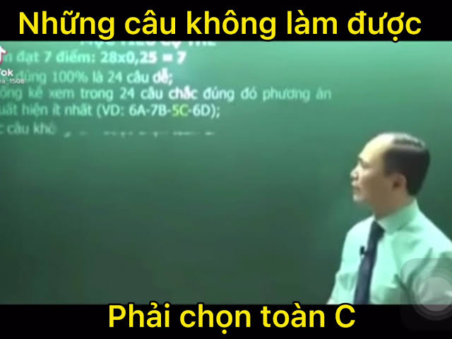

Nhưng như thế, vẫn chưa đủ nghiêm trọng. Chúng ta nên hướng ra một cuộc chiến lớn hơn đi, đó chính là sự vào cuộc của những hệ thống học liệu online hay các khóa học trên mạng. Thậm chí là bây giờ, cơn sốt IELTS lớn tới mức mà giờ còn có khóa học IELTS 7.0 chỉ trong nửa năm. Phải nhìn nhận rằng, sự ra đời của các hệ thống học liệu online là một điều tất yếu, khi người ta cần có một hệ thống học liệu mà họ có thể dễ dàng truy cập và đáp ứng tùy tiến độ học tập. Điển hình, những hệ thống học liệu như Udemy hay Coursera đã làm rất tốt trong việc phổ cập kiến thức cơ bản về công nghệ thông tin tới nhiều người mà chi phí bỏ ra không quá chát. Nhưng đáng tiếc, những khóa học trên mạng của chúng ta… lại được phát triển bằng tâm lý FOMO - sợ bị bỏ lỡ và sự gian lận hợp pháp bằng mẹo vặt. 

Tôi nói đơn giản thế này, nếu bạn nhìn thấy sự phát triển gần đây của các hệ thống học liệu và tần suất để chúng hiện lên trên mạng xã hội, bạn sẽ thấy ở giai đoạn lớp 12 và những mốc như cuối kì hay chuẩn bị thi đại học, thì tần suất trở nên dày đặc hơn so với những lúc ở trong kì học. Lý do ở đây là những thời điểm cuối kì đó thì học sinh cần một nơi để tăng tốc cái tiến độ học. Các hệ thống học liệu đã làm rất tốt trong việc lưu trữ tiến độ học tập và giúp học sinh có kiến thức cơ bản trong thời gian ngắn - điều này tôi phải thừa nhận đó là một điểm sáng so với học thêm truyền thống. Nhưng kể cả điểm sáng là vậy, nó cũng không thể xua đi bản chất rằng nó biến kiến thức thành một thứ để tiêu thụ nhanh. Tôi từng có giai đoạn học khá căng vào lớp 12, và tôi để ý cái format của một chương học hay bài học, thường là 2 - 5, tức là 2 phần lý thuyết, 5 phần là làm đề. Thực ra thì mọi người thường bỏ đi cái 2 phần và nhảy sang 5 phần kia, vì 2 phần ấy, cuối cùng cũng chỉ là lấy công thức mà thôi. Các trung tâm học liệu ấy cũng biết thị hiếu như vậy, nên cũng cắt dần đi phần lý thuyết và dần dồn phần luyện đề nhiều hơn. Cuối cùng, nó cũng chả khiến cho việc học dễ thở hơn, mà nó còn thúc ép tốc độ khiếp hơn do cái mức độ dễ dàng để tiếp cận kiến thức. 

Bằng cái tốc độ nhanh của nó, thì những công ty học liệu ấy thường mang điểm số của học viên làm nền để marketing - tôi không nói rằng các bạn ấy học kém hay gian lận hay chỉ trích thực học, mà tôi nói rằng, cái thứ làm nên cuộc chạy đua vũ trang giữa các trung tâm học liệu ấy, chính là thành tích của các học sinh. Tâm lý của phụ huynh hay học sinh, ở học thêm truyền thống hay online đều có một điểm chung, là nếu ai cho điểm cao thì học. Đó, chạy đua vũ trang đến từ cả hai phía, từ người dạy và người học là vậy đó.

**tôi nhắc lại một lần cuối cùng… thực học đã chết rồi…**

---

**last. what’s after…**

fact: đây là bộ phim mà tôi xem trước kì thi đại học, nói về vấn nạn cạnh tranh thành tích và những hậu quả tâm lý mà nó để lại…. đây là một bộ cực kì đáng xem nếu muốn có một tổng quan cho toàn bộ phần mà tôi viết: “Sky Castle”.

Còn đây là phần về hậu quả, những vấn đề chính trị nảy sinh từ cái nền giáo dục nhân tài trị và tư duy của học sinh. Mặc dù ở phần trước đó đã có nhắc đến và mọi người ắt hẳn cũng không cần phải đọc đến đây để hiểu.

Cái hệ quả rõ ràng nhất, là nó tạo ra một nhóm tân bảo thủ và trì trệ để tiếp thu một kiến thức mới. Điều này được thể hiện bởi việc cắt xén kiến thức một cách cực đoan, lịch học dày đặc và sự thiếu kiên nhẫn trong quá trình truyền đạt kiến thức. Tôi có nói rồi đấy, tôi thấy mình ngu, không phải là vì sự lập dị của mình, mà là vì người ta không đủ kiên nhẫn và không thích những ý tưởng ấy. Với một cường độ học tập và đề thi nặng, bạn dám chắc rằng những ý tưởng mà bạn đưa ra, liệu có phải là một ánh mặt trời trong bóng tối, hay chỉ khiến cho họ khó chịu hơn. Điều này khiến tôi hiểu ra một thực tế rằng, quan điểm học tập của tôi và họ đã khác biệt, tôi luôn kiên nhẫn và cố gắng học mọi thứ bằng cách tự học và chấp nhận sự không hoàn hảo của mình, còn họ thì họ cần một cái gì đó nhanh hơn. Khi nhìn vào sự thật buồn ấy, tôi cũng tự biết phải rút lui, và cũng chấp nhận sự thật ấy như là một thứ không bao giờ có thể hàn gắn, vì một bên cần nhanh, còn một bên thì luôn kiên nhẫn và cởi mở. Tôi càng hiểu rõ điều ấy khi nhìn vào điểm thi của mình và sự hụt hơi trong cái cuộc chạy đua điểm số ấy, tôi không bao giờ phù hợp….

Điều thứ hai, chính là sự thiếu chân thành và cái chết của tình bạn thật sự. Tôi nói điều này có vẻ cực đoan vì không phải ai cũng nhìn theo cách mà tôi nhìn, nhưng điều này không phải là không có cơ sở. Có một cái kiểu suy nghĩ điển hình từ cái câu nó vô hại: “gần mực thi đen, gần đèn thì rạng”. Câu này bị cổ xúy một cách cực đoan là, chỉ nên làm bạn với người giỏi, còn người giỏi thì chỉ nhìn là mình không nên chơi với thằng dốt. Điều này là một tư duy vụ lợi khủng khiếp và sự sụp đổ của tình bạn, vốn cần sự chân thành và cởi mở. Thay vì tiếp xúc bằng một quá trình tìm hiểu cặn kẽ và tổng hòa của góc nhìn, thì người ta chỉ nhìn vào cái giá trị mà họ kỳ vọng sẽ mang lại cho họ, và nó càng khơi thêm những khoảng cách về mặt thành tích. Cũng từ đó, mà nó tạo ra một cộng đồng cô lập và tạo thành một hệ đẳng cấp mới - như trong bộ phim “Sky Castle” ấy, chỉ những người giỏi mà thôi…

Điều cuối cùng, đó là sự thui chột về tương lai cho cả một đất nước. Thực tế mà nói, nhân tài trị không đồng nghĩa với công bằng, dù biểu hiện của nó gần như “công bằng”. Mục đích của nhân tài trị không phải là theo đuổi hay tạo động lực học tập đúng nghĩa, mà nó hoạt động như chứng khoán, đó là chỉ đầu tư cho những ai sinh lợi nhuận. Do cái việc chỉ tập trung lợi nhuận cho nhóm người giỏi nhất, nên thành ra, quy mô giáo dục cũng thu hẹp lại là chỉ tạo ra và chọn nhân tài, chứ không phải là đào tạo bằng kiến thức được đại chúng hóa. Việc cắt xén kiến thức như vậy đã khiến cho lực lượng lao động thiếu những kiến thức cơ bản, và chỉ có thể chấp nhận làm việc mà không có khả năng vươn lên. Điều đó càng trở nên hợp lý hơn khi nhìn sang kinh tế, với việc tầng lớp siêu giàu lớn mạnh về mặt quy mô và có tác động lớn đến kinh tế, thì cái giáo dục đào tạo ra nhân tài, thực chất đã làm giảm chất lượng giáo dục xuống khi kiến thức để học, giờ đã không còn nữa….

Tôi viết hậu quả viết chắc phải thành sớ, nhưng đến đây thôi…

---

Thật ra, tôi phải chờ rất nhiều năm để có thể phân tích toàn bộ những gì trong quá trình học tập ấy. Tôi muốn nói rằng, tôi chưa bao giờ tự hào chuyện mình học lớp chọn hay điểm cao, vì nó đánh đổi cả chính con người thật của tôi cho những thứ ảo tưởng mà tôi biết rằng sẽ cần phải có hồi kết. Tôi viết những vấn đề này trên một phương diện rõ ràng hơn, khi có thời gian đi làm và nhìn ra những gì đã trôi qua trong nhiều năm. Nghĩa vụ để nói lên sự thật, về một xã hội nhân tài trị ấy, là một điều cần thiết để nói rằng, chúng ta cần phải thay đổi từ quan điểm giáo dục, khi thứ chúng ta cần, phải là những người thực sự dám học và dám tiếp thu những kiến thức ấy, kể cả khi những kiến thức kia không thể giúp cho điểm đại học cao hơn nhưng sẽ giúp họ có khả năng cởi mở văn hóa - thứ cần thiết tới khả năng phát triển của chính họ…

Tôi viết cho tôi và tôi viết cho các bạn… vậy thôi.

    
<strong>anxiety reckoning</strong>

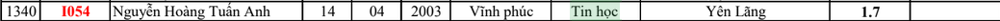

> 
> 
> 
> “oh, i hope someday I’ll make it out of here  
> even if it takes all night or a hundred years  
> need a place to hide, but i can’t find one near  
> wanna feel alive, outside i can’t fight my fear  
> 
> isn’t it lovely, all alone?  
> heart made of glass, my mind of stone  
> tear me into pieces, skin to bone  
> hello, welcome home...”  
> 
> Billie Eilish, Khalid – “Lovely”
> 

điều tồi tệ nhất không phải là mất em, mà là tôi mất đi cả cuộc sống của chính mình.…

Tôi vẫn nhớ khoảnh khắc ấy, vào khoảng cuối tháng 4, đầu tháng 5 — khoảnh khắc mà tôi biết mình không thể tiếp tục giả vờ rằng mọi chuyện vẫn ổn. Những người tôi yêu quý lần lượt rời khỏi cuộc sống của tôi: bạn bè, thầy cô, những điều thân thuộc trong gia đình và cuối cùng là tình yêu mà tôi từng cố gắng giữ lại. Khi biết tin ấy, tôi rời khỏi máy tính trong trạng thái trống rỗng và suýt ngất đi. Tôi chỉ muốn tìm một nơi để giấu mình rồi khóc, thậm chí từng nghĩ chết đi cũng được, nhưng lại không thể rơi nổi một giọt nước mắt. Tôi vẫn cố tỏ ra như không có chuyện gì xảy ra, trong khi gần như không còn cảm nhận được điều gì từ cuộc sống nữa.

Những ngày sau đó giống như một cuộc tra tấn âm thầm. Tôi vẫn phải đi học, vẫn ôn thi và vẫn xuất hiện trước mọi người như một học sinh bình thường, nhưng bên trong chỉ còn cảm giác cô độc và thua cuộc. Điều làm tôi đau đớn nhất không phải chuyện cô ấy đã chọn một người khác. Tin tức ấy chỉ là giọt nước tràn ly, buộc tôi phải nhìn thẳng vào một sự thật: cuộc sống mà tôi từng muốn gìn giữ đã chết đi từ rất lâu, và tôi không còn biết mình đang cố gắng vì điều gì nữa.

Đó là lúc tôi nhận ra mình đã rơi vào một trạng thái mà đến bây giờ tôi mới có thể gọi tên là trầm cảm. Không phải vì tôi khóc quá nhiều, mà vì tôi không còn khóc được; không phải vì một người rời đi, mà vì qua sự mất mát ấy, tôi nhận ra gần như mọi thứ từng khiến mình muốn sống đều đã biến mất.

---

Tôi không tức giận vì crush có người mới. Sự thật còn đau đớn hơn thế nhiều. Trong một khoảng thời gian dài, tôi vẫn tin rằng rồi sẽ có ngày mình gặp lại những người cũ, tìm lại sự vô tư và tiếp tục cuộc sống đã bị bỏ dở. Cô ấy giống như dấu tích cuối cùng của thế giới ấy — một bằng chứng rằng quãng đời tôi từng yêu, từng vui và từng là chính mình là có thật. Khi sợi dây cuối cùng ấy đứt, tôi hiểu rằng mình không chỉ phải tạm biệt một người, mà còn phải tạm biệt cả con người trước kia của mình.

Tôi biết tâm lý mình đã có vấn đề, nhưng khi ấy tôi không thể đi chữa trị. Việc chăm sóc sức khỏe tinh thần cần thời gian và tiền bạc — những thứ gia đình tôi khó có thể dành ra lúc đó. Vì thế, tôi mang trạng thái tan vỡ ấy qua những năm tháng sau. Tôi càng đạt thành tích cao, cảm giác trống rỗng càng trở nên khó giải thích: bên ngoài, tôi vẫn là một học sinh học tốt; bên trong, tôi giống như một chiếc lon rỗng, không còn biết điều gì thật sự thuộc về mình.

Trầm cảm không phải lúc nào cũng hiện ra trên khuôn mặt. Một người vẫn có thể cười, đi học, thi cử và sống trong giấc mơ mà người khác đặt lên họ, trong khi tinh thần đã kiệt quệ. Họ có thể cố gắng kêu cứu bằng những cách vụng về, lặp đi lặp lại một nỗi nhớ hoặc bám lấy những điều đã trở thành dĩ vãng, rồi chính những biểu hiện ấy lại bị nhìn như sự lập dị. Cuộc sống học sinh của tôi đã kết thúc như thế: cô đơn, mất dần ý chí sống và vật vờ như một cái bóng.

Tôi gọi phần này là “anxiety reckoning” — cuộc đối diện với những mặc cảm và lo âu đã chiếm lấy đời mình. Tôi không kể lại để biến nỗi đau thành một thứ huy chương, càng không muốn coi trầm cảm là điều bình thường. Tôi chỉ muốn nói rằng đã có những chuyện thật sự xảy ra, và hậu quả của chúng không kết thúc cùng ngày tôi rời khỏi trường.

> Tôi đã không còn cuộc sống của chính mình — vậy làm sao tôi có thể tin rằng mình đủ khả năng mang lại hạnh phúc cho một người khác?
> 

---

Thật khó để kể lại quá trình từ mặc cảm tự ti đến trầm cảm, bởi nó không xuất hiện như một công tắc. Nó là một sự bào mòn diễn ra từng ngày, trong lúc tôi vẫn cố hoàn thành mọi nghĩa vụ và giả vờ rằng mình có thể chịu đựng được.

Đầu tiên là áp lực trong lớp học: áp lực từ những bài khảo sát, từ các mối quan hệ không thuộc về mình và từ sự khác biệt trong cách suy nghĩ. Tôi vẫn đến lớp, trực nhật và hoàn thành bài vở, nhưng sự mệt mỏi dần ăn sâu vào đầu óc. Khi ai đó hỏi, tôi thường trả lời rất dài vì không biết phải diễn đạt thế nào để không khiến họ khó chịu. Càng cố giải thích, tôi càng cảm thấy mình nói sai; càng cố thể hiện bản thân, tôi càng nhận ra không ai muốn nghe. Cuối cùng, tôi lựa chọn im lặng và từ bỏ dần những thói quen vốn hết sức bình thường của mình, nhường chỗ cho một con người luôn dè chừng trước mọi ánh mắt.

Nếu tôi có một cuộc sống bên ngoài lớp học đủ bình yên, có lẽ mọi chuyện đã không trở nên khủng khiếp đến vậy. Nhưng ngay cả ngoài sân trường, tôi cũng luôn có cảm giác mình đang bị theo dõi và phán xét. Khi tôi làm điều gì bị coi là không phù hợp, người ta thường không nói thẳng với tôi rằng tôi đã vi phạm điều gì hoặc nên sửa ra sao; câu chuyện lại đi tới gia đình trước khi chính tôi được biết. Tôi không thể khẳng định người khác cố ý đẩy mình đến đường cùng, nhưng cách mọi việc được xử lý khiến tôi cảm thấy đời sống riêng tư của mình có thể bị mang ra bàn tán bất cứ lúc nào. Mỗi lần về nhà, tôi lại lo rằng một hành động nhỏ ở trường sẽ trở thành nguyên nhân cho một cuộc tranh cãi khác.

Thất bại trong kỳ thi môn Tin càng khoét sâu cảm giác ấy. Tôi đã mang về một kết quả rất tệ, nhưng nỗi buồn không chỉ nằm ở điểm số. Điều khiến tôi suy sụp là cảm giác thất bại của mình bị biến thành bằng chứng cho hình ảnh “một kẻ lập dị” mà người khác đã dựng lên. Từ trường học đến gia đình, tôi liên tục bị chất vấn về một kết quả mà bản thân đã đủ đau đớn để đối diện. Tôi không còn cảm thấy nỗ lực của mình được nhìn nhận như nỗ lực của một con người; mọi điều tôi làm dường như chỉ được dùng để củng cố một phán quyết đã có sẵn về tôi.

Những năm tháng ấy trở nên ngột ngạt vì tôi không nhìn thấy lối thoát. Tôi không thể xin nghỉ khỏi chính cuộc sống của mình, cũng không biết phải chạy đi đâu để thoát khỏi cảm giác bị đánh giá. Dần dần, tôi không còn muốn tiếp xúc với ai và đánh mất khả năng biểu đạt những nhu cầu rất cơ bản. Mỗi khi định nói ra một ý tưởng hoặc làm điều gì khác biệt, tôi lại tưởng tượng rằng người ta sẽ tiếp tục gọi mình là lập dị, tiếp tục biến nó thành một câu chuyện khác và tiếp tục mang nó về nhà. Tôi bắt đầu sống như thể mọi hành động đều cần được kiểm duyệt trước khi diễn ra.

Và cuối cùng, tôi không thể giữ lại tình bạn hay tình yêu của mình. Điều đau đớn nhất không phải cô ấy có tình cảm với tôi hay không, mà là việc tôi nhận ra mình không còn đủ sức bảo vệ bất kỳ mối quan hệ nào trước một cuộc sống đang ngày ngày vắt kiệt tinh thần. Khoảng một tuần sau khi biết tin, tôi chấp nhận sự thật rồi lặn đi trong một thời gian dài, chỉ còn học và ôn thi. Tôi không còn thấy vui nữa. Mọi thứ giống như đang chĩa vào phần yếu đuối nhất trong tôi, còn tôi chỉ có thể im lặng chịu đựng.

Nhưng hậu quả không dừng lại ở tuổi học sinh. Nó đi theo tôi qua đại học, rồi đến cả lúc đi làm. Tôi dễ căng thẳng khi bị chất vấn, sợ trở thành người thừa trong một tập thể và luôn chuẩn bị tinh thần rằng một sai sót nhỏ có thể bị biến thành phán quyết về toàn bộ con người mình. Khi một lời cầu cứu bị phớt lờ hoặc khi ai đó nói rằng tôi “yếu đuối”, tâm trí tôi lại quay về căn phòng học cũ, nơi tôi từng tin rằng mình có nói gì cũng chẳng ai nghe. Cơ thể tôi đã rời khỏi ngôi trường ấy từ lâu, nhưng có những năm tâm trí vẫn sống như thể đang bị theo dõi và chờ đợi một lời kết tội.

Đó là cách trầm cảm và lo âu kéo tụt tuổi trẻ của tôi: không chỉ bằng những ngày buồn bã, mà bằng việc chúng thay đổi cách tôi nhìn bản thân, nhìn người khác và nhìn cả tương lai. Tôi mất rất nhiều năm mới dám tin rằng mình vẫn có quyền lên tiếng, quyền thử nghiệm, quyền mắc sai lầm và quyền sống như một con người bình thường.

Tôi ghét quãng thời gian ấy, không phải chỉ vì những chuyện đã xảy ra, mà vì nó tiếp tục sống trong tôi rất lâu sau khi mọi người khác đã quên. Học giỏi không giúp tôi bình yên; thành tích không trả lại cuộc sống đã mất; và việc tiếp tục tồn tại cũng không có nghĩa là tôi đã thật sự thoát ra.

    
<strong>shadow of myself…</strong>

Tôi từng nghĩ rằng trầm cảm sẽ khiến một con người hoàn toàn không thể làm được gì nữa. Nhưng trải nghiệm của tôi lại khác. Tôi vẫn đi học, vẫn làm bài, vẫn bước vào phòng thi và vẫn đạt được một vài kết quả mà người khác có thể gọi là đáng tự hào. Tôi vẫn xuất hiện trong ảnh lớp, trong bảng điểm và trong ký ức của những người từng gặp mình. Chỉ là khi nhìn lại những hình ảnh ấy, tôi không còn chắc người đang sống trong đó có thật sự là tôi hay không.

Sau khi cuộc sống cũ khép lại, một phiên bản khác của tôi tiếp tục bước đi. Nó biết khi nào phải im lặng, phải học bao nhiêu và phải che giấu cảm xúc như thế nào để không trở thành một vấn đề. Nó vẫn hoàn thành mọi nghĩa vụ, nhưng không biết tận hưởng; vẫn có thể giúp đỡ người khác, nhưng không tin rằng chính mình xứng đáng được giúp đỡ. Nó tồn tại rất tốt — tốt đến mức trong nhiều năm, chẳng mấy ai nhận ra bên trong nó gần như không còn điều gì.

Đó là cái bóng của tôi.

Cuộc sống của cái bóng không có quá nhiều ước mơ. Mục tiêu của nó chỉ là đừng làm sai, đừng khiến ai phật lòng, đừng để gia đình phải nghe thêm một câu chuyện nào khác và đừng cho người ta thêm lý do để gọi mình là lập dị. Trước khi nói, tôi phải đoán xem người khác muốn nghe điều gì; trước khi làm, tôi phải nghĩ xem hành động ấy có thể bị diễn giải thành chuyện gì. Tôi không còn hỏi bản thân muốn sống như thế nào, mà chỉ hỏi mình cần làm gì để được yên.

Thành tích cũng trở thành một phần của cơ chế sinh tồn ấy. Tôi học không chỉ vì tò mò hay muốn khám phá, mà còn vì sợ rằng nếu mình thất bại, mọi phán xét tồi tệ nhất về mình sẽ trở thành sự thật. Điểm số không giúp tôi cảm thấy tự do; nó chỉ giúp cái bóng trông giống một con người bình thường hơn. Người ta có thể nhìn vào kết quả và nghĩ rằng tôi vẫn ổn, trong khi bản thân tôi chỉ đang dùng việc học để trì hoãn khoảnh khắc phải đối diện với chính mình.

Trong tôi khi ấy giống như có hai con người cùng tồn tại. Một người từng vô tư, thích thử nghiệm, nói nhiều, yêu công nghệ, nhiếp ảnh và sẵn sàng kết bạn với đủ kiểu người. Người còn lại luôn dè chừng, tính toán từng câu nói và mặc định rằng mọi mối quan hệ rồi cũng sẽ kết thúc bằng việc mình bị bỏ lại. Con người đầu tiên muốn bước ra ngoài để khám phá thế giới; cái bóng chỉ muốn tìm một nơi không ai nhìn thấy.

Cái bóng ấy không biến mất khi tôi rời khỏi trường THPT. Nó theo tôi lên đại học, kể cả trong những năm tháng tôi làm lớp trưởng và cố gắng bảo vệ mọi người. Có lẽ chính vì từng biết cảm giác không được lắng nghe, tôi trở nên đặc biệt nhạy cảm trước việc một ai đó bị bỏ lại. Tôi luôn muốn trở thành người mà mọi người có thể tìm đến, nhưng lại rất khó tin rằng chính mình cũng có quyền yếu đuối và cầu cứu. Tôi học cách gánh trách nhiệm cho người khác, trong khi những điều bên trong mình vẫn bị đẩy sang một bên.

Rồi cái bóng tiếp tục theo tôi tới nơi làm việc. Khi lời cầu cứu của tôi bị phớt lờ, khi tôi trở thành người thừa trong một dự án hoặc khi ai đó nói rằng tôi “yếu đuối”, tâm trí tôi lại quay về căn phòng học cũ. Tôi thu mình, mặc những chiếc áo có mũ và cố biến bản thân thành một người ít bị chú ý nhất có thể. Cơ thể tôi đã rời khỏi thời THPT từ lâu, nhưng có những lúc tôi vẫn sống như thể mình đang chờ đợi một lời kết tội.

Đó có lẽ là kết luận buồn nhất cho quãng đời trầm cảm ấy: tôi đã sống sót, nhưng trong một khoảng thời gian rất dài, tôi không biết sống sót để làm gì. Tôi bước qua những kỳ thi, tốt nghiệp đại học và bắt đầu đi làm, nhưng một phần trong tôi vẫn đứng nguyên ở nơi mọi thứ đã tan vỡ. Tôi không đánh mất khả năng tồn tại; tôi chỉ đánh mất cảm giác rằng người đang tồn tại ấy thật sự là mình.

Nhưng nếu phải thành thật, tôi cũng không thể hoàn toàn căm ghét cái bóng ấy. Trong những năm tháng mà tôi gần như không còn lý do để bước tiếp, chính nó đã thay tôi hoàn thành những việc cần phải làm. Nó đưa tôi đến lớp, ngồi vào bàn thi và giữ tôi tồn tại trong những ngày mà bản thân chẳng còn cảm nhận được điều gì. Nó học cách im lặng để tôi không tiếp tục bị tổn thương, học cách đề phòng để tôi không bị bỏ lại và học cách trở nên hữu ích để ít nhất tôi vẫn có một lý do được ở bên cạnh người khác.

Cái bóng ấy đã cứu tôi theo một cách rất buồn: nó giúp tôi tồn tại bằng việc giấu đi gần như toàn bộ con người thật của mình.

Tôi không muốn biết ơn những tổn thương đã tạo ra nó. Không phải mọi đau khổ đều cần được biến thành một bài học đẹp đẽ, và không phải cứ sống sót thì những gì từng xảy ra sẽ trở nên đúng đắn. Nếu được lựa chọn lại, tôi vẫn mong cậu bé năm ấy có một người chịu ngồi xuống lắng nghe, một nơi đủ an toàn để được khóc và một cơ hội được sống như một con người bình thường. Tôi ước cậu ấy không phải học cách trưởng thành bằng việc liên tục đánh mất những thứ mình yêu quý.

Tuy nhiên, ở bên trong cái bóng ấy, vẫn có những phần của tôi chưa bao giờ thật sự biến mất. Đó là lý do tôi vẫn cố gắng lắng nghe khi ai đó nói rằng họ không ổn, bởi tôi biết cảm giác kêu cứu mà không có ai trả lời. Đó là lý do khi làm lớp trưởng, tôi luôn muốn bảo vệ quyền được lên tiếng của từng người. Và đó cũng là lý do tôi tạo ra cái repo này: nếu ở đâu đó có một người đang cảm thấy mình bị bỏ lại, tôi không muốn họ phải tin rằng trên thế giới này chẳng còn ai sẵn sàng lắng nghe.

Có lẽ con người tuổi 13 của tôi chưa từng chết hoàn toàn. Cậu ấy vẫn xuất hiện mỗi khi tôi cầm máy ảnh và thử ghi lại một khoảnh khắc đẹp; mỗi khi tôi bắt đầu một dự án lập trình chỉ vì tò mò; mỗi khi tôi muốn thử một hình ảnh mới mà không cần biết người khác có công nhận hay không. Tôi từng nghĩ những điều ấy chỉ là tàn dư của một cuộc sống đã chết. Nhưng có lẽ, chúng là bằng chứng rằng cuộc sống ấy chưa từng biến mất — nó chỉ bị chôn quá sâu dưới những lớp sợ hãi, mặc cảm và nghĩa vụ mà tôi đã phải mang theo để sinh tồn.

Và rồi tôi hiểu rằng, một cái bóng không thể tự mình tồn tại.

**Nó chỉ xuất hiện khi ở đâu đó vẫn còn ánh sáng.**

Tôi chưa hoàn toàn bước ra ngoài. Vẫn có những ngày tôi muốn trùm kín chiếc hoodie, tránh khỏi ánh mắt của mọi người và biến mất khỏi những câu chuyện không thuộc về mình. Vẫn có những lúc một lời nói, một cuộc họp hay sự im lặng của ai đó kéo tôi trở lại những năm tháng cũ. Nhưng giờ đây, ít nhất tôi đã có thể nhìn cái bóng ấy và nói rằng: “mày đã giúp tao sống sót, nhưng tao không muốn chỉ sống sót nữa.”

Tôi không cần phải giết chết cái bóng. Sau cùng, nó cũng là một phần của câu chuyện và là bằng chứng cho việc tôi đã đi qua những ngày tồi tệ đến mức nào. Nhưng tôi có thể ngừng để nó bước trước mình. Tôi có thể quay lại đối diện với ánh sáng, để cái bóng trở về đúng vị trí của nó — ở phía sau, thay vì che phủ toàn bộ cuộc đời.

Cái bóng đã giúp tôi sống sót qua những năm tháng ấy.

Nhưng ở hiện tại, tôi không muốn chỉ sống sót nữa.

**Tôi muốn được sống như chính mình.**

Và nếu vẫn còn một nơi nào đó cho hy vọng, có lẽ tôi phải bắt đầu bằng việc tìm lại những phần ánh sáng đã từng bị chính cái bóng ấy che khuất.…

# but hope somewhere???

> i wonder if the sun burnt out tonight…  
>would you let me go or hold me tight?  
>just one touch could erase the light  
>say we’ll be alright  
>say we’ll be alright….  
>  
>VALORANT ft. Grabbitz, Oli Sykes, Courtney LaPlante - “If The Sun Burns Out Tonight”
> 

Có lẽ hy vọng trong những năm tháng ấy không hề trông giống hy vọng.

Nó không phải một phép màu xuất hiện để kéo tôi ra khỏi trầm cảm, cũng không phải một ngày tôi tỉnh dậy và bỗng thấy cuộc sống lại trở nên tươi đẹp. Tôi vẫn cô đơn, vẫn phải đi học trong trạng thái mệt mỏi và vẫn không biết tương lai của mình sẽ đi về đâu. Nhưng cùng lúc với quá trình mọi thứ dần sụp đổ, có một cuộc đấu tranh khác cũng diễn ra bên trong tôi — cuộc đấu tranh để giữ lại những lý do cuối cùng khiến mình chưa hoàn toàn buông tay.

Tôi không có nhiều bạn ở THPT. Nhưng “không có nhiều” không có nghĩa là hoàn toàn không có ai.

Tôi vẫn còn những người anh em từng biết tôi trước khi mọi chuyện trở nên tồi tệ, những người ít nhiều nhắc tôi nhớ rằng mình từng có một cuộc sống khác. Tôi vẫn còn một vài người bạn mà sự hiện diện của họ, dù đôi khi ngắn ngủi, cũng đủ khiến thế giới bớt xa lạ. Và dù giữa tôi với mẹ có rất nhiều cuộc tranh cãi, ở đâu đó, bà vẫn dành cho tôi một chút tin tưởng — có thể không phải sự thấu hiểu hoàn toàn, nhưng vẫn là một nơi để tôi biết rằng mình chưa bị cả thế giới từ bỏ.

Hy vọng khi ấy không phải một ngọn lửa lớn. Nó chỉ là vài đốm sáng nhỏ, nhiều lúc yếu đến mức tôi tưởng rằng chúng đã tắt. Nhưng chính những điều nhỏ bé ấy đã giữ tôi lại trong những đêm mà tôi không còn biết ngày mai có ý nghĩa gì.

Và rồi còn có những lần cuối tôi nhìn thấy em.

Tôi biết giữa chúng ta không còn một kết cục nào khác. Tôi cũng không nhìn em với hy vọng rằng mọi chuyện sẽ quay trở lại như trước. Nhưng mỗi lần nhìn thấy em, tôi lại nhớ đến con người mình từng muốn trở thành — một người biết yêu, biết cố gắng và vẫn còn đủ chân thành để mong người khác được hạnh phúc, kể cả khi hạnh phúc ấy không còn có mình trong đó.

Có lẽ điều em để lại không phải một lời hứa rằng chúng ta sẽ gặp lại. Đó là một câu hỏi: sau tất cả những gì đã mất, tôi sẽ tiếp tục để bản thân biến mất, hay sẽ thử thay đổi để giành lại cuộc sống của chính mình?

Tôi chưa có câu trả lời vào lúc ấy. Tôi chỉ biết rằng mỗi lần nhìn thấy em, dù đau đớn, tôi vẫn cảm nhận được trái tim mình còn hoạt động. Tôi vẫn còn biết nhớ, biết tiếc nuối và biết mong muốn trở thành một con người tốt hơn. Nếu tôi thật sự đã chết ở bên trong, có lẽ tôi đã chẳng còn cảm thấy điều gì nữa.

Vậy nên, trong lúc mặt trời của tôi dần tắt đi, vẫn có những người giữ lại một phần ánh sáng: những người anh em, một vài người bạn, chút tin tưởng còn sót lại từ mẹ và hình ảnh của một người con gái từng khiến tôi biết rằng mình vẫn có thể yêu một ai đó.

Không ai trong số họ có thể sống thay cuộc đời tôi. Họ cũng không thể tự mình kéo tôi ra khỏi bóng tối. Nhưng sự tồn tại của họ đã nói với tôi một điều mà khi ấy tôi chưa thể tự nói với chính mình:

**có lẽ mọi chuyện vẫn chưa kết thúc.**

> *say we’ll be alright…*  
*say we’ll be alright…*  
> 

Tôi không biết liệu rồi chúng ta có thật sự ổn hay không.

Nhưng ít nhất, trong khoảnh khắc ấy, tôi vẫn muốn tin rằng mình còn một tương lai để bước tới.

    
<strong>some nights….</strong>

    
>some nights, i stay up cashing in my bad luck  
>some nights, i call it a draw  
>some nights, i wish that my lips could build a castle  
>some nights, i wish they’d just fall off…  
>but i still wake up, i still see your ghost  
>oh lord, i’m still not sure what i stand for  
>what do i stand for?  
>what do i stand for?  
>most nights, i don’t know…. anymore  
> Fun. - "Some Nights" - "Some Nights"    
>

Câu chuyện bắt đầu bằng những đêm tôi không thể ngủ, khi tương lai cứ hiện ra trước mắt như một lời hẹn không thể trì hoãn. Một mặt, tôi phải sống trong một trạng thái xa lạ với chính mình, nơi mỗi ngày đi học không khác gì một cực hình. Nhưng mặt khác, tôi cũng hiểu rằng quãng thời gian của mình ở THPT đang dần đi đến hồi kết. Điều đó có nghĩa là tôi phải nghĩ về một tương lai mà sớm muộn gì mình cũng phải đối diện.

Nhiều năm sau, cảm giác ấy quay trở lại dưới một hình thức khác. Khi viết những dòng này, tôi cũng đang đếm ngược thời gian trước khi thất nghiệp — hoặc có thể phải rời đi sớm hơn. Trong lòng tôi có một sự giằng xé rất lớn: một mặt, tôi muốn kết thúc quãng đời hiện tại càng sớm càng tốt; mặt khác, tôi vẫn chưa hoàn toàn chuẩn bị cho tương lai ở phía sau nó. Khi cuộc sống của điểm số trở nên khốc liệt hơn, tôi dần phải đối diện với một sự thật không thể tránh khỏi: trước sau gì cũng sẽ đến ngày tôi phải nhìn vào sự kết thúc của con người cũ trong mình…

Ở thời điểm của những đêm khó ngủ ấy, tôi bắt đầu chấp nhận một vài sự thật đau đớn. Đó là một thế giới mà dù cố gắng đến đâu, tôi vẫn có cảm giác chẳng ai thật sự hiểu mình. Một thế giới mà niềm vui dần biến mất, chỉ còn lại những đêm cày đề và những buổi sáng phải thức dậy từ bốn giờ. Gia đình tôi cũng dần chấp nhận và chuẩn bị cho một kịch bản tồi tệ nhất. Còn tôi chỉ biết cố gắng lê thân mình tới ngày phán xét: hoặc tiếp tục bước đi, hoặc chết cứng trong cái quá khứ đang âm thầm ăn mòn trái tim. Tôi đếm ngược từng ngày, lặng lẽ chuẩn bị cho một cuộc chiến dài hơi giữa mình và một môi trường đang dồn lên tôi những áp lực khủng khiếp…

Nhưng chính trong những đêm khó ngủ ấy, tôi vẫn tìm thấy một thứ có thể gọi là tương lai — dù nó chỉ xuất hiện giữa cảm giác hấp hối của chính mình. Tôi từng nghĩ mình không còn gì để mất: tình bạn, tình yêu và gần như mọi thứ từng khiến tôi cảm thấy mình thuộc về cuộc sống. Vì thế, tôi bắt đầu nhìn tương lai như một tờ giấy trắng. Nó vô định, nhưng câu chuyện trên đó vẫn có thể được tôi tô màu theo cách mình muốn.

Tương lai khi ấy giống như một cuộc chiến: hoặc tôi mất sạch tất cả, hoặc tôi vẫn có thể tiếp tục. Tôi đã đoán trước cả kết cục tệ nhất, nên bước vào nó với một tâm thế gần như quyết tử. Mỗi khi buông xuôi và nghĩ về kết cục bi thảm mà mình có thể phải chịu, tôi lại tự nhắc rằng: kể cả khi tương lai khép lại bằng một điểm thi tồi tệ, tôi cũng sẽ không phải hối tiếc, bởi ít nhất tôi đã chiến đấu hết mình cho tương lai ấy…

Và rồi, giữa những đêm khó ngủ cùng những lời nhắn kéo dài tới tận khuya, cuối cùng cũng có ai đó chạm tới được trái tim tôi. Người ấy giúp tôi đi qua bóng tối và hiểu rằng, trong những khoảng thời gian cô độc và đầy nước mắt, vẫn có người nghe thấy tiếng khóc của tôi, nhìn thấy sự bất lực của tôi và trao cho tôi tình thương như một con người bình thường. Tôi biết ơn điều ấy…

Lại là những đêm khó ngủ. Nhưng lần này, giữa những ám ảnh ấy, tôi bắt đầu nhìn thấy chính mình…

    
<strong>brothers…</strong>

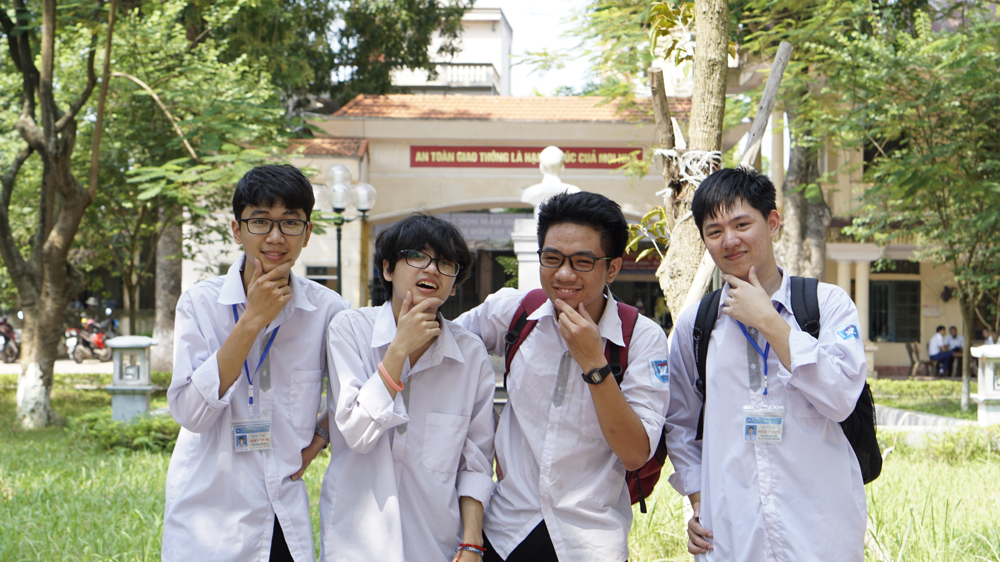

Xin giới thiệu một chút, đây là bức ảnh tôi chụp cùng những người anh em của mình — nếu không muốn nói là những người đầu tiên chủ động bước tới bên tôi trong một môi trường hoàn toàn xa lạ. Theo như tôi nhớ, bức hình này được chụp vào khoảng năm 2020, khi chúng tôi vừa kết thúc lớp 11.

Trong trái tim tôi khi ấy, họ là những người đầu tiên làm quen với tôi dù xung quanh đã có sẵn rất nhiều định kiến. Ban đầu, có thể một phần xuất phát từ sự tò mò đối với một kẻ bị xem là lập dị. Nhưng rồi sự tò mò ấy dần trở thành những cuộc trò chuyện, những lần chia sẻ và những tháng ngày đi cùng nhau trong phần lớn quãng đời học sinh. Họ là những người đầu tiên nhìn thấy tôi dưới một góc độ khác: không phải một thành tích, một lời đồn hay một hình ảnh méo mó, mà là một người bình thường có câu chuyện riêng của mình.

Nếu không có họ, tôi không chắc mình đã có thể đi qua được những năm tháng khó khăn ấy như thế nào…

---

> i’ve got you brother…
> 

Đối với tôi, tình anh em và tình bạn luôn là những điều đáng được trân trọng. Con người có thể rất giỏi giang, độc lập và mạnh mẽ, nhưng không ai thật sự sống mà không cần đến một mối quan hệ xung quanh mình. Tôi từng nghĩ mình không cần bạn bè, không phải vì tôi căm ghét mọi người, mà vì đã quá quen với việc dù có cố gắng đến đâu cũng chẳng ai muốn bước tới gần.

Rồi có một khoảnh khắc làm tôi thay đổi suy nghĩ ấy.

Trong một lần ra chơi, tôi ngồi đọc cuốn sách mình mang theo. Hành động ấy vô tình trở thành đề tài tò mò và bàn tán của vài người xung quanh. Dù vậy, vẫn có một vài người chủ động bắt chuyện — có người tôi đã quen từ trước, cũng có người hoàn toàn xa lạ. Tôi không biết họ thật sự nghĩ gì về mình, nhưng rồi tôi tự nhủ rằng: nếu họ đã chịu bước tới, có lẽ tôi cũng nên thoải mái đón nhận cuộc trò chuyện ấy.

Tôi đã sống một mình quá lâu rồi. Ít nhất, tôi cũng nên cho bản thân một cơ hội để nói chuyện với ai đó.

Ban đầu, chúng tôi chỉ nói về chuyện học tập, về việc tôi học như thế nào và những vấn đề chuyên môn. Tôi thường khuyên họ đừng tự đặt quá nhiều áp lực phải trở thành người giỏi nhất, vì có những thứ cần thời gian để làm quen và hiểu đúng. Sau đó, tôi bắt đầu làm quen với nhiều nhóm người khác nhau, trong đó có những người ở các câu lạc bộ như Kịch. Mỗi người lại mở ra cho tôi một góc nhìn mới: lập trình, máy tính, kịch bản, hóa trang, thẩm mỹ, những câu chuyện đời thường, những góc khuất của trường học và cả những suy nghĩ rộng hơn về giáo dục.

Từ những cuộc trò chuyện như vậy, tôi dần bước ra khỏi cái lồng thành tích mà mình đã tự nhốt bản thân vào. Tôi nhận ra mình không chỉ cần những người cùng học giỏi, mà cần những người có thể giúp tôi nhìn thấy thế giới rộng hơn những điểm số và bảng xếp hạng. Khi tôi chấp nhận sự cởi mở ấy, những người bạn cũng đến với tôi một cách tự nhiên hơn. Chỉ riêng điều đó thôi đã đủ làm tan băng một phần trái tim tôi rồi…

Điều khiến tôi trân quý họ hơn cả là họ biết những bất lợi mình có thể gặp phải khi làm bạn với tôi. Họ biết những ánh nhìn dị nghị, những lời bàn tán và cả hình ảnh tiêu cực mà người khác đã gán lên tôi. Làm bạn với một người đã bị định nghĩa sẵn chưa bao giờ là chuyện dễ dàng, nhưng họ vẫn lựa chọn bước qua nỗi sợ ấy. Trong những năm tháng tồi tệ nhất, khi tôi gần như không có ai để chia sẻ, họ coi tôi như một người thân thiết. Họ lắng nghe những câu chuyện của tôi và cho tôi một nơi để tạm thời trốn khỏi những ánh mắt khiến tôi luôn thấy mình bị phán xét. Họ không cần phải làm điều gì quá lớn lao. Đôi khi, chỉ việc ngồi đó, nói chuyện với tôi và đối xử với tôi như một người bình thường cũng đã là một sự cứu rỗi rất lớn.

Tôi không muốn biến họ thành những nhân vật hoàn hảo hay kể câu chuyện này như thể họ đã một mình kéo tôi ra khỏi bóng tối. Họ cũng có cuộc sống, những khó khăn và những giới hạn riêng. Nhưng sự hiện diện của họ đã cho tôi một điều mà tôi từng nghĩ mình sẽ không bao giờ có lại: cảm giác được thuộc về một nhóm người mà mình không cần phải liên tục chứng minh bản thân.

Thật ra, rất khó để kể hết những gì chúng tôi đã trải qua, bởi cuộc sống khi ấy phần lớn chỉ xoay quanh trường học và học thêm. Nhưng chính trong những khoảng thời gian tưởng như rất nhỏ — lúc đi học về, lúc ngồi nói chuyện hoặc khi vô tình có thêm vài phút rảnh — chúng tôi đã tạo ra những kỷ niệm mà đến bây giờ tôi vẫn nhớ. Những điều ấy kéo tôi ra khỏi sự cô độc từng chút một, và đưa tôi đến gần hơn với thứ mà tôi vẫn gọi là ánh sáng của nhân văn.

Tôi cũng muốn tin rằng, giống như cách họ từng cho tôi một chỗ để dựa vào, tôi cũng có thể trở thành một người mà họ tìm đến khi cần. Tình anh em không chỉ là việc một người cứu một người khác; đôi khi, đó là việc chúng ta cùng nhau tồn tại qua những năm tháng khó khăn mà không để ai phải hoàn toàn biến mất.

Họ là hy vọng trong những đêm đen. Và nếu một ngày nào đó họ cần tôi, tôi muốn mình vẫn là người có thể xuất hiện đầu tiên — giống như cách họ từng ở đó khi tôi không còn biết phải tìm đến ai….

    
<strong>la resistance</strong>

>O bella ciao, bella ciao, bella ciao ciao ciao  
>Una mattina mi sono alzato  
>E ho trovato l'invasor  
>
>"Bella Ciao" - Anti-fascism song

Có lẽ, sự phản kháng của tôi bắt đầu từ một ý nghĩ rất nhỏ: tôi không muốn cuộc sống của mình mãi là như thế này. Tôi vẫn sợ, vẫn mệt mỏi và chưa biết phải thay đổi điều gì trước tiên. Nhưng giữa những ngày chỉ cố gắng để được yên, tôi bắt đầu muốn giữ lại một chút quyền quyết định cho mình — học một thứ vì thật sự muốn hiểu, giữ một ý tưởng dù chưa ai đồng tình, và không vội coi những lời phán xét là toàn bộ sự thật về bản thân.…

Những quyết tâm ấy chưa đủ để đưa tôi ra khỏi bóng tối. Có điều làm được, có điều vẫn chỉ nằm trong dự định. Tôi không muốn kể chúng như một cuộc nổi dậy đầy chiến thắng, bởi khi ấy, ngay cả việc tin rằng mình còn một lựa chọn khác cũng đã rất khó khăn. Tôi chỉ biết rằng mình không muốn mang nguyên cuộc sống này đi qua hết những năm tháng còn lại.

Tôi chưa biết thế giới phía bên kia sẽ như thế nào, hay mình có thật sự tìm được một nơi để sống khác đi hay không. Nhưng nếu thế giới này không có chỗ cho những điều tôi muốn gìn giữ, thì có lẽ tôi phải thử tìm — và góp phần tạo nên — một thế giới khác.…

Và thời gian khi ấy cũng không chờ đợi tôi, tôi phải chuẩn bị và tin vào sự phản kháng ấy….

Tôi phải nhìn vào tương lai, một lằn ranh giữa sự sống và cái chết….

Ít nhất, tôi đã chọn sự phản kháng và một chút bền bỉ cuối cùng….

