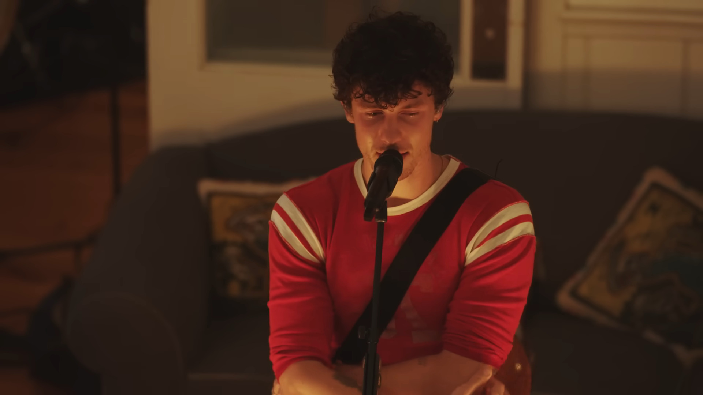
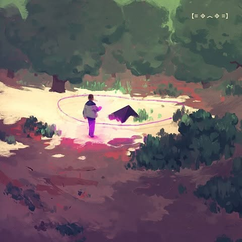
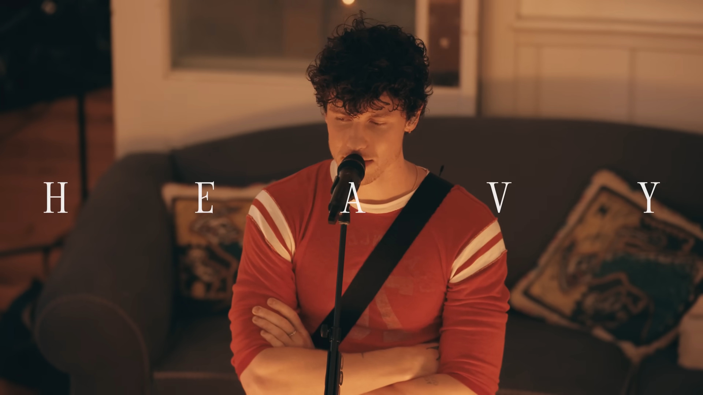
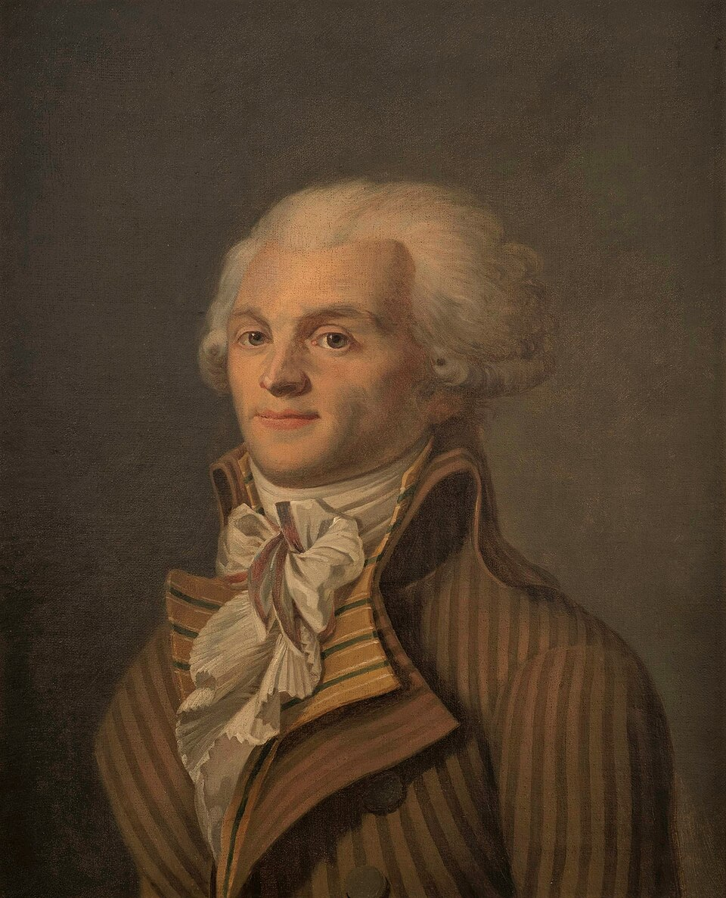

# chapter 2: the empty space…

Yah, đáng ra sẽ có một intro rất dài phải không. Dĩ nhiên là không rồi, vì những gì tôi kể thì tôi đã tập trung hết ở phụ lục đầu tiên rồi…. Đây chỉ là tóm tắt và thêm một chút những gì diễn ra sau đó thôi

:))))

# some attempts, looking back…

> honestly, it’s been a while since i’ve thought of you…  
>in the end, we didn’t talk much  
>i didn’t know what you were going through  
>i’m sorry that i wasn’t there  
>to hug your mama at your funeral  
>brian said he broke down  
>but he promised it was beautiful  
>
>when we were young  
>we didn’t care  
>we shot for the stars  
>i see you up there  
>
>you had a heart of gold….  
>
>Shawn Mendes - “Heart of Gold” - “Shawn”
> 

Trong 12 bài hát của album “Shawn”, có một bài hát nói về một người bạn khá thân trước khi Shawn nổi tiếng và nội dung của bài hát mang một nỗi buồn khi không thể ở bên bạn mình trong những giai đoạn khó khăn nhất. Theo như Shawn chia sẻ, thì anh có một người bạn rất thân, tầm 13 tuổi gì đó, tên là Deijomi, có tính cách cũng nhạy cảm như ổng và hai người gần như là anh em với nhau ấy. Khi Shawn bắt đầu trở nên nổi tiếng, đi tour thì gần như tình bạn trở nên phai nhạt vì không thể gặp được nhau, Brian - một ông bạn thân mà đi cùng Shawn trên mọi tour, đôi khi vẫn hay về nhà và báo một tin buồn là Deijomi bị dính dáng vào chất gây nghiện. Và điều tồi tệ nhất, đến vào năm 2018, chính là cái ngày mà Deijomi mất và Shawn thì lúc ấy đang đi tour nên không thể dự đám tang, mà chỉ có thể gửi tiền qua. Thấm thoát trôi đi cũng tầm 6 năm, khi ý tưởng cho album với bài “Heart of Gold” ra đời, mọi người hỏi về người bạn ấy của Shawn và mọi cảm xúc mà chưa từng nhìn lại khi ấy, tự nhiên ùa về. Cái chết thương tâm của người bạn khiến Shawn quyết định viết ra bài hát để nói những điều không thể nói ra khi ấy. Sơ lược về bài hát là vậy và tôi nghĩ mục đích của bài hát ấy khá phù hợp với phần nhìn lại những gì thực sự đã xảy ra, cũng như câu chuyện làm sao bước tiếp khi những thứ thân thuộc với mình không còn nữa...…

Tôi nghĩ tới phần này tính từ lúc tôi bắt đầu thi xong kì thi đại học. Thật sự không dễ dàng vì tôi phải đối diện với hai thứ: mất mát từ quá khứ và vô định của tương lai. Tôi bắt đầu trong một trạng thái mà hầu hết những người bạn của mình không còn ở bên, những sang chấn tâm lý vẫn chưa thực sự nguôi và nỗi lo âu của một người chưa hoàn toàn chuẩn bị về mặt pháp lý cho bản thân. Đó là một giai đoạn có phần cô đơn, tôi thấy xa lạ với chính mình và cảm thấy rất thiếu tự nhiên. Mỗi một ngày trôi qua cũng lạ, không còn đề thi, nhưng tôi lại chẳng thấy vui - chắc sự chán nản ăn mòn tâm trí tôi mất rồi, nên dù có thoát cũng không thể mỉm cười. Người ta liên tục hỏi về kết quả thi cử rồi trường học, tôi nghĩ kiểu: “mấy người hỏi câu đó thì có lấy lại được khoảng thời gian mà mấy người đã lây đi không?”. Tôi lặn khỏi mạng xã hội trong vòng 3 tháng, sống một cuộc sống ẩn dật, chỉ có ngồi code, tập thể dục, làm việc nhà.... tóm lại là một cuộc sống mà tôi không phải dậy sớm chỉ để làm đề nữa…

Tôi không nghĩ cuộc sống ấy vui, nhưng ít nhất, tôi có một ít thời gian để nhìn lại những gì mình đã đi qua, có thể dành nhiều thời gian hơn để trò chuyện với anh em và đối diện với những mất mát mà trước đây tôi chưa từng nhìn lại. Tôi biết mình chưa hoàn toàn chữa lành, nhưng khoảng thời gian ấy cũng phần nào nhẹ nhàng hơn. Bắt đầu tập thể dục, nói chuyện với gia đình và suy nghĩ mọi thứ cởi mở hơn,... và chuẩn bị tinh thần cho những buổi học đại học, thời kì dịch bệnh…

Thôi thì một chút cô đơn, nhưng cũng không đến mức nhàm chán, ít nhất là tôi có thời gian để đối diện với một vài mất mát để lết tiếp…

    
<strong>it will never be the same….</strong>

> 
> 
> 
> you carve into the bridge  
> "it might not be so bad to die"  
> believing in a lie that we'll leave behind  
> 
> Porter Robinson ft. Amy Millan - “Hollowheart” - “Worlds 10th Anniversary Edition”
> 

Trong tour diễn của album “SMILE” năm 2024, Porter đã quyết định mở khóa một bài hát đặc biệt: “Hollowheart”. Đáng ra bài hát đã có thể xuất hiện trong album “Worlds”, nhưng vì trễ deadline nên bị cất lại suốt 10 năm. “Worlds” từng tạo nên một cơn sốt lớn trong giới EDM, lấy cảm hứng từ những tựa game cũ, những câu chuyện trên internet và nỗi nhớ về một thời đại đã xa. Còn “Hollowheart”, theo cách tôi cảm nhận, mang tinh thần của “Anohana: The Flower We Saw That Day”: nỗi nhớ về một khoảng thời gian từng tưởng như vĩnh viễn, sự chia ly và việc rồi ai cũng phải học cách bước tiếp.

Nội dung ấy khá u buồn, nhưng cũng vừa vặn với tiêu đề: “mọi thứ sẽ chẳng bao giờ còn như trước”. Tôi đã phải suy nghĩ rất lâu xem nên bắt đầu câu chuyện này từ đâu, cho đến khi nhớ lại những “lần cuối” với crush — và tôi có ba lần như vậy. Tôi không bói toán hay cố gán cho chúng một ý nghĩa định mệnh nào cả, nhưng mỗi lần cuối ấy đều xuất hiện đúng lúc tôi phải thay đổi, phải lựa chọn sống tiếp cho chính mình trước khi một phần cuộc đời hoàn toàn lụi tàn.

Trong ba lần ấy, lần thứ hai diễn ra vào kỳ thi đại học năm 2021, khoảng ngày 9 tháng 7. Ngày hôm ấy khá ảm đạm, một phần vì dịch bệnh, nhưng với tôi, nó còn là lằn ranh giữa hai phần đời: một tương lai vô định mà tôi buộc phải bước tới và một quá khứ tăm tối đang dần nuốt chửng mọi thứ — từ chính tôi, việc học cho đến những mối quan hệ xung quanh. Ngay trên lằn ranh ấy, tôi nhìn thấy một con người mà mình từng nghĩ đã chết: một kẻ vẫn còn quyết tâm sống cho chính mình.…

Có lẽ con người tôi ở đại học cũng bắt đầu từ ngày hôm ấy. Khi chấp nhận rằng mọi thứ đều có thời hạn và tôi không thể quay trở lại như xưa, tôi quyết định sẽ thử sống cho mình thêm một lần nữa — không hối hận, bởi có những điều chỉ xuất hiện một lần trong đời.…

Có lẽ tôi nên kể lại cái cảm giác ấy như thế nào….

---

Khoảng thời gian cuối cùng của lớp 12 vô cùng cam go. Kết quả kỳ thi ấy gần như sẽ định đoạt tương lai của tôi, trong khi tôi không có nhiều lựa chọn khác. Song song với việc cặm cụi luyện đề từ 4 giờ sáng, tôi âm thầm thu thập tài liệu và học những kiến thức lập trình cơ bản — những thứ sau này đã giúp tôi rất nhiều ở đại học. Tất cả được lưu trong một chiếc ổ cứng mà đến giờ tôi vẫn giữ. Đó cũng là lần đầu tiên tôi dùng Git để lấy tài liệu và xem các dự án khác vận hành như thế nào. Tôi đếm ngược từng ngày và tự nhủ rằng: khi thoát khỏi giai đoạn này, tôi phải chuẩn bị để bắt đầu lại từ đầu.…

Kế hoạch đại học lại thay đổi vào phút chót. Năm 2021, HUST ngừng tuyển sinh một số chương trình khoa học máy tính liên kết với nước ngoài và TROY là lựa chọn còn lại. Việc vào TROY vốn không nằm trong dự định ban đầu — tôi từng nghĩ tới Úc hoặc Pháp nhiều hơn — nên tôi đã phải cố gắng thuyết phục gia đình chấp thuận một hướng đi mới.

Nhưng điều khó nhất không chỉ là chọn trường, mà là hình dung mình sẽ sống thế nào sau khi thi xong. Những năm THPT đã lấy đi rất nhiều thời gian và cả niềm tin vào bản thân; tương lai phía trước vì thế vừa tự do, vừa vô cùng khó đoán. Trong nhiều đêm mất ngủ, tôi hiểu rằng những kế hoạch và khả năng học tập mình có khi ấy đã là tất cả những gì tôi có thể chuẩn bị. Tôi không thể đưa mọi thứ trở lại như ban đầu. Tôi chỉ có thể chấp nhận rằng mình phải đi tiếp — bởi chỉ có đi tiếp mới giúp tôi bắt đầu giải quyết những gì quá khứ để lại.…

Tôi niêm phong lại toàn bộ dự án cá nhân và quá trình thu thập tài liệu, và tập trung chuẩn bị tốt nhất cho tâm lý của mình khi đi thi. Tôi vẫn đâu đó do dự, nào thì những thất bại, nào thì kết quả không tốt, tôi vẫn mang nỗi sợ ấy mãi cho đến một ngày…

Nó là vào cuối ngày phổ biến quy chế thi, thời tiết hoàng hôn khi ấy nắng nhẹ sau một buổi sáng ảm đạm nọ. Tôi lại ngồi chờ người quen trước khi về nhà và ở phía bên kia đường, tôi nhìn thấy crush của mình cũng đang chờ một ai đó. Và tôi nhìn cô ấy, cả hai chẳng nói một lời nào, chỉ như vậy cho đến khi tôi về nhà. Cũng giống như lời bài hát, cái khoảnh khắc ấy như mãi mãi với tôi, nhìn một mối tình của mình trong xa xăm mà ngỡ như mình có thể giữ được. Thật đáng tiếc trong dòng đời, tôi đã không thể giữ được cuộc sống của mình và phải cay đắng chấp nhận mọi thứ. Trong nhiều năm, nỗi hối hận vì phải để ai đó ra đi và không thể chiến đấu, để lại trong tôi một nỗi mặc cảm rằng - có lẽ tôi không thể làm gì hay bước tiếp, vì cuộc sống của tôi đã hoàn toàn biến mất rồi. Tôi rất sợ tương lai và lúc ấy cũng do dự chẳng biết nên làm gì tiếp theo. Crush xuất hiện trước mặt, trong khoảnh khắc ấy, có lẽ tôi muốn nói rất nhiều, là lời xin lỗi, cảm ơn và một chút lời tỏ tình trước khi tôi phải đối diện với cái lằn ranh ấy. Đó mãi là khoảnh khắc in sâu vào trái tim tôi, một khoảnh khắc mà tôi biết ở đâu đó, tôi vẫn sống, chỉ là việc đó không dễ dàng lắm.…

Cái cảm xúc ấy, tôi chôn giấu trong trái tim, nhưng lại là một động lực rất lớn. Tôi biết có hơi ích kỷ, chỉ là tôi ước cái khoảnh khắc ấy dài hơn và có thể, tôi sẽ mạnh mẽ để nói ra lời xin lỗi mà tôi chưa kịp nói trước kia. Kể từ cái khoảnh khắc “cuối cùng” ấy, tôi chuyển tâm trạng của mình: “**ừ, có lẽ tôi sẽ không hối hận, bất kể kết quả có ra sao thì tôi sẽ làm hết mình**”. Tâm trạng tôi có phần vui vẻ khi làm bài thi. Tôi đi về, cũng như vậy và lần đầu tiên tôi vươn hai cánh tay của mình lên trời và nói rằng: “**có lẽ tôi đã cảm nhận chút mặt trời rồi**”. Trong tâm tôi, thì tôi hoàn toàn biết mình không thể trở về lúc trước khi trầm cảm, hay kéo dài một khoảnh khắc, nhưng chính khoảnh khắc ấy nói với tôi rằng tôi nên chuẩn bị để đi tiếp cho một thế giới rộng lớn hơn. Tôi mang một tâm trạng như được cứu và hiểu ra những điều mình cần làm. Cũng kể từ lúc ấy, tôi bắt đầu toàn bộ kế hoạch để dọn dẹp dần hậu quả…

Có hai việc lúc đó tôi đã làm, theo đúng tiến trình sau khi thi. Việc đầu tiên sau khi tôi thi xong, đó là tìm hết đề thi để đốt hoặc bán sắt vụn. Những đề thi ấy đã cướp đi cuộc sống của tôi rồi, và chẳng có cái lý gì để biết ơn thứ đã cướp đi cuộc sống của tôi cả, theo tôi nhớ là chỉ bán sắt vụn, chứ bình thường là tôi sẽ không do dự mà đốt luôn. Tôi cũng bắt đầu tạm lánh về quê một thời gian, phần vì dịch bệnh và cũng là chuẩn bị học lái xe. Tầm đấy, tháng 8, khi tôi nhận được kết quả thì - không tệ, và việc tôi làm là... out nhóm Zalo của lớp chính và lớp học thêm. Với tôi thì, dù tôi không đến mức cực đoan, tôi cũng không thấy vui vẻ trước cái việc tiết lộ điểm số như một nghĩa vụ, vì họ không thèm để tôi vào mắt, nên tôi làm như vậy cũng chẳng khiến họ bị ảnh hưởng. Nhưng lớn hơn, tôi muốn bỏ đi một hình ảnh mà vốn không thuộc về mình, một kẻ bị định nghĩa bởi thứ đã phá hoại anh ta, để tôi có thể thoải mái với cuộc sống hiện tại. Lớn hơn nữa, là khi tôi chính thức đỗ đại học, thì tôi đã chính thức thành công cắt đứt toàn bộ liên hệ dưới danh nghĩa trước đó và cho mình thời gian lặn vừa đủ để làm việc với lớp mới.

Những ngày sau đó khá bình lặng. Việc biết rằng mình không còn phải sống trong hình ảnh cũ vừa khiến tôi lo lắng, vừa đem lại một cảm giác nhẹ nhõm. Tôi phải tập sống cho hiện tại, đối diện với những tổn thương của mình và bắt đầu lại gần như từ con số 0.

Từ lúc ấy, tôi cũng đặt ra một ranh giới rõ ràng hơn để bảo vệ quyền riêng tư: không công khai điểm thi và nơi mình học nếu bản thân không muốn. Câu trả lời của tôi khi ấy khá thẳng: “**nếu cần thiết tới vậy thì tự tìm hiểu đi**”. Sau nhiều năm người khác đem chuyện học tập và đời sống cá nhân của tôi ra bàn tán, tôi không muốn tiếp tục trao cho họ quyền ấy nữa. Tôi cũng nói rõ điều này với bố mẹ: đây là câu chuyện của tôi, và tôi có quyền quyết định ai được biết nó.

Có thể cách làm ấy không mềm mỏng, nhưng vào thời điểm đó, nó là cách tôi biết để tự bảo vệ mình. Khi chính thức bước vào đại học, tôi hiểu rằng mình phải sống cho những điều thật sự cần thiết và ngừng làm tổn thương bản thân chỉ để giữ một hình ảnh vốn chưa bao giờ thuộc về mình. Tôi chưa hoàn toàn chữa lành, nhưng ít nhất đã nhìn thấy một chút ánh sáng ở cuối đường hầm. Tôi không thể quay lại thời điểm trước khi mọi thứ tan vỡ; tuy vậy, nếu vẫn còn một cách để yêu thương phần con người còn lại, tôi sẵn sàng lựa chọn nó.…

# another world…

> if i had a choice…  
>i’d be somebody else…  
>if i had a voice  
>i’d speak if no one tells  
>
>’cause it’s lately my own kind  
>who’s breaking me inside  
>
>if i had a choice…  
>i’d be somebody else…  
>
>Michael Clifford - “if i had a choice” - “SIDEQUEST”
> 

Lời hát có phần đơn giản phải không: “**nếu cho tôi một lựa chọn, tôi muốn trở thành một ai đó khác đi**”.

Hầu hết khoảng thời gian diễn ra ở bản phụ lục đầu tiên, chính là thời kì đại học, nơi mà mọi người dần biết về những gì tôi đã làm, đã trải qua và học những gì từ những trải nghiệm ấy. Cũng vì đó, tôi sẽ không kể lại toàn bộ quyết định, nhưng điều tôi muốn làm là tại sao tôi lại nghĩ đến những điều đó, và cái cách tôi nghĩ về những quyết định ấy, ắt hẳn phải có một lý do đằng sau… Sự thật, nếu như bạn đọc phần “long depression”, thì bạn sẽ nhìn ra một thế giới gần như không có sự sống, chỉ có tồn tại và chạy đua thành tích, thì với câu chuyện của “một thế giới khác”, có thể hiểu là cái cách tôi đảo ngược những gì tôi đã làm, trong cùng một bối cảnh, cùng một khó khăn ấy. Nhân đây, tôi cũng muốn có một chút tri ân tới những người bạn mà cùng tôi đi suốt khoảng thời gian khó khăn ấy….

Tôi nghĩ là, nếu không có sự giúp đỡ của các bạn, thì khó mà có tôi, điều đó quá rõ ràng rồi….

    
<strong>warmth from strangers…</strong>

   

    
> it’s been so heavy…  
>it’s been so long…  
>running from everything…  
>and nothing at all…  
>
>you’ve been rock steady  
>tryna help me through  
>now i’m finally ready…  
>to let you…  
>
>Shawn Mendes - “Heavy” - “Shawn”
> 

Nói về bài “Heavy” của Shawn, bài hát khá đơn giản nhưng có một thông điệp rất lớn tới cá nhân tôi về việc tin tưởng mọi người và tin rằng ở đâu đó, vẫn có những người yêu thương tôi và giúp tôi vượt qua những giai đoạn tăm tối nhất. Trong buổi gặp mặt để nghe trước album của Shawn - “The Clubhouse Session”, anh tôi có nói về giai đoạn khó khăn trong cuộc sống sau những thất bại liên tiếp, từ hủy tour, cho đến việc không thể thu âm một bài hát nào và cái cảm giác như không còn cảm nhận được tình thương của mọi người, và đây là những gì anh nói:

> “People talk a lot about learning how to give love but honestly receiving love is really hard... being open to receive love”
> 

Khi nghe những lời chia sẻ ấy và cả bài hát, có một khoảng thời gian tôi nghe bài này suốt ở những năm cuối đại học vì lời hát thật sự chạm đến trái tim tôi và giúp tôi vượt qua những giai đoạn vô định nhất trong cuộc đời của mình. Bạn nghe một bài hát mà gần như bạn cởi bỏ được gánh nặng và học cách mở lòng với tất cả mọi người, đó cũng chính là cảm giác khi ở đại học của tôi, và cũng là những gì tôi muốn nói ở tiêu đề: “hơi ấm từ những người lạ”. Trước khi tôi nói tới những gì tiếp theo sẽ diễn ra - ở đây là câu chuyện làm lớp trưởng, thì tôi cũng muốn nói rằng tôi không thể trở thành lớp trưởng nếu như không có sự giúp đỡ từ những người bạn…

Cứ coi đây là một phần ngắn kể về mối quan hệ của tôi và những người bạn xung quanh mình kể từ lúc vào đại học cho tới hiện tại…

---

Phần này có một cái tên khác là “những người lạ thân quen”, như cái cách tôi miêu tả những mối quan hệ ở đại học của mình. Thực tế mà nói, thì những mối quan hệ mà tôi có, trừ mấy anh em từ cấp II, thì hầu hết đều không dựa trên những gì người ta biết về tôi ngay từ đầu. Ví dụ, mấy anh em ở xứ “địa ngục” của tôi thường không biết quá nhiều chuyện về học lực, hoặc nếu biết thì họ cũng không quá quan tâm hay khoảng cách gì về điều đó. Họ không đặt một giả thuyết là họ biết tôi ngay từ đầu và họ khá thoải mái, nên thành ra, có thể gọi là “**người lạ nhưng thân quen**” là như vậy đó…

Nhưng câu chuyện ở đại học còn lớn hơn một chút. Thật ra, tôi biết đến lớp cũng khá muộn, thậm chí là phải sau vài buổi học đầu tiên thì tôi mới chủ động tìm lớp. Tính tôi thì khá xàm, lên nhóm lớp kể đủ thứ nhưng có một cái khá hay là họ không có ác cảm lắm từ mấy chuyện xàm xí. Kể từ đó, thì tôi có một suy nghĩ là tôi muốn giúp sức cho lớp của mình, một phần là từ ám ảnh cái lớp chọn trước kia, nhưng một phần khác là tôi muốn mình có thể giúp sức và tìm kiếm những mối quan hệ tốt sau này. Đi hơn 8 kì, làm việc với những con người ấy khiến tôi thật sự mở mang được rất nhiều thứ và cũng buông rất nhiều thứ. Tôi thấy họ hiểu chuyện, họ thông minh, họ đoàn kết, đúng nghĩa là suy nghĩ của những người văn minh. Có vô số điều mà tôi muốn học hỏi từ họ….

Cái điều tôi nhìn thấy và học hỏi từ họ, có lẽ là sự cởi mở về văn hóa. Ở lớp tôi, sự cởi mở ấy là một điều rất tự nhiên, dù mỗi người có những sở thích và góc nhìn khác nhau. Cái nơi tôi bắt đầu sự cởi mở ấy, có lẽ là Discord của lớp, thực tế là lần đầu tôi mới dùng để trao đổi với bạn bè, tạo bot hay là nhận thông báo của một hội nhóm nào đó. Từ trước tới nay, tôi chưa một lần nào cho phép mình dùng những thứ mới mẻ ấy và việc dùng Discord giống như một thế giới mới vậy. Học và làm việc với mọi người, tôi có một cảm giác như mình không cảm thấy phải xa lạ với những ý tưởng mới mà mình còn tiếp thu khá nhanh và chịu đi tìm hiểu những thứ văn hóa ấy. Tôi có khá nhiều người bạn trong lớp với nhiều quan điểm văn hóa và lĩnh vực họ quan tâm, đặc biệt về game và hội họa, họ là những người đầu tiên cho tôi biết rằng thế giới này đủ rộng lớn để khám phá, và đôi khi việc tìm hiểu một văn hóa nào đó không đến mức căng thẳng như tôi từng nghĩ. Ngoài chuyện trường lớp, thì những câu chuyện ngoài lề về văn hóa ấy giúp tôi giao tiếp tốt hơn và hiểu về những quyết định của mình sẽ phần nào tác động lên ai đó để điều chỉnh sao cho phù hợp. Sẽ chẳng biết như thế nào nếu phải làm việc với những người bảo thủ nữa, chỉ là tôi thấy rất nhẹ đầu, dễ nói chuyện và dễ tiếp thu với những người cởi mở, phải nói là vậy…

Tiếp theo là sự kiên nhẫn và một thái độ có phần “chill”. Tôi không nghĩ là họ đủ kiên nhẫn với mọi thứ nhưng thái độ “chill” trước mọi chuyện khiến tôi vừa khó hiểu vừa nể phục. Cái tính của tôi, kể từ lúc bắt đầu bị trầm cảm và xuyên suốt đại học, luôn trong một cái nỗi sợ rằng mình không thể làm tốt và phải làm mọi thứ nhanh nhất có thể. Một trong số ví dụ ấy là tôi dễ lo âu chuyện điểm số - không phải vì tôi ưa điểm số, mà là tôi sợ trượt môn, nhưng họ đều cho tôi một lời khuyên khá thực tế: “**chill đi ông ạ**”. Khi họ nhắn như vậy thì tôi không chắc là họ có nghĩ vậy hay không, nhưng tôi biết rằng tôi cần phải bình tĩnh và nhìn vấn đề rộng hơn một chút. Có những thứ mà tôi không thể vội vã được, hay phải đòi hỏi quá nhiều về việc nó phải thành công, tôi chỉ có thể chấp nhận rằng tôi đã làm xong một thứ nào đó, và việc tốt nhất là phải chuẩn bị cho những thứ khác quan trọng hơn. Giữa áp lực trượt môn ấy, sự bình tĩnh của họ giúp tôi trân trọng từng khoảnh khắc đi học hơn và tập nhìn một vấn đề mà không quá vội vã. Tôi vẫn chuẩn bị cho tình huống xấu nhất, nhưng cũng dần hiểu rằng không phải chuyện gì cũng cần được đối diện trong một tâm thế căng thẳng…

Và cuối cùng là họ trưởng thành, nếu không muốn nói là hơn tôi một chút. Một trong số những lý do khiến lớp hoạt động khá đoàn kết và trơn tru không phải là việc họ nhất nhất đồng ý với mọi thứ tôi đề xuất, mà là họ có chính kiến và sẵn sàng trao đổi rõ ràng về những điều mình thấy hợp lý hay chưa hợp lý. Trong đầu chúng tôi luôn treo lơ lửng cái án trượt môn - rằng nếu trượt một môn thì có thể mất hẳn 1 kì = 26 củ, cái việc đoàn kết không phải dựa trên một suy nghĩ quá ngây thơ mà họ hiểu rằng, làm việc riêng rẽ không mang lại kết quả tốt, và nếu muốn đoàn kết thì phải tôn trọng lẫn nhau. Trong những vấn đề của lớp, dù tôi là lớp trưởng nhưng họ lại khá chủ động về mặt thông tin nên thành ra, ngay trước khi tôi ra một quyết định hoặc có một ý kiến nào đó để hỏi, thì họ ít nhất cũng biết được cái tác động và đã chuẩn bị trước rồi.

Thêm nữa, tôi khó có thể học cách làm tốt vai trò của mình nếu như không có sự bao dung của những con người tuyệt vời ấy. Tôi nói luôn, là đời lớp trưởng của tôi gặp vô số chuyện xui xẻo, sai lầm và những xung đột nội tâm không dễ để giải quyết, nhưng ít nhất thì tôi có thể tìm ai đó, nói chuyện và tìm kiếm lời khuyên rằng tôi nên làm gì và không nên làm gì trong cái trường hợp đó. Việc nhìn từ nhiều góc độ giúp tôi đưa ra những quyết định tốt hơn mà không bị cảm xúc chi phối nhiều - vì tôi biết một khi tôi đưa ra một quyết định thì sẽ có rất nhiều người sẽ liên quan, nên ít nhất việc hỏi một ai đó không bao giờ thừa, nhất là với những người có liên quan.

Đó là những tóm tắt chung về lớp, nhưng có lẽ còn có khá nhiều thứ đặc biệt đã xảy ra, thậm chí là từ những chuyện đó mà khiến thời đại học trở nên đáng nhớ…

    
<strong>liberté, égalité, fraternité</strong>

    
Phần tiêu đề lại khá đặc biệt: “**Liberté, Égalité, Fraternité**” — “**Tự do - Bình đẳng - Bác ái**”, tiêu ngữ của nước Cộng hòa Pháp. Tôi không định biến phần này thành một bài kể về lịch sử, cũng không muốn ví một lớp học với cả một cuộc cách mạng. Tôi chỉ mượn ba chữ ấy để gọi tên những điều mình đã cố gắng thực hiện khi làm lớp trưởng: mỗi người có quyền tự quyết định, có cơ hội tiếp cận thông tin như nhau và có thể giúp đỡ lẫn nhau, thay vì phải tự xoay xở một mình.…

---

Trong khoảng thời gian tôi viết cái phần phụ lục này, tôi đã rất muốn có một cơ hội để giải thích những vấn đề nảy sinh khi làm lớp trưởng, cũng như cái quan điểm của tôi khi ấy. Phần phụ lục chỉ giải thích cách nó tiến hành, còn để nói về quan điểm thì chưa thật sự rõ ràng. Tôi cũng chưa biết phải dùng từ gì để có thể miêu tả cái tổ hợp quan điểm ấy, vì hầu hết tôi chỉ tập trung hành động, còn về nguyên tắc thì chưa hệ thống hóa được. Thế nhưng mà tự dưng lại nhớ tới cái tiêu ngữ ấy và tôi nghĩ là, cái tiêu ngữ mô tả sát nhất những quan điểm và phương pháp làm việc mà tôi hướng tới cho mình và lớp học của mình. Nếu nhìn rộng ra, thì những quan điểm và phương pháp làm việc ấy chứng minh rằng một tập thể lành mạnh hoàn toàn có thể xảy ra, với những phương pháp cấp tiến và giúp cho mọi người giải quyết tốt những vấn đề trong học tập cũng như cuộc sống cá nhân…

Để giải thích cái phương pháp làm việc và quản lý theo kiểu “tự quản”, thì tôi cũng muốn nói rõ… tôi là một người theo quan điểm Marxist. Đây là một phần trong cách tôi nhìn những vấn đề về bất bình đẳng, quyền tiếp cận thông tin và trách nhiệm với tập thể, chứ không có nghĩa mọi người trong lớp phải cùng quan điểm với tôi. Tôi bắt đầu những quan điểm này từ những năm tháng THPT, sống dưới tình trạng phân biệt đối xử và bất bình đẳng trong học tập. Như tôi nói ở thời kì “trầm cảm dài” - “long depression”, thì việc cạnh tranh từ trên xuống, thay vì tạo ra những người có khả năng học tập tốt, thì lại tạo ra một tầng lớp nhân tài trị và kéo sập khả năng học tập của toàn bộ học sinh. Đây là tồn tại xã hội mà tôi biết, và điều này cũng nói rõ rằng, tôi làm lớp trưởng hay các quyết định của tôi đều không từ sự ngây thơ nào cả. Lớn hơn nữa, những gì thực sự hoạt động ở trong cái chương trình học và vấn đề quản lý khi ấy đã tạo ra một sự bất mãn lớn trong các sinh viên, điều này cũng thúc đẩy sự ra đời của phương pháp quản lý mới và những quan điểm lạ lẫm khi đó…

Các bạn không cần cùng hệ tư tưởng với tôi để đọc câu chuyện này. Điều tôi muốn làm rõ hơn là những quan điểm ấy đã đi vào công việc hàng ngày như thế nào, giúp được gì cho lớp và vì sao tôi lựa chọn cách làm ấy…

---

Điều đầu tiên, làm lớp trưởng không phải là tạo ra một thế độc quyền về mặt thông tin hay dựa trên niềm tin rằng đặc quyền sinh ra từ chức vụ, mà nó đến từ một trải nghiệm tâm lý dẫn đến sự thay đổi trong cách nhìn nhận - “**tính tự quản**”. Tôi làm lớp trưởng bằng sự chỉ định, chứ không thông qua bầu cử. Tôi không biết nếu tiến hành bầu cử thì mình có được chọn hay không. Nhưng việc được chỉ định không có nghĩa là tôi đương nhiên có được sự tin tưởng của mọi người; điều đó vẫn phải được xây dựng bằng cách làm việc. Cái đen đủi ở chỗ là, đáng ra tôi có thể tiến hành mọi thứ như dự định với một tâm lý ổn, thì ngay đúng kì thứ 3, tôi gặp không ít chuyện xui xẻo, nghiêm trọng nhất chính là việc tôi bị hỏng máy tính trong thời gian 4 tháng cuối năm 2022 - tương đương một kì học mà tôi gần như không thể nguôi ngoai đi. Ngay đúng lúc đầu làm lớp trưởng, sự cố hỏng máy tính ấy đã dẫn đến những tình huống khó hiểu, theo tôi nhớ lúc ấy là lớp không thể nhận thông tin về thời khóa biểu và phải đến buổi đầu tiên thì mới có thông tin. Dù chưa đến mức nghiêm trọng để thành một bê bối, nhưng cái sự chậm trễ ấy khiến tôi phải suy nghĩ rất nhiều về những phương pháp quản lý, và càng về sau, còn có nhiều vụ việc như là tôi bị mất liên lạc với mọi người do bị vô hiệu hóa Messenger, khiến tôi nghĩ ngay đến việc từ chức, vì ngay lúc mới nhậm chức thì đã bị chặt tay rồi.

Mọi người thường nhìn nhận cái chức lớp trưởng là cái gì đó to tát lắm, nhưng thực tế, với tôi thì những thứ “lợi ích” hay “đặc quyền” mà mọi người nghĩ đến, thì tôi lại không có. Làm lớp trưởng, xen giữa mối quan hệ giữa sinh viên, giảng viên và quản lý, thì tôi nhận thấy một thực tế rằng sinh viên tôi học có quá ít sự hỗ trợ nhưng vẫn trong tình trạng bị kiểm soát rất chặt. Lớp tôi khi ấy, nếu muốn cần sự hỗ trợ thì chỉ có thể gọi chủ nhiệm, nhưng chủ nhiệm thì thường đưa ra câu trả lời khá chung chung, thậm chí là bị trách ngược. Chức lớp trưởng khi ấy, nhiều khi giống như một con rối hơn, một mặt vẫn phải làm việc với lớp và đối diện thực tế hàng ngày, và một mặt thì vẫn phải tỏ ra như thể là con cưng của chủ nhiệm vậy. Tôi đánh giá là vô cùng khó xử và sự khó xử ấy yêu cầu một phương pháp làm việc mới…

Vậy nên, tôi chọn một phương pháp làm việc mang xu hướng tự quản, nơi mà các sinh viên, một là tự do và tự chịu trách nhiệm trước mọi hành động khi được cung cấp thông tin, hai là các hội bạn trong lớp sẽ tận dụng những thông tin thu thập để có thể phản ứng, ba là chia sẻ thông tin giữa các sinh viên với nhau và tăng sự minh bạch cũng như tính chính xác của quyết định. Việc đó chính là chuyển tiếp toàn bộ thông tin mail từ mail lớp về toàn bộ các mail cá nhân, rồi dùng chính thông tin thu thập báo lại cho những người chưa biết hoặc chưa nhận được mail trước đó. Nhờ việc này mà vấn đề thông tin như thời khóa biểu, bài tập hay là thông tin về điểm số được giải quyết một cách gọn ghẽ, và cái gánh nặng cũng giảm đi khá nhiều…

Với tôi, “**tự do**” ở đây là có đủ thông tin để tự lựa chọn và chịu trách nhiệm, chứ không phải bị bỏ mặc để tự đoán mọi thứ. “**Bình đẳng**” là việc tiếp cận thông tin không phụ thuộc vào chuyện bạn có thân với lớp trưởng hay không. Còn “**bác ái**” nằm ở một việc rất nhỏ: khi mình đã biết, mình vẫn báo lại cho người chưa nhận được, thay vì coi phần việc của mình đã xong. Ba điều ấy không tách rời nhau; chúng giúp mỗi người chủ động hơn mà không phải xoay xở một mình.…

Tôi chưa bao giờ nhìn một công việc trên góc độ quyền lực, ngay cả chức lớp trưởng của tôi thì tôi không muốn độc quyền gì về thông tin. Với một chương trình học có rất ít sự hỗ trợ, hoặc gần như không có, thì việc duy trì phương pháp độc quyền như cũ, không tạo ra sự tiến triển mà chỉ khiến cho mọi người trở nên bị động trước những quyết định khó hiểu đến từ ban quản lý. Nhìn trên phương diện cá nhân, tôi cũng có lúc mệt mỏi, gặp sự cố hoặc không thể có mặt kịp thời — và bất kỳ ai đảm nhận công việc này cũng có thể như vậy. Nếu thông tin của cả lớp chỉ đi qua một người, thì một trục trặc cá nhân cũng có thể khiến mọi người bị ảnh hưởng. Tôi chọn chia sẻ thông tin để mỗi sinh viên có thể chủ động thực hiện những quyền và nghĩa vụ của mình, thay vì phải chờ lớp trưởng trong mọi tình huống. Trải nghiệm đầu tiên dạy tôi rằng một lớp học chỉ có thể phát triển khi tính tự quản và tính cộng đồng là ưu tiên, chứ không phải là sự độc quyền từ ai đó…

---

Tiếp theo, chính là mục đích khi tôi làm lớp trưởng. Ban đầu, tôi cũng có một chút tư lợi và mong muốn được công nhận — ai mà chẳng muốn có một chút danh vọng, nhỉ? Nhưng có lẽ quan điểm của tôi đã thay đổi rất nhiều kể từ lúc phải đối diện với những nỗi khổ của mọi người thông qua những trao đổi hết sức cá nhân cũng như theo dõi tình trạng học tập của mỗi người. Tôi có nói ở phần đầu, chúng tôi học trong một chương trình có rất ít sự hỗ trợ; riêng với tôi, đó còn không phải là lựa chọn mình muốn ngay từ đầu. Thử nhìn những sinh viên chúng tôi khi ấy bị quay như chong chóng, tệ hơn là giống như bị bóc lột về mặt tâm lý ấy, điều đó khiến tôi không thể chịu nổi, một phần là trải nghiệm cá nhân tồi tệ, nhưng lớn hơn là cái thực tế đó lại đang ăn mòn khả năng của mọi người - trong đó có tôi.

Thế nên, mục tiêu của tôi dần trở thành giúp lớp bớt bị động, có đủ thông tin và có khả năng bảo vệ quyền lợi trước những vấn đề trong quản lý. Để làm được điều đó, cả lớp cần được vận hành theo một hướng khác. Tôi lấy từ góc nhìn của chủ nghĩa Marx, trong đó quyền lợi của sinh viên phải được ưu tiên hàng đầu và các sinh viên phải được hỗ trợ bởi một đội ngũ có khả năng tư vấn, cũng như cả tập thể lớp. Tôi muốn lớp có thể chủ động hơn với tương lai của mình, và muốn cùng mọi người đặt những nền móng đầu tiên cho cách làm ấy. Tự quản không có nghĩa là chúng tôi phải gánh thay mọi trách nhiệm của chương trình, mà là có thể hỗ trợ nhau thay vì chỉ chờ đợi.

Repo sinh ra với một cái lẽ khá đơn giản: nếu sự hỗ trợ chưa đủ, thì ít ra chúng tôi còn có một cổng thông tin được cập nhật liên tục để chủ động hơn trong việc học, thay vì cứ phải xoay xở trong tình trạng thiếu thông tin. Nhìn lại, điều khiến tôi thấy công sức ấy có ý nghĩa là lớp đã tự quản tốt hơn, mọi người chủ động chia sẻ và hỗ trợ nhau, cũng bớt phải phụ thuộc vào tôi. Chính điều đó cũng giúp tôi nhẹ đi một phần gánh nặng tâm lý trong lòng mình….

---

Còn về những khác biệt trong cá nhân, phần này gần như khá nhẹ, nhưng tôi nghĩ có một vài điểm cần được nhắc đến…

Về vấn đề bình đẳng, thì tôi cho rằng: “**Chúng ta bình đẳng về quyền lợi và cùng có trách nhiệm với tập thể; còn những khác biệt về tính cách, sở thích hay quan điểm không nên trở thành lý do để coi thường hoặc loại trừ nhau.**”. Mỗi người trong lớp đều có suy nghĩ và lựa chọn riêng. Với tôi, tôn trọng họ cũng là tôn trọng những khác biệt ấy, chứ không lấy chúng làm lý do để áp đặt hoặc gạt ai đó ra ngoài. Lớp cũng làm rất tốt trong việc giúp cho những khác biệt ấy không cản trở tới khả năng học tập của mỗi người. Dù là người mới hay người ở lớp trên đến học chung môn với lớp tôi, cách đối xử cũng không có nhiều sự phân biệt. Thành ra, nhờ cách đối xử bình đẳng ấy, việc phối hợp trong lớp cũng thuận lợi hơn. Điều tôi trân trọng không phải là mọi người luôn đồng ý với nhau, mà là chúng tôi có thể trao đổi thẳng thắn và làm việc cùng nhau mà không cần biến những khác biệt cá nhân thành khoảng cách…

Nhìn rộng hơn, tôi nghĩ bình đẳng và bác ái cần bổ sung cho nhau: quyền lợi chung phải đi cùng sự hỗ trợ thực tế, còn việc giúp đỡ không nên chỉ dành cho những người thân quen. Trở lại với lớp tôi, chúng tôi đều là người học và cùng đối diện với những khó khăn của chương trình, dù hoàn cảnh và khả năng của mỗi người không giống nhau. Nếu còn phân biệt đối xử hoặc để một số người thiếu thông tin, thiếu sự hỗ trợ, thì làm sao họ có thể học và đóng góp tốt cho tập thể?

Với tôi, cách làm việc cởi mở là tạo điều kiện để mỗi người có thể phát huy khả năng, thay vì gạt những ý tưởng hoặc nhu cầu khác biệt sang một bên. Trước hết, mọi người cần được bảo đảm những điều kiện học tập cơ bản, rồi từ đó mới tìm cách hỗ trợ những khó khăn riêng. Điều đó không có nghĩa ai cũng cần được giúp theo cùng một cách. Công việc lớp trưởng của tôi không phải là bảo đảm mọi người có kết quả giống nhau, mà là cố gắng để không ai bị mất cơ hội học tập chỉ vì thiếu thông tin, thiếu hỗ trợ hoặc bị gạt ra ngoài bởi những khác biệt cá nhân…

---

Cuối cùng, điều tôi muốn ở mình và mọi người là sự trung thực. Bạn khó có thể học tập và làm việc khi không biết rõ điều gì đang xảy ra, hoặc phải dựa vào những thông tin không đúng với thực tế. Trong những ngày chúng tôi đi học mà sự hỗ trợ từ phía quản lý còn quá ít, thông tin thiếu rõ ràng chỉ khiến mọi người thêm bị động. Vì vậy, điều tôi thấy có ý nghĩa ở repo là nỗ lực phản ánh trung thực những vấn đề của giảng viên và môn học, đồng thời phân biệt trải nghiệm cá nhân với những thông tin có thể kiểm chứng. Sự trung thực ấy là cần thiết để đưa ra những quyết định có cơ sở hơn, từ đó giúp lớp chủ động hơn trước những thay đổi.

Nhưng muốn mọi người nói thật, thì cũng phải có sự tôn trọng và lắng nghe từ nhiều phía. Những điều đó khó duy trì nếu mọi sự cạnh tranh chỉ hướng đến danh hiệu cá nhân. Với tôi, một tập thể không cần lúc nào cũng đồng thuận, nhưng phải có chỗ để mỗi người nói thật, được lắng nghe và cùng sửa những điều chưa ổn. Đó cũng là điều tôi muốn giữ lại trong repo này….

---

Tôi chẳng nhớ hết những lý thuyết nào cả, hầu hết những gì tôi biết chỉ là hành động của mình và những điều tích cực sau đó. Việc tôi rũ bỏ đi một phương pháp cũ kĩ và thay thế bằng sự thoải mái và lắng nghe mọi người, đã giúp tôi cởi mở hơn và việc học tập cũng nhẹ nhàng hơn nhờ có sự trợ giúp từ tất cả mọi người. Ít nhất thì tôi đã kịp chứng kiến một thế giới mà mọi người có thể tự quản, nơi mà phân biệt đối xử bị loại trừ và mọi người được sống trong phẩm giá, bất kể mọi sự khác biệt nào. 

Repo ấy cũng không chỉ là nỗ lực của riêng tôi, mà là của tất cả mọi người và niềm tin rằng các bạn hoàn toàn có thể cùng nhau vượt qua. Tôi muốn và các bạn cũng muốn một môi trường lành mạnh, thì hãy đấu tranh vì nó…. tôi chỉ nói vậy thôi…

