# chapter 3: the continuation…

> 
> 
> 
> look at the sky, i'm still here  
> i'll be alive next year  
> i can make something good, oh  
> something good  
> 
> look at the sky, i'm still here  
> i'll be alive next year  
> i can make something good, oh  
> something good  
>  
> Porter Robinson - “Look At The Sky” - “Nurture”
> 

---

Cũng một khoảng thời gian dài tính từ lúc tôi vỡ mộng khi đi làm, chấp nhận những gì buộc phải đến và đối diện với cảm xúc từ quá khứ. Thật khó tin thời gian trôi nhanh đến thế, và sau chừng ấy nỗi đau, tôi vẫn còn tồn tại — chỉ là đã rất lâu rồi tôi không cảm nhận được niềm vui. Nhìn lại những đổ nát khi ấy, trong lòng tôi từng có một nỗi tiếc nuối lớn: giá như ngày đó có một cơ hội khác, có lẽ mọi chuyện đã không tệ đến mức này, và tôi đã giữ được nhiệt huyết của mình. Nhưng nói đi cũng phải nói lại, tôi biết ơn những người đã giúp tôi đi qua giai đoạn tồi tệ nhất trong sự nghiệp; không có họ, có lẽ tôi đã phát điên mất. Cuộc sống luôn đòi hỏi sự đánh đổi để bước tiếp. Có những thứ ở một thời điểm ta nghĩ là cần thiết, nhưng khi nhìn lại mới thấy mình đã đánh mất cả một quãng đời có thể sống an yên. Dẫu vậy, sau khi đã nếm trải đủ hối hận và lường trước những kịch bản tồi tệ nhất, câu chuyện lúc này không còn dừng lại ở sự nuối tiếc nữa, mà là:

> “Kể cả khi đã biết trước những điều tồi tệ ấy, liệu tôi có muốn bước tiếp, và đâu là con người mà tôi thật sự muốn trở thành???”
> 

Trong suốt 6 tháng đầu đối diện với kiệt sức, đó là một câu hỏi rất khó trả lời. Xung quanh tôi là deadline, là những ngày gồng mình chống đỡ cảm xúc trong cô độc, là cảm giác lặp đi lặp lại đơn điệu và một công việc thiếu vắng sự sáng tạo... đủ trọn bộ cho một chuỗi ngày kiệt quệ. Thế rồi, tôi bắt đầu tìm lại chính mình qua những thứ rất khác — những điều giản dị, tình cờ, không chạy theo xu hướng của ai. Đó là những món đồ cũ của Sony: một chiếc Xperia 1 II bản Docomo, một chiếc máy ảnh ngàm E ra mắt từ 5 năm trước, chiếc máy nghe cassette từ năm 1996,... kèm theo vài phụ kiện như tai nghe dây B&O của LG, và 3 cuốn băng cassette của Shawn Mendes trải dài từ 2018 đến 2024 mà tôi mua bằng tiền thưởng. Cảm giác gắn bó với những thứ xưa cũ ấy mang một vẻ đẹp tĩnh lặng. Chúng nhắc tôi nhớ rằng: trên đời này, mình không nhất thiết phải chạy đua. Có những món đồ đã cũ nhưng vẫn hoạt động bền bỉ, mang lại niềm vui và sự an tâm chân thật khi sử dụng. Từ sự bình yên nhỏ bé ấy, một ý niệm mới bắt đầu nhen nhóm giữa cuộc sống mệt mỏi mà ngày ngày tôi phải đối mặt.…

Chính chiếc máy ảnh ngàm E ấy đã kéo tôi trở lại với nhiếp ảnh — kỹ năng mà tôi từng học được từ chính những mất mát. Suốt một thời gian dài, tôi từng đánh mất toàn bộ ảnh chụp cũ, không thể khôi phục lại những khoảnh khắc nguyên bản. Cùng với chứng trầm cảm sau đó, sự cố ấy từng để lại nỗi day dứt khôn nguôi: tôi luôn nơm nớp lo sợ mọi thứ quý giá sẽ biến mất mà không cách nào tái hiện lại. Nhưng khi cầm máy ở hiện tại, nhiếp ảnh mang đến cho tôi một lăng kính hoàn toàn khác. Trong khung hình, tôi không cần phải chạy đua với ai, cũng chẳng cần cố làm đẹp lòng ai; điều quan trọng duy nhất là bắt trọn khoảnh khắc và lưu giữ nó. Tôi tập chụp mỗi ngày để rèn phản xạ và nuôi dưỡng cảm quan thẩm mỹ. Tôi chụp đủ thứ: từ cảnh vật, cây cối, ngọn đèn đường, những mái nhà, góc bàn học cho đến con người. Cảm giác chấp nhận một bức ảnh có thể chưa hoàn hảo nhưng chân thực mang lại niềm vui nhẹ nhõm đến khó tả. Chấp nhận sự bất toàn không chỉ giúp tôi tìm thấy niềm vui, mà còn đưa tôi hòa vào dòng suy nghĩ và cảm xúc sống động của chính mình một lần nữa…

Nhìn lại chuyện học tập, sự nghiệp và công việc, tôi nhận ra suốt một thời gian rất dài, mình chưa từng cho phép bản thân làm điều gì với một tâm thế vô tư thực sự. Điều đó dễ hiểu thôi, bởi hầu hết 10 năm qua có quá ít niềm vui, mà phần nhiều là sự giằng xé giữa tự ti, lo âu và trầm cảm. Đến thời điểm hiện tại, khi đã dám nhìn thẳng vào những vết thương ấy và viết ra những dòng này, tôi đang chuẩn bị cho những kế hoạch lớn hơn ở phía trước — sau bước đệm từ một vài dự án thử nghiệm thành công. Thay vì đặt nặng việc mình phải xuất sắc hay tuyệt đối hóa kết quả, tôi chọn cho bản thân được học và trải nghiệm thật nhiều với một tâm trí cởi mở cùng sự kiên nhẫn cần thiết. Sự vội vã trong nhiều năm từng phá nát trải nghiệm học tập của tôi trong quá khứ. Giờ là lúc tôi thiết lập lại tư duy của mình: luôn cởi mở và sẵn sàng trong tâm thế “chấp nhận thất bại là điều tất yếu, để từ đó có thể tự do thử nghiệm mọi ý tưởng mà không còn sợ hãi”.

Và cuối cùng, đó là câu chuyện về cậu bé của nhiều năm trước. Tôi nhận ra mình đang sống trong hai trải nghiệm song hành: một nửa vẫn nâng niu những ký ức cũ, một nửa đã thấu suốt rằng quá khứ vĩnh viễn không thể quay lại như xưa. Điều đó không sai, nhưng nhìn xa hơn, tôi muốn sống những năm tháng tiếp theo với một tâm trí sáng rõ và thanh thản. Việc tôi phải làm ở hiện tại là sống thật tốt và làm trọn vẹn những gì cần làm; sẽ chẳng ai có thể bước đi vững vàng nếu cứ mãi mang theo chiếc ba lô nặng trĩu những ám ảnh cũ. Tôi chấp nhận quá khứ, nhưng quan trọng hơn là tôi đã ý thức trọn vẹn trách nhiệm với cuộc đời mình — điều mà cậu học sinh THPT năm xưa chưa thể có. Tôi mang con người tuổi 13 năm ấy trở lại, nhưng không phải để ngây thơ như trước, mà với sự quyết đoán của một người đã bước ra thế giới lớn hơn. Nơi đó, nhiệt huyết và dũng khí mới là động lực để định hình cuộc sống, chứ không phải sự khôn lỏi dựng nên từ nỗi sợ hãi… Tôi không cần phải nói thêm quá nhiều. Mọi câu trả lời giờ đây sẽ được chứng minh qua hành động ở hiện tại...

Chà..., đã đến lúc tôi trở về với chính mình sau quá nhiều năm phải chôn giấu đi…

# spark of 13.

Tôi không viết phần này để vẽ ra một cái kết trọn vẹn, hay giả vờ như mình đã biết trước tương lai sẽ đi về đâu. Ở hiện tại, mọi thứ chỉ vừa mới bắt đầu lại từ những chuyển động rất nhỏ.

“Spark of 13” không phải là việc cố quay ngược thời gian để sống lại tuổi 13, mà là quá trình tôi tự làm mới lại chính mình sau nhiều năm kiệt quệ. Đó là việc nhặt lại sự tò mò, lòng kiên nhẫn và niềm vui giản dị từng bị bỏ rơi, để bước tiếp vào một thế giới dang dở mà ngày ấy tôi chưa kịp khám phá hết.

Tôi không biết con đường phía trước sẽ dẫn tới đâu. Nhưng lần này, tôi bước đi với một tâm trí nhẹ nhõm — không còn phải chạy đua, và không còn phải cố trở thành một ai đó khác.

Có lẽ tôi nên thử khám phá những điều chưa biết về mình, một lần nữa…

    
<strong>because i had you</strong>

> 
> 
> 
> “you’re with somebody i can’t be  
> but i can tell that you’re happy  
> 
> it’s time for me to finally meet somebody new  
> take her to all the places that i took us to  
> and she might help me forget  
> but loving her is something i could never do  
> because i had.... because i had you”  
> 
> Shawn Mendes - “Because I Had You” - “Shawn Mendes”: The Album
> 

Tiêu đề mở đầu cho câu chuyện lại là tên của một bài hát mà tôi rất thích, thích đến mức mà định hình cả suy nghĩ của tôi bây giờ. Ở đại học cũng có một bài hát của Shawn cũng có nội dung gần tương tự, đó là “That’ll Be The Day” - track thứ 8 trong album “Shawn” mà tôi có kể ở trước đó. Câu chuyện của bản nhạc này xuất phát ở một thời điểm mà tôi không thể tìm thấy lối ra trong cuộc sống của mình, cái cuộc sống khi ấy, THPT, như tôi kể, là vô cùng tẻ nhạt, bí bách và cô đơn trong một cuộc chạy đua mà chỉ tìm cách vắt kiệt cảm xúc. Phần nhạc thì khá đơn giản, chỉ một chiếc guitar điện và lời hát dễ nghe, bài hát đã giúp tôi đối diện với cảm xúc của chính mình và nói với tôi rằng: “**có lẽ không nhất thiết phải quên đi những điều vốn đã tốt đẹp với mình, chỉ để giả vờ như thể mình sống tốt...**”. Tôi cũng phải thừa nhận rằng cái lời nó vận vào tôi thật, đó là dù cố quên những kỉ niệm cũ, cố tìm kiếm sự công nhận từ một người nào đó khác và cố tỏ ra như hứng thú lắm với chuyện tình cảm khác, thì tôi không cảm thấy vui như lần đầu được thích một ai đó, được cởi mở và được sống. Nỗi tiếc nuối ấy dài và tôi từng chỉ nghe đúng bài hát này trong 3 năm học vì không có bài hát nào khiến tôi thấy khá hơn cả - cái tâm trạng nó u ám như vậy đấy. Nhìn lại, câu chuyện giờ đây đã đi xa hơn một nỗi buồn quá khứ. Tôi dần chấp nhận rằng mọi thứ đã qua và không thể quay trở lại, nhưng việc biết mình vẫn còn giữ trọn vẹn điều đẹp đẽ ấy trong tim chính là động lực để tôi sống một cuộc đời không phải hối hận. Và chính nỗi nhớ ấy là đốm lửa mở đầu cho toàn bộ phần tiếp theo: “**spark of 13...**”

Cùng một bối cảnh và cảm xúc ấy, nhưng sẽ là một góc nhìn khác, khi tôi đã đi qua sự nuối tiếc để trở lại hiện tại với một tinh thần vững chắc hơn….

---

Hầu hết cuộc sống của tôi đều diễn ra trong một cuộc sống lặp đi lặp lại, có lẽ kể từ THPT thì nó đã phải như vậy rồi. Cuộc sống ở đại học hay đi làm đều diễn ra như một cuộc chạy trốn chẳng có hồi kết, cũng như càng lúc lại trở nên vỡ mộng đến đau lòng. Kể từ lúc ở đại học, tôi từng hứa là mình sẽ khác đi, sẽ thay đổi, nhưng có lẽ là ngoài sức chịu đựng tốt hơn, biết nhiều chuyện hơn, thì có lẽ cái cảm giác vỡ mộng ấy vẫn như vậy. Nó như một vòng lặp chẳng có hồi kết, và cứ như vậy, tôi mất định hướng cho cuộc sống của chính mình. 6 tháng đầu tiên là khoảng thời gian vô định nhất và cuộc sống tôi lặp lại như một con robot vậy, chẳng lấy gì làm vui vẻ. Người ta đến hỏi chuyện thì cũng chỉ hỏi về những thứ khiến tôi không vui một chút nào, lúc thì chuyện tình duyên, lúc thì chuyện công việc, lúc thì thành tích,... cứ nghe những câu hỏi như vậy khiến tôi không biết phải trả lời ra sao vì họ muốn hỏi về một hình ảnh mà tôi thấy chán ghét. Tôi mang một nỗi mặc cảm rằng, tại sao tôi không thấy dễ chịu, kể cả tôi có chút “khá hơn”, có lẽ vì những tổn thương trong quá khứ vô tình khiến tôi quên mất bản thân mình thật. Cái mặc cảm khiến tôi gặp khó trong việc theo đuổi một dự án, cái khó khăn của việc nghĩ ra một ý tưởng và tận hưởng nó chỉ vì sợ rằng nó không hoàn hảo.... Nói chung là tôi quen với sự chán nản ấy tới mức tôi cũng chẳng thấy niềm vui xung quanh mình nữa…

Thế nhưng, tôi bắt đầu nghĩ về một cuộc sống khác, khi tôi thử chụp ảnh hoặc theo đuổi một vài dự án nhỏ nhặt và có một câu hỏi mà tôi nghĩ trong đầu:

> “vậy nếu không phải là cuộc sống trong ý nghĩ của người khác, vậy thì tôi là ai và tại sao phải đến giờ thì tôi mới biết điều đó???”
> 

Dĩ nhiên, cái trải nghiệm để biết mình là ai, không phải là một trải nghiệm dễ dàng. Sự trưởng thành với tôi không mang lại niềm vui - tôi thừa nhận là vậy. Tôi chạy vòng vòng để cố gắng chứng tỏ mình khác hơn, nhưng cũng chỉ về đúng một kiểu người mà tôi thấy chán nản, đó là hèn, sợ hãi, cạn kiệt tinh thần và quá để tâm suy nghĩ của người khác. Với một cuộc sống riêng, có nhiếp ảnh và một vài thứ sách riêng mà tôi vẫn lấy ra đọc, hoặc một vài chuyện cũ, nó giống như một trải nghiệm khá lạ lẫm với bản thân. Tôi nghĩ là, chưa một lúc nào mà tôi thấy thoải mái khi chụp một bức ảnh, đọc một cuốn sách hay thử viết một dự án lập trình - dù nhỏ nhưng là cả sự kiên nhẫn. Hay cả chính hiện tại, khi tôi thử vận động vào buổi sáng bằng việc chạy thì đây là lần hiếm hoi mà tôi có thể bung hết sức lực của mình chạy vài vòng mà không thấy quá mệt. Lạ nhỉ??? Có lẽ trong nhiều năm, tôi chỉ biết bản thân là một kẻ dễ chán nản mà vài ngày trở lại đây, tôi lại có cái gì đó lạ lắm, và có lẽ đây chính là một phần ẩn giấu mà tôi chưa từng biết về mình, hoặc có lẽ là một ai đó đã chôn quá sâu trong trái tim…

Chà...., có lẽ khi tôi viết những điều này, tự học, chấp nhận sai lầm và vui vẻ với những gì đang thực sự diễn ra ở trong một khoảnh khắc nhỏ, thì tôi nhớ ra chính mình, một phiên bản khác mà người ta không thực sự biết, và tôi thấy thoải mái với điều đó…

Nỗi nhớ là một thứ có giá trị, và chúng ta nhiều khi chỉ nhìn vào điều tiêu cực bởi nó. Khi viết ra điều này ở hiện tại, sau khi trải qua những biến cố khác nhau, thì tôi hiểu tại sao tôi lại nghĩ như vậy. Điều tuyệt vời của nỗi nhớ, đó là chỉ khi đi qua những nuối tiếc, thì ta mới thật sự hiểu con người mình như thế nào và thật sự vui vẻ vì điều gì. Trong cái cảm xúc và suy nghĩ của tôi thì, tôi có nỗi nhớ về những người bạn, một mối tình đầu, những thầy cô bao dung, một môi trường học tập tôn trọng sự khác biệt và một bản thân luôn kiên nhẫn cởi mở với mọi thứ. Có thể hiểu rằng, người ta chỉ có thể hiểu những điều đó khi họ thực sự có một nền tảng vững chắc ấy. Thật nực cười khi bắt ai đó phải quên đi hình ảnh đẹp đẽ của chính họ, vì trong hình ảnh đó, họ cảm thấy vui vẻ và có lý do để phấn đấu trong một thế giới có quá nhiều sự thay đổi. Xa hơn nữa, đó là chính họ, mọi hành động ấy của họ là chính họ và họ thoải mái với mọi thứ. Riêng điều này khiến tôi hiểu ra rằng, việc cố gắng để quên đi hình ảnh vui vẻ ấy của bản thân, không phải là cách để tôi thật sự tiến lên trong cuộc sống.

Và dĩ nhiên, khi thấy một hình ảnh vui vẻ ấy của mình, thật sự rất khó chấp nhận một cái hình ảnh bị thêu dệt tiêu cực bởi người khác. Tôi nghĩ rằng, chắc trong nhiều năm, tôi phải thấy chán nản lắm vì ngoài việc chẳng thể sống đúng với cá nhân của mình, người ta cũng chẳng cho tôi được sống như một người bình thường. Tại sao cứ phải gắn cuộc sống vui vẻ của họ bằng một vài cái từ ngữ tiêu cực, và tại sao cứ phải coi nỗi nhớ của một ai đó với chính họ là một thứ gì đó tiêu cực... Lớn hơn nữa, chính cái câu chuyện của bài hát ấy khiến tôi muốn cho mình một không gian riêng đối với mình và bước tiếp với một hình ảnh quen thuộc, hơn là phải cố gắng lừa bản thân rằng mình phải là ai đó khác đi.

Câu chuyện mở đầu là vậy, và nỗi nhớ ấy là điểm xuất phát của mọi ý tưởng ở hiện tại. Tôi muốn sống ở hiện tại cũng vì tự hào mình đã làm tốt trong cái cuộc sống cách đó chừng 10 năm, và tôi cần phải trở lại với hình ảnh vui vẻ ấy, hơn là một hình ảnh mà tôi dần cảm thấy chán ghét.…

**Không cần phải cố bước tiếp với một hình ảnh xa lạ, đôi khi nỗi nhớ cũng khiến ta cảm thấy dễ chịu hơn....**

    
<strong>a bit of homesickness, mixed feelings…</strong>

>the sun is out  
>the sky is bright  
>people come and go with smiles…  
>yet i’m still freezing cold in california…  
>
>and waves of heat   
>from the concrete  
>the sand is burning on my feet  
>yet i’m still freezing cold in california  
>
>without you, i’m freezing cold in california  
>
>Shawn Mendes - “Cold In California” - “Illuminate”
> 

Trước khi tôi nói nhiều hơn về những cảm xúc hỗn loạn và nỗi nhớ của chính mình, thì tôi muốn giới thiệu về bài hát trước. Nhân kỷ niệm 10 năm của album “Illuminate” của Shawn, thì anh ấy đã quyết định thả xích 3 bài hát demo mà đã từng bị leak năm 2019, bài hát này còn được biết là “Track 16” trong album kỷ niệm 10 năm, như cái bài “Hollowheart” của Porter Robinson. Có một giai đoạn tôi nghe nhiều vì nội dung tuy đơn giản nhưng chạm đến trái tim, khi nó khắc họa sự chia ly bằng sự trái ngược giữa thời tiết và tâm trạng. Như bài hát có viết, California là một vùng ấm và nóng, nơi thực hiện những giấc mơ và hoài bão, dòng người đến và đi, nhưng tâm trạng của sự chia ly không hề thấy vui vẻ. Đó là một tâm trạng lạnh lẽo, cảm giác cô độc và trống rỗng, vì đến lúc thực hiện giấc mơ thì cũng là lúc chia ly. Tâm trạng của tôi trong nhiều năm cũng không khác gì lắm, thậm chí còn khủng khiếp hơn, vì ngoài cảm giác “nhớ nhà” ấy, còn là trầm cảm và mất dần cảm hứng trong cuộc sống.…

Thứ khởi đầu của “spark of 13” - “những tia sáng của tuổi 13”, không xuất phát từ những gì huy hoàng, mà xuất phát từ việc nhận ra sự chán nản ấy của mình, cái kiểu mà mọi người gọi là “trưởng thành” nhưng giống như “mèo vờn chuột”, mỗi một ngày lại phải sống như một cái máy, của một vòng tròn mà mình đã biết hoàn toàn kết cục. Khoảnh khắc “tia sáng” ấy xuất hiện cũng mới ở đầu năm, một khoảng thời gian sau kiệt sức, đó là cảm giác mọi thứ như đảo ngược. Mình cảm thấy xa lạ với cái cuộc sống chán nản nhưng lại chút quen thuộc khi nhìn vào những gì mình đã làm được trong những năm qua. Hoặc, có thể là tình đầu, một cô gái bí ẩn mà đã cách xa nhau hàng chục năm. Hoặc đó có thể là cảm giác mình bỏ đi vài thứ không phù hợp, mình thấy xa lạ với đống thành tích và ô nhục đó. Ý tưởng của nỗi nhớ ấy chính là sự quen thuộc từ một con người mà mình phải bỏ lại, là lần đầu không hiểu tại sao mình lại có thể nói từ chối một điều gì đó - thứ mà trước kia chưa một lần nói đến.…

Tôi nghĩ là mình nên nói về những sự quen thuộc ấy, khi bản thân về một ngôi nhà thân thuộc sau gần 10 năm và những sự lẫn lộn trong cảm xúc khi ấy…

---

Khoảnh khắc ấy đến từ đầu năm, chính xác là từ lúc tôi mua chiếc Xperia của mình. Tôi là một người chuộng đồ cũ, đặc biệt là những món đồ thuộc dạng “GOAT”. Chiếc Xperia ấy tôi mua cùng mẹ tôi sau một lần, chiếc điện thoại mà tôi vẫn dùng trong công việc và suốt những năm tháng chán nản ấy, đã bị cán, 2 ngày trước nghỉ Tết. Tối hôm đó, sau hàng đống cửa hiệu với một loạt điện thoại giống nhau, tôi cuối cùng đã chọn được chiếc điện thoại ấy, giá rẻ: 3 củ 1, nhưng thuộc dạng “GOAT”. Nói như này, màn OLED 4K, chuẩn màu phim, camera với ống kính Zeiss, chụp liên tiếp 20fps, ra mắt 6 năm rồi mà chưa một lần dính sọc màn, chất lượng như mới. Tôi chốt luôn mà không cần suy nghĩ quá nhiều, vì tôi biết, đó là chiếc điện thoại mà tôi rất cần với một chất lượng siêu tốt - không có đối thủ nào trong cái tầm giá của nó cả. Ấy thế mà cũng gần 1 năm sử dụng và cuộc sống của tôi đã thay đổi từng chút một, kể từ khi đó…

Khoảnh khắc của nỗi nhớ ấy, chính là việc chụp ảnh, nghe nhạc và một cuộc sống rất khác bên ngoài cái cuộc sống chán nản ấy. Mỗi một ngày, đi về nhà, tôi có thể dừng lại nếu như thấy một cảnh đẹp mà không muốn bản thân bỏ lỡ. Tôi cứ chụp ảnh như một thói quen tới nỗi cái lưu trữ trên điện thoại và cả cloud đã không còn chỗ để lưu trữ. Riêng cái việc chụp ảnh đã giúp tôi rất nhiều, vì có lẽ tôi sống trong chán nản nhiều tới mức đã không còn biết mình thật sự có những khả năng gì. Nếu như mỗi dự án lập trình của tôi đều thất bại với một lý do không có thời gian, thì việc chụp ảnh lại không diễn ra bằng sự ép buộc hay lo âu nào cả. Tôi thích một cảnh đẹp và không muốn bỏ lỡ, thì phải nâng máy lên mà chụp hình, dù tôi không biết là có lưu giữ được hay không. Dù không thể xóa tan đi sự chán nản, nhưng nó dạy tôi rằng nếu có một khoảnh khắc mà bạn không muốn bỏ lỡ, thì phải cố gắng bắt thật nhiều khoảnh khắc ấy, vì khoảnh khắc ấy không phải lúc nào cũng xuất hiện. Tôi nghe nhạc nhiều hơn, thậm chí là nếu có những bài hát muốn lưu giữ, thì tôi sẽ tìm cách để tải về với chất lượng cao nhất có thể. Dĩ nhiên, một chiếc màn hình tốt như vậy, thì tôi phải kiếm một vài bộ phim để xem, thì tôi xem rất nhiều bộ phim kinh điển hay là những bộ phim 10 năm trước mà tôi thích, hoặc những bộ mà tôi chưa từng có thời gian để cày. Những ý tưởng đó nói với tôi là, trước khi tôi đến với nỗi nhớ, thì tôi hiểu rằng đâu đó, xen giữa cuộc sống mệt mỏi và chán nản thì luôn có một vài khoảng lặng và sở thích để tôi luôn thoải mái với chính mình. Trong thế giới đó, không có ảo tưởng, chỉ là những khoảnh khắc thường ngày khi tôi không cần phải đóng vai một ai đó trong mắt của người khác, và tận hưởng cảm giác của chính mình - dù chỉ là một ít…

Nhưng câu chuyện của nỗi nhớ, cũng phải có một chút liều lĩnh. Tôi là một người lãng mạn và thích những món cũ, nên cũng trong thời điểm ấy, tôi quyết định mua hai thứ: cassette và máy ảnh. Chuyện về 3 băng cassette của Shawn là trải nghiệm đặc biệt nhất mà tôi có, dù ở hiện tại cũng không có quá nhiều thời gian để dùng. Nếu trước đó, tôi toàn mua những thứ không thích, thì từ lúc đó, tôi chọn mua những thứ mà khiến tôi thoải mái. Cảm giác dùng một chiếc cassette từ năm 1996, bật 3 cái băng, nghe những bài nhạc mà không cần phải tua, là một trải nghiệm mà trước giờ tôi chưa từng làm. Thích nghe những cuộn băng ấy từ hồi còn bé, rất muốn sưu tầm cho mình một tập và phải đến khi nhận ra mình muốn tìm một cuộc sống vui vẻ hơn, sở thích ấy đến như một cơn mưa rào đi qua trái tim cằn cỗi ấy. Rồi cuối cùng, tôi cũng quyết định dành một phần tiền thưởng để mua máy ảnh. Như tôi có viết trong nhật kí riêng, trải nghiệm nhiếp ảnh dạy tôi rất nhiều thứ. Một phần là sự quan trọng của việc lưu giữ khoảnh khắc, nhưng xa hơn, nó còn là việc bao dung cho sự không hoàn hảo và tìm kiếm sự sáng tạo bằng một tâm trí nhẹ nhàng hơn. Mỗi một lần chụp ảnh, tôi chỉnh, rồi chụp và cứ xem những bức hình ấy. Không áp lực, không vội vã, không kỳ vọng, chỉ có chup và chụp. Việc xa nhất, có lẽ là việc tôi dành một cơ hội nào đó để tận hưởng cuộc sống một mình, đi đâu đó và chụp ảnh với một tâm trạng vô tư nhất có thể. Trong tháng 9, tôi đi đủ chỗ, nào thì Đồng Mô, nào thì Phúc Yên, nào thì khu sinh thái,... tôi đi và nhìn cuộc sống chạy qua mình cùng chiếc xe bus lăn bánh. Dù có chút cô đơn khi phải tự đi một mình, nhưng cảm giác đó khiến tôi nhớ lại sự tự do và bao dung mà trước giờ tôi đã đánh mất. Tôi thấy rất lạ rằng, phải đến bây giờ tôi mới thấy mọi thứ rõ ràng như vậy mà trước giờ tôi phải sống trong câu hỏi rằng tôi là ai khi không còn sống trong suy nghĩ của người khác.…

Đó cũng là lúc nỗi nhớ và sự quen thuộc với chính mình quay trở lại, một cảm giác mà mình thật sự thoải mái và sống thật với cảm xúc của mình, mà không phải ép mình quên đi mọi thứ sau đó…

---

Nghĩ về cuộc sống của tuổi 13, tôi giống như trở về nhà sau một quãng thời gian rất dài, và có thể cái việc trở về đó cũng sẽ rất đau khổ khi mọi thứ chẳng giống như lúc tôi rời đi. Chỉ là có một điều mà khiến cái việc trở về trở nên có ý nghĩa, đó là tôi biết những thứ mà tôi đang phải sống chung ở hiện tại, không phải là điều tôi muốn vì tôi không có quyền hạn gì hay được nó cho cái gì. Và câu chuyện của nỗi nhớ thật sự bắt đầu…

Cảm xúc lẫn lộn ấy khi tôi nghĩ về khoảng thời gian mình bao dung nhất với bản thân. Trở về nhà khi ấy, tôi mang một nỗi buồn rằng mọi thứ chẳng như nó đã từng - tôi không phủ nhận, nhưng tôi vui vì ít nhất tôi cũng có một nơi để sống là chính mình. Thời điểm đó, tôi chấp nhận một cuộc sống không dễ dàng, cho nó một cơ hội để biến tấu, chấp nhận những thách thức, không kỳ vọng mình thành công mà đã cố gắng hết sức, kể cả khi biết mình sẽ thất bại. Từ lúc THPT cho đến lúc đầu đi làm, tôi chưa từng như vậy với bản thân mà phải sống trong mặc cảm và nỗi sợ thất bại. Tôi rất nhớ những cái táo bạo ấy của mình và đã sống thật vui tươi như chưa từng trước đó. Cảm xúc tôi khi nghĩ về những điều đó, thật sự phức tạp, vì mọi thứ đã không thể giống như trước kia và tôi cũng đã tổn thương chính mình. Chỉ là, khi tôi trở về cái ngôi nhà thân thuộc ấy, sau một quãng chạy trốn, tôi không cần phải ép mình quên đi, mà tự do, cho mình một không gian và làm lại từ đầu với cuộc sống hiện tại. Tôi chưa bao giờ quên mình là ai, chỉ là tôi đã giấu nó rất lâu mà chưa một lần sống đúng với con người thật của mình.…

Điều tiếp theo tôi nhớ là những người bạn, những người thân thuộc, mối tình đầu.... Nỗi nhớ về một cuộc sống đã từng trôi dạt đều không thể thiếu đi những con người sống trong đó. Nghĩ về những con người ấy, trong tôi có một cảm giác, vừa biết ơn nhưng cũng buồn vì trong nhiều năm đã không thể gặp lại và nói một vài câu tử tế. Những người bạn của tôi, từ vị tiền bối cùng lớp, những người anh em,... đều là những người giúp tôi hòa nhập, khoan dung và thay đổi chính mình theo cách tích cực hơn. Những người bạn ấy không ép tôi phải trở thành một con người khác đi, mà cho tôi một cơ hội để thể hiện chính mình và làm mọi thứ trong trạng thái thoải mái nhất. Để nói về nền tảng IT và tự học, thì không thể không nhắc tới người bạn thân kiêm tiền bối cùng lớp, khi tôi gặp khó trong việc lập trình và hiểu thuật toán, chính anh bạn đã giúp tôi làm quen với lập trình và cho tôi cơ hội để thể hiện, thử sức tới những đề tài mà tôi luôn quan tâm. Hay là những người bạn cùng lớp, mới đây thôi, đại ca tôi cũng cưới vợ và đã mời tôi đến, tôi nghĩ kiểu: đáng ra họ có thể quên đi mình rồi nhưng họ vẫn mời, tôi thấy có chút thoải mái và không nặng lòng suy nghĩ gì nhiều. Tôi nghĩ là, nếu như không có họ giúp đỡ thì mình cũng khó mà hòa nhập, chấp nhận con nguời mình hiện tại và cho mình một cơ hội để làm lại từ đầu. Không thể quên nhắc đến tình đầu, cô gái mà tôi đem lòng thích tới hiện tại. Ngoài anh em bạn bè, thì tình đầu là người khiến tôi thoải mái khi nghĩ về. Thời điểm mà tôi còn học chung với crush và chạm mặt hàng ngày, tôi thấy rất thoải mái. Tôi có thể trở thành bất cứ ai mà tôi thích, chỉ cần thấy crush cười là đủ cho một ngày. Crush có nhiều điểm mà tôi muốn ở bản thân, đó là tự tin, vui vẻ trong mọi trường hợp và luôn là chính mình. Nỗi nhớ ấy giúp tôi biết rằng, tôi đã từng có những người tuyệt vời trong cuộc đời của mình và không việc gì phải quên đi hay phải buồn cả. Điều tôi nên làm mà trân trọng những điều tuyệt vời ấy từ họ và trở thành con người mà tôi thật sự muốn...

Cuối cùng một tương lai cần tôi thực hiện sau nhiều năm bỏ ngỏ. Một nỗi nhớ không nên là ảo tưởng từ quá khứ, mà phải là động lực lớn để tìm kiếm chính mình. Thật khó tin, nhưng tôi biết con người thật của mình ở thời điểm đó, không bị những ảo vọng về thành tích che mắt, càng không hèn nhát hay bỏ cuộc trước số phận. Tôi vẫn hay nhắc về lớp 8 ấy như là một tương lai chưa hoàn thành, vì thời điểm đó tôi sống rất tốt như một con người đúng nghĩa. Tôi đặt ra những mục tiêu, học tập, lao động và tận hưởng một cuộc sống như vậy. Tôi nghĩ, cái cuộc sống vui vẻ ấy mới chính là tương lai của mình, tôi muốn một ngày trôi qua, mình không phải hối hận, và nếu có những bất công hay sai phạm, thì tôi sẽ đứng lên và chiến đấu tới cùng. Tôi của năm ấy đã chọn sống vì tương lai, vì những lý tưởng cao đẹp và dũng khí để dám đứng lên một lần nữa. Những khía cạnh, từ sự cao thượng và bao dung cho những điều không hoàn hảo, hay thái độ không lùi bước, hay là những khoảnh khắc với bạn bè, những điều đó góp vào những suy nghĩ của bản thân vì tương lai rằng, tôi muốn trở thành một con người như vậy, đúng nghĩa là một người như vậy. Khi nhìn lại ở hiện tại, một cuộc sống bên ngoài sự chán nản, thì đó là cuộc sống mà tôi thật sự muốn, đó là tại sao năm lớp 8 - lại chính là một tương lai còn bỏ ngỏ mà tôi từ lâu đã muốn thực hiện...

Tôi nghĩ về cảm giác nhớ nhà như thế, phải thật sự đi xa, gần 10 năm trốn chạy để trở về, ngôi nhà đó vẫn chào đón tôi và cho tôi một cơ hội để sống tiếp. Tôi không cần phải trở thành một ai đó, cứ là chính mình, sống thật tốt và không để mình hối hận..…

**vì trong cái nỗi nhớ đó..., tôi là chính mình.**

    
<strong>the documentary</strong>

        
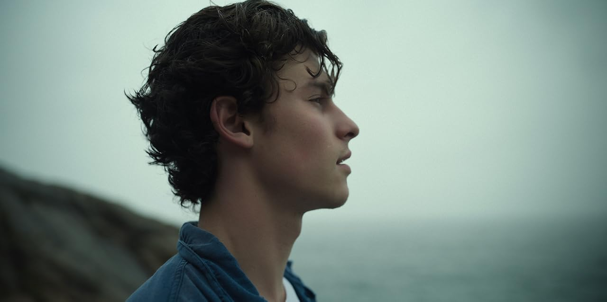
    
> “Sự nặng nề của chuyến lưu diễn, theo nhiều cách, khiến tôi muốn lật ngược tình thế và trở nên tích cực hơn. Tôi viết nhiều hơn về sự lo âu như là một người bạn mà tôi phải chịu đựng hơn là một kẻ thù mà tôi cố chống lại….”  
>    
Shawn Mendes - “In Wonder”
> 
    
Một trong những câu chuyện đầu tiên ở đại học mà tôi muốn kể là lần xem “In Wonder” của Shawn Mendes. Bộ phim cho tôi nhìn thấy cuộc sống đằng sau ánh hào quang và những áp lực trong hành trình lưu diễn của anh. Khi nghe album “Wonder” cùng với những gì đã thấy trong phim, tôi cảm nhận rõ hơn một tinh thần có hơi hướng thoát ly một xíu: tự khám phá bản thân, đối diện với những tự ti và thử nghiệm những điều chưa từng thử trước kia. Điều khiến tôi muốn kể lại không chỉ là âm nhạc, mà là cái cảm giác nhận ra một người được coi là thành công vẫn có những nỗi sợ rất bình thường…
    
Tôi biết đến phim này cũng theo một cách rất tình cờ, đó là lúc tôi bắt đầu những kì học đầu tiên ở đại học. Lúc ấy, có lẽ tôi cũng khá sợ hãi vì tôi chưa từng làm quen với một môi trường mà mình phải tự làm mọi thứ, phải làm quen lại từ đầu và cái ám ảnh về thất bại cứ treo lơ lửng thôi. Lúc ấy thì Netflix vẫn có free tier đối với một vài khu vực để có thể thu hút người dùng, và đây là một trong số đó. Từ lúc tôi bắt đầu xem, tôi biết được khá nhiều chi tiết và cũng tập trung lắng nghe nhiều bài hát trong album “Wonder” khi hiểu được nhiều tầng ý nghĩa hơn, đặc biệt là bài “305”, “Song For No One” hay là “Higher”. Có một vài điều mà tôi muốn nói về những gì mà tôi đã học được…
    
Điều đầu tiên mà tôi học được, đó là tính hai mặt trong cuộc sống của con người, nhất là những nghệ sĩ thì càng hiểu rõ điều này và đôi khi, chúng ta chỉ nhìn vào khía cạnh bên ngoài, hơn là nhìn vào toàn cảnh, điều này có thể chứng minh bằng thói quen nghe nhạc và cái cách mà ngành công nghiệp âm nhạc đánh giá mỗi nghệ sĩ. Trong phim, thì ngoài những tour diễn choán hết cả một năm, thì Shawn cũng chỉ như một người bình thường, có một đứa em đi học cấp 3, có bố mẹ và những đứa bạn từ thời thơ ấu vẫn đến ủng hộ. Dù có nổi tiếng tới đâu, thì khi bước ra khỏi ánh đèn sân khấu, thì họ cũng quay về như hầu hết chúng ta thôi. Bộ phim khiến cách tôi quan tâm đến một nghệ sĩ cũng thay đổi: thay vì chỉ tập trung vào sự nổi tiếng hay những bài nhạc hàng tỷ lượt stream, tôi muốn lắng nghe cả những trải nghiệm bình thường, những bài nhạc ít được chú ý và những cuộc nói chuyện giúp mình hiểu thêm về họ. Ai cũng có cuộc sống cá nhân của mình và sẽ thật sự tốt nếu như chúng ta có thể chia sẻ những khía cạnh ấy để học hỏi và phát triển cùng nhau…
    
Điều thứ hai, đó chính là gánh nặng của kỳ vọng và sự nổi tiếng vô tình làm biến dạng những gì đẹp nhất của một nghệ sĩ, cũng như không phải nghệ sĩ nào cũng chấp nhận thoát ra nó để bảo vệ chính mình. Thực tế thì như Shawn kể, anh có một nỗi tự ti và cái tiêu chuẩn hơi cao đối với chính mình, một phần từ đam mê nhưng phần khác là do những kì vọng của ngành công nghiệp âm nhạc. Trong phim, những vấn đề về giọng hát và áp lực biểu diễn khiến tôi chú ý đến cái giá của việc luôn muốn làm mọi thứ thật chuẩn chỉnh. May mắn là hầu hết những người hâm mộ đủ lịch sự và tinh tế để chấp nhận mất đi một tour, còn hơn là hủy hoại thần tượng của mình. Đối với nhiều người, âm nhạc của Shawn giống như một sự chữa lành và họ không muốn anh phải bị tổn thương chỉ vì những kì vọng quá cao. Nhìn sang giai đoạn sau này, khi anh tạm dừng lưu diễn rồi trở lại với album “Shawn” và những buổi diễn “For Friends And Family Only”, tôi lại nghĩ đến bài học ấy. Với tôi, cách biểu diễn đó mang một cảm giác thoải mái hơn, như thể anh đang cho mình không gian để trở về với âm nhạc mà không phải gồng lên như trước. Đôi khi, sự nổi tiếng hay những danh hiệu cá nhân không thể thay thế được những trải nghiệm thực tế và dài hạn, tôi phải nói như vậy. Cũng có lúc, chúng ta nên chấp nhận rằng chúng ta cũng chỉ là người bình thường, chẳng phải bất tử, vì những kì vọng quá cao ấy sẽ khiến chúng ta quên mất những mục tiêu đầu tiên của mình. Có một chi tiết trong phim mà tôi thích: khi anh không thể tiếp tục một buổi diễn vì vấn đề sức khỏe, những người hâm mộ tụ tập bên dưới tòa nhà và chúc anh khỏe mạnh. Điều đó nói rằng, thật tốt khi có những người biết đến mình, không đến từ kì vọng hay định kiến, mà bằng một trái tim chân thành mong mình ổn hơn. Với tôi, đó cũng là điều mình từng thiếu: một sự quan tâm không bắt đầu bằng câu hỏi tôi đã làm tốt đến đâu, mà là tôi có đang ổn hay không…
    
Và cuối cùng, là một sự tự do trong phong cách làm nhạc. Sau cái khoảng thời gian ốm bệnh ấy, thay vì suy sụp thì anh tiếp tục hành trình của mình, cũng hoàn thành tour và tâm trí cũng đỡ áp lực hơn. Khi kể về quá trình tạo ra album “Wonder”, anh cảm thấy khá thoải mái vì không phải dồn ép mình vào những đề tài quá “công nghiệp” mà tập trung vào những đề tài của chính mình, những cảm giác của chính mình và sự bay bổng thật sự. Tôi thích cái ý tưởng chấp nhận sự không hoàn hảo ấy, vì chúng ta không ngừng khám phá những ý tưởng cho mình, và để khám phá, chấp nhận sự không hoàn hảo là điều nên làm. Sau này, với album “Shawn” thì tôi càng thấy điều này rõ ràng hơn khi anh quyết định làm đúng như những gì đã nói, đó là bỏ đi ánh hào quang và trở về với giá trị âm nhạc thường thấy của mình. Thay vì chạy đua những con số lượt stream, thì tập trung về âm nhạc, về lời hát và tận hưởng quá trình tạo ra album ấy. Phần nào, tôi cực kì thích những album của anh cũng vì những điều chân thật mà anh muốn truyền tải. 
    
Lý do mà tôi muốn nói về phim tài liệu không chỉ là vì tôi thích Shawn hay album “Wonder”. Nhìn lại, ba điều ấy cũng là những gì tôi cần để bắt đầu lại: nhìn mình như một con người thay vì một bảng thành tích, không để kỳ vọng lấy đi toàn bộ cuộc sống cá nhân, và cho mình quyền thử nghiệm dù chưa hoàn hảo. Bộ phim không khiến những nỗi sợ của tôi biến mất ngay lập tức, nhưng nó cho tôi một cách khác để nghĩ về chúng. Ở hiện tại, khi trở lại với nhiếp ảnh và những dự án lập trình của mình, tôi càng hiểu rằng điều mình muốn không chỉ là làm thật tốt, mà còn là được tận hưởng quá trình làm những điều ấy như chính mình….
    
Tôi rất háo hức được vui vẻ trở lại, chỉ là tôi muốn mình vững chắc hơn một chút thôi…

    

    
<strong>past “fake” glories</strong>

    
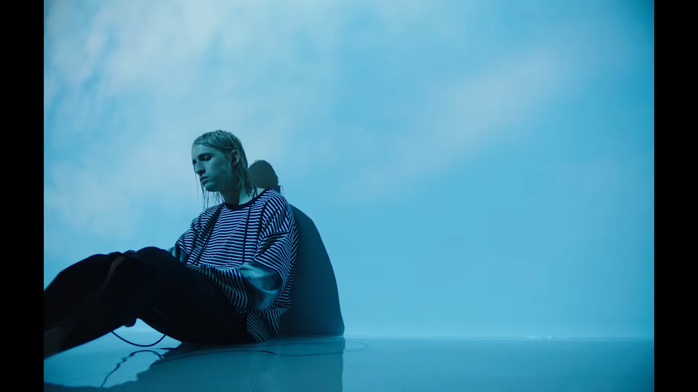

> when the glory tries to tempt you  
>it may seem like what you need  
>but if glory makes you happy   
>why are you so broken up???  
>
>so tell me how it felt  
>when you walked on water  
>did you get your wish?  
>floating to the surface  
>quicker than you sank  
>idol, idol…  
>  
>Porter Robinson - “Get Your Wish” - “Nurture”
> 

Chuyện đến từ một khoảnh khắc khá ngẫu nhiên, khi người ta nhắc về chuyện học hành hay là chuyện đi làm và nói rằng: **“ồ, thành công phết ấy chứ**”, hay khi mẹ tôi nhiều lúc thấy tôi vô cùng buồn phiền về những tháng năm THPT, mẹ tôi có một quan điểm khá trái ngược là tôi nên biết ơn vì chuyện tôi đạt được điểm khá tốt khi thi đại học. Hay là câu chuyện khi tôi cảm thấy khó xử với chính quá khứ của mình, mỗi khi người ta nhắc về tôi, thì người ta chỉ nhìn thấy một kẻ có vinh quang nhưng kiêu ngạo và hối tiếc bởi nó.... đủ thứ chuyện. Trong những năm tháng vô vọng ở hiện tại, nhìn vào những ám ảnh và mặc cảm từ quá khứ gây ra, tôi luôn mắc kẹt trong một cái cảm xúc là “mình phải bị định hình bởi những điều đó”, nhiều lúc tôi quen tới nó nhiều đến mức mà tôi đoán hẳn người ta sẽ định hỏi cái gì về tôi lúc ấy, và thành ra tôi hơi thiếu cởi mở do không thể nói về những chủ đề mà tôi thật sự quan tâm - vì họ chỉ muốn tin những gì họ từng biết, thay vì thật sự cởi mở trước những ý tưởng mới lạ. Tôi mắc kẹt trong những kỳ vọng của họ và chẳng biết là nếu như người ta biết về một nửa kia hiện tại của mình, thì liệu họ có thật sự thích nó, hay lại khoác lên cái sở thích ấy bằng đủ thứ chuyện khác.... Rồi đến một khoảnh khắc ở hiện tại mà tôi có lẽ không bao giờ quên…

Khi tôi bắt đầu chụp ảnh, lập trình, đếm ngược và viết một vài demo cũng như những gì trong tương lai tôi phải làm, tôi thấy khá nhẹ nhõm khi nghĩ về bản thân trong những ý tưởng ấy. Nó không phải là tôi không cảm thấy điều gì, mà là việc tôi nhìn vào quá khứ, nhìn vào những hình ảnh và vinh quang ấy, soi chiếu vào hiện tại rồi cái năm 13 tuổi. Có một kết luận mà tôi rút ra được, và cũng là nội dung của phần này:

> “hóa ra, những gì họ nghĩ về tôi cũng chẳng đúng về bản chất của tôi lắm....”.
> 

Những suy nghĩ ấy khá dài, nhưng tôi có thể tóm tắt lại. Đó là để có cái vinh quang mà họ tự nhìn nhận ấy, cái thứ “vinh quang” và cả “nỗi ô nhục” mà tôi phải gánh chịu, liệu có xuất phát từ chính bản thân tôi hay không??? Nó giống như là, liệu tôi có thật sự là chính mình khi cố gắng đạt đến cái vinh quang hay cái nỗi ô nhục mà họ ngày ngày nhắc về nó. Tôi thừa nhận là tôi đã rất cố gắng như thể sống chết vì nó, bán đi toàn bộ bản thân và thời gian của chính mình cho những cái vinh quang ấy, nhưng hiện tại thì tôi thấy cái gì??? Nhìn lại, ở tuổi 13 hay bây giờ, tôi thấy rất thoải mái khi được làm những việc mà không phải nghĩ tới những thứ giả tạo kia, nhưng tại sao họ cứ nhắc về những thứ đó theo cái suy nghĩ: “**nó phải là tôi trong những vinh quang ấy**”... Và đó là điểm đột phá của toàn bộ câu chuyện.…

Tôi nên nói một chút những suy nghĩ của mình và giải thích sâu hơn về những **“vinh quang giả tạo của quá khứ**” ấy, và cái cách tôi nghĩ về bản thân mình hiện tại như thế nào khi quyết định ra khỏi nó…

---

Mọi thứ xuất phát từ một thực tế, một nỗi lo mà tôi từng nghĩ là mình có thể che giấu, đó là những gì diễn ra trong vòng 6 tháng đầu tính từ lúc tôi bị kiệt sức vào cuối 2025. Có một vài nỗi phiền toái mà tôi phải trải qua: công việc nhàm chán lặp đi lặp lại, cái ngành không phù hợp với mình, môi trường công sở căng thẳng, sự khan hiếm về mặt thời gian cho bản thân,… Kể từ lúc tôi phải làm việc với đội nhóm mà tôi không hề tin tưởng, nó đã tạo thành một áp lực tâm lý khủng khiếp. Điều khiến tôi cảm thấy lo âu, bực tức và vỡ mộng, đó là khi nhìn vào thời hạn hợp đồng và tình trạng tài chính thực tế. Tại cái thời điểm tôi viết thì còn 299 ngày nữa là đến thời hạn kết thúc hợp đồng lao động, tôi tính đến ngày 1/8/2027, và tôi càng trở nên lo sợ về một viễn cảnh thất nghiệp khi nhìn vào bản thân mình. Cũng từ cái nỗi mặc cảm ấy, những bi kịch và kỳ vọng tan vỡ, lại ám tôi một khoảng thời gian nữa. Tôi cũng phải thừa nhận một sự thật là, từ trước tới giờ, tôi chưa từng thật sự đối diện với những vấn đề đó, chỉ là tôi đã từng giải quyết tốt tới nỗi mà tưởng như những điều ấy không quay lại nữa…

Nhìn sang câu chuyện của những mặc cảm, tôi nhìn vào những dự án mình làm, những dự án mà đã từng lên kế hoạch nhưng đã phải bỏ vì lý do không còn thời gian hay cả những cảm xúc đã cũ, trong lòng tôi có một nỗi đau rất khó tả. Cứ mỗi lần tôi ngồi vào bàn học và muốn làm một dự án nào đó, tôi lại không thể làm được. Rất nhiều lý do để viện ra, nào thì dự án đó không đẹp trên CV, nào thì không đủ thời gian, nào thì thất bại, nhưng lớn hơn cả, đó là cảm giác vô dụng mà tôi phải vác theo trong suốt thời gian dài. Tôi thích công việc lập trình, nhưng cảm giác tan vỡ kỳ vọng từ một cái ngành mà mình chẳng còn thấy phù hợp - trường hợp của tôi là SAP ABAP ấy, khiến tôi trở nên kiệt sức. Mỗi tối muốn học, thì tôi lại chẳng có thời gian, vì lại phải dậy sớm để đi làm sớm tại một nơi cách nhà 30km, rồi cứ thế tôi lại chẳng thể học được. Tôi cực kì chán nản cái cảm xúc ấy lắm, vì luôn phải biện dẫn một lý do nào đó rồi lại cuốn theo. Nỗi tự ti lớn dần trong suy nghĩ và càng đau đớn hơn khi tôi nghĩ về hình ảnh của mình ở THPT ấy….

Nếu nhìn từ câu chuyện ở THPT, tôi phải nói rằng mình đã làm rất tốt trong việc chạy trốn sự thật và sinh tồn, điều đó không có nghĩa là tôi thích chạy trốn, mà đúng hơn là tại thời điểm ấy, tôi vẫn chưa đủ dũng khí để đối diện với sự thật về bản thân và đã từng nghĩ là mọi thứ sẽ khá hơn. Biết gì không, dù chuyện đã qua gần 10 năm nhưng cái cảm giác đau lòng vẫn y nguyên, cho dù tôi đã quá quen với nó rồi. Nhiều lúc, khi nhìn vào cuộc sống của mình và người khác, tôi có một nỗi mặc cảm cực kì lớn vào việc mình không thể vui vẻ như ai đó. Người ta cứ hỏi tôi về những thứ vinh quang ấy, trong khi chính tôi đang thật sự rất chán nản và lo âu chẳng biết trả lời như thế nào. Cái cảm giác vô dụng từ cái thời THPT nó vẫn khiến tôi không thể mạnh mẽ đưa ra một quyết định đủ cứng rắn, cho dù tôi thật sự rất cố gắng để làm vài bước ban đầu. Những lời chê bai, hay câu chuyện về sự “lập dị”, hay là một thành tích dần trồi sụt, khiến tôi không còn thấy tự tin hay học hành một cách vui vẻ nữa. Tôi cảm thấy bị mắc kẹt trong một thế giới mà người ta không để cho tôi làm những việc mà tôi làm, và dần bào đi từng chút thời gian mà tôi cố gắng chắt chiu. Người ta luôn so sánh tôi và cái vinh quang thời THPT, nhưng họ đâu biết rằng chính cái vinh quang mà họ nói khiến tôi cảm thấy bực tức ra sao, vì để có vinh quang đó, tôi đánh đổi cả sự cởi mở của chính mình. Rồi chính cái vinh quang và ám ảnh từ nó lại cắn tôi của hiện tại, kéo tôi xuống một vũng bùn tâm lý của vỡ mộng, cứ như thế, thành một cái vòng tròn không hồi kết…

Gần như, cứ như một thói quen, lại đi vòng vòng, lúc nghĩ được gần xong thì lại chả nghĩ được gì, vòng xoáy của kiệt sức nó thảm hại như vậy đó…

Nhưng…, câu chuyện dần rẽ sang một hướng khác khi tôi chụp ảnh và thử tập sống một cuộc sống bên lề của công việc và vinh quang trong quá khứ, đó chính là những sở thích từng bị lãng quên. Tôi nghĩ thế này: **thôi thì tạm gác lại những cái ánh hào quang đó, cái công việc đó và hãy thử xây dựng cuộc sống cá nhân đi, vì trong nhiều năm thì tôi chưa từng có một cuộc sống đúng nghĩa mà**… Điều ấy đúng, sự thật là tôi đã phải chạy đi chạy lại quá nhiều để nhận ra rằng tôi cũng nên có cuộc sống cá nhân của chính mình. Tôi nhìn lại cái mà gọi là “vinh quang” ấy và nỗi “ô nhục” mà họ thích gắn theo, liệu có phỉa là tôi không, hay đó chỉ là những gì họ tạo ra để rồi chính tôi lại bị ám ảnh bởi điều đó. Nhờ nhiếp ảnh, tôi học được một điều, đó là luôn thoải mái với mọi thất bại và tôi nên vui vì có thể chụp lại và xóa đi nếu không thích. Khác với cuộc sống trước đó - vốn được định nghĩa bằng thành công trong điểm số hay sự thất bại khi không đạt được thứ hạng cao, thì cuộc sống nhiếp ảnh dạy tôi về sự vô tư và thoải mái với những thất bại như thể là tôi sẽ mắc phải nó thật nhiều. Mỗi lần tôi chụp ảnh, là tôi biết quý trọng cuộc sống và những giá trị tôi có, vì dù sao những trải nghiệm ấy sẽ giúp tôi tìm thấy ánh sáng. Cũng vì chính cuộc sống mới chớm nở ấy, mà tôi phải viết ra những điều này càng sớm càng tốt, như là để nói rằng mình đang chuẩn bị để move on - chỉ là tôi cần thời gian và thời điểm thích hợp thôi….

Khi tôi nhìn thấy cuộc sống cá nhân và những gì đẹp nhất của tuổi 13 đã từng ẩn khuất - giờ đã quay trở lại, thì tôi muốn nói là, chính tôi là người muốn move on khỏi cái hình bóng quá khứ THPT đầy ám ảnh ấy. Mọi người lải nhải rằng hình ảnh tuổi 13 không phù hợp với tôi và cho rằng tôi phải xứng với thành tích và định kiến do họ tạo ra. Cái đau lòng nhất là, chính cái hình ảnh do họ tạo ra và thích nhắc đi nhắc lại ấy, lại là thứ khiến tôi rất đau lòng và khó chịu. Tôi không gọi những gì của tuổi 13 là quá khứ, vì tôi rất quyết tâm để làm và tôi vô cùng quyết đoán - đó là thứ tinh thần mà tôi thật sự cần ở hiện tại. Còn thời thì THPT thì sao?? Đó là những năm tháng trầm cảm, những năm tháng tôi không sống như chính mình, tôi học và làm đề như điên cho những thứ còn chẳng đảm bảo tương lai, thì lấy đâu ra cơ sở để nói rằng nó là hình ảnh của tôi??? Họ chưa bao giờ chấp nhận rằng cái hình ảnh đó chẳng phải là tôi, và họ liên tục nhắc lại mãi về cái định kiến ấy như thể tôi phải sống như vậy. Tôi nhận ra, họ còn chẳng cho tôi một ngày để tôi sống hay cởi mở, và tôi phải biết ơn cái thành tích, dù cái thành tích đó đã biến tôi thành một kẻ bảo thủ với chính mình. Thật nực cười khi bắt tôi phải biết ơn. Tôi muốn nhân đây, nhắc lại rằng, cái hình ảnh của một thằng ở lớp chọn và bị khoác lên đủ thứ xỉ vả ấy, chưa bao giờ là tôi cả. Kẻ muốn move on nhất là tôi, chứ không phải họ…

Tôi nghĩ đi nghĩ lại và nhận ra, tôi không có một thành tích nào, càng không thể nói là thành tích khi nó còn chẳng phải chính tôi tạo ra mà là việc tôi bị bóc lột về mặt tâm lý. Tại sao nhỉ, tại sao cứ phải khiến tôi tiếc nuối về một thứ thành tích còn chẳng bao giờ thuộc về mình và cũng chẳng giúp mình khá hơn nhỉ??? Họ lấy tôi ra như biểu hiện cho nỗi ô nhục, trong khi chính tôi còn chẳng thể sống với chính mình khi ấy??? Có lẽ, chính tôi cảm thấy lãng phí và bực tức vì cái cảm giác như mỗi khi tôi muốn sống là chính mình, thì họ nói đủ điều như thể tôi phải trông như cái cách mà họ nghĩ. Thật sự rất khó chấp nhận cái suy nghĩ đóng cứng người khác như vậy lắm…

Tôi nhận ra là… kẻ có được thành tích khi ấy, không phải là tôi; và cũng đến lúc tôi nên sống thật và chuẩn bị cho viễn cảnh sắp tới. Việc gì tôi phải buồn khi mất đi những thứ tôi không bao giờ có được??? Có lẽ tôi chẳng thèm đến vậy đâu….

Vậy nên là… khi tôi công khai những suy nghĩ này, mọi người nghĩ sao thì nghĩ, còn với tôi thì, tôi không cần phải nhận về những ô nhục và thành tích mà chẳng phải của chính mình. Tôi càng sống và hiểu cho chính mình, tôi càng thấu điều ấy….

**Đừng bao giờ định nghĩa bản thân dựa trên thứ không bao giờ thuộc về mình!**

thật ra, chính tôi cũng mới hiểu gần đây thôi và… tôi nên viết những điều này sớm hơn….    

    
<strong>begin again…</strong>

    
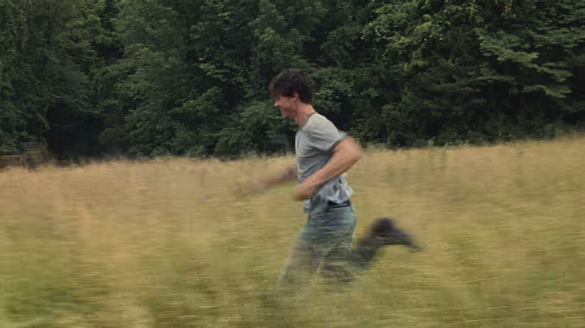

> 
> 
> 
> i stepped off the stage with nothin' left  
> all the lights were fuckin' with my head  
> but here i am, singin' songs again  
> why, why, why? ease my mind  
> 
> i don’t know why…  
> i don’t know, don’t know why…  
> why why why, why why why????  
> 
> Shawn Mendes - “Why Why Why” - “Shawn”
> 

Đáng ra, phần này nên được viết đầu tiên, nhưng mà tôi lại để nó ở mục giữa khi quyết định nói một chút về hiện tại. Bạn có bao giờ cảm thấy rằng, đến một thời điểm nào đó, bạn nhận ra rằng bạn thật sự muốn bỏ đi hết những gì đã từng xảy ra và muốn bắt đầu lại mọi thứ chưa???? Bạn có bao giờ cảm nhận rằng, bạn dù học rất giỏi nhưng càng học, bạn chỉ thấy xa lạ với cái kiến thức đã học và chỉ muốn học lại từ đầu chưa? Hay là, kiểu bạn đã quá quen với cái cuộc sống chán ngắt và rồi đến một ngày, bạn nhận ra là đã sống trong đó quá lâu, bạn tự nhiên lại muốn reset hết mọi thứ lại từ đầu… Hay là, nếu như bạn có thể bỏ đi những mặc cảm từ quá khứ đối với một sự việc và có thể nhìn nhận mọi thứ nhẹ nhàng hơn, cảm giác như thể bạn không cần phải cố nhớ ra ấy… Thì những cảm giác ấy chính là những gì song hành trong 6 tháng đầu năm, một mặt thì tôi vẫn phải cố sống với hình ảnh đó, nhưng mặt khác thì tôi cũng dần nghĩ về chuyện phải bắt đầu lại từ đầu. Khi mà tôi dần nhìn quá khứ của mình, trôi theo nó, nhìn lại những gì đã từng xảy ra và dần hiểu rằng, có lẽ mình đã sống trong một hình ảnh không phải mình ấy. Những năm tháng THPT đã bào mòn cả trái tim và trí tuệ của mình, tôi không thể phủ nhận và nhiều lần tôi muốn rũ bỏ đi hình ảnh đó lắm. Tôi rất yêu cái hình ảnh vui vẻ của mình lúc chưa trầm cảm nhưng thật khó để dám nói rằng mình có thể bắt đầu lại, nhất là khi chuyện trôi qua hàng chục năm rồi. Làm lại mọi thứ, từ con số 0, đâu phải dễ, vì thứ chúng ta thấy rõ ràng nhất, không phải niềm vui, mà là nỗi buồn và sự mặc cảm…

Dẫu vậy, có một vài khoảnh khắc mà giúp tôi hiểu rằng, ở một phía nào đó, tôi vẫn có thể bắt đầu lại những suy nghĩ ấy, chỉ là nó cần một chút nỗ lực hơn, nhưng cũng không đến mức gồng ép mình quá nhiều, cứ một chút thôi…

---

Ý tưởng về việc thoát ra khỏi cái “**vinh quang giả tạo**” từ quá khứ, không phải là đến bây giờ mới có mà ở đại học đã nhiều lần như vậy. Lần này, cũng như vậy, nhưng trong một văn cảnh khác, không phải là một người thành công hay phải sống trong danh vọng, mà là một người dần phải đối diện với những điều thực tế, cũng giống như năm lớp 8 thôi. Có điều, mọi chuyện khó khăn hơn khi thứ tôi đi qua là cả những mâu thuẫn chưa được giải quyết hoàn toàn, nên thật khó để bước ra mà không phải suy nghĩ. Tôi từng thử nghiệm nhiều thứ, nhưng trong suốt 6 tháng và ngay cả bây giờ, rất khó để tôi có thể làm một dự án cá nhân khi thời gian cho chính mình cũng chẳng đủ, và cái nỗi sợ bị đánh giá vẫn treo lơ lửng trên đầu. Muốn bắt đầu lại bằng việc tìm hiểu thứ gì đó sâu hơn, đọc nhiều hơn, nhưng đấy, tôi không thể kiên nhẫn trong một quãng thời gian quá eo hẹp, dù tôi có thừa kinh nghiệm để làm việc. Kỳ vọng từ công việc và xã hội, kèm theo thời gian quá eo hẹp, là những lý do mà trong 3 tháng cuối năm này, tôi sẽ không quá tập trung để học kiến thức khi tôi chưa đủ chắc chắn về mặt tư tưởng hay chuyện thời gian… Thế thì để xây lại nền tảng cho cuộc sống sau này, để bắt đầu lại quá trình reset ấy và tìm kiếm chút năng lực cho cá nhân, thì tôi phải bắt đầu từ đâu và tôi đã học được những gì????

Tôi không nhìn nhận chuyện bắt đầu lại một công việc, một ý tưởng hay một đam mê từng bị chôn vùi nào đó là những thứ có thể làm được trong ngày một ngày hai, và gần như không thể trong một trạng thái mà thời gian đi làm đã ăn gần như một nửa quỹ thời gian trên một ngày rồi. Nếu tính ra, tôi cũng chỉ có tầm 3-4 tiếng, bao gồm ăn uống, làm việc riêng, nghỉ ngơi..., những hoạt động mà người ta gọi là “leisure activities”. Còn thời gian ở thứ 7 hay chủ nhật gần đây, tôi cũng bị lấp đầy bởi đám cưới - mà toàn những việc không mong muốn. Tôi muốn xác định như vậy để nói rằng, tôi không có quỹ thời gian quá nhiều, và những dự án trước đó lại không thể tiến xa hơn, một phần không nhỏ từ quỹ thời gian eo hẹp và những kỳ vọng đã tan vỡ, chạy theo một vòng tròn. Thế nên là, khi tôi bắt đầu lại từ đầu, tôi hoàn toàn không đặt kì vọng gì ở cá nhân của mình, càng không nghĩ đến điều gì lớn lao, ngay cả những việc tôi đang làm ở 3 tháng cuối năm là viết nốt phần “special appendix” này sau khi đã phải cắt bỏ một vài phần do vấn đề nội dung, kiệt sức và sự eo hẹp về thời gian. Vậy thì, cái cách tiếp cận của tôi khi đó là gì???

---

Thật ra, tôi có viết trong nhật kí chính theo từng năm, thì tôi chọn việc không làm gì cả, và cũng không ép mình phải làm nếu như tinh thần, sức lực hay thời gian không cho phép, hoặc nếu làm thì không kỳ vọng và chấp nhận bị rơi vào “dự án ma”, ngay cả bản phụ lục này, tôi cũng đã cắt đi một vài phần quá phức tạp và chỉ tập trung vào những điểm cốt lõi, vì tôi không muốn mình phải kỳ vọng quá nhiều việc ai đó phải đọc, phải hiểu và phải kỳ vọng quá nhiều tới một bản nhật kí được vết nên từ sự không hoàn hảo. Tôi nhìn lại tất cả vấn đề của mình, từ lúc về nhà, học hành rồi ngay cả ở công ty, tôi nhận ra một sự thật: tôi chưa bao giờ cho mình cái quyền để dừng lại. Nhìn vòng vòng cả một câu chuyện kiệt sức, những ngày đầu, tôi từng cố gắng nghĩ rằng mình có thể kiểm soát đươc toàn bộ mọi thứ, mình phải làm cái gì đó thật lớn và đó là những gì tốt nhất mà mình phải hướng tới. Đúng là lối suy nghĩ “phải đi tiếp” ấy đã từng phù hợp, ít nhất là nhìn dưới góc độ công sở thì tôi không còn cách nào khác ngoài cách đó, nhưng mọi chuyện đã không thể giữ được lâu, từ sức khỏe thể chất đến sức khỏe tinh thần. Nếu như ở đại học hoặc ở nhà, tôi có thể làm đến tận 1-2 giờ sáng, hoặc dồn một buổi nào đó vào dự án, thì hiện tại, với việc phải dậy từ 5h sáng - 6h đi làm, riêng chuyện giờ giấc thôi đã khiến cho dự định ấy mong manh rồi, vì nếu tôi ngủ muộn hơn một chút thôi, nguyên ngày hôm sau không còn sức để làm. Có một vài lúc, tôi từng đặt mục tiêu là sẽ tìm hiểu một đề tài nào đó, nhưng đi được nửa chừng thì phải dừng lại, và thế là trôi ngay cả một dự án mà mình từng cố gắng đặt mục tiêu. Cái cảm giác đó lặp đi lặp lại, ngay cả trong việc viết lách, tìm hiểu hoặc làm một dự án nào đó, thành một vòng tròn khó thoát khỏi. Nhưng, có phải tôi chọn ngừng lại hoàn toàn một dự án mà không có việc gì ở phía sau hay không?

Nói tôi đơn thuần không làm gì thì cũng không hoàn toàn đúng, nếu nói đúng ra, là tôi dần hiểu một thực tế rằng tôi không có quá nhiều thời gian cho phần cuộc sống cá nhân của mình, và dù tôi cố gắng tới đâu, tôi cũng chẳng biết nên dừng ở đâu và cảm thấy đủ khi mình đã từng sống trong cảm giác thiếu thốn nặng nề. Việc đặt ra một kỳ vọng quá lớn, không thật sự giải quyết tốt những vấn đề của hiện tại mà càng khiến bản thân gặp khó khi phải làm những việc cần một sự tập trung lớn và cần một khoảng thời gian đủ lớn. Thế nên, việc đầu tiên tôi làm, không phải là cố theo đuổi cái gì lớn lao, mà là chọn cách lùi lại, giảm quy mô, thậm chí là cắt giảm một vài thứ quá phức tạp, nhưng - nhấn mạnh là nếu như có dự án quan trọng thì thay vì làm dở dang, thì phải đưa nó đến một giai đoạn mà bản thân có thể biết mà tìm lại. Một trong số đó là việc tôi giả lập ISA, mấy dự án giả lập chip các kiểu, thì tôi thành công ở ban đầu, nhưng lại chưa thể tiến xa - hiện tại đang làm 6502, thì thay vì cố ép bản thân phải hoàn thành, thì tôi để nó ở giai đoạn nền tảng cần thiết mà từ đó, có thể tìm lại và đi xa, chính là đoạn memory addressing - cơ chế trích xuất bộ nhớ. Tôi có tham vọng khá lớn về mấy dự án kiểu RISC-V với hypervisor, nhưng tôi nghĩ là thay vì phải đi quá xa, tôi cần làm một vài ý tưởng nền tảng. Tôi kiểu không bỏ hoàn toàn, nhưng cũng không cố ép nó phải đi tiếp nếu như bản thân chưa thực sự ổn định về mặt thời gian và tâm lý. Tôi nhìn từ nhiều dự án trước của mình, đã từng thành công và có những dự định tan vỡ để rồi trở thành “dự án ma” mà tôi còn chưa biết phải bắt đầu lại, thì tôi hiểu rằng, không phải là mình không có chí tiến thủ hay là lười nhác, mà đôi khi, kỳ vọng quá lớn sinh ra những vỡ mộng khó chữa lành, mà vỡ mộng khó chữa lành khiến ta mất niềm tin và sự kiên nhẫn cần có, để rồi thành một vòng tròn của những dự án ma. Việc chấp nhận một sự dở dang nào đó giúp tôi cởi bỏ gánh nặng về kỳ vọng của chính mình và cho mình một không gian để đối mặt với những bóng tối tâm lý, cũng như để trở lại với một tâm trí như nước suối nguồn vậy - trong vắt…

Tiếp đến câu chuyện của việc lập trình, tôi thấy có một vấn đề khá lớn mà tôi phải đối mặt. Nó không phải là vì tôi không làm tốt, mà là việc tôi thiếu kiên nhẫn với chính mình và quá kỳ vọng vào việc nó phải thành công - hệ quả từ những cuộc chạy đua điểm số, FOMO và thời gian eo hẹp. Cái tư duy ấy khiến việc lập trình của tôi trở nên vô cùng khó khăn, nhiều hơn nữa là ác mộng, vì cái gì cũng phải làm tốt, nên nếu như mọi chuyện không như ý muốn thì cũng không biết phải sửa làm sao. Thành ra, thay vì cố ép mình phải học lập trình ngay, tôi muốn mình cần cải thiện tư duy, khả năng sáng tạo và có lẽ, từ việc chấp nhận những sự dở dang, tôi sẽ cải thiện khả năng sáng tạo, kiên nhẫn hơn, bền bỉ hơn và hoàn thành mục tiêu tốt hơn. Và, để có thể cải thiện tư duy ấy, tôi không bắt đầu bằng những thứ có nhịp điệu quá nhanh như game hay những cuộc thi, mà từ những việc chẳng liên quan: nhiếp ảnh và viết lách…

Tôi có một niềm yêu thích với nhiếp ảnh từ thời cấp II, bức ảnh đầu tiên của phần “me before depression” là một trong rất nhiều bức mà tôi chụp vào cuối năm lớp 8 và khi đó, tôi chụp vô số bức ảnh và xây những quan điểm đầu tiên về nhiếp ảnh thông qua những trải nghiệm ấy. Trong khoảng thời gian dài do trầm cảm, tôi cũng không thể dành thời gian cho những sở thích cá nhân và chìm vào một khoảng thời gian vô định kéo dài. Việc tôi bắt đầu bằng nhiếp ảnh là một ý tưởng hay, từ một sở thích quen thuộc đến việc cải thiện tư duy, tính sáng tạo, sự cởi mở từ những nỗ lực rèn luyện bằng sự thoải mái trong tâm trí. Tôi giờ cũng không chụp ảnh nhiều, nhưng nếu có ý tưởng, thì tôi sẽ luôn lôi máy ảnh để chụp, hoặc là xem những bức hình đã chụp trước đó và học hỏi xem những bức hình ấy có gì cần cải thiện hay không. Trong nhiếp ảnh, tôi không cảm thấy mình phải cạnh tranh xem là ảnh tôi đẹp hay xấu hơn ai, mục tiêu của tôi là phải chụp những bức ảnh sát nhất với thực tế và có mức độ chi tiết hợp lý. Việc đó tưởng dễ nhưng lại rất khó trong xã hội mà ai ai cũng phải đẹp. Nếu các bạn nhìn thấy, thì người ta có xu hướng phải chụp những bức ảnh thật đẹp, xóa phông các kiểu,... tôi không có gì để chê bai, nhưng tôi thấy không phù hợp lắm với bản thân nhiếp ảnh. Mục tiêu của nhiếp ảnh là chụp thật nhiều và chụp thật chuẩn, tức là có những khoảnh khắc mà đôi khi chúng ta không thể đoán trước và thứ ta lưu giữ nên là những gì thật sự diễn ra trong cái khoảnh khắc ấy. Vì lẽ đó, nhiếp ảnh chính là biến những thứ không hoàn hảo thành những điều diệu kỳ, biến những khoảnh khắc chẳng ai đoán trước thành những tuyệt tác mà người đời nhớ tới. Hiểu ngắn gọn, nó cần một sức sáng tạo và tính chân thật để ôm trọn những sự không hoàn hảo ấy, chứ không phải là tìm kiếm một điều gì quá lớn lao. Từ cái tư duy ấy, tôi bắt đầu tập chụp ảnh với môt tâm thế kiểu: “nếu bức này quá lỗi thì có thể chụp lại và chụp thật nhiều - thật chuẩn xác”, càng lỗi thì càng hiểu tại sao nó lỗi. Chính trải nghiệm được chụp với một tâm thế thoải mái như vậy giúp tôi đối diện với mặc cảm tâm lý nhẹ nhàng hơn, thay vì phải mang một suy nghĩ quá nặng nề. Hơn nữa, tôi cũng bắt đầu thử nhiều ý tưởng chụp hình, từ cảnh vật, trường học, lễ tốt nghiệp của mấy đứa bạn hay là đường phố... Tôi chụp không thiếu thứ gì và đó là lần đầu tôi tự đi ra khỏi nhà, khám phá cuộc sống ở bên ngoài. Đây chính là điểm đầu tiên khiến tôi cảm thấy nhẹ nhõm... có khi là tôi chưa từng bắt đầu cái gì với một tâm thế thoải mái và nghiêm túc nên tôi muốn bắt đầu một thứ gì đó giúp tôi cởi mở tư duy, hơn là phải lặp đi lặp lại một chuỗi những vỡ mộng mà mình đã có thể tránh khỏi.…

Việc bắt đầu lại không phải là thứ mà đến từ hư không, càng không thể nói rằng việc bắt đầu lại luôn là hành trình đầy màu hồng. Thực tế thì nó chứng minh ngược lại những suy nghĩ trên...

Bạn cứ tưởng tượng rằng, việc viết lại một thứ dở dang hay bắt đầu những thói quen mà bạn đã từng phải giấu đi, có bao giờ thực sự dễ dàng hay không. Thực tế là rất ít người dám nghĩ và có một tư duy thông suốt để dám nói rằng tôi không ổn và tôi cần một khoảng nghỉ để dừng lại. Nó giống như kiểu, bạn thấy một cỗ máy đã bị hỏng và deadline cần hoàn thành, bạn phải đưa ra một trong hai lựa chọn khả dĩ ấy: một là đi sửa máy và chấp nhận deadline có thể bị trễ; hai là hoàn thành deadline nhưng dần mất đi khả năng để làm những công việc về sau này. Việc bắt đầu lại một thứ gì đó, chính là việc bạn phải trả lời câu hỏi trên và đưa ra lựa chọn. Tôi không nói tuyệt đối hóa rằng một lựa chọn nào đúng hay sai, mà mỗi lựa chọn đều dẫn tới một kết cục: thất bại, và bạn phải thật sự dám đối diện với điều đó - và ở mỗi lựa chọn, bạn phải chuẩn bị rất nhiều thứ có thể - vì chẳng biết kết cục của những lựa chọn đó sẽ ra sao…

Bản thân việc lập trình, chụp ảnh hay viết lách, với tôi cũng chỉ là những nỗ lực nhỏ để nói rằng mình phải bắt đầu lại, nhưng thiết nghĩ, có một vài vấn đề mà tôi muốn mình bỏ ngỏ như một dụng ý:

> “bạn có thực sự bắt đầu lại hay đang cố gắng làm một thứ gì đó với một tâm trạng đã cũ…”  
“và nếu mọi thứ chẳng thành, ngày tươi sáng chẳng tới, liệu bạn có hối hận.…”  
“nếu như mặt trời vụt tắt…”  
> 

Lớn hơn chỉ là câu nói bắt đầu lại một thứ gì đó, tôi cần các bạn hướng tới những điều sâu nhất khi chúng ta quyết định làm điều gì đó: dũng khí, quyết tâm, nghị lực và sự kiên định…

    
<strong>if the sun burns out tonight…</strong>

   

> 
> 
> 
> “now the void calls out my name  
> it gets louder everyday  
> and in the darkness, all i need is you  
> if the sun burns out tonight”  
> 
> Grabbitz, Oli Sykes, Courney LaPlante - “If The Sun Burns Out Tonight”   
> VALORANT Champions Shanghai 2026.
> 

Trước khi viết, thì tôi muốn thông báo và nói về cảm hứng của bài hát đối với cá nhân tôi - “spark of 13”. Tại thời điểm viết, thì mùa giải VCT 2026 đã kết thúc tại Thượng Hải, Mercedes-Benz Arena với chiến thắng thuộc về LOUD với chiếc cup thứ hai kể từ mùa giải 2022. Để nói về đội chiến thắng, thì đội hình của LOUD là trẻ nhất trong số tất cả các đội tuyển VCT đã tham dự Champions, trẻ nhất là tkzin và IGL của đội: Erde. Đội của những thanh niên trẻ đến từ khu vực Mỹ Latin đã chiến đấu sòng phẳng với những ông lớn của VCT như Edward Gaming (EDG, CN), Team Vitality (VIT, EMEA) và PRX (Paper Rex, APAC). Nhưng câu chuyện còn khiến người ta nể phục và xúc động nhất chính là về cậu erde: cậu IGL sinh năm 2008. Trong buổi phỏng vấn sau khi giành chức vô địch cùng đồng đội, cậu bé đã rơi những giọt nước mắt khi nhận được danh hiệu MVP của trận:

> “I want to dedicate this win to my mom. She died like two days before the EDG game. I couldn’t believe it because I thought she was going really well with this disease. But yeah, I dedicate this tournament for her, I only play for her. That’s it”
> 

Trước trận đấu với EDG tầm 2 ngày, thì erde có nhận được tin báo rằng mẹ cậu đã mất, và ngay trong trận vòng bảng. Nhưng, thay vì suy sụp, thì đội LOUD đã chứng tỏ một lối chơi vô cùng áp đảo và kỷ luật bậc nhất so với độ tuổi, áp đảo EDG tại 2 map: Lotus và Summit với tỷ số lần lượt là: 13-8 và 13-5, từ đó tiến sâu vào vòng playoff và chung kết tổng. Hơn nữa, cái tinh thần này hoàn toàn phù hợp với slogan: “frag or die”, và kết thúc kỷ nguyên Franchise kể từ 2023.

Điều khiến người ta sẽ nhớ mãi về trận đấu, chính là tinh thần của những cậu trai trẻ ở LOUD ấy, còn rất trẻ mà cái tinh thần chiến đấu ngang bằng, thậm chí là hơn những đội lớn khác. Tinh thần kỷ luật, sức trẻ và chiến thuật tốt khiến cho chiến thắng của LOUD hoàn toàn xứng đáng. Đó cũng chính là cảm hứng để tôi viết như là một phần của những hy vọng mà tôi muốn hướng tới.…

---

Hoàn cảnh về trận đấu và bài hát là như thế, nhưng nếu xét trên cá nhân tôi thì câu chuyện còn lớn hơn chỉ là một tựa game hay bài hát thông thường. Đáng ra, tôi sẽ không viết riêng phần này, và “begin again” đã có thể dài hơn. Tuy nhiên, có một suy nghĩ nảy ra trong đầu tôi, nó không phải là việc có bắt đầu lại hay không, mà là một câu hỏi rằng chúng ta liệu có dám bắt đầu lại, và nếu mọi thứ không thể thành công thì liệu cố gắng có vô nghĩa, và xa hơn nữa, câu chuyện không dừng lại ở thất bại hay thành công, mà là sau những điều đó, ta sẽ nhìn về câu chuyện của chúng ta theo hướng nào. Nếu như chỉ nói riêng chuyện bắt đầu lại một đam mê thì có lẽ đã đánh giá quá nhẹ tình hình mà quên đi rằng thực tế rất khốc liệt. Thời gian thì như thể cạn kiệt dần, mà việc bắt đầu lại với một tâm lý đầy vết xước giống như cố gắng cứu sống một bệnh nhân mà khả năng sống sót không thực sự cao, hoặc là không thể chữa khỏi hoàn toàn. Buông bỏ kỳ vọng là một chuyện, nhưng liệu rằng, nếu không có kỳ vọng, thứ gì sẽ níu giữ ta??? Tôi trải qua câu hỏi đó trong một khoảng thời gian rất dài, lưu ý là rất dài, tìm kiếm đủ loại ý tưởng và cảm hứng, nhưng phải đến khi trải qua một cú sốc tâm lý ở hiện tại, nhìn về quá khứ, tôi dần thấy một tia sáng khác, cũng là một trong những cốt lõi của “spark of 13”..…

> **“nếu như mọi thứ sụp đổ, tôi sẽ vẫn ở đó, đối diện và chiến đấu tới cùng, dù tôi có thể sẽ chết…”**
> 

Nhưng, để nó trở thành một phần của “spark of 13”, định hình một tư duy mà tôi muốn hướng tới, hẳn phải có một câu chuyện đằng sau, những cảm hứng đằng sau cái tư duy ấy và cái cách nó thay đổi những suy nghĩ hiện tại của tôi, ngay lúc này. Tôi nghĩ đến lúc để có thể hé lộ nhiều hơn và những phương pháp mà tôi học được trong quá trình đối diện ấy.…

so, start…

---

Đáng ra, tôi sẽ phải nói từ hồi cấp II cơ, nhưng nếu xét trên quy mô thì chưa đủ lớn vì thực tế, mọi chuyện khi ấy còn quá đơn giản và những biến cố học tập lẫn tinh thần chưa thực sự lớn để nói rằng cái tư duy ấy sẽ tác động và thay đổi tôi ra sao. Nếu kể ra thì nó giống như là mọi thứ quá dễ dàng, điều mà không đúng sự thật một chút nào. Câu chuyện phải bắt đầu cuối cấp III - giai đoạn mà tôi trầm cảm nhất, đi qua những năm tháng khó khăn ở đại học và cảm hứng của hiện tại, những điều khiến tôi thật sự tin và thay đổi suy nghĩ.…

Đối với mọi học sinh THPT, mục tiêu cuối cùng là thi tốt nghiệp và đỗ đại học, những mục tiêu mà dù các bạn tô vẽ nó màu hồng ra sao, thì nó vẫn khốc liệt như vậy. Đối với tôi thì mọi chuyện còn kinh khủng hơn vậy nhiều. Gần như tôi mất sạch tất cả, từ khả năng học tập, crush, những người thân quen và phải bắt đầu trong một trạng thái đơn thương độc mã, khi tôi biết đến thông tin này, thay vì vui mừng, thì tôi chìm vào một áp lực tâm lý lớn khủng khiếp. Bạn cứ tưởng tượng, nó giống như cái cảnh của một chiếc xe bị ngập: một là bạn không thể thoát ra khỏi chiếc xe đó và hai - bạn phải thoát ra khỏi chiếc xe đó khi nó ngập tới nơi rồi. Và nói một kết cục rõ ràng nhất, cái khả năng tôi sống sót và lành lặn, gần như bằng 0, tức là, cái chết hoàn toàn rõ ràng, nhưng kể cả có sống thì cũng thương tật rất nặng. Tôi chìm vào suy nghĩ đó trong nhiều tháng học, áp lực tăng dần và tôi cảm thấy vô định lẫn chán nản, thất bại từ kì thi HSG thành phố, cho đến sự hụt hơi trong chạy đua điểm chuyên đề dần khiến tôi cảm thấy bế tắc khủng khiếp. Một trong số những dự định ngoài lề của việc học, chính là tích trữ tài liệu, tôi buộc phải làm với một trạng thái hết sức bí mật. Một mặt, tôi vẫn phải cố gắng chạy đua thành tích, nhưng mặt khác thì phải tìm hiểu những gì sẽ diễn ra ở đại học và chuẩn bị một đường thoát nếu mọi thứ sụp đổ. Dù không thể chuẩn bị đủ tốt, nhưng sự chuẩn bị ấy vô cùng cần thiết và nó đã chứng minh rất nhiều ở đại học sau này. Nhưng lớn hơn, cái phương pháp thu thập ấy cũng rất đặc biệt. Tôi không có đủ thời gian để đọc toàn bộ tài liệu đó, nhưng có một vài đầu sách mà sau này ở đại học thì tôi đọc, một trong số đó là những cuốn sách về Golang, C# và thuật toán. Một trong số những kiến thức tôi học được là hiểu flow chạy của một chương trình nhất định và tập bám sát những gì diễn ra ở bên trong, và để hiểu điều đó, thì phải đọc thật kĩ cú pháp, kiên nhẫn đọc từng dòng và xem nó tính làm gì. Nhờ việc đó mà tôi thích nghi với ngành học khá nhanh so với những gì tôi đã nghĩ. Nhưng điều lớn nhất, và cũng là câu trả lời đầu tiên:

> **“nếu như thất bại là tất yếu, mọi nỗ lực và sự chuẩn bị không bao giờ thừa, dù chỉ là một ít.…”**
> 

Nhưng câu chuyện vẫn chưa dừng lại ở đó, một trong những vấn đề lớn ở đại học chính là sự tan vỡ của kỳ vọng và những biến cố cá nhân khiến tôi gặp khó trong việc thực hiện chức vụ của mình. Có rất nhiều lần, tôi chỉ muốn mình có thể buông một điều gì đó để hướng tới điều lớn hơn, rằng tôi không mong cái thời kì đại học phải gặp lắm biến cố cá nhân như vậy. Cuộc sống ở đại học cũng thật sự quá tải, khi tôi phải đối mặt với vấn đề học tập, chuyện trên lớp và cả quá khứ không mấy vui vẻ của mình. Ngay đúng vài ngày đầu tiên khi làm lớp trưởng, tôi gặp một biến cố gia đình và cá nhân cực lớn, đó là chuyện laptop của tôi bị hỏng kèm theo những tài liệu mà đáng ra tôi cần phải hoàn thành. Tôi lúc đó mới nhậm chức, còn chưa kịp biết tình hình ra sao, thì tôi gặp phải một tin dữ tiếp theo, đó là chuyện không kịp bàn giao mail lớp, dẫn đến cả lớp bị mất thông tin trong việc lấy thời khóa biểu, nghiêm trọng tới mức là phải đến khi buổi học đầu tiên, thì tôi mới trắng mắt ra nhìn cái sự nghiêm trọng có thể hại tới một tập thể như thế nào. Thế là trong thời gian đó, tôi chìm trong sợ hãi và dù có nghĩ như thế nào, thì ngoài chuyện từ chức, tôi không thể nghĩ ra cái gì đó khác. Tinh thần khi đó của tôi gần như sụp đổ, vì tôi đã không thể làm tốt đúng như kỳ vọng của mình. Để cứu vớt chút thể diện, tôi từng cố liên lạc với một vài đứa bạn và đề nghị giao chức vụ cho ai đó nếu như có điều gì không ổn, nhưng tôi không chọn được ai cả. Thế là, tôi quyết định nói trung thực về vấn đề tâm lý của mình và nói rằng... tôi không thể làm tốt vì đã không thể quản lý thông tin cho mọi người, và có một quyết định khi đó xoay chuyển tình thế, đó là giao quyền tự quản về mặt thông tin cho tất cả mọi người. Tôi lên một chiến dịch chuyển tiếp mail cá nhân, để đảm bảo rằng nếu tôi không tiếp cận được thông tin, thì ai có được sẽ chuyển tiếp lại cho tất cả mọi người. Nhờ việc này mà gánh nặng từ chức vụ giảm xuống đáng kể. Đó là cách mà tôi vẫn đảm bảo mọi thứ vẫn hoạt động mà không phải đưa ra bất cứ quyết định cực đoan nào và câu trả lời tiếp theo là:

> **“nếu như sau đó là từ chức, thì phải hoàn thành nhiệm vụ đến cuối cùng”**
> 

Chuyện học tập và quá trình trở lại hiện tại của tôi, cũng là một xác nhận đủ lớn cho những gì tôi đã học được. Khoảnh khắc khi tôi nhận ra rằng mình muốn sống và học tập một lần nữa, chính là lúc tôi đi ngang qua crush của mình trong một ngày cuối tháng 6. Trong đầu tôi vẫn loáng thoáng những vỡ mộng của kì VI, VII và VIII, đợt thực tập không lương dài 8 tháng đã bào mòn thời gian, tâm trí và sức lực của mình cho những chuyện không đáng. Và ngày đó, như cái lần thi đại học kia, khiến tôi nhận ra rằng trong nhiều năm, tôi đã không thể làm đúng những gì mà mình thật sự muốn. Mỗi một lần tôi cố gắng, tôi lại không thể làm tốt chuyện của chính mình, tôi không thể có một thành tích mà tôi muốn, tôi không thể thực hiện dự án mà không phải thấy lo âu. Tôi muốn có dũng khí, vì tôi biết trước sau gì cũng thất bại nên tôi cần một dũng khí. Khoảnh khắc ấy đánh dấu việc tôi sẽ hoàn thành dự án của mình nhanh nhất có thể và trình diễn nó ở một thời khắc nhất định. May mắn là dự án ít nhiều thành công, dù quy mô khá nhỏ nhưng ít nhất thì nó cũng giúp tôi giải quyết được rất nhiều nghi ngờ và đưa tôi tỉnh táo trở lại, để kết thúc kì IX và X.

Tưởng rằng, khi kết thúc đại học thì chuyển giao trong êm thấm, nhưng thực tế đã tạt một gáo nước lạnh. Dẫu vậy...., nó cũng là lần mà tôi thấy may mắn nhất trong cuộc đời của mình và giúp tôi trả lời được những câu hỏi mà tôi chưa thể trả lời được…

---

**“nếu ngày mai vụt tắt....**”

Tôi có nói về chuyện đi làm trong những bản nhật kí riêng và phụ lục riêng rồi, và nó có thể tóm lại bằng một từ “vỡ mộng”. Tôi tốt nghiệp đại học trong một tình thế không mấy có lợi cho những sinh viên khoa học máy tính nói chung, đó là giai đoạn cắt giảm trên toàn thế giới và cuộc chiến để tìm việc làm trong một bối cảnh không mấy có lợi cho mình. Nếu câu chuyện chỉ là vấn đề việc làm sau khi tốt nghiệp thì mọi thứ chưa đến mức nặng nề, điều nặng nề diễn ra sau khi tôi thử việc và đi làm một khoảng thời gian. Người đi làm cũng mang nỗi sợ thất nghiệp, kể cả đã đi làm một thời gian thì càng sợ hãi hơn, tôi không phải là ngoại lệ. Thời gian đầu thì tôi khá cố gắng, nếu muốn nói chuẩn là kỳ vọng khá nhiều về một cuộc chuyển giao trong hòa bình và có thể hòa giải với quá khứ một cách nhẹ nhàng. Như bao người, mưa bão vẫn đến công ty, vẫn cố mang một nụ cười rằng mình phải hoàn thành việc nọ việc kia, và ít nhất, tôi hoàn thành chúng rất tốt. Mọi chuyện cứ như vậy cho tới một ngày.…

Tôi làm việc với một đội nhóm mà nhiều khi, tôi phải dùng từ “rắn độc” để miêu tả chuẩn nhất. Trước thì tôi có nghe cái tin đồn từ bạn mình và những lo ngại đó rồi, nhưng tôi đã bỏ qua và không để ý những gì sẽ đến. Cái cảm giác từ những lần họp khiến tôi có một cảm giác ngột ngạt, chênh lệch kinh nghiệm chỉ là một phần nhỏ, nhưng sự xa cách và sự im lặng của họ trước những lời cầu cứu khiến tôi không còn có cảm giác muốn làm bất cứ điều gì nữa. Mỗi một ngày, áp lực của việc không thể hoàn thành, dần hút cạn tinh thần và thể chất. Mỗi một ngày về nhà, trong một giờ giấc vô cùng muộn, tổng thời gian bao gồm cả làm việc và đi lại chiếm 12 tiếng - nhắc lại là 12 đến 13 tiếng. Tôi về nhà mà người gần như không còn đủ thời gian để nghĩ đến việc vận động tay chân - ngay cả ở hiện tại, tôi cũng phải chuyển hết về hai ngày cuối tuần vì thể chất tôi hoàn toàn không sẵn sàng. Cái cảm giác tồi tệ khi biết rằng cái cuộc sống dần tuột khỏi tay của mình khiến tôi tan nát. Vừa áp lực, mệt mỏi và tôi không còn cảm hứng nào để vui vẻ nữa. Ngay cả từ trang phục, từ những trang phục phóng khoáng, dần thành những trang phục u tối và mệt mỏi. Môi trường công sở gần như không có chỗ cho sự năng động, tôi chỉ có thể ngồi một chỗ, chờ thông báo và lướt điện thoại đến hết ngày.

Áp lực công sở chỉ là một phần nhỏ của câu chuyện, điều tôi tan vỡ nhất, giống như hồi THPT ấy, chính là câu chuyện của chiếc xe bị đắm. Thực tế, theo như hợp đồng, tính từ thời điểm viết, tôi còn hơn 280 ngày nữa là hết hợp đồng và nếu như không gia hạn, thì cũng là lúc tôi sẽ nghỉ việc. Tiếp theo, cái ngành tôi làm việc lại không phải cái ngành mà tôi tin tưởng hay có khả năng sáng tạo: ABAP. Một yếu tố nữa là chuyện tài chính của gia đình là thứ rõ ràng nhất và khó giải quyết nhất khi đòi hỏi cả thời gian và sức lực. Cuộc sống mà tôi từng nghĩ sẽ có một cuộc chuyển giao trong hòa bình, không còn nữa, nếu không muốn nói là mọi ảo tưởng đều chết đi kể từ ngày tôi chính thức đi làm rồi. Tôi nhìn lại cuộc sống của mình, với một nỗi mặc cảm sâu sắc rằng tại sao những thứ tôi cố gắng phấn đấu và làm việc lại không thể mang một kết quả tốt, có phải tôi kỳ vọng quá nhiều, có phải tôi đáng bị trừng phạt, hay tôi hèn kém,... Trong đầu tôi là một loạt câu hỏi về tương lai và một hình dung về quá khứ mà tôi cố trốn chạy lại trở nên rõ ràng và đau đớn đến thế. Trong nửa năm ấy, tôi có một vài đợt ốm khủng khiếp, có những lần khóc vì cực kì mệt mỏi, vừa đau đầu, sốt và chán nản rằng tại sao sức khỏe của mình nhiều khi lại không thể tốt như mình muốn... Những ngày đó vô cùng đau lòng, chán nản và tệ hại bậc nhất ở cái tuổi 23, tôi chẳng biết mình học và làm để làm gì khi mọi thứ sụp đổ ngay trước mắt.

Chuyện xuôi đi, tôi nhìn lại ở quá khứ của mình, cũng là lý do tôi viết, đó là tôi chưa thực sự vượt qua được cái quá khứ tăm tối ấy, nói đúng hơn là dù tôi không đến mức suy sụp như ngày đó, nhưng trong những năm qua, thay vì đối mặt và cam kết rằng sẽ dọn dẹp hậu quả, tôi lại chạy trong vòng xoáy sinh tồn, lại phải chạy trốn những nguy cơ ấy, luôn đặt mình trong một kỳ vọng rằng mọi thứ phải thật ổn vì tôi không chắc là mình có thể đối diện được vấn đề đó hay không. Ừ, ở đại học thì may ra cái công việc lớp trưởng còn giúp tôi dễ chịu và bớt cô đơn khi có người để giao tiếp, nhưng khi đi làm và gặp những chuyện như hiện tại, tôi gần như không còn ảo tưởng gì nữa. Tôi nhận ra rằng, khi ảo tưởng mất đi, nó chẳng mấy dễ chịu. Nó là bất an, nó là cảm giác cuộc đời vô nghĩa khi nhận ra mình phải bỏ đi những thứ mình yêu thương cho một thứ mà sẽ tàn phai, tôi nhìn lại từ thành tích hay những ô nhục và nghĩ: “**thật là một sự phí phạm**”. Tôi không thể tận hưởng cuộc sống như một người bình thường, hoặc nếu có thì cũng chẳng được lâu, trong lòng tôi cũng chưa một ngày bình yên hay tìm hiểu điều gì đó thật sự. Việc sống trong sự thiếu vắng đó khiến tôi nhiều lúc không thể cam kết hay làm cái gì đó đàng hoàng, vì tôi biết tôi lại thất bại lần nữa, cứ theo một quy luật tự nhiên và những lý do hoàn toàn cũng củ chuối theo cách hiển nhiên..…

Nhưng câu chuyện rẽ sang một hướng khác....., tôi thật sự cảm thấy có chút may mắn, chỉ là may mắn ấy quá muộn để tôi hiểu được mình thật sự muốn gì, tin gì và thật sự là ai trong cuộc đời này.…

Nó xuất phát từ một con Xperia, một chiếc máy ảnh và một vài cảm hứng mà tôi chưa từng khám phá nghiêm túc. Tôi tập đi những nơi mà tôi chưa từng đi một mình, tận hưởng những khoảng lặng từ một nơi mà tôi chưa từng biết đến trước kia. Và suy nghĩ khi đó của tôi là:

> **“có lẽ trong nhiều năm, tôi chưa từng thật sự tận hưởng cuộc sống theo cách mà tôi muốn và tôi nên làm...”**
> 

Những trải nghiệm ấy,dù không thật sự dễ dàng nhưng giúp tôi cởi mở hơn với mọi ý tưởng của mình. Trong thế giới ấy, tôi không đặt ra bất cứ kỳ vọng nào, và nếu tôi có một ý tưởng thì tôi có quyền triển khai, nếu tôi sai và muốn sửa thì cứ việc sửa, và nếu tôi không ổn, thì tôi cũng không ép mình phải đi tiếp vào một sai lầm nào đó. Cùng một bối cảnh, khi tôi phải đối diện với nỗi bất an của một người đã mất tất cả và phải sống với những thứ mà trước sau gì cũng tan vỡ. Tôi thiếu tự tin tới mức mà phải đến khi chụp ảnh và chấp nhận rằng sẽ có những khiếm khuyết và những bức ảnh không thể hoàn hảo, tôi mới dần tự tin và thoải mái hơn. Cũng lúc đó, tôi quyết định nhìn lại quá khứ, nhìn vào những quyết định, những khoảng tối và một chút ánh sáng. Có rất nhiều điều mà tôi nghĩ và tôi học được, tôi thật sự thấy may mắn vì ít nhất có một vài điều tôi có thể nhớ đến.…

Nhìn lại cả một quãng thời gian qua, tôi nhìn thấy một sự thật rằng kỳ vọng quá lớn từ quá khứ và sự trốn chạy, không thật sự giúp tôi tiến lên trong cuộc sống của mình. Người ta nhìn nhận sự trưởng thành với thành công, và đặt ra hàng tá quy chuẩn về nó. Mỗi một ngày, chúng ta đọc về triết học tích cực kiểu: “**ngày mai sẽ tới và chúng ta luôn mỉm cười**”, và đôi khi, ta vẫn phải tỏ ra như thể ta thật sự tham vọng một điều gì đó, cố gắng một điều gì đó, nhưng liệu đó có phải điều ta muốn???? Sau khi đã phải bỏ lại bản thân và chạy đua liên tục, liệu ta có thật sự thấy vui vẻ hay an toàn hơn??? Kỳ vọng lớn dần, nhưng kèm theo đó, là hối hận, bất an và cảm giác như thể, ta vẫn phải cố tin vào một điều mà ta chẳng biết gì về nó. Từ cái lúc tôi biết về cuộc sống cá nhân, suy nghĩ về nó đủ nhiều và tôi nhận ra rằng:

> 
> 
> 
> **“nếu như có một điều tồi tệ có thể sẽ đến, nó chắc chắn sẽ đến.  
> 
> nếu cái chết có thể sẽ đến, thì đó là nguy cơ rõ ràng nhất.  
> 
> nếu công việc nó có thời hạn, thì dù có giữ cũng không kéo dài lâu hơn.…”**  
> 

Tôi nhìn từ câu chuyện của cấp II, từ THPT và những đốm sáng ở đại học, những khoảnh khắc nhỏ nhoi ấy dạy tôi rằng ít nhất trong những khoảnh khắc vỡ vụn nhất, tôi đã yêu thương một ai đó thật lòng, dù tôi không thể đi đến cuối cùng. Tôi không kỳ vọng gì ở họ, nhưng họ khiến tôi muốn sống lại, vì họ muốn tôi sống không hối hận và sống theo cách tôi muốn. Trong những khoảnh khắc đó, tôi đối diện với nỗi sợ, được khóc và tự cho mình một nơi bình yên sau hàng tá chuyện tồi tệ. Khi tôi thử làm những dự án nhỏ, không kỳ vọng, chỉ có sáng tạo và niềm vui của việc khám phá, thì tâm trạng đã khá hơn rất nhiều. Tôi hiểu rằng, đôi khi không nhất thiết phải có kỳ vọng, hoặc tốt nhất là không. Thật sự rất khó để nghĩ mọi thứ sẽ tốt hơn chỉ sau một đêm khi những gì xảy ra trước mắt chỉ là tan hoang. Việc kỳ vọng một điều gì đó quá nhiều, khiến ta chìm sâu hơn vào nỗi sợ và những sai lầm khó vãn hồi. Lớn hơn nữa, tôi hiểu rằng, thất bại là điều thật sự rất rõ ràng, đó là điểm đáy nhất mà chúng ta có thể biết, nhưng điều ta có thể biết được là khi chúng ta biết rõ điều đó, ta sẽ luôn phải đối diện cho dù có trốn tránh tới đâu. Câu hỏi không phải là việc chúng ta sẽ thất bại, mà là một câu hỏi trần trụi và cần sự quyết đoán:

> 
> 
> 
> “**một, là ta thất bại trong hối hận và nghĩ về chuyện thất bại đó như một nỗi ô nhục.**  
> 
> **hai, là ta thất bại, buồn, nhưng có thể nhẹ nhàng nói rằng ta đã làm hết sức và để nó trôi đi.…**”
> 

Tôi nghĩ không phải ai trong chúng ta suy nghĩ nhẹ nhàng như vậy, ngay cả bản thân tôi cũng chưa thật sự chuẩn bị tâm lý nếu như nhận được thông báo cắt giảm nhân sự hoặc sa thải. Chỉ là giờ, tôi thấy rõ ràng nhất, đó là tôi sẽ thất bại, không thất bại kiểu này thì cũng là kiểu khác, nhưng vấn đề là chuyện tôi sẽ nghĩ về nó, hoặc là nỗi ô nhục, hoặc là một nỗ lực không thành. Tuy nhiên, có một điều mà tôi tin rằng mình phải sống, đó là khi tôi hiểu cái câu nói này:

> “**cuộc đời không có cơ hội thứ hai**”
> 

Tôi nghĩ lại từ những suy niệm ấy, nếu nói rằng không phải là không có cơ hội thứ hai. Cuộc sống của chúng ta sau mỗi thất bại, thì đều phải giải quyết hậu quả từ nó, thì cũng có nghĩa là chúng ta luôn phải giải quyết chính nó mà, chúng ta không giải quyết thì nó vẫn chẳng đi đâu cả. Nhưng, cái vấn đề của câu nói ấy, chính là sự hối hận. Cảm giác hối hận và mặc cảm khi không thể can đảm đưa ra một lựa chọn hợp lý, sẽ ăn mòn ý chí sống của chúng ta, đơn giản là vì cảm giác hối hận đó khiến ta không dám đối mặt với hậu quả từ lựa chọn của chính mình, và càng không thể dọn dẹp hậu quả từ nó. Hoặc nói đơn giản hơn, nếu chúng ta không có dũng khí dám đối diện với những sai lầm, thì có cho cơ hội thứ hai cũng chẳng giải quyết được gì.…

Và điều này giúp tôi trả lời được câu hỏi ở tiêu đề, câu trả lời của tôi là:

> 
> 
> 
> “**nếu ngày hôm nay là tận thế và mặt trời đã vụt tắt, thì tôi cũng sẽ không chạy trốn.**
> 
> **nếu thất bại là điều rõ ràng, thì tôi cũng chẳng cần phải biết, và tôi cũng sẽ chiến đấu hết mình.**
> 
> **nếu ngày đó là ngày cuối cùng tôi nhìn thấy crush, thì tôi sẽ cố gắng để lưu giữ nó tận sâu trong trái tim mình…**
> 
> **và nếu một ngày nào đó tôi sẽ chết, thì tôi muốn sống một cuộc đời mà mình không phải hối hận…**”
> 

Quan điểm của tôi không phải là việc tôi sẽ thành công, mà tôi đặt mình như hồi đó, như cái câu hỏi cho viễn cảnh chiếc xe bị đắm ấy, đó là nếu như tôi biết là tôi sẽ chết chìm - một nguy cơ rất rõ ràng, thì tôi không còn gì phải sợ nữa, tôi sẽ thử đủ mọi cách, làm mọi điều có thể, để tìm một lối ra, dù mong manh tới đâu. Những người thất bại và không có gì để mất, lại chính là những người rõ ràng về tầm nhìn nhất, đối với tôi là vậy. Vì khi họ biết họ thất bại, họ hiểu và họ đã sẵn sàng, thì họ luôn luôn thoải mái để đạt được mục tiêu của chính mình, họ chuẩn bị rất kĩ, vì dù chẳng biết chuẩn bị tới đâu, thì họ sẽ làm mọi cách để giảm bớt thiệt hại. 

Sau cùng, cái từ mà tôi muốn nhấn mạnh, là thứ tôi coi trọng hơn trí thông minh: “**dũng khí.…**”

Tôi không nói rằng các bạn phải quá liều lĩnh hay đưa ra những quyết định bồng bột, mà tôi muốn mọi người hiểu rằng, trí thông minh không thể đi đôi với sự hèn nhát. Nếu như không thể đảm bảo thành công, thì phải đảm bảo rằng ta sẽ thất bại nhưng đã làm hết sức. Tôi không nói rằng các bạn phải cố tỏ ra mạnh mẽ, chỉ là tôi muốn các bạn hiểu rằng, các bạn thật sự muốn sống vì điều gì, và nếu có một quyết định nào đó mà các bạn thấy cần thiết, thì hãy làm hết sức vì quyết định đó, và đối diện với thất bại với một tâm trí nhẹ nhàng, vì sau này các bạn còn phải đối diện với hậu quả của nó mãi về sau và nhiều lần. Sẽ không có điều gì tốt hơn cả, ngày mai sẽ không tới, nếu như các bạn mang một kỳ vọng và nỗi hối hận quá lớn.…

Vậy nên, nếu như ngày mai vụt tắt, thì hãy tỉnh táo, chiến đấu hết mình và để tâm trí của mình trôi theo nó…

Nếu như biết trước thất bại mà vẫn chiến đấu đến cùng, thì đó là hy vọng....

    
<strong>a world without you, my love...</strong>

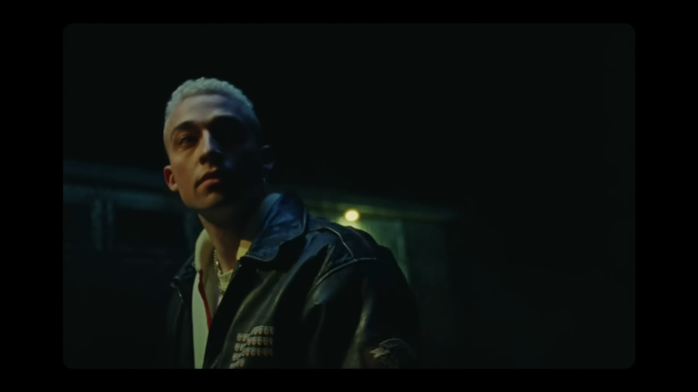

> 
> 
> 
> you crossed my mind
> it's been a while
> now i'm sitting in a taxi with his arms around me
> she just moved out
> and i don't know why
> i really wanna call you up and talk about it
> 
> soon as one of us is happy
> the other one gets lonely
> so sad it's almost funny
> how off we are
> should it be this hard?
> 
> never took the shot, thought i had to hide it
> it was stupid, i know
> never spoke my mind and i blamed the timing
> every time we got close
> yeah, we could be great, anybody can see it
> i'm the last one to know
> never took the shot, it was dumb, i'm sorry
> is it over? did we miss the party?
> 
> Clara Mae, Maximillian - “Miss The Party” - “Learning Experience” 
> 

Tháng 11 rồi, tôi đang phải gấp rút hoàn thành bản nhật kí này trước khi chính thức release vào cuối năm. Khoảng thời gian trước đó, tôi gần như không có thời gian để viết tiếp một phần nào cả, lúc tôi có ý tưởng để viết thì lại phải làm một đống việc không liên quan. Cảm giác mà bị mất cảm hứng liên tục xảy ra, đặc biệt ở cái giai đoạn cuối này. Tôi còn 3 mục ở phần cuối, và 3 mục ở phần đầu. Tôi có viết tiếp ở phần đầu nhưng vì chuyện diễn ra cũng 10 năm và tôi muốn, nếu như mình muốn viết về niềm vui, thì phải học cách viết về những chuyện buồn và những tiếc nuối trước tiên, đó cũng là lý do tôi chọn viết trước phần sau của chuyện tình cảm của mình, như là một cách để bắt đầu nhìn thế giới rõ ràng hơn…

Hôm nay trời nắng đẹp, và tại sao lại không nói về những tiếc nuối và nỗi nhớ ấy nhỉ???

---

Câu chuyện ở nửa sau, trong tuyến tình cảm của tôi, không phải là một cảm giác của một người quá đỗi hạnh phúc, mà là câu chuyện của một người đứng đối diện bên kia với những điều hạnh phúc đó và tìm thấy bản thân mình. Tôi muốn nói về sự tự do, bao dung và những quyết định đau đớn nhưng mạnh mẽ và không hối hận để làm nên con người của tôi hôm nay. Điều khiến một mối tình trở nên đáng nhớ, không chỉ là những câu chuyện của hạnh phúc, mà còn là những bài học để trở thành một con người đúng nghĩa, những chân thành và sự quyết đoán để dám sống đúng với con người thật của mình. Hơn hết, tôi muốn tập trung nhiều hơn những sự trái ngược giữa hiện thực - mơ mộng và về chuyện mình move on, một là rất lâu, hai là gần như không thể, tôi muốn giải thích tại sao tôi lại nghĩ như vậy dựa trên chính trải nghiệm của mình…

---

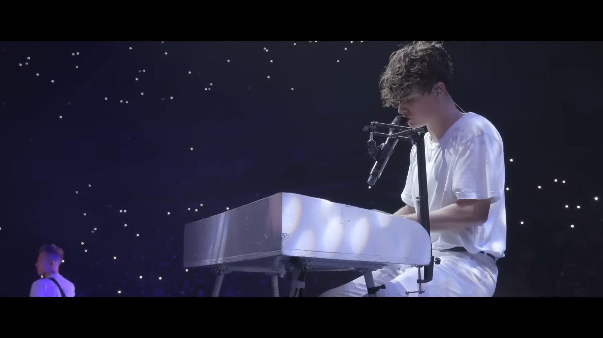

> 
> 
> 
> i've had space and time to realize the grass
> ain't greener and i kinda miss my side
> know i shoulda listened, when you told me the first time
> "you won't find another like me"
> 
> 'cause i'm sat here in my front room
> with a girl, who ain't you
> hoping and praying
> you're breakin' up with another fool
> who didn't hear the words
> that i hear on the same loop
> you won't find another like me
> 
> maybe i should have loved harder
> put up more of a fight
> i know i could have been stronger tonight
> 
> i've looked for love but there's a space inside my mind
> Where i keep on missing you
> i keep on missing you
> if you've seen enough
> know that i'll be right here
> not with somebody new
> i keep on missing you (you, you)
> 
> The Vamps - “Missing You” - “Missing You” (EP)
> 

Vào ngày cuối cùng khi tôi ở lại trường, tầm 28 tháng 5, quanh đấy, lúc bế giảng, có lẽ là một ngày tôi sẽ không bao giờ quên. Trước khi tôi đi, thì ít nhất, tôi đã có cơ hội để sống trọn vẹn nhất những ngày của mình, những ngày mà với anh em, tôi có lẽ không bao giờ quên được khoảnh khắc mà anh em có thể vui vẻ nói về chút dự định học tập của tương lai, hoặc ít nhất là có thể hồn nhiên và cảm thấy mọi thứ cũng chỉ là một ngày bình thường. Tôi trong đầu vẫn nghĩ là, ổn thôi, kiểu gì chả gặp lại. Tôi âm thầm tạm biệt, rời trường và đi thi cấp III những ngày sau đó. Kì thi khá khốc liệt, kiểu là tôi không thể chuẩn bị trước rằng kì thi ấy có thể sẽ khó khăn và tôi cũng không làm được bài, phải nói thẳng thắn là vậy. Thi chuyên thì tạch cả 3, nhưng điều đau đớn nhất lại xảy ra với mình là…. kết quả thi không được như kỳ vọng. Gia đình tôi, kể từ lúc biết kết quả, đã rơi vào tình trạng tranh chấp kéo dài, mối quan hệ gia đình trở nên ngột ngạt khi biết mình đã phản bội lòng tin của ai đó chỉ vì có chút chủ quan, hoặc là chuẩn bị không tốt, đủ thứ… Tôi nhìn vào cái ngày bế giảng ấy và bạn biết gì không, nó chốc bị tan tành trong đầu tôi, bị rút khỏi trí nhớ của mình và để lại đó là một trạng thái của việc bị mất trí nhớ. Tôi không còn tận hưởng niềm vui của cuộc sống nữa, học gần nhà nhưng cảm giác trở nên xa lạ với chính mình, phải tập sống trong trách móc, cứ như vậy mà đã hơn 8 năm tôi sống với cảm giác lạnh nhạt đến thế, với chính cuộc sống của mình…

Như tôi có kể chuyện ở trường, nếu nói về áp lực học tập, nhân tài trị thì đúng, nhưng chưa đủ làm nên vấn đề nghiêm trọng, vì cái cảm giác như người ta không chấp nhận danh tính thật của mình, nó tệ hại làm sao, đặc biệt là trong chuyện tình cảm. Cảm giác của một kẻ, vừa nổi tiếng trong cái môi trường chẳng phù hợp, và bị lãng quên bởi hồi ức của chình mình, nó khủng khiếp ra sao không…

Tôi nhận được hàng tá những ánh nhìn phán xét, những câu rì rào, và cả chuyện tôi là “idol” nào đó, khiến tôi cảm thấy xa lạ với chính mình. Người ta mổ xẻ hàng tá câu chuyện của một kẻ học giỏi nhưng hành xử kiêu ngạo, cái cảm giác mà bị lôi ra để người ta bàn tán rồi bị gia đình chỉ trích bởi những lời bàn tán mà ngay cả nạn nhân cũng cảm thấy xa lạ trước những chỉ trích đó. Cả chuyện tình cảm cũng vớ vẩn, hàng tá lời mời gọi từ mấy đứa học sinh khác, nhưng thái độ của họ cũng chẳng nghiêm túc. Không một lời hỏi thăm nào đàng hoàng, cứ áp cái quan điểm rằng tôi phải thích một ai đó, thích họ và phải chú ý tới khiến tôi có cảm giác như thể cuộc sống của mình bị mang ra làm trò tiêu khiển. Cái cảm giác mà bạn phải cố gắng sống trong một vòng tròn của những chuyện tình cảm lãng nhách mà bạn đã hoàn toàn biết trước kết cục đầy mệt mỏi của nó…. thật tồi tệ khi tôi sống gần 10 năm như thế rồi…

---

Nhưng nếu chỉ là câu chuyện về một thanh niên vỡ mộng về hiện thực, và câu hỏi kiểu: “**thế thì tại sao m không đi kiếm lại crush m ấy mà phải buồn vậy???**”, thì đây là lúc tôi bắt đầu nhìn ra một sự thật còn đau đớn hơn nhiều, và cũng từ những góc nhìn đau đớn ấy, tôi đã phải đưa ra rất nhiều lựa chọn không mấy dễ dàng, bao gồm cả việc từ chối thẳng thừng những lời mai mối thực dụng và dối trá…

Tôi biết tin crush có người yêu mới, thực chất là tầm vài tháng trước đó, và mọi thứ xác nhận đúng vào ngày nghỉ nọ. Với tôi, đó là một nỗi nhục nhã của kẻ thua cuộc, vừa thua trên con đường học tập, lại còn thua ở chuyện tình cảm. Điều tồi tệ hơn là tôi mất hoàn toàn khả năng liên lạc với tất cả mọi người bạn trước đó của mình, không khác nào một trạng thái của kẻ đã mất sạch ký ức về những ngày tháng tươi đẹp và phải gánh theo cái cảm giác như thể mình đã không còn giá trị. Dĩ nhiên, tôi không thể nói về điều đó một cách bình thường như thể tôi không có cảm giác gì, tôi không có quyền tức giận vì điều đó - dù tôi phải chứng kiến bản thân mình suy sụp từng ngày, và điều tồi tệ nhất trong chuyện tình cảm khi nhìn ra hiện thực của mình khiến tôi phải đưa ra một lựa chọn vô cùng đau đớn:

> không move on, không tiến tới bất cứ mối quan hệ nào và giữ nguyên mọi thứ….
> 

Viễn cảnh mà tôi đưa ra, cho dù tôi có thắng ở bất cứ chuyện tình cảm nào, dù ở thời điểm đó hay ở hiện tại, là một viễn cảnh thảm khốc. Đó là việc người đó sẽ không thể nào sống yên ổn khi người ta không để cho tôi sống lấy một ngày, khi cuộc sống riêng tư của mỗi người bị lôi ra làm thứ châm chọc, khi mỗi ý kiến của bản thân đều không được lắng nghe, khi cái cảm giác chiến thắng trong chuyện tình cảm không mở ra một tương lai tươi sáng mà chỉ mở ra một kỷ nguyên tăm tối vận hành bằng định kiến và sự ích kỷ. Từ chuyện gia đình, những tranh chấp, những tan vỡ, định kiến xã hội, đã giáng một cái tát và nói rằng: “**sẽ không có kết cục tốt nào diễn ra cả**”. Tôi đã không thể bảo vệ chính mình, thì làm sao tôi dám đòi việc người khác sẽ phải sống và tin vào những điều bất hạnh ấy bằng hàng tá lời dối trá chồng lớp lên nhau…

Kể từ đó, cuộc sống không có crush lại bắt đầu một lần nữa, có khi là mãi mãi…

---

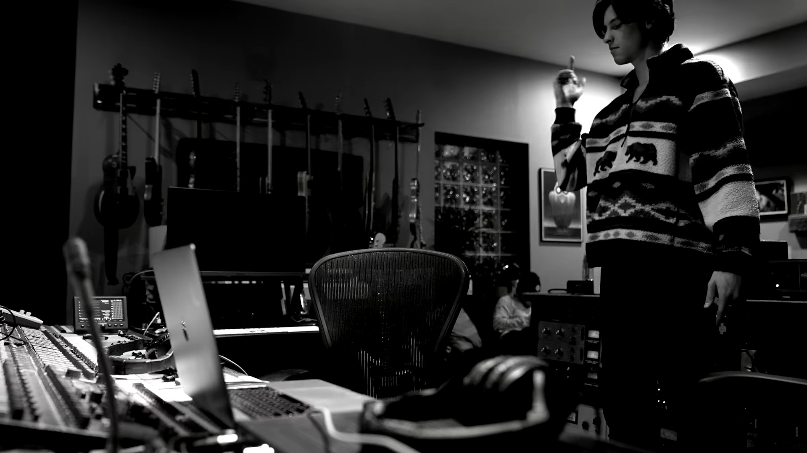

> 
> 
> 
> i need to learn how to cope without you
> i'm tryna protect myself but only you know how to, yeah
> oh, i know what we're supposed to do
> oh, but i hate the thought of losing you
> so, i'm just tryna hold on
> 
> hold on
> i don't wanna know what it's like when you're gone
> i don't wanna move on
> i don't wanna know what it's like when you're gone for good
> you're slipping through my fingertips
> a little bit by a little bit
> i didn't know that loving you was the happiest i've ever been
> so i'm just tryna hold on
> 
> Shawn Mendes - “When You’re Gone”
> 

Thật sự mà nói, rất khó để có thể định hình bản thân mình khi phải học cách sống thiếu vắng một ai đó. Cũng phải nói là tôi cũng từng cố gắng thay đổi để nói rằng mình thích một ai đó và nghĩ rằng, mình sẽ không sống trong hồi ức đó nữa. Thực tế khi ấy lại cho thấy một kết quả khác. Đó là một cảm giác chán nản rằng, dù kể cả mình có thay đổi, có trải chuốt hơn, cái cảm giác bị từ chối, vẫn y nguyên trước khi crush xuất hiện. Tôi thay đổi rất nhiều, nhưng cái cảm giác mà vừa trở thành một con người khác, tôi không cảm nhận được niềm vui, sự công nhận hay một chút thoải mái nào từ những người xung quanh mình. Cảm giác đó như thể là, mình phải học cách sống trong một thế giới không thuộc về mình và mình phải chấp nhận mọi thứ có thể xảy tới….

Nhưng câu hỏi của thời điểm này, khi thiếu vắng một ai đó, không phải là việc tôi có được ai đó hay không, mà là việc tôi sẽ quyết định như thế nào khi phải ở trạng thái một mình trong nhiều năm như thế. Từ đó, góc nhìn về cuộc sống của tôi, đã thay đổi từ đó…

Việc đầu tiên là tôi học được cách từ chối một điều không phù hợp với mình, bất kể lời hứa hẹn có ra sao. Thực ra trước khi có crush, tôi đã từng sống như vậy, nên chẳng có gì lạ khi tôi quay lại đưa ra quyết định ấy. Nhưng điều lớn lao hơn tôi nhận ra là: Nếu không thể chọn được một cuộc sống hoàn toàn theo ý muốn, tôi phải học cách kiên cường đấu tranh với một thực tế không công bằng. Và học cách từ chối chưa bao giờ là sai cả.

Tôi tập cách nói 'không' trước những lời mai mối đầy gượng ép. Tôi học cách nói 'không' với những người không chịu trách nhiệm cho rủi ro mà họ kéo mình vào. Trước một quyết định quan trọng, nếu được phép lựa chọn, tôi muốn suy nghĩ thật kỹ để không bao giờ đi vào vết xe đổ mà mình đã biết trước kết cục. Lối sống này hoàn toàn khác với thời THPT—cái thời kỳ mà tôi luôn phải nói 'đồng ý' trước những việc không khiến mình mãn nguyện, để rồi nếm trải cảm giác bất lực khi người ta giẫm đạp lên nó và phủi tay khỏi trách nhiệm. Tôi không muốn lặp lại sai lầm đó một lần nào nữa, càng về chuyện tình cảm thì tôi càng kiên định như thế…

Việc thứ hai là, tôi bắt đầu định nghĩa về mình trong một lăng kính khác: lăng kính của hoài niệm và những ước mơ chưa thành. Tôi nhớ một lần cuối cùng đi qua crush, đó là thời điểm tôi dần đi hết chặng đường đại học và phải học cách đối diện với sự bấp bênh sau chuỗi biến cố liên tiếp. Tôi chợt nhìn ra rằng, để sống với cái mác 'trưởng thành', tôi đã vô tình từ bỏ những điều mình từng tin tưởng và để ước mơ của mình dang dở.

Bạn có bao giờ nghĩ rằng, việc cố gắng trở thành một con người khác thực ra không hề mãn nguyện như ta kỳ vọng? Đơn giản vì nếu động lực thay đổi không đến từ việc bạn muốn tìm lại chính mình, mà chỉ là sự ám ảnh về một thời kỳ đã cũ, thì quanh đi quẩn lại bạn vẫn mắc kẹt ở đó. Tôi chọn bắt đầu từ sự hoài niệm vì đó là cuộc sống mà tôi thực sự muốn thuộc về. Ở khoảng thời gian ấy, tôi chân thành nhất về mặt cảm xúc, biết yêu mà không sợ hãi, và là một con người mà tôi có thể tin tưởng—gặp khó khăn nhưng không chùn bước, luôn giữ niềm tin vào những điều tích cực. Tôi coi những hoài niệm đó là giấc mơ chưa thành của một người bình thường hướng tới tương lai, chứ không phải là một quá khứ đáng để lãng quên. Tôi muốn biến nó thành căn tính của mình—một con người có nguồn cội và luôn biết tìm về chính mình sau mọi biến cố…

Và cuối cùng, định nghĩa của tôi về việc 'move on' không phải là bước ra khỏi một nỗi nhớ, mà là bước tiếp từ những nỗi nhớ dở dang và học cách làm lại mọi thứ từ đầu. Các bạn có thể đồng tình hoặc không về đích đến của việc bước tiếp, nhưng xét trên mục đích, 'move on' phải đến từ việc bạn sẵn sàng chịu trách nhiệm với quyết định của mình và không hối hận vì nó.

Tôi không hối hận vì đã yêu crush. Tôi đã sống rất nhiệt thành và muốn giữ vẹn nguyên sự nhiệt thành đó ở hiện tại. Điều tôi cần bây giờ là một tâm trí vững vàng hơn, quyết đoán hơn, táo bạo hơn, để có thể chân thành yêu một ai đó mà không còn sợ hãi liệu họ có chấp nhận mình hay không. Tôi bắt đầu lại không phải để cố cầu xin một cái gật đầu. Bất kể kết quả ra sao, tôi vẫn sẽ sống tiếp và tin tưởng vào con đường mình chọn. Hiện tại là khoảng thời gian tốt nhất để tôi sửa chữa sai lầm, vững vàng bước đi và không bao giờ để bản thân đánh mất chính mình một lần nữa...

---

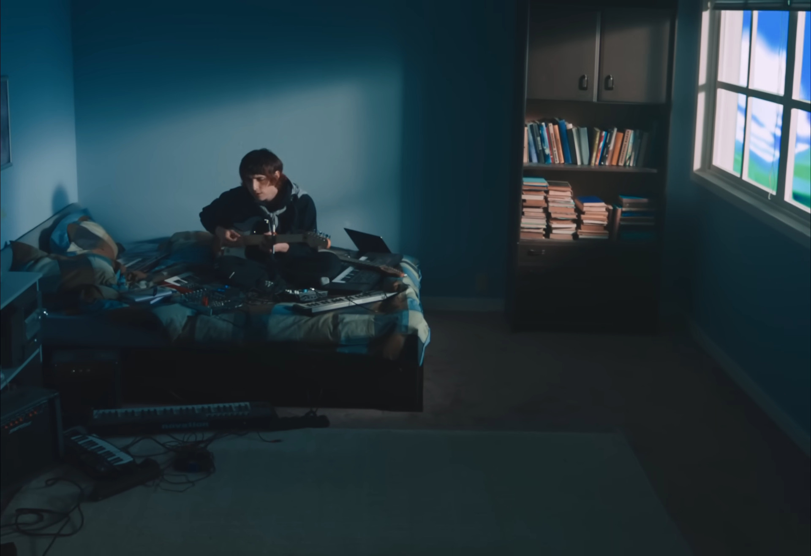

> 
> 
> 
> somehow, i don't even know what she does now
> but do i wish her the best or do i actually miss her?
> she had hearts in her eyes, she was rootin' for me all the time
> her love, the type that makes you dedicate your life
> oh, my cheerleader
> thought she needed me, but i need her
> 
> Porter Robinson - “Cheerleader” - “SMILE :D”
> 

“Có còn cơ hội gặp lại nhau hay không….?”, tôi nghĩ đây không phải là câu hỏi mà tôi nên nghĩ, không phải vì hết yêu, mà còn có một câu hỏi lớn hơn là:

> nếu như gặp lại, tôi muốn trở thành ai???
> 

Chắc chắn là nếu như tôi trở lại và gặp lại tình đầu, tôi không muốn mình phải sống như thể đó là một nỗi buồn của sự thiếu vắng, tôi muốn coi đó là động lực để mình sống tốt hơn và tin tưởng bản thân mình, sống với một tư thế không sợ hãi….

Kể cả lúc ấy hay bây giờ, tôi vẫn muốn sống và sẽ trọn vẹn hơn nếu như được gặp cô ấy một lần nữa…

well, i miss her so much…. meehhhh    

    
<strong>rollin right along…</strong>

    
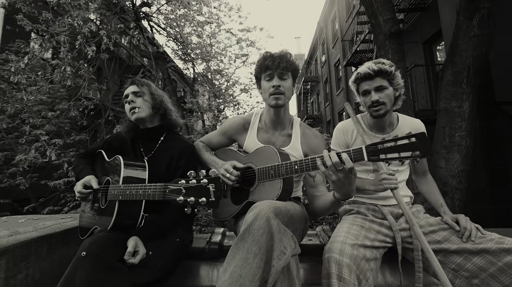

> 
> 
> 
> rollin', rollin', rollin' right along
> rollin', rollin', rollin' right along
> doesn't matter if i'm right or if i'm wrong
> rollin' right along
> 
> i was tryna grow up way too fast
> when time's the only thing i can't get back
> i'm strapped in for the ride, life goes on
> rollin' right along
> 
> might lose my way
> gone, gone, gone
> but i'm gonna stay
> rollin' right along
> 
> two years since i held my baby tight
> learned my heart can break and that's alright
> 'cause i'm not the only one who's movin' on
> rollin' right along
> 
> might lose my way
> gone, gone, gone
> but I'm gonna stay
> rollin' right along
> 
> Shawn Mendes - “Rollin’ Right Along” - “Shawn”
> 

Một chút thông báo là sau cả tháng chìm trong trạng thái “hạn hán” ý tưởng - hiểu nôm na là cảm giác không thể nghĩ ra cái gì để viết, thì tôi đã viết gần 100% những gì trong bản nhật kí này rồi, tức là toàn bộ phần 1 và 2, đã chính thức xong sau khi lược bỏ những phần không cần thiết, và phần 3 này cũng chỉ còn đúng 2 mẩu nhỏ. Trong khoảng thời gian ấy, tôi phải đối diện với trạng thái cạn kiệt ý tưởng nhiều lần, đặc biệt là cảm giác như thể mình không viết được niềm vui khi trong đầu chưa hoàn toàn bước tiếp ra khỏi quá khứ. Gần như, những gì tôi viết được chắp bút trong những thời gian trũng, có nghĩa là tôi phải tận dụng thời gian để hoàn thành cũng như tối ưu độ dài để vừa truyền tải ý nghĩa tốt nhất và vừa tối ưu thời gian khi nửa ngày của mình lại không thể ở nhà. Khác với những bản nhật kí trước, khi tôi còn quá tham vọng rằng tôi phải viết thật nhiều và viết thật nhanh, thì ở giai đoạn cuối này, tôi chủ động giãn tiến độ, một phần là vì sức khỏe tinh thần, phần vì vấn đề thời gian, phần lớn là vì nội dung. Tôi nghĩ là trong một khoảng thời gian có hạn, thì nội dung cần được chú trọng và trau chuốt, hơn là chỉ chạy đua về những gì có thể viết, mặt khác, tôi cũng sử dụng AI để nắn chỉnh lại câu từ và giải quyết lỗi chính tả do đánh máy nên gần như cả bài viết đã tốt hơn so với kỳ vọng lúc đầu. Đến phần cuối cùng rồi, tôi sẽ không sử dụng AI nhằm truyền tải trọn vẹn, kể cả chút sai lầm để đảm bảo tính chân thật. Tâm trạng của tôi mấy ngày nay là đủ đẹp để tôi có thể viết về những suy nghĩ ở hiện tại, khi tôi quyết định “move on” khỏi quá khứ và quay trở lại với hướng đi mà tôi muốn theo đuổi trong nhiều năm.

Để giải thích cái nhan đề, thì ban đầu, nó có một nhan đề hơi dài và lan man:
“closing of high-schooler nightmare, reflection about myself.…”

Đúng là về nội dung thì như vậy, nhưng tôi cảm thấy rằng, việc đưa ra một tiêu đề quá dài sẽ khiến người đọc cảm thấy thiếu thú vị, dông dài và thiếu gần gũi, khi những gì họ đọc lại trở nên quá dễ đoán và hơi mang tính giáo điều - rằng kết cục phải như thế. Chính vì lẽ ấy, nên hầu hết các phần đều có tiêu đề ngắn và một vài trong đó lấy tiêu đề từ những bài hát hoặc lời hát mà tôi thích, ví dụ như bài “Rollin’ Right Along” của Shawn. Ngoài việc truyền tải nội dung thông qua bài hát, tôi cũng muốn quảng bá cho nghệ sĩ mà tôi thích và ý nghĩa của những bài hát xuyên suốt quá trình tôi viết bài, đó cũng là một trải nghiệm mang tính chữa lành nhất tính từ lúc tôi chắp bút viết về những tâm sự này…

Về bài hát, thì đây là bài thứ 11 trong tổng số 12 của album “Shawn”, cũng có thể gọi là tổng kết cho những năm tháng qua và quyết định sống cho riêng mình. Shawn có nói về nhiều thứ, bao gồm sự nổi tiếng diễn ra ở một thời điểm quá non trẻ khiến anh gặp áp lực lớn trong sự nghiệp và chuyện tình đầy hứa hẹn nhưng đã tan vỡ. Dù nội dung có phần bâng khuâng khi nhìn lại những thứ qua đi mà không thể lấy lại, nhưng kết vẫn là: “rollin’ right along”, tức là vẫn sẽ bước tiếp trong cuộc sống khi bản thân cảm thấy rõ ràng hơn về chính mình, thay vì cảm thấy áp lực trước tất cả mọi thứ. Đôi khi, chúng ta nên chấp nhận lạc lối như là một phần để tìm chính mình, vì đôi khi, chúng ta đã sống quá lâu trong một hình ảnh vốn không thuộc về mình và để nó can thiệp quá sâu đến cái cách ta sẽ bước tiếp. Đây cũng là ý nghĩa mà tôi muốn truyền tải tới cho mọi người…

Như tôi có kể ở những phần trước đó, là khoảnh khắc “tia sáng ở tuổi 13” đến vào một thời điểm không mấy dễ chịu lắm, đó là những năm tháng tôi mông lung và tự ti nhất ở đời mình khi liên tiếp vỡ mộng và đối diện với những cảm xúc mà trước giờ tôi chưa từng nghiêm túc nhìn nhận trước đây. Ngay cả ở hiện tại, tôi biết là tôi rất muốn đi tiếp, nhưng cái cảm giác mệt mỏi nhất là khi mình cảm thấy bị mắc kẹt trong những hồi ức tệ và không thể nào giải quyết nó để sống thật trọn vẹn cho hiện tại. Nếu bạn đọc ở chap 1 - “long depression”, bạn sẽ thấy cái cuộc sống của tôi từng khủng khiếp thế nào để khiến cho tiến độ viết trở nên chậm một cách đáng sợ. 10 năm mà 8 năm sống trong trầm cảm và hậu quả của nó để lại, rất khó để nói về hy vọng như thể nó là một bức tranh hoàn toàn tươi sáng, nên thành ra tôi phải học cách đối diện với nỗi đau và viết ra những điều mà mình cần phải làm ở hiện tại, để có thể trân trọng niềm vui mình có được. Câu hỏi lớn hơn là:

“nếu tôi quyết định bước tiếp, thì tôi sẽ là ai???”

Thật sự rất khó để trả lời nếu chỉ nói rằng cứ move on, cứ vui vẻ lên trong khi mình còn chưa thể rạch ròi với quá khứ của chính mình. Tôi muốn viết ra điều này để trả lời và phân loại dựa trên 4 câu hỏi mà tôi cảm thấy rõ ràng nhất:

1. **Tôi chấp nhận điều gì????**
2. **Tôi muốn chống lại điều gì????**
3. **Tôi bỏ đi cái gì???**
4. **Tôi giữ cái gì???**

Câu hỏi đầu tiên, thì tôi xin trả lời là tôi chấp nhận cuộc sống bấp bênh ở hiện tại, quãng thời gian trầm cảm, những đổ vỡ, sự xa cách và lãng quên. Nói ra thì nhiều, nhưng có thể hiểu ngắn gọn là chấp nhận rằng sự tiêu cực đã tồn tại và chắc chắn sẽ xảy ra. Tôi nghĩ đây là câu trả lời thực tế nhất mà tôi có thể đưa ra cho các bạn, tôi không hề có ý định vinh quang hóa một thứ khủng khiếp, mà tôi chỉ nói rằng đó là thực tế xã hội khốc liệt mà tôi hay các bạn sẽ phải trải qua trong thế giới của người lớn. Đã có những tan vỡ mà nhiều lúc nhìn lại, tôi không muốn mình phải trải qua điều đó, và nếu như tôi vững vàng hơn thì có lẽ tôi sẽ giữ mọi thứ lâu nhất có thể. Tôi muốn chấp nhận và nó nên là một bài học về một viễn cảnh rằng thế giới có thể khốc liệt tới mức nào, và tôi muốn các bạn thấu hiểu điều đó để không phải đi vào vết xe đổ mà tôi từng vấp…

Câu hỏi thứ hai, thì tôi xin trả lời với một câu nói: “phòng còn hơn tránh”. Mục tiêu tối thượng của cái repo này, là để cho các bạn hiểu về tình trạng thực tế để có những đối sách, chứ không phải là làm ngơ trước những thực trạng đó. Các bạn không thể tránh khỏi một thực trạng thì luôn phải sẵn sàng giải quyết hậu quả mà nó gây ra, đơn giản là vì cuộc sống của bạn cần tiến lên phía trước, chứ không phải là sống tiếp mà tâm trí bị giam cầm bởi nỗi hối hận. Những bài học này tôi rút ra từ trải nghiệm tồi tệ ở THPT, đó là một thế giới của nhân tài trị, quan liêu, giả dối và bất công. Tôi có thể chấp nhận rằng đó là quá khứ, nhưng tôi không thể bước tiếp mà nhìn những đặc tính tiêu cực này phá nát thế giới đáng sống của mình, và ít nhất, dưới tư cách lớp trưởng, tôi đã phần nào bảo vệ được những người xung quanh trước khi mọi thứ sụp đổ hoàn toàn. Cũng vì lẽ đó, tôi rất nể phục sự trung thực và động thái mạnh mẽ của các bạn trước thực trạng như vậy, vì đó là thái độ mà tôi muốn các bạn nên có. Các bạn học và sống, không phải cho một thương hiệu, mà là để tiến tới tương lai, mà muốn tới tương lai, các bạn phải có nhận thức và dám phản kháng trước những bất công diễn ra ngay trước mắt bạn.

Câu hỏi thứ ba, tôi nghĩ câu trả lời là thành tích, nuối tiếc và kỳ vọng. Nhìn lại cả quãng thời gian ấy, tôi chưa một ngày nào sống trọn vẹn như mình muốn, không phải là tôi ghét cuộc sống này, mà là vì tôi phải gánh theo những thứ mà tôi không bao giờ muốn mang đi. Cái cảm giác tồi tệ khi nghĩ về cuộc sống này, đó là cảm giác mọi thứ tốt đẹp sẽ không trở lại và phải sống với nuối tiếc như thể đó là thực tại duy nhất mà tôi nhìn thấy. Từ nuối tiếc, tôi lại mang theo những kỳ vọng từ thành tích trước đó của mình, giống như kiểu, tôi kỳ vọng rằng mình phải đạt được mốc này mốc kia, khiến cái cảm giác thất bại trở nên nặng nề. Nhìn lại cả cuộc sống của mình, để đạt một thành tích thì chưa một ngày nào tôi cảm thấy mình là chính mình khi đạt những thành tích ấy, ở THPT, tôi học giỏi nhưng không có quyền được biểu đạt ý kiến và lắng nghe, thế thì liệu thành tích ấy có đáng để mang theo? Tôi nghĩ là, nếu như ai đó nuối tiếc vì tôi không được thế nọ, không được thế kia, thì tôi chỉ muốn nói là tôi chỉ đơn giản bỏ đi thứ không thuộc về mình, vì để có được những thứ đó, tôi phải bán đi cuộc sống của mình và liệu có đáng để tiếc thương cho những thứ như thế??? Không ai “vinh quang hóa” một nỗi đau cả, kể cả khi bạn có sống sót thì không có nghĩa là tương lai phải mang theo cùng một nỗi đau đó, và nó đáng bị phản kháng, đơn giản có vậy thôi.…

Và cuối cùng, sau tất cả những biến cố, nuối tiếc và bấp bênh, tôi muốn giữ con người của mình, với sự lạc quan, lòng biết ơn và ánh sáng của niềm tin trong những thời khắc tăm tối nhất, có thể hiểu là, tôi chấp nhận khoảng thời gian tươi đẹp ấy đã không thể quay trở lại, nhưng tôi hoàn toàn có thể mang những điều tốt đẹp nhất từ nó đến hiện tại để đi tiếp và giải phóng suy nghĩ của mình. Tôi không cần phải cảm thấy mình phải trở thành ai đó vĩ đại, hay phải ôm một nuối tiếc về những gì không thể lấy lại, hay phải định nghĩa mình bằng những thành tích không phải của chính mình, tôi đơn giản là một người đàn ông, có tình đầu, có khả năng học tập tốt, tôi cởi mở với thế giới, luôn giữ nhiệt huyết và coi trọng anh chị em của mình. Tôi như Don Quixote vậy, dù tôi rất sợ thất bại và cái chết, nhưng nếu không thể tránh khỏi, thì tôi sẽ chiến đấu tới cùng như thể mình không còn gì để sợ. Từ trước tới giờ, tôi muốn mình lạc quan và ở hiện tại, tôi muốn mình giữ một tâm trí rõ ràng như thế, để ngẩng cao đầu mà sống, để dám đối diện với sai lầm và sửa chữa nó. Tóm lại, tôi là ai, thì vẫn mãi như vậy.…

Tôi không có một công thức rằng các bạn khi bước tiếp sẽ trở thành ai, vì hầu hết những gì tôi viết đều là trải nghiệm cá nhân, nhưng đơn giản, tôi muốn nói là cuộc sống hiện tại có thể là màu xám xịt, nhưng nếu sống ngày nào, thì hãy sống thôi.... vậy là đủ....

    

    
<strong>in my blood</strong>

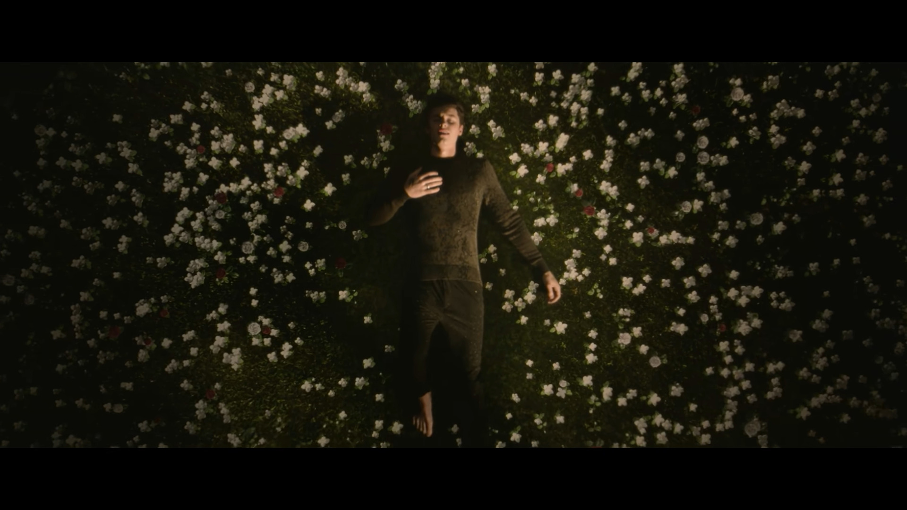

> “help me
>it’s like the wall are caving in
>sometimes i feel like giving up
>but i just can’t
>it isn’t in my blood”
>
>Shawn Mendes - “In My Blood” - “Shawn Mendes”
> 

translation:

> “giúp tôi với…
dường như mọi thứ đang dần sụp đổ rồi
đôi khi tôi chỉ muốn buông xuôi
nhưng tôi không thể…
vì đó không phải là chính tôi.”
> 

Tôi xin chính thức thông báo, đây là phần cuối cùng mà tôi viết cho toàn bộ phụ lục này. Để nói về cảm giác hiện tại, lúc tôi chính thức xong phần viết và chuẩn bị đến phần chỉnh lý, tôi có một cảm giác nhẹ nhàng và rõ ràng hơn so với lúc tôi bắt đầu chắp bút. Như tôi có nói ở phần “rollin’ right along”, thì trải nghiệm viết ra những lời này, giống như nhìn lại cuộc đời của mình, có niềm vui tột đỉnh, có những nỗi buồn ám ảnh gần thập kỷ, có cả những đấu tranh và ở hiện tại, đó là một sự bắt đầu - tiếp tục những ước mơ đã từng phải dở dang. Đối với tôi, phần phụ lục này, vừa là tâm sự về những điều chưa thể nói và cũng là thứ chữa lành trái tim mà tôi rất muốn lôi ra đọc đi đọc lại. Dù thật khó để bắt đầu lại, và tôi cũng chưa thể nói rằng mình đã hoàn toàn “move on” khỏi quá khứ, nhưng ít nhất, tôi yêu hiện tại của mình, và đó là lý do của phần kết này - không phải là một kết thúc, mà cho một khởi đầu mới…

Như mọi phần, nếu có một bài hát thì tôi phải giới thiệu chút hoàn cảnh sáng tác và ý nghĩa của nó nhể. Như các bạn đã biết, tôi là một fan cứng của Shawn, nghe từ năm lớp 8 tới tận bây giờ. Vào 2018, sau sự thành công của album “Illuminate” và “Handwritten”, cái bóng của hai album đó quá lớn để anh có thể chuyển hướng trong phong cách âm nhạc của mình ở album tiếp theo. Shawn cùng đội ngũ khi đó bao gồm Teddy Geiger, Scott Harris, Geoff Warburton và George Seara, làm việc ở Malibu, Woodshed Studio. Đó là một nơi ở vách núi, có view hướng thẳng ra đại dương. Mỗi khi ông anh cảm thấy bế tắc khi sáng tác thì lại đi bộ cùng với anh em và chỉ tận hưởng view đại dương. Mọi người thử rất nhiều giai điệu, và đặc biệt trong số đó là một nhạc cụ đặc biệt mà vừa gảy đàn, vừa có phím đàn. Thế là có những giai điệu đầu tiên. Còn chuyện về lời hát, thì mọi người nói về đủ thứ chuyện, và thế là Shawn có ý tưởng, mọi người bắt tay thực hiện toàn bộ các công đoạn khác như sáng tác lời, phối nhạc.

Còn về nội dung của bài, thì trong một buổi phỏng vấn, toàn bộ bài “In My Blood” nói về chứng lo âu và tự ti, cái cảm giác vô định không thể làm gì, rất muốn gọi cho người thân nhưng không muốn họ thấy vì sợ bố mẹ lại lo lắng. Ngay trong khoảnh khắc muốn buông xuôi nhất, thì Shawn nói rằng mình không muốn bỏ cuộc và phải chiến đấu tiếp. Nội dung bài hát vô cùng đơn giản nhưng chạm đến trái tim của tất cả các fan trên toàn thế giới. Đặc biệt hơn, bài hát đã thay đổi hoàn toàn hướng đi trong phong cách âm nhạc của Shawn năm 20 tuổi, đó là cho phép thử nghiệm nhiều thể loại nhất có thể và kể những câu chuyện của chính mình. Vì lẽ đó, bài hát đã tạo cảm hứng để tôi viết ra phần kết của “spark of 13”, để bắt đầu cho một giai đoạn mới của mình.…

Về cá nhân tôi, cảm giác khi quyết định nhìn lại mọi thứ, từ hạnh phúc, nỗi đau, vô định và cả đấu tranh cho hiện tại giống như một tàu lượn siêu tốc vậy. Nó xuất phát từ một ý định mà trước giờ tôi chưa từng nghiêm túc hành động, đó là thử hỏi bản thân xem mình thật sự là ai và thật sự muốn gì trong cuộc đời, nhất là ở bối cảnh mà rất có thể một ngày nào đó, tôi có thể bị thuộc diện cắt giảm và đối diện với nguy cơ thất nghiệp. Thật sự phải bắt đầu nhìn lại và tìm lại bản thân mình trong đó, trong hàng đống thứ lộn xộn chồng lên nhau nhiều lúc khiến tôi thật sự không biết mình đang nghĩ tới điều gì, nỗi đau ấy thật sự quá lớn để tôi có thể viết về nó mà giảm nhẹ đi mức độ nghiêm trọng, còn hạnh phúc thì trở nên rất mờ nhạt, thành ra tiến độ viết đã bị giãn tới mức mà tôi đã phải cắt bỏ rất nhiều phần, tối ưu độ dài, tưởng chừng như thể đây lại là một dự án ma khác. May mắn làm sao là tôi đã hoàn thành phần lớn và cho mình một cơ hội để đối diện với sự thật, để khiến mình rõ ràng hơn ở hiện tại.

Khi tôi nói đến bài hát này, tôi muốn nói tới sự đấu tranh cho hạnh phúc là một điều tất yếu, mà nếu không vì hạnh phúc thì ít nhất cũng phải là việc chúng ta sẽ sống tiếp với một quan điểm khác. Có một điểm mà tôi thích ở bài hát, đó là việc đấu tranh không phải là thứ sáo rỗng rằng ai ai cũng sẽ nghĩ tới đầu tiên, mà đôi khi, đó là cảm giác chúng ta gần như buông xuôi, nhưng lại không thể và đứng dậy một lần nữa. Điều này khiến tôi nhớ lại những nỗ lực của mình, kể cả ở trong một thế giới không hạnh phúc, thì tôi đã phần nào cố gắng và đã không chọn con đường cực đoan nhất. Tôi biết, ở trên đời này, không phải ai cũng may mắn như thế, có những người đã không thể chờ đến thời điểm mà họ vững vàng để bước tiếp, và đã phải bỏ lại đời mình cùng những đam mê, dự định và gia đình. Thế nên, tôi muốn viết ra những lời này, giống như một chút lời tâm sự của mình sau những nỗi buồn ấy, tôi vẫn sống và nên cố gắng, dù cơ hội gần như chạm đáy.…

Tôi tin vào hy vọng, tôi chắc chắn một điều rằng nếu ai đó muốn sống tiếp, thì chẳng ai lại muốn sống với một tương lai u tối cả, đó là điều tôi khẳng định và cũng là cơ sở cho những điều mà tôi đã từng viết từ trước đến nay. Nhưng, hy vọng đấy không đến như hư vô, hay bất cứ sự ban phát như thể nó đã có ngay từ đầu. Nó xuất phát từ việc các bạn đấu tranh tới cùng cho cuộc sống của chính mình, hy vọng phải xuất phát với tâm niệm rằng các bạn, dù có sợ hãi tới đâu, thì cũng phải học cách yêu lấy tương lai của chính mình. Cái cách để bạn có thể yêu cái tương lai ấy, chắc chắn chỉ có thể yêu lấy hiện tại và bảo vệ những thứ quý giá nhất của mình. Khoảnh khắc các bạn chọn bước tiếp, đó là một điều rất mạnh mẽ rồi.…

Dù sao cũng là kết bài, khi tôi của tuổi 13 quay lại trong một dáng vẻ chắc chắn hơn, tôi muốn mình có thể tận hưởng cuộc sống và làm những điều cần làm. Dù tôi chưa thể nói rằng mình hoàn toàn move on, nhưng khi tôi viết ra hồi kết này, lòng tôi đã nhẹ đi rất nhiều và đầu óc cũng trở nên rõ ràng hơn so với lúc tôi bắt đầu viết. Giờ là lúc để tôi chuẩn bị và tiến hành cho năm mới, cái thời điểm mà mọi thứ là bất định, nhưng cũng sẽ rất thú vị.…

**love you all.... be brave…**

**from bronstein, the founder.**

    
# the reality: to be fearless between life and death…

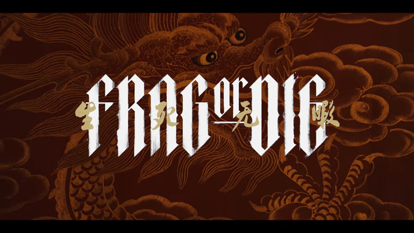

> “**生死无暇**”
”**frag or die**”
”**sinh tử vô hạ**”
>
>VALORANT Champions Shanghai.
> 

---

Thời điểm tôi viết những dòng này là ngày 11/10/2026, trong giai đoạn playoff của VALORANT Champions 2026 tại Thượng Hải (24/9–18/10). G2 và T1 đang gặp nhau ở Lower Round 2, một trận đấu loại trực tiếp: đội thua sẽ phải dừng bước. Tôi đang theo dõi map 3: Ascent — map quyết định đội nào được đi tiếp và đội nào phải về nước.

Trận đấu vốn đã cam go vì tính chất loại trực tiếp. Nhưng với tôi, nó còn mang thêm ý nghĩa của một cuộc chuyển giao: từ năm 2027, VCT sẽ chuyển sang mô hình thi đấu mới, mở thêm con đường từ vòng loại mở tới những sự kiện lớn.[[1]](https://valorantesports.com/news/the-new-valorant-champions-tour) Điều đó khiến trận này giống như một dấu mốc của kỷ nguyên thi đấu hiện tại — không phải lời kết cho sự nghiệp của các tuyển thủ, mà là thời điểm khiến câu hỏi “ai được đi tiếp, ai phải dừng lại?” trở nên nặng hơn….

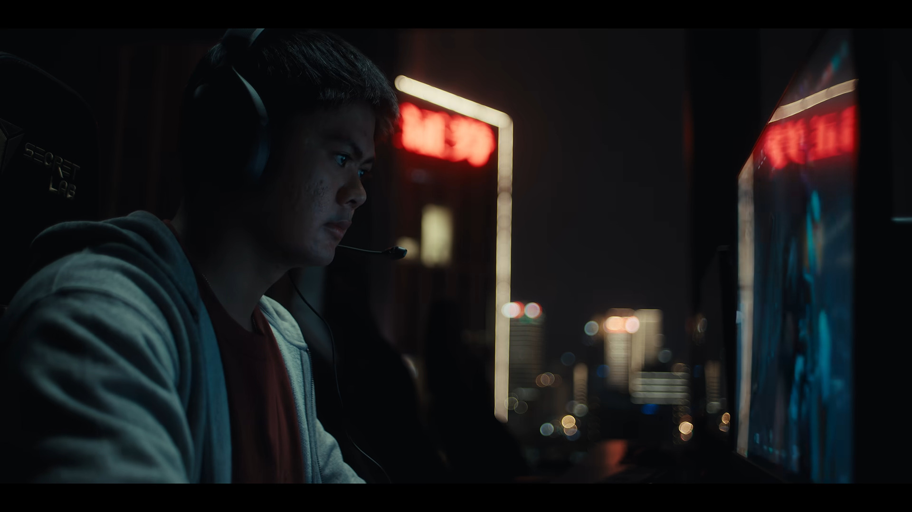

Còn về slogan trên, tôi cắt ra từ một đoạn teaser của giải cho ngày thi đấu đầu tiên, theo như tôi nhớ là trận của Paper Rex (PRX) - Team Liquid (TL) và G2 - TYLOO. Chủ đề của mùa giải này, tôi thấy có ý nghĩa nhất tính từ năm 2021 - thời điểm mà giải VCT chính thức được thành lập. Năm 2026 là kỷ nguyên cuối cùng của franchise, và các đội, dù thành công hay thất bại thì đều phải chấp nhận rằng đây có thể là mùa giải cuối cùng mà họ vẫn còn được bảo trợ dưới tư cách đó. Trọng tâm của giải khi đó không phải là câu chuyện thắng hay thua đơn thuần, mà như Patmen thuộc GE chia sẻ: “**nếu đây là mùa giải cuối cùng, thì có lẽ chắc tôi sẽ cày cả đêm**”. Phần tiêu đề được lấy từ câu chốt của KangKang mà tôi cho là ý nghĩa với chính bản thân tôi nhất:

> “Sống không sợ hãi trước lằn ranh sinh tử….”
> 

Và đó là cách cái tiêu đề được tạo ra, đến lúc tôi nên nói về cái thực tế này rồi…

---

Câu chuyện của tôi mới diễn ra trong nửa năm thôi, tính từ lúc tôi bị burnout ấy. Các bạn có bao giờ hiểu cái cảm giác mà các bạn kỳ vọng quá nhiều vào một thứ, đổ dồn hết năng lượng và niềm tin của mình vào một công việc hay một nơi làm việc - dù cái tổ hợp đó không lý tưởng cho bạn, rồi đến một thời điểm thì bạn vỡ mộng, các bạn có thấu được cái đó không…. Với những người đang đi học hay ở kì cuối cùng, nói ra viễn cảnh thực tế này có thể không phù hợp, nhưng tôi cũng không thể giấu được sự thật ấy. Điều còn khiến tôi cay đắng hơn là, lúc tôi biết được cái thời hạn hợp đồng và nguy cơ bị cắt giảm ấy, nó khiến cho kỳ vọng của tôi càng lúc càng sụp đổ. Tính từ cái lúc tôi tốt nghiệp đại hoc cho đến lúc tôi có việc làm, thì tôi dồn khá nhiều kỳ vọng vào đó, thậm chí là để tập trung cho nó, tôi đã phải bỏ lại rất nhiều thứ khác, từ cuộc sống cá nhân, chuyện học tập, những sở thích thường ngày và cả tương lai nữa, chỉ để cố gắng khớp mình trong đó. Mỗi một ngày về nhà, cảm giác như tôi vô vọng lắm, vì ngoài công ty - tôi đã rất áp lực vì sự khác biệt trong cách làm việc và cảm giác mình không thuộc về thế giới đó, còn về nhà thì tôi chỉ nằm dài và chờ cho ngày trôi qua đi vì tôi cũng không còn sức lực nào cho cá nhân mình nữa. Chuyện cá nhân thì chắc còn đỡ, nhưng điều khiến tôi không dám mạo hiểm thì đó là chuyện tài chính của gia đình, việc xây nhà đã tạo ra một khoản nợ mà ước tính phải một năm sau - tính từ hiện tại thì mới hoàn toàn giải quyết. Cái hiện trạng như vậy khiến tôi kiệt quệ năng lượng và cảm xúc, vì mọi điều tôi đưa ra lúc ấy không thể giải quyết triệt để cho cái nguy cơ trên: vừa burnout trong công việc, nợ thì treo lơ lửng trên đầu và nguy cơ cắt giảm - không thể tìm được việc làm trong một khoảng thời gian dài….

Riêng 6 tháng đầu năm, tôi gần như không thể lập trình hay dành thời gian để nghiêm túc làm một cái gì đó. Kể ra, thì gần 10 tiếng tôi làm + 3 tiếng đi lại + 8 tiếng ngủ, như vậy trong 5 trên 7 ngày, thì bạn nghĩ xem là tôi có gì để làm cho dự án cá nhân không??? Dĩ nhiên là không rồi. Ngay cả việc tự học trên công ty cũng là một trải nghiệm của sự chán nản, vì hệ thống mạng thì chặn đủ thứ, công ty giám sát chặt và tôi luôn trong tâm thế phải đề phòng xem mình bị bắt lỗi ở điểm nào. Thứ may mắn duy nhất trong 6 tháng, đó chính là chuyện chụp ảnh và viết lách ở cái cuốn nhật kí này, nơi mà tôi có thể bày tỏ cái nỗi lo và những lời tôi không thể nói ra cho người ngoài, chỉ có thể viết cho các bạn. Dù tôi không thể làm được gì quá nhiều trong 6 tháng ấy khi cuộc sống chủ đạo của tôi chỉ có đi làm “trái ngành”, tôi lại có những phân tích rất giá trị về cuộc sống cá nhân và những điều tôi nên làm để chuẩn bị cho nghỉ việc. Ý tưởng của phần này xuất phát từ một câu hỏi thực tế và câu trả lời sau đó:

> Ừ, tôi đã chấp nhận chuyện nghỉ việc rồi, sau đó là gì????
> 

Khi tôi viết đến câu hỏi này, thì nó khiến tôi nhìn lại toàn bộ quyết định của mình và nhiều lúc, tôi cảm thấy có chút cay đắng. Như tôi có nói, kể từ THPT, cuộc sống của tôi phải định hình bằng sự sinh tồn và kỳ vọng của gia đình rằng tôi phải làm mọi thứ mà không có thất bại, ví dụ như không được thất nghiệp, không được trượt môn hay không được phép xếp loại kém,… Tôi làm rất tốt những khoản đó, nhưng đến khi tôi biết được sự thật từ cái hợp đồng lao động, tôi mới đau lòng mà nhận ra, những gì tôi bán sống bán chết, từ chuyện thi cử, học đại học và đi làm, tôi chưa một lần nhìn nhận rằng tôi nên làm gì và không nên làm gì. Tôi buộc phải đinh ninh về một điều mà tôi biết rằng trước sau gì cũng vỡ vụn, và nó đã vỡ vụn rồi. Cái câu nói chấp nhận kia vô cùng đau đớn, vì tôi không thể hình dung rằng cuộc sống mình sẽ ra sao khi nói câu nghỉ việc, và nhìn lại để cho cái kỳ vọng ấy, tôi bỏ phí cả khả năng học tập, sự cởi mở và cuộc sống cá nhân, tôi thấy nó cực kì lãng phí cái khả năng của mình. Tôi không thấy vui một chút nào cả, mỗi ngày trôi đi nó vô nghĩa lắm ấy. Mỗi một ngày, lên một ý tưởng, làm được nửa chừng rồi chẳng làm được nữa, tôi cũng thấy chán chứ, vì tôi chẳng thể dành đủ thời gian cho những cái cần thiết mà thời gian của tôi lại phải cố gắng duy trì cho một cuộc sống công sở mà tôi biết nó sẽ kết thúc. Đó là một cái cảm xúc tồi tệ, ăn mòn khả năng của bản thân và trong nửa năm, tôi không còn cảm nhận được cuộc sống như vốn có nữa…

Tôi nghĩ đi nghĩ lại nghĩ hoài nghĩ mãi về cái câu hỏi đó, và mọi nỗ lực để duy trì những thói quen mới ấy, thật sự không dễ dàng một chút nào. Cứ có một ý tưởng, thì tầm vài ngày sau lại dập tắt, thành ra tôi mới viết phụ lục này ngay khi mới nóng hổi. Tôi nghĩ về một tương lai có việc làm ngay lập tức, nhưng nhìn nhận về kiến thức của mình - tôi lại cảm thấy như mình không đủ. Sự thật là, tại cái thời điểm mới xong việc học, tôi không thấy mình thông minh và sau này phải công nhận là vậy. Nỗi sợ thất nghiệp trong giai đoạn cắt giảm khiến tôi không có đủ thời gian để đưa ra một lựa chọn đủ tốt và đáng ra, tôi đã có thể chọn một cách thức tốt hơn nhưng cái nỗi sợ thất nghiệp, nợ treo ngay trên đầu khiến tôi phải gác lại sự kiên nhẫn ấy với chính mình. Rồi đến khi đi làm, vỡ mộng và nhận ra sự lãng phí ấy, tôi nhận ra một thực tế rằng: “**có lẽ thất nghiệp xem chừng không đáng sợ bằng việc không có kiến thức cho bản thân**”. Ngay cả khi tôi nói câu này, tôi cũng chưa hoàn toàn chuẩn bị cho viễn cảnh ấy….

Mọi chuyện dần khác đi một chút vào một vài ngày nọ….

---

Câu chuyện về cuộc sống riêng, khi tôi bắt đầu chụp ảnh chỉ là một phần. Tôi không coi việc chụp ảnh là việc chính, vì ngay hôm sau, tôi vẫn phải cất máy ảnh và đi làm quần quật như vậy, thì lấy đâu ra để nói rằng tôi sẽ nghỉ việc. Nhưng ý tưởng về cuộc sống “phía bên kia” và sự cởi mở cho tôi một góc nhìn khác, cũng là nội dung của tiêu đề:

> Ừ, nếu tôi biết chắc chắn rằng tôi sẽ thất nghiệp, thì tôi biết mình sẽ phải đối mặt với nó, bất cứ lúc nào, chỉ là tôi cần thời gian thôi…
> 

Khi tôi nói ra câu này, tôi mới nhận ra rằng trong nhiều năm, tôi chưa có một cuộc sống cá nhân ngoài công việc đúng nghĩa. Đáng ra, tôi đã có thể học tập và nghĩ thật nhiều ý tưởng, nhưng tôi lại phải bỏ đi nó chỉ để dồn thời gian duy trì cho những thứ chẳng giúp gì bản thân sau này. Nỗi sợ thất bại là quá lớn để tôi có thể nhìn rõ ràng về việc tôi sẽ phải đối diện và sửa chữa nó. Tôi luôn mắc trong cái cảm xúc rằng mọi chuyện đã qua và tôi không thể sửa chữa, và điều đó cản trở khả năng của tôi rất nhiều. Đáng ra, có những chuyện mà tôi dùng chút kinh nghiệm xử lý thì đã chả vất vả đến thế, nhưng vì có cảm giác như “sửa cũng chẳng được gì”, nên tôi làm ngơ và tôi phải trả giá. Tôi phải cố duy trì một hình ảnh mà người ta gọi là “thành công” nhưng trong tâm tôi lại thấy như một “thất bại”, vì đáng ra đã có thể nỗ lực sửa sai, thì tôi lại không dám làm cho chính mình. Chính vì lẽ đó, tôi rất ghét một hình ảnh bị định nghĩa bởi thành tích và thành công, vì nó không miêu tả chính xác những gì trong lòng tôi thật sự nghĩ đến…

Dù ở hiện tại, khi nhận thức được sự việc, tôi vẫn chưa thể tiến công vào cuộc sống cá nhân của mình ngay lập tức, vì cái án “sa thải” và “cắt giảm” vẫn lơ lửng treo trên đầu, nhưng nó đã thả lỏng và giúp tôi có quyết tâm lại trong cuộc sống. Chắc chắn, tôi không phải là thằng ngu mà không biết những gì đang thực sự diễn ra, nhưng sự quyết tâm, khi tôi viết những lời này là cần thiết để nghĩ về tương lai. Tôi ngồi nghĩ lại và:

> Ừ, có bao giờ tôi đã bắt đầu một cuộc sống, một ý tưởng, một ước mơ hay là dám làm một điều gì đó nhỏ nhoi, một cách nghiêm túc bao giờ chưa??
> 

Thực tế, trong nhiều năm, câu trả lời là chưa. Nỗi sợ về thất nghiệp khiến tôi không thể nghĩ về bản thân một cách vui vẻ được. Rồi khi có chút cuộc sống cá nhân và viết những lời này cho các bạn, chúng thật sự rất quý giá để tôi quyết tâm hết mình. Tôi đã chấp nhận rằng trước sau gì cũng thất nghiệp, nhưng nỗ lực để bảo vệ những điều quý giá, trước lằn ranh sinh tử ấy, không hề vô nghĩa một chút nào. Những nỗ lực ấy, từ một dự án giả lập nhỏ, chụp ảnh hay làm một việc gì đó mà không bận lòng, đã dạy cho tôi rằng cuộc sống này đủ khốc liệt nhưng cũng đủ quý giá để bảo vệ tới cùng. Việc mất đi tất cả không đáng sợ bằng việc không dám nỗ lực tới cùng để cải thiện cuộc sống của chính mình. Và câu này, lại đi sang một ý nghĩa lớn hơn khi tôi đối diện với mặc cảm của chính mình…

> Kẻ đáng sợ nhất là kẻ đã biết mình thất bại và không có gì để mất, vì hắn đã hoàn toàn vượt qua nỗi sợ của chính mình rồi…
> 

Cái suy nghĩ này, ở hiện tại chính là những gì tôi hướng tới và cố gắng nhất có thể. Tôi nhìn lại những kỳ vọng đã tan vỡ, cảm giác chênh vênh và cái cuộc sống mới chớm ấy, và tôi nói rằng, có lẽ tôi đã chấp nhận mình thất bại nhưng tôi vẫn yêu cuộc sống này rất nhiều. Cái suy nghĩ kiểu “không còn gì để mất” là một suy nghĩ cực kì tự do và mang một sức mạnh rất lớn. Tôi trả lời rằng: “**ừ, tôi thất nghiệp cmnr nên tôi sẽ học nhiều nhất có thể, vì dù sao cũng thất nghiệp nên học nhiều hơn chút cũng chẳng sao**”. Tôi nên thấy rằng, điều đáng sợ không phải là thất bại, mà là đã không dám chiến đấu tới cùng cho cuộc sống của chính mình. Tôi chọn nghị lực hơn trí thông minh, không phải là tôi đánh giá thấp, mà là tôi biết rằng trước sau gì mình cũng phải đối diện, nên thà rằng mình đối diện và có thể chết đi, còn hơn phải sống trong dằn vặt và tan vỡ khi biết kỳ vọng sẽ liên tục tan vỡ. Dù tôi chưa thể làm được gì ở hiện tại, nhưng đó là điều rõ ràng nhất mà tôi có thể thấy và tôi đang gấp rút, viết ra những điều này và chuẩn bị thật tốt cho năm sau - lúc tôi có thể phản công lại…

---

Còn với các bạn, những sinh viên Troy đang học, tôi không viết ra những điều này như thể cố an ủi hay khiến mọi chuyện khác đi trong đầu các bạn. Không thể che giấu sự thật rằng ngành học này đang dần chết và ngay chính tôi, lúc tạo ra repo này cũng chỉ là nỗ lực để giúp các bạn phần nào vượt qua, chứ không thể thay đổi sự thật ấy, những lời này càng không thể dỗ ngọt hay vẽ ra một ảo tưởng rằng mọi thứ sẽ khá hơn chỉ sau một đêm. Nhưng có một suy nghĩ mà tôi muốn các bạn hiểu…

Trước sau gì, tôi hay các bạn cũng sẽ thất bại, và những kỳ vọng cũng sẽ tan vỡ, theo nhiều cách khác nhau. Nhưng khi tôi nói chuyện sinh tử với các bạn, thì tôi không đơn thuần chỉ miêu tả cái cảm giác cận kề giữa sự sống và cái chết, mà tôi muốn nói rằng nếu như các bạn biết trước sự thật, biết trước rằng một ngày nào đó, các bạn sẽ thất bại, thì liệu các bạn chọn điều gì??? Có người rút lui, không hèn nhát chút nào nếu không phù hợp, và nếu đi tiếp - cũng không phải là ngu ngốc. Điều tôi muốn nói sau chuỗi vỡ mộng và cảm giác sinh tử ấy là, hãy thử nhìn lại lựa chọn của mình, và nghĩ xem điều nào thật sự phù hợp và đúng với các bạn. Đừng cố gắng để giữ một thứ mà trước sau gì cũng tan vỡ - vô ích cả thôi, mà hãy suy nghĩ với một ý chí rằng các bạn vẫn sẽ phải cố gắng đi tiếp, và các bạn có muốn mang cái hối hận chỉ vì một cái lựa chọn nào đó hay không. Người ta thường nói rằng “cơ hội chỉ đến một lần” không đơn giản như vậy, mà người ta muốn nói rằng nếu như có một bối cảnh như vậy xuất hiện trở lại mà bạn đã thấy được sai lầm trước đó, thì hãy đưa ra quyết định mà khiến bạn không phải lặp lại trong cái hối hận ấy. Và để ai đó dám đi ra khỏi hối hận của chính mình, nó cần rất nhiều dũng khí để dám đứng lên vì mình…

Tôi muốn nhấn mạnh là, cái ngành học Troy này, có sống chết ra sao, cũng không quan trọng bằng tương lai của các bạn, nên hãy nhớ việc đi tiếp hay dừng lại, phụ thuộc hoàn toàn vào việc các bạn còn thấy nó phù hợp hay không. Hãy chiến đấu hết mình để bảo vệ cái quyền được lựa chọn ấy của chính các bạn và những quyền lợi học tập chính đáng ấy, vì tương lai của chính các bạn…

---

Chắc chắn là tôi không ép các bạn phải gồng mình lên, tỏ ra mạnh mẽ khi các bạn chưa hoàn toàn thông suốt để đối diện, tôi hoàn toàn hiểu và chính tôi cũng chưa thể sẵn sàng ngay. Nhưng hãy nhớ rằng, trước sau gì những khoảnh khắc “sinh tử” ấy trước sau gì cũng đến, và nếu có một quyết định gì khiến bạn không thấy hối hận, thì hãy mạnh dạn mà bước tới, chiên đấu tới cùng vì tương lai của các bạn. Đừng cố gắng ôm một kỳ vọng mà các bạn biết chắc chắn sẽ tan vỡ, vì chính cái nỗi sợ và kỳ vọng ấy sẽ tước đi khả năng của chính các bạn sau này….

Tôi sẽ giải nghĩa cho câu nói ấy như là kết bài: **trước lằn ranh sinh tử, không còn chỗ cho hối hận — chỉ còn chiến đấu đến cùng.**

> “no regrets on this path. true to myself, i’m fearless”
> 

# last part: present is a gift, the comeback…

Để kết thúc phần trở lại này, tôi xin không dông dài hay giải thích một câu từ, tôi sẽ chỉ đưa ra đúng câu nói của sư phụ Oogway trong “Kungfu Panda”:

> *“**Yesterday is history, tomorrow is a mystery, but today is a gift. That is why it is called the present.”***
> 

Cuối cùng, điều tôi muốn nói là, dù các bạn có học đủ thứ từ quá khứ, hoặc chuẩn bị tốt nhất ở tương lai vì sự bất định, thì nên nhớ rằng cái cơ hội tốt nhất để bạn có thể giúp bản thân, chỉ có thể là ở hiện tại. Nếu như có thể chuẩn bị cho tương lai, thì chỉ có thể ở hiện tại. Nếu như muốn sửa chữa hậu quả từ quá khứ, bạn cũng chỉ có thể làm ở hiện tại. Hối tiếc luôn là điều chúng ta luôn phải đối mặt, nhưng tôi tin rằng đến một thời điểm, khi được trao cho một cơ hội để thoát khỏi bóng tối của chính mình, thì tôi mong các bạn sẽ nhận lấy và chiến đấu hết mình cho lựa chọn ấy…

Đó là điều tôi muốn nói…
